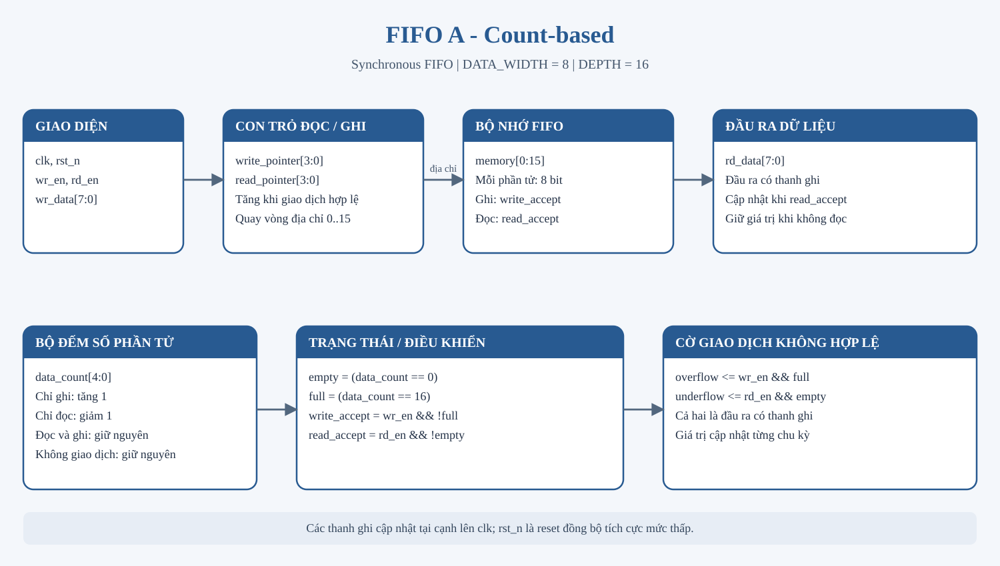
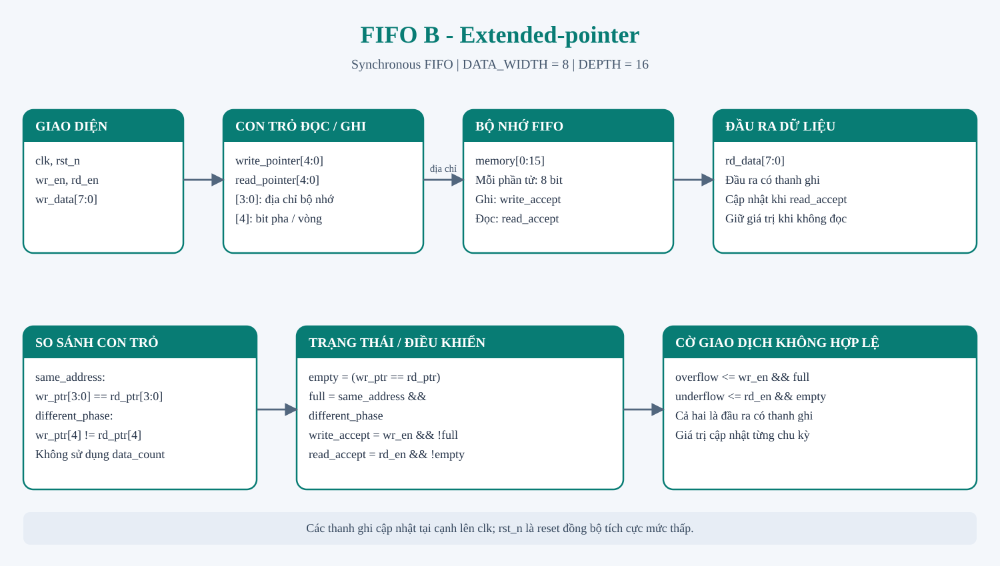
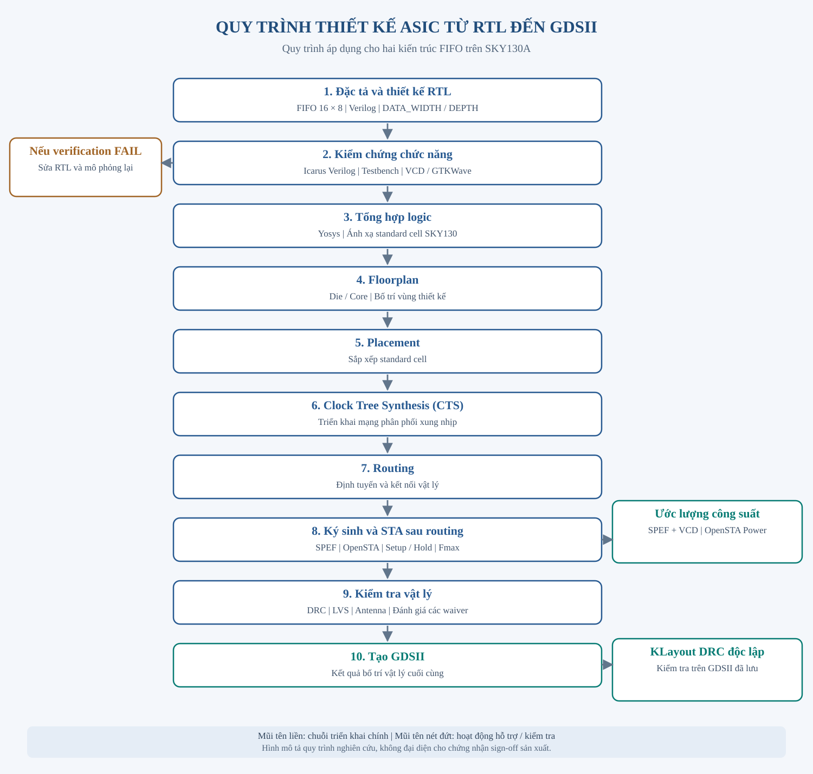
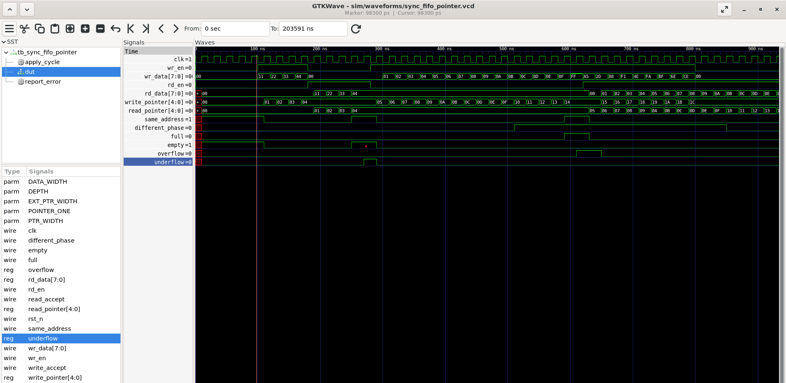
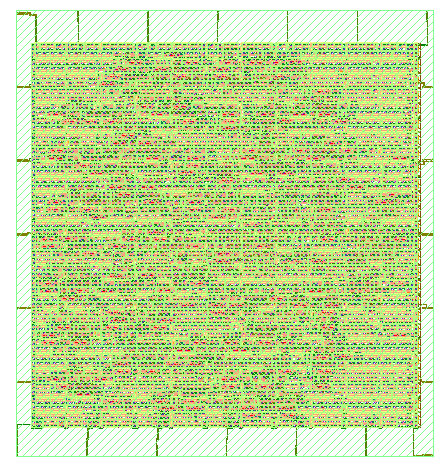
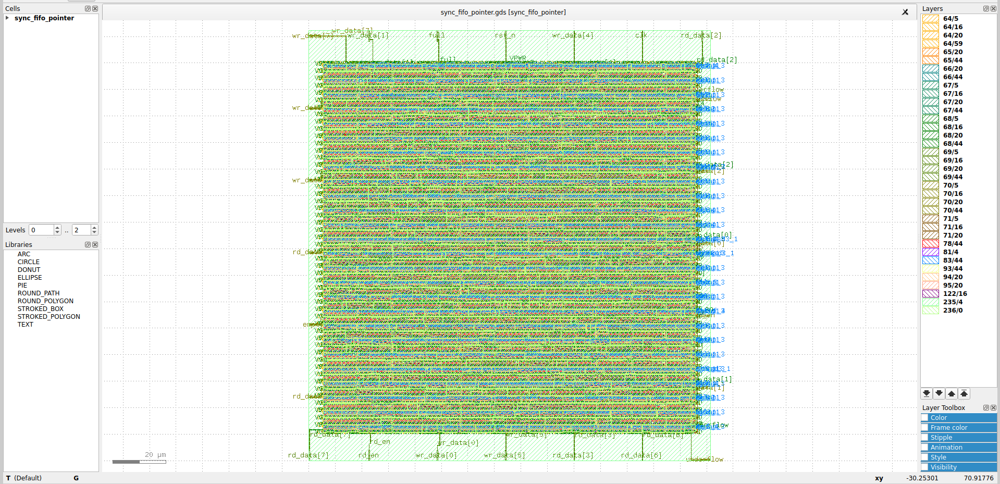
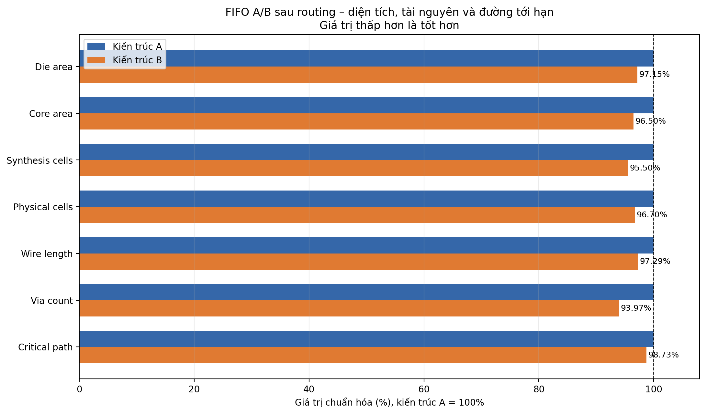

# Hướng dẫn xem đồ án FIFO

## 1. Thông tin phiên bản

- Repository: datn-a4-t01
- Nhánh: feature/fifo-ip
- Ngày cập nhật tài liệu: 20/11/2026

Các đường dẫn trong tài liệu tính từ thư mục gốc repository.

## 2. Đề tài và mục tiêu

Đồ án thiết kế IP FIFO đồng bộ có độ rộng 8 bit và độ sâu 16 phần tử.
Hai cách tổ chức được so sánh:

- FIFO A — count-based: dùng bộ đếm số phần tử đang lưu để xác định
  trạng thái đầy và rỗng.
- FIFO B — extended-pointer: dùng con trỏ đọc/ghi có thêm bit vòng để
  phân biệt trạng thái đầy và rỗng.

Hai thiết kế được viết bằng RTL, kiểm chứng bằng mô phỏng, tổng hợp,
phân tích thời gian và đưa qua các bước thiết kế vật lý đến GDSII.
Kết quả được so sánh theo Power, Performance và Area (PPA).

Cấu hình chính: SKY130A, thư viện sky130_fd_sc_hd, clock mục tiêu
50 MHz (chu kỳ 20 ns).

## 3. Lộ trình xem nhanh

1. `README.md` — mục tiêu, cách chạy và kết quả tóm tắt.
2. `PROJECT_CHARTER.md` — phạm vi, đầu vào/đầu ra và tiêu chí đánh giá.
3. `docs/chang1_specification.md` — yêu cầu chức năng FIFO.
4. `rtl/` và `tb/` — thiết kế và kiểm chứng.
5. `scripts/` — cách chạy mô phỏng và phân tích.
6. `results/verification_summary/` — bằng chứng verification.
7. `results/sta_summary/`, `results/physical_summary/`,
   `results/ppa_summary/` — kết quả timing, physical và PPA.
8. `docs/figures/` — hình kiến trúc, waveform, layout và biểu đồ.
9. `demo/DEFENSE_RUNBOOK.md` — trình tự demo.

## 4. Mã nguồn RTL và testbench

| File | Nội dung |
|---|---|
| `rtl/sync_fifo_count.v` | RTL FIFO A, quản lý occupancy bằng bộ đếm |
| `rtl/sync_fifo_pointer.v` | RTL FIFO B, quản lý đầy/rỗng bằng extended pointer |
| `tb/tb_sync_fifo_count.sv` | Testbench cho FIFO A |
| `tb/tb_sync_fifo_pointer.sv` | Testbench cho FIFO B |
| `tb/tb_fifo_equivalence.sv` | So sánh hai FIFO dưới cùng kích thích và mô hình tham chiếu |
| `tb/tb_fifo_power.sv` | Tạo workload phục vụ phân tích power |

Các testbench kiểm tra reset, đọc/ghi, trạng thái đầy/rỗng, thao tác
không hợp lệ, wrap-around và các tình huống đọc/ghi đồng thời. Xem từng
testbench để biết chính xác điều kiện và cách chấm PASS/FAIL.

### Hình kiến trúc





## 5. Các script chạy và mục đích

| Lệnh | Mục đích | Xem kết quả tại |
|---|---|---|
| `bash scripts/run_sim_a.sh` | Chạy mô phỏng FIFO A | Đọc thông báo cuối lệnh và file kết quả do script ghi |
| `bash scripts/run_sim_b.sh` | Chạy mô phỏng FIFO B | Đọc thông báo cuối lệnh và file kết quả do script ghi |
| `python3 scripts/run_evidence_regression.py` | Regression A/B với nhiều seed | `results/verification_summary/` hoặc đường dẫn được script in ra |
| `python3 scripts/run_t16_parameter_matrix.py` | Kiểm thử nhiều cấu hình width/depth | `results/` và báo cáo T16 |
| `python3 scripts/run_t17_equivalence_matrix.py` | So sánh A/B với cùng kích thích và reference model | `results/` và báo cáo T17 |
| `bash demo/run_demo_verification.sh` | Chạy phần verification ngắn để demo | Terminal và kết quả demo |
| `bash scripts/collect_synth_sta_a.sh` | Thu thập kết quả synthesis/STA A đã lưu | `results/synthesis_a/` |
| `bash scripts/run_postroute_sta.sh` | Phân tích STA sau routing trên dữ liệu physical đã có | `results/sta_summary/` hoặc `results/sta_reproduced/` |
| `bash scripts/run_power_streaming.sh` | Tạo/thu thập dữ liệu hoạt động cho workload streaming | `results/power_summary/` |
| `python3 scripts/compare_ppa_ab.py` | Tổng hợp và so sánh các chỉ số A/B | `results/ppa_summary/` |

Trước khi chạy, đọc phần hướng dẫn trong `README.md` và script tương ứng.
Một số bước cần Docker, PDK SKY130A và dữ liệu physical đã có. Lệnh
`collect_synth_sta_a.sh` thu thập kết quả đã lưu.

## 6. Báo cáo và bằng chứng kết quả

| File/thư mục | Giảng viên có thể kiểm tra |
|---|---|
| `results/verification_summary/T16_T17_INDEPENDENT_AUDIT.md` | Tổng kết T16/T17 và số lượt kiểm tra |
| `results/verification_summary/` | Regression, manifest và log verification |
| `results/synthesis_a/` | Netlist, báo cáo synthesis và STA A |
| `results/sta_summary/sta_comparison.md` | So sánh setup/hold, minimum period và Fmax |
| `results/physical_summary/physical_comparison.md` | Chỉ số physical của hai phương án |
| `results/power_summary/power_comparison.md` | Power ước lượng và điều kiện workload |
| `results/ppa_summary/ppa_comparison.md` | Bảng so sánh PPA tổng hợp |
| `EVIDENCE_LEDGER.md` | Đường dẫn từ từng kết luận đến log/report gốc |

GDSII:

- FIFO A: `results/physical_a/PHYS_A_50MHZ/final/gds/sync_fifo_count.gds`
- FIFO B: `results/physical_b/PHYS_B_50MHZ/final/gds/sync_fifo_pointer.gds`

Khi trình bày một con số, cần nêu report chứa số đó, cấu hình thiết kế
và điều kiện phân tích.

## 7. Hình ảnh nên xem












Waveform minh họa hoạt động theo thời gian. Hình layout cho thấy kết quả
bố trí vật lý; hình ảnh không thay thế báo cáo DRC/LVS. Biểu đồ PPA cần
được đọc cùng bảng số liệu và điều kiện đo trong report.

## 8. Tiến độ đồ án

| Hạng mục | Trạng thái theo bằng chứng trong repository | Bằng chứng |
|---|---|---|
| Đặc tả và kiến trúc FIFO | Hoàn thành | [Đặc tả](docs/chang1_specification.md), [kiến trúc A](docs/chang2_architecture_a.md), [kiến trúc B](docs/chang7_architecture_b.md) |
| RTL FIFO A và B | Hoàn thành | [RTL A](rtl/sync_fifo_count.v), [RTL B](rtl/sync_fifo_pointer.v) |
| Verification cơ sở A/B | 12/12 lượt PASS theo báo cáo | [Tổng hợp regression](results/verification_summary/regression_summary.txt) |
| T16 — kiểm tra nhiều cấu hình | 16/16 lượt PASS | [Kiểm toán T16/T17](results/verification_summary/T16_T17_INDEPENDENT_AUDIT.md) |
| T17 — so sánh A/B bằng mô phỏng | 8/8 lượt PASS; không phải formal equivalence | [Kiểm toán T16/T17](results/verification_summary/T16_T17_INDEPENDENT_AUDIT.md) |
| Synthesis và STA | Hoàn thành theo báo cáo; kết quả STA nêu trong điều kiện phân tích, chưa phải sign-off đa góc | [Kết quả synthesis A](results/synthesis_a/SYNTH_A_50MHZ/), [so sánh STA](results/sta_summary/sta_comparison.md) |
| Physical implementation và GDSII | Hoàn thành A/B theo báo cáo | [So sánh physical](results/physical_summary/physical_comparison.md), [GDSII A](results/physical_a/PHYS_A_50MHZ/final/gds/sync_fifo_count.gds), [GDSII B](results/physical_b/PHYS_B_50MHZ/final/gds/sync_fifo_pointer.gds) |
| DRC/LVS/antenna | PASS theo báo cáo; còn 6 vi phạm clock max-fanout được ghi dưới dạng QoR waiver mỗi kiến trúc | [So sánh physical](results/physical_summary/physical_comparison.md) |
| Power và PPA | Đã có báo cáo; power là ước lượng theo workload, không phải đo trên chip | [Power](results/power_summary/power_comparison.md), [PPA](results/ppa_summary/ppa_comparison.md) |
| Luận văn, slide và demo | Đang rà soát/hoàn thiện; cần xác nhận bản cuối trước khi bảo vệ | [Rà soát nội dung luận văn](results/thesis_finalization/THESIS_MARKDOWN_FINAL_AUDIT.md), [runbook demo](demo/DEFENSE_RUNBOOK.md), [slides](slides/) |

Số liệu T16/T17 và trạng thái trong bảng dựa trên báo cáo lưu trong repository. Cần đọc cùng mục giới hạn và điều kiện phân tích ở các báo cáo STA, power và physical.

## 9. Giới hạn cần nêu khi báo cáo

- T17 dựa trên mô phỏng, không phải formal equivalence.
- STA áp dụng cho điều kiện PVT và dữ liệu parasitic ghi trong report;
  không tự kết luận là sign-off đa corner.
- Power là ước lượng cho workload đã chọn, không phải phép đo trên chip.
- Ghi rõ các waiver hoặc ngoại lệ QoR còn tồn tại trong báo cáo physical.
- Không dùng hình layout thay cho bằng chứng DRC/LVS.
- Đối chiếu `docs/chang11_finalization.md` với file thực tế vì trạng thái
  hoàn thiện có thể chưa được cập nhật đồng bộ.

## 10. Hồ sơ thuyết trình và bảo vệ

- `defense/THUYET_MINH_15_PHUT.md` — nội dung thuyết minh.
- `defense/CAU_HOI_PHAN_BIEN.md` — câu hỏi và gợi ý trả lời.
- `demo/DEFENSE_RUNBOOK.md` — kịch bản demo.
- `demo/screenshots/` — ảnh dự phòng waveform/layout.
- `slides/` — slide bảo vệ.
- `thesis/` và `thesis/export/` — nội dung và bản xuất luận văn.

## 11. Kiểm tra phiên bản đang xem

```bash
git status --short --branch
git log -1 --oneline

```
