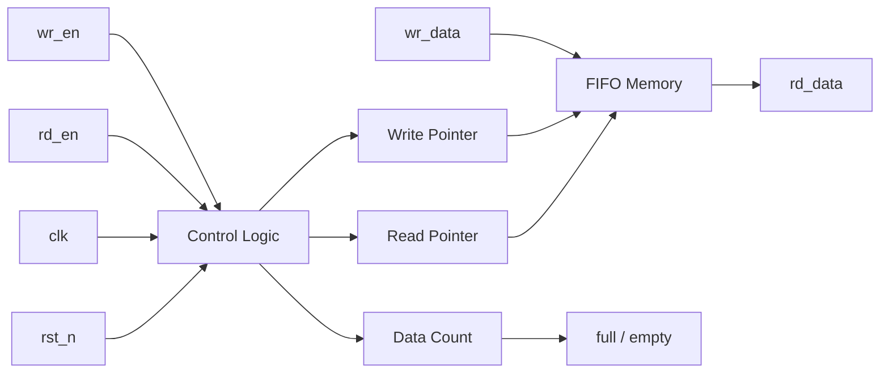

# KIẾN TRÚC A — COUNT-BASED SYNCHRONOUS FIFO

## 1. Tổng quan

Phương án A sử dụng bộ đếm data_count để theo dõi số phần tử hiện có trong FIFO.

Các khối chính gồm:

- Mảng memory lưu dữ liệu.
- Write pointer xác định địa chỉ ghi.
- Read pointer xác định địa chỉ đọc.
- Data count theo dõi số phần tử.
- Logic full và empty.
- Logic overflow và underflow.

## 2. Sơ đồ khối

