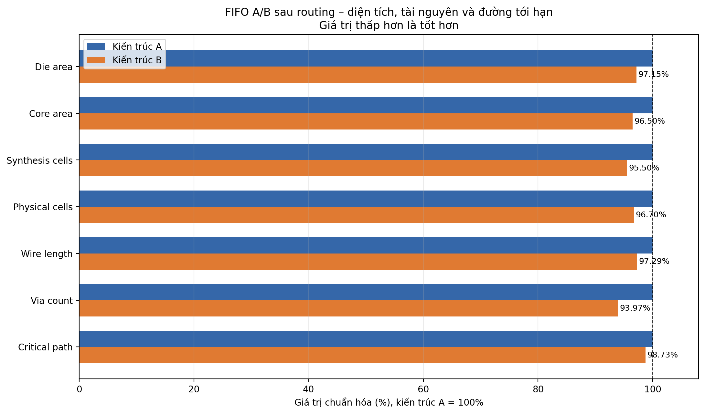

# Chặng 10 – So sánh PPA giữa hai kiến trúc FIFO A và B

## 1. Mục tiêu

Chặng này so sánh hai vi kiến trúc synchronous FIFO sau khi hoàn thành
physical implementation bằng OpenLane:

- Kiến trúc A: FIFO sử dụng bộ đếm số phần tử.
- Kiến trúc B: FIFO sử dụng con trỏ mở rộng.
- Cả hai có chiều rộng dữ liệu 8 bit.
- Cả hai có độ sâu 16 phần tử.
- Cả hai được đánh giá tại clock period 20 ns, tương ứng 50 MHz.

Mục tiêu của phép so sánh là đánh giá:

- Power: công suất.
- Performance: hiệu năng timing.
- Area: diện tích và tài nguyên phần cứng.
- Chất lượng physical implementation.
- Khả năng đạt timing và signoff của hai phương án.

## 2. Hai kiến trúc được so sánh

### 2.1. Kiến trúc A – count based

Kiến trúc A sử dụng biến trạng thái `data_count` để lưu số phần tử
hiện có trong FIFO.

Các trạng thái được xác định như sau:

- `empty` khi `data_count == 0`.
- `full` khi `data_count == DEPTH`.
- Khi chỉ ghi thành công, `data_count` tăng.
- Khi chỉ đọc thành công, `data_count` giảm.
- Khi đọc và ghi đồng thời thành công, `data_count` không đổi.

RTL chính:

`rtl/sync_fifo_count.v`

Kết quả physical implementation:

`results/physical_a/PHYS_A_50MHZ`

Commit hoàn thành physical implementation A:

`302d038`

### 2.2. Kiến trúc B – extended pointer

Kiến trúc B sử dụng read pointer và write pointer mở rộng thêm một bit
để nhận biết trạng thái quay vòng của bộ nhớ.

Các trạng thái được xác định như sau:

- `empty` khi read pointer bằng write pointer.
- `full` khi phần địa chỉ của hai pointer bằng nhau nhưng bit quay vòng
  khác nhau.
- Không sử dụng bộ đếm số phần tử riêng để tạo `full` và `empty`.

RTL chính:

`rtl/sync_fifo_pointer.v`

Kết quả physical implementation:

`results/physical_b/PHYS_B_50MHZ`

Commit hoàn thành physical implementation B:

`faaf8db`

## 3. Điều kiện so sánh công bằng

Hai kiến trúc được triển khai với các điều kiện chung sau:

| Tham số | Kiến trúc A | Kiến trúc B |
|---|---:|---:|
| Data width | 8 bit | 8 bit |
| FIFO depth | 16 | 16 |
| Dung lượng lưu trữ | 128 bit | 128 bit |
| PDK | sky130A | sky130A |
| Standard-cell library | sky130_fd_sc_hd | sky130_fd_sc_hd |
| Clock period | 20.0 ns | 20.0 ns |
| Tần số mục tiêu | 50 MHz | 50 MHz |
| Synthesis strategy | AREA 0 | AREA 0 |

Hai file cấu hình physical chỉ khác các trường bắt buộc theo thiết kế:

- `DESIGN_NAME`.
- `VERILOG_FILES`.

Tất cả các trường cấu hình còn lại giống nhau. Kết quả kiểm tra được
lưu tại:

`results/ppa_comparison/config_equivalence.txt`

Trạng thái kiểm tra công bằng:

```text
fairness_check=PASS
all_other_config_fields=IDENTICAL

```

## 4. Phương pháp tính

Với mỗi metric, phần trăm thay đổi của kiến trúc B so với kiến trúc A
được tính bằng:

```text
Delta (%) = (B - A) / A × 100%
```

Đối với các metric trong bảng so sánh chính:

- Giá trị âm nghĩa là B sử dụng ít tài nguyên hơn hoặc có đường tới hạn
  ngắn hơn A.
- Giá trị dương nghĩa là B lớn hơn A.
- Các kết quả chỉ được kết luận trong cùng điều kiện flow và constraint
  đã nêu.
- Runtime không được dùng để kết luận kiến trúc vì có thể chịu ảnh hưởng
  bởi tải của máy tính và container.

## 5. Kết quả so sánh diện tích và tài nguyên

| Metric | Kiến trúc A | Kiến trúc B | B − A | B so với A | Đánh giá |
|---|---:|---:|---:|---:|---|
| Die area (mm²) | 0.025295219 | 0.024573193 | -0.000722026 | -2.8544% | B tốt hơn |
| Core area (µm²) | 20169.344 | 19462.416 | -706.928 | -3.5050% | B tốt hơn |
| Synthesis cells | 600 | 573 | -27 | -4.5000% | B tốt hơn |
| Total physical cells | 2425 | 2345 | -80 | -3.2990% | B tốt hơn |
| Wire length (µm) | 18677 | 18170 | -507 | -2.7146% | B tốt hơn |
| Via count | 4905 | 4609 | -296 | -6.0347% | B tốt hơn |

Kiến trúc B sử dụng ít hơn 27 cell synthesis, tương ứng giảm 4.5%.
Đây là chỉ số phản ánh trực tiếp hơn sự khác nhau về logic giữa hai
kiến trúc.

Tổng số physical cell còn bao gồm các cell phục vụ physical
implementation như filler, tap, decap và clock-tree cell. Vì vậy,
chỉ số này được sử dụng cùng với synthesis cell count thay vì thay thế
synthesis cell count.

Core area của B giảm khoảng 3.5050% và die area giảm khoảng 2.8544%.
Wire length và số lượng via của B cũng thấp hơn A.

## 6. Kết quả performance

| Metric | Kiến trúc A | Kiến trúc B | Đánh giá |
|---|---:|---:|---|
| Clock period | 20.0 ns | 20.0 ns | Giống nhau |
| Target frequency | 50 MHz | 50 MHz | Giống nhau |
| Post-route WNS | 0.0 ns | 0.0 ns | Đều đạt |
| Post-route TNS | 0.0 ns | 0.0 ns | Đều đạt |
| Critical path | 2.37 ns | 2.34 ns | B ngắn hơn |
| Critical-path change | – | -1.2658% | B tốt hơn nhẹ |

Cả hai kiến trúc đều đạt timing tại tần số mục tiêu 50 MHz.

Critical path do flow báo cáo của B ngắn hơn A 0.03 ns, tương ứng
khoảng 1.2658%. Chênh lệch này nhỏ, vì vậy kết luận phù hợp là B tốt
hơn nhẹ về đường tới hạn trong thí nghiệm hiện tại.

Không suy diễn trực tiếp critical path thành tần số hoạt động tối đa vì
kết quả còn phụ thuộc input delay, output delay, clock uncertainty,
corner và các constraint khác.

## 7. Placement utilization

| Metric | Kiến trúc A | Kiến trúc B | Chênh lệch |
|---|---:|---:|---:|
| Placement utilization | 36.68% | 36.83% | +0.15 điểm phần trăm |

Hai giá trị utilization gần tương đương. Chênh lệch 0.15 điểm phần trăm
không được dùng để tuyên bố kiến trúc nào tốt hơn.

## 8. Kiểm tra physical signoff

| Kiểm tra | Kiến trúc A | Kiến trúc B |
|---|---:|---:|
| TritonRoute violations | 0 | 0 |
| Magic DRC violations | 0 | 0 |
| LVS total errors | 0 | 0 |
| Pin antenna violations | 0 | 0 |
| Net antenna violations | 0 | 0 |
| Unannotated drivers | 0 | 0 |
| Timing status | PASS | PASS |
| Physical signoff | PASS | PASS |

Hai kiến trúc đều hoàn thành physical flow, đạt timing và không có lỗi
DRC, LVS hoặc antenna.

Cả hai run đều có 6 clock max-fanout violations tại các buffer của clock
tree. Các vi phạm này đã được ghi nhận là documented QoR waiver trong
Chặng 6 và Chặng 9. Chúng không phải lỗi DRC, LVS hay routing.

## 9. Đánh giá Power

Hai kết quả physical đều ghi:

```text
power_estimate_status=NOT_USED_WITHOUT_QUALIFIED_SWITCHING_ACTIVITY
```

Đồ án chưa sử dụng VCD hoặc SAIF có hoạt động chuyển mạch được kiểm
soát cho phân tích power hậu layout. Vì vậy, các giá trị power mặc định
từ flow không được dùng để kết luận kiến trúc nào tiêu thụ ít công suất
hơn.

Trạng thái đánh giá:

```text
power_result=NOT_EVALUATED
```

Đây là giới hạn của thí nghiệm, không phải bằng chứng rằng hai kiến trúc
có công suất bằng nhau.

Do chưa có dữ liệu power hợp lệ, báo cáo không tuyên bố kiến trúc B là
phương án thắng đầy đủ cả ba thành phần PPA.

## 10. Biểu đồ so sánh chuẩn hóa

Biểu đồ sử dụng kiến trúc A làm mốc 100%. Các cột của kiến trúc B thể
hiện tỷ lệ so với A.



Trong các metric được biểu diễn, giá trị thấp hơn là tốt hơn. Tất cả
các giá trị B đều thấp hơn 100%, phù hợp với bảng dữ liệu định lượng.

Biểu đồ không chứa Power vì chưa có switching activity hợp lệ.

## 11. Giải thích kết quả

Kết quả cho thấy kiến trúc B cần ít cell synthesis hơn kiến trúc A.
Quan sát này phù hợp với khác biệt vi kiến trúc: B sử dụng quan hệ giữa
các con trỏ mở rộng để xác định `full` và `empty`, trong khi A duy trì
thêm trạng thái `data_count`.

Việc giảm logic synthesis của B tiếp tục phản ánh xuống physical
implementation:

- Core area nhỏ hơn.
- Die area nhỏ hơn.
- Tổng số physical cell thấp hơn.
- Wire length thấp hơn.
- Via count thấp hơn.
- Critical path ngắn hơn nhẹ.

Tuy nhiên, đây là kết quả cho cấu hình FIFO 8 × 16, thư viện
`sky130_fd_sc_hd` và constraint 50 MHz. Không nên khái quát kết quả cho
mọi kích thước FIFO hoặc mọi công nghệ mà không thực hiện thêm thí
nghiệm.

## 12. Kết luận lựa chọn kiến trúc

Trong cùng điều kiện thí nghiệm:

- Cả A và B đều đúng chức năng.
- Cả A và B đều đạt timing 50 MHz.
- Cả A và B đều đạt physical signoff.
- B có diện tích và số cell thấp hơn.
- B có wire length và via count thấp hơn.
- B có critical path ngắn hơn nhẹ.
- Power chưa đủ dữ liệu để so sánh.

Vì vậy, kiến trúc B được chọn làm phương án ưu tiên cho báo cáo và demo
cuối kỳ xét theo area, tài nguyên physical và performance được báo cáo.

Giới hạn của kết luận:

```text
NO_FULL_PPA_WINNER_WITHOUT_VALID_POWER_DATA
```

## 13. Khả năng tái lập

Chạy lại phép so sánh bằng:

```bash
./scripts/compare_ppa_ab.py
```

Hiển thị biểu đồ trên màn hình bằng:

```bash
./scripts/compare_ppa_ab.py --show
```

Các checksum của dữ liệu nguồn được lưu tại:

`results/ppa_comparison/source_checksums.txt`

## 14. Sản phẩm đầu ra

- Script so sánh:
  `scripts/compare_ppa_ab.py`
- Bảng dữ liệu:
  `results/ppa_comparison/ppa_ab.csv`
- Tóm tắt kết quả:
  `results/ppa_comparison/ppa_ab_summary.txt`
- Kiểm tra cấu hình:
  `results/ppa_comparison/config_equivalence.txt`
- Checksum dữ liệu nguồn:
  `results/ppa_comparison/source_checksums.txt`
- Biểu đồ PNG:
  `docs/figures/ppa_ab_normalized.png`

**Trạng thái Chặng 10: PASS.**
