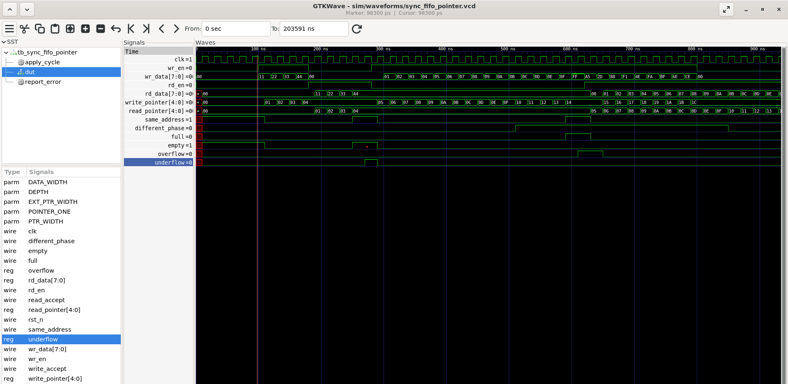

# Chặng 8 – Functional Verification FIFO kiến trúc B

## 1. Mục tiêu

Chặng này kiểm chứng chức năng FIFO kiến trúc B dùng con trỏ mở rộng. Kiến trúc B được kiểm tra bằng cùng golden model, directed tests, corner cases và random regression đã sử dụng cho kiến trúc A.

## 2. Cấu hình

- DUT: `sync_fifo_pointer`
- DATA_WIDTH: 8 bit
- DEPTH: 16 phần tử
- Clock period: 20 ns
- Random cycles: 10000 chu kỳ mỗi seed
- Seeds: 1, 2, 3, 4, 5 và 20260924
- Simulator: Icarus Verilog
- Waveform viewer: GTKWave

## 3. Golden model

Golden model sử dụng bộ nhớ tham chiếu, con trỏ đọc, con trỏ ghi và số lượng phần tử tham chiếu trong testbench.

Mỗi giao dịch hợp lệ của DUT được so sánh với kết quả mong đợi từ golden model. Golden model độc lập với cách kiến trúc B tạo full và empty.

Testbench B được tạo từ testbench A và chỉ thay đổi nhận dạng DUT, tên testbench, tên waveform và tiêu đề báo cáo. Toàn bộ thuật toán golden model và tập kiểm thử được giữ nguyên.

## 4. Directed tests và corner cases

| Test | Nội dung | Kết quả |
|---|---|---|
| T01 | Reset | PASS |
| T02–T04 | Ghi, đọc và kiểm tra thứ tự FIFO | PASS |
| T05 | Điền đầy FIFO | PASS |
| T06 | Overflow | PASS |
| T07 | Đọc cạn FIFO | PASS |
| T08 | Underflow | PASS |
| T09 | Đọc và ghi đồng thời ở trạng thái thường | PASS |
| T10 | Đọc và ghi đồng thời khi full | PASS |
| T11 | Đọc và ghi đồng thời khi empty | PASS |
| T12 | Con trỏ quay vòng nhiều lần | PASS |
| T13 | Reset khi FIFO đang chứa dữ liệu | PASS |
| T14 | Random regression | PASS |

## 5. Random regression

| Seed | Random cycles | Errors | Kết quả |
|---:|---:|---:|---|
| 1 | 10000 | 0 | PASS |
| 2 | 10000 | 0 | PASS |
| 3 | 10000 | 0 | PASS |
| 4 | 10000 | 0 | PASS |
| 5 | 10000 | 0 | PASS |
| 20260924 | 10000 | 0 | PASS |

Dữ liệu chi tiết được lưu tại:

- `results/verification_b/regression_summary.txt`
- `results/verification_b/seed_20260924.txt`

## 6. So sánh cùng seed với kiến trúc A

Kiến trúc A và B được chạy với cùng seed 20260924, cùng 10000 chu kỳ random và cùng golden model.

Các chỉ số cycles, checks, accepted writes, accepted reads, overflow, underflow, simultaneous events và errors giống nhau.

Kết quả:

- `metrics=IDENTICAL`
- `result=PASS`

Bằng chứng được lưu tại `results/verification_b/a_b_same_seed_check.txt`.

## 7. Dạng sóng

Dạng sóng minh họa quá trình cập nhật con trỏ mở rộng, địa chỉ và bit pha, cùng các trạng thái full, empty, overflow và underflow.

## 8. Giới hạn

Kết quả Chặng 8 xác nhận chức năng ở mức RTL. Kết quả này chưa đại diện cho timing hoặc physical implementation. Synthesis, STA và GDSII của kiến trúc B được thực hiện ở Chặng 9.

## 9. Kết luận

FIFO kiến trúc B đáp ứng đặc tả chức năng và không phát hiện lỗi trong directed tests, corner cases hoặc random regression sáu seed.

**Trạng thái Chặng 8: PASS.**
