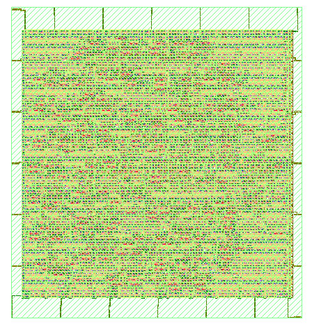

# Chặng 6 – Physical implementation và GDSII kiến trúc FIFO A

## 1. Mục tiêu

Chặng này triển khai kiến trúc FIFO A từ RTL/netlist sang layout vật lý bằng OpenLane và PDK SKY130.

Các mục tiêu gồm:

- Thực hiện floorplan và tạo mạng cấp nguồn.
- Placement standard cell.
- Clock Tree Synthesis (CTS).
- Global routing và detailed routing.
- Trích xuất ký sinh hậu layout.
- Phân tích timing hậu routing.
- Kiểm tra DRC, LVS và antenna.
- Xuất DEF, LEF, SPEF, SDF, gate-level netlist và GDSII.
- Thu thập bằng chứng có thể kiểm tra và tái lập.

## 2. Phiên bản thiết kế đầu vào

| Thông tin | Giá trị |
|---|---|
| Kiến trúc | FIFO A – count based |
| Module top | `sync_fifo_count` |
| Data width | 8 bit |
| FIFO depth | 16 phần tử |
| Clock period | 20 ns |
| Tần số mục tiêu | 50 MHz |
| PDK | sky130A |
| Standard-cell library | sky130_fd_sc_hd |
| Repository snapshot | `ba14f49d42a99c26ad38516230f8add60e4204af` |
| RTL SHA-256 | `3eabfd780a007e2c39fb4e67e2785d5dad3d40a0584c18ea42fc77d636ba2e74` |

Cấu hình physical implementation được lưu tại:

- `openlane/sync_fifo_count_phys/config.json`
- `results/physical_a/PHYS_A_50MHZ/resolved_config.tcl`

Run tag:

- `PHYS_A_50MHZ`

## 3. Quy trình physical implementation

OpenLane thực hiện các bước chính:

1. Synthesis RTL sang standard cell.
2. Floorplan và bố trí chân I/O.
3. Tạo Power Distribution Network.
4. Global placement.
5. Detailed placement.
6. Clock Tree Synthesis.
7. Global routing.
8. Detailed routing.
9. Trích xuất ký sinh RC.
10. Static Timing Analysis hậu routing.
11. Magic DRC.
12. LVS.
13. Antenna checking.
14. Xuất GDSII và các view cuối.

Flow kết thúc với trạng thái:

```text

flow_status=flow completed

```

Thời gian thực hiện:

| Chỉ số | Kết quả |
|---|---:|
| Tổng thời gian flow | 2 phút 16 giây |
| Thời gian đến khi routing hoàn thành | 1 phút 55 giây |

## 4. Kết quả diện tích và placement

| Chỉ số | Kết quả |
|---|---:|
| Die area | 0.025295218625 mm² |
| Core area | 20169.344 µm² |
| Placement utilization | 36.68% |
| Cell sau synthesis | 600 |
| Tổng cell sau physical implementation | 2425 |

Con số 600 là số standard cell logic sau synthesis. Con số 2425 sau physical implementation còn bao gồm các cell được backend thêm vào như clock buffer, filler, tap và decap. Vì vậy không được diễn giải rằng số lượng logic của thiết kế tăng trực tiếp từ 600 lên 2425.

## 5. Kết quả routing

| Chỉ số | Kết quả |
|---|---:|
| Tổng wire length | 18677 µm |
| Tổng số via | 4905 |
| TritonRoute violations | 0 |

Detailed routing hoàn thành và TritonRoute không báo vi phạm routing.

## 6. Kết quả timing hậu routing

| Chỉ số | Kết quả | Đánh giá |
|---|---:|---|
| Clock period | 20.0 ns | Constraint |
| Tần số mục tiêu | 50 MHz | Constraint |
| Post-route WNS | 0.0 ns | MET |
| Post-route TNS | 0.0 ns | MET |
| Critical path do flow báo cáo | 2.37 ns | Không có slack âm |

WNS và TNS bằng 0 cho biết không tồn tại đường timing có slack âm trong kết quả hậu routing được thu thập.

Không suy diễn trực tiếp tần số cực đại từ giá trị critical path 2.37 ns vì kết quả còn phụ thuộc loại timing path, I/O delay, clock uncertainty và corner phân tích.

## 7. Kết quả signoff vật lý

| Kiểm tra | Số vi phạm hoặc lỗi | Trạng thái |
|---|---:|---|
| TritonRoute | 0 | PASS |
| Magic DRC | 0 | PASS |
| LVS | 0 | PASS |
| Pin antenna | 0 | PASS |
| Net antenna | 0 | PASS |

Báo cáo LVS cho biết layout và netlist khớp nhau. Magic không phát hiện lỗi DRC và kiểm tra antenna không phát hiện vi phạm trên pin hoặc net.

Bằng chứng được lưu tại:

- `results/physical_a/PHYS_A_50MHZ/manufacturability.rpt`
- `results/physical_a/PHYS_A_50MHZ/reports/magic_drc.rpt`
- `results/physical_a/PHYS_A_50MHZ/logs/lvs.txt`
- `results/physical_a/PHYS_A_50MHZ/logs/antenna.txt`

## 8. Phân loại cảnh báo

### 8.1. Cảnh báo độ rộng RTL

Linter phát hiện hai cảnh báo `WIDTHTRUNC`:

- Biểu thức `DEPTH - 1` được gán cho `LAST_ADDRESS`.
- Tham số `DEPTH` được gán cho `DEPTH_COUNT`.

Với cấu hình đang kiểm chứng là `DEPTH=16`:

- `LAST_ADDRESS=15` biểu diễn vừa trong 4 bit.
- `DEPTH_COUNT=16` biểu diễn vừa trong 5 bit.

Hai cảnh báo không làm sai cấu hình hiện tại. Nếu thay đổi tham số `DEPTH`, thiết kế phải được lint và verification lại.

### 8.2. Max fanout trên cây clock

Báo cáo hậu routing ghi nhận:

```text
clock_max_fanout_violation_count=6
```

Các vi phạm nằm trên các clock-buffer net của cây clock. Đồng thời:

- Không có max-slew violation.
- Không có max-capacitance violation.
- Không có timing path có slack âm.
- DRC, LVS và antenna đều đạt.

Trong phạm vi đồ án, kết quả được chấp nhận dưới dạng:

```text
clock_max_fanout_assessment=ACCEPTED_QOR_WAIVER
```

Đây là waiver về chất lượng cây clock, không được diễn giải thành “không có mọi loại vi phạm”. Hướng cải tiến tiếp theo là khảo sát cấu hình CTS clustering và constraint max fanout.

## 9. Đánh giá PPA

### 9.1. Performance

Thiết kế đáp ứng constraint 50 MHz trong kết quả STA hậu routing, với WNS và TNS bằng 0.

### 9.2. Area

- Die area: 0.025295218625 mm².
- Core area: 20169.344 µm².
- Placement utilization: 36.68%.

### 9.3. Power

Không sử dụng số liệu power làm kết quả PPA chính thức vì flow chưa được cung cấp switching activity đã kiểm chứng như SAIF hoặc VCD phù hợp.

Trạng thái được ghi nhận:

```text
power_estimate_status=NOT_USED_WITHOUT_QUALIFIED_SWITCHING_ACTIVITY
```

## 10. Layout GDSII

Ảnh layout của kiến trúc FIFO A:



File GDSII gốc:

- `results/physical_a/PHYS_A_50MHZ/final/gds/sync_fifo_count.gds`

## 11. Sản phẩm đầu ra

| Sản phẩm | Đường dẫn trong thư mục run đã thu thập |
|---|---|
| GDSII | `final/gds/sync_fifo_count.gds` |
| DEF | `final/def/sync_fifo_count.def` |
| LEF | `final/lef/sync_fifo_count.lef` |
| Liberty | `final/lib/sync_fifo_count.lib` |
| Gate-level netlist | `final/verilog/gl/sync_fifo_count.v` |
| SDF | `final/sdf/sync_fifo_count.sdf` |
| SPEF | `final/spef/sync_fifo_count.spef` |
| SPICE LVS | `final/spi/lvs/sync_fifo_count.spice` |
| Metrics gốc | `metrics.csv` |
| Chỉ số tổng hợp | `key_metrics.txt` |
| Đánh giá cảnh báo | `warning_assessment.txt` |

Các đường dẫn trong bảng nằm dưới:

```text
results/physical_a/PHYS_A_50MHZ/
```

## 12. Cách thu thập lại kết quả

Sau khi OpenLane đã hoàn thành run `PHYS_A_50MHZ`, chạy:

```bash
python3 scripts/collect_physical_a.py PHYS_A_50MHZ
```

Kiểm tra sản phẩm bắt buộc:

```bash
test -s results/physical_a/PHYS_A_50MHZ/final/gds/sync_fifo_count.gds
test -s results/physical_a/PHYS_A_50MHZ/key_metrics.txt
test -s results/physical_a/PHYS_A_50MHZ/logs/lvs.txt
test -s results/physical_a/PHYS_A_50MHZ/warning_assessment.txt
```

## 13. Kết luận

Kiến trúc FIFO A đã được triển khai thành công từ RTL đến GDSII bằng OpenLane và SKY130. Flow hoàn thành, timing mục tiêu đạt, routing không có vi phạm, Magic DRC sạch, LVS khớp và antenna không có lỗi.

Sáu vi phạm max fanout trên cây clock được lưu minh bạch dưới dạng QoR waiver và được xác định là một hướng tối ưu hóa tiếp theo.

**Trạng thái Chặng 6: PASS.**
