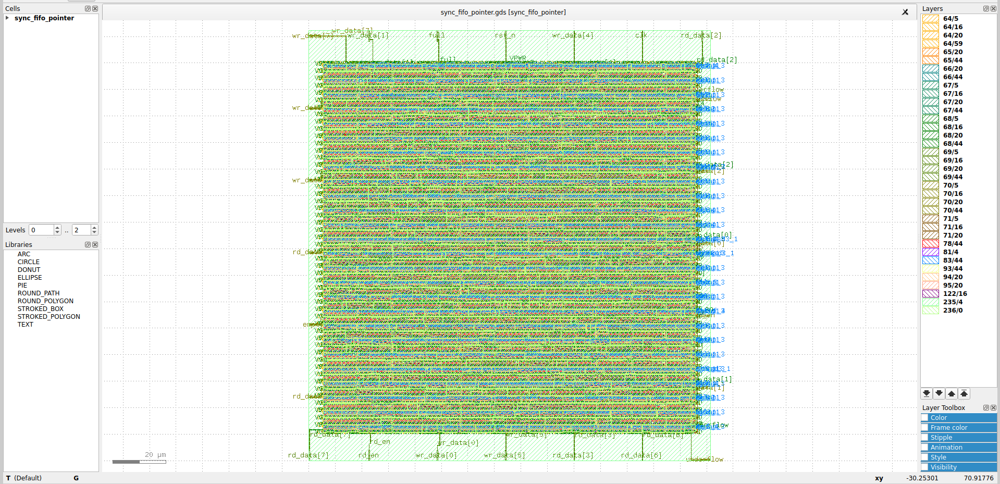

# Chặng 9 – OpenLane và GDSII kiến trúc FIFO B

## 1. Mục tiêu

Chặng này triển khai kiến trúc FIFO B từ RTL đến layout GDSII bằng OpenLane và PDK SKY130.

Kiến trúc B sử dụng hai con trỏ mở rộng để xác định trạng thái FIFO:

- Các bit thấp biểu diễn địa chỉ bộ nhớ.
- Bit mở rộng biểu diễn pha quay vòng.
- `empty` được xác định khi hai con trỏ bằng nhau.
- `full` được xác định khi hai con trỏ có cùng địa chỉ nhưng khác pha.

Các mục tiêu gồm:

- Tổng hợp RTL sang standard cell.
- Floorplan và tạo mạng cấp nguồn.
- Placement và Clock Tree Synthesis.
- Global routing và detailed routing.
- Trích xuất ký sinh RC.
- Phân tích timing hậu routing.
- Kiểm tra DRC, LVS và antenna.
- Xuất DEF, LEF, SDF, SPEF, gate-level netlist và GDSII.
- Lưu đầy đủ bằng chứng để tái lập kết quả.

## 2. Phiên bản thiết kế đầu vào

- Module top: `sync_fifo_pointer`
- Kiến trúc: `B_extended_pointer`
- RTL: `rtl/sync_fifo_pointer.v`
- Repository commit khi chạy flow: `9cf8378888fec4b47aca41c677c91e837b802c1f`
- RTL SHA-256: `678342f2a6d33ef3a8d1ea7673b362502f31d2e3c2cafb0e0456d3993afa0899`
- Data width: 8 bit
- FIFO depth: 16 phần tử
- Dung lượng lưu trữ: 128 bit

## 3. Cấu hình physical implementation

| Tham số | Giá trị |
|---|---:|
| PDK | sky130A |
| Standard-cell library | sky130_fd_sc_hd |
| Clock port | clk |
| Clock period | 20.0 ns |
| Tần số mục tiêu | 50 MHz |
| Synthesis strategy | AREA 0 |
| Core utilization mục tiêu | 35% |
| Placement target density | 0.45 |
| Max fanout constraint | 10 |

Cấu hình được lưu tại:

- `openlane/sync_fifo_pointer_phys/config.json`
- `results/physical_b/PHYS_B_50MHZ/resolved_config.tcl`

Cấu hình physical của B được sao chép từ kiến trúc A. Hai cấu hình chỉ khác `DESIGN_NAME` và `VERILOG_FILES`. Điều này bảo đảm Chặng 10 có thể so sánh PPA giữa hai kiến trúc dưới cùng điều kiện công nghệ và constraint.

## 4. Quy trình OpenLane

OpenLane thực hiện các bước chính:

1. RTL synthesis.
2. Floorplan và bố trí chân I/O.
3. Power Distribution Network.
4. Global placement.
5. Detailed placement.
6. Clock Tree Synthesis.
7. Global routing.
8. Detailed routing.
9. Trích xuất ký sinh RC.
10. Static Timing Analysis hậu routing.
11. Magic DRC.
12. LVS.
13. Antenna checking.
14. Xuất GDSII và các view cuối.

Run tag:

- `PHYS_B_50MHZ`

Flow kết thúc với trạng thái:

- `flow_status=flow completed`
- Tổng thời gian: 2 phút 02 giây
- Thời gian đến routed result: 1 phút 41 giây

## 5. Kết quả synthesis và placement

| Chỉ số | Kết quả |
|---|---:|
| Standard cells sau synthesis | 573 |
| Tổng cells sau physical implementation | 2345 |
| Die area | 0.0245731929 mm² |
| Core area | 19462.416 µm² |
| Placement utilization | 36.83% |

Tổng số cell hậu physical lớn hơn số cell synthesis vì bao gồm clock buffer, tap cell, filler, decap và các cell vật lý khác được thêm trong flow.

## 6. Kết quả routing

| Chỉ số | Kết quả |
|---|---:|
| Tổng wire length | 18170 µm |
| Tổng số via | 4609 |
| TritonRoute violations | 0 |
| Max slew violations | 0 |
| Max capacitance violations | 0 |
| Unannotated drivers | 0 |
| Partially unannotated drivers | 0 |

Detailed routing hoàn thành và không phát hiện routing violation. Ký sinh RC được chú thích đầy đủ cho phân tích timing hậu layout.

## 7. Kết quả timing hậu routing

| Kiểm tra | Kết quả | Đánh giá |
|---|---:|---|
| Post-route WNS | 0.00 ns | MET |
| Post-route TNS | 0.00 ns | MET |
| Setup slack trong detailed report | +13.41 ns | MET |
| Critical path | 2.34 ns | MET |
| Đường có slack nhỏ hơn -0.01 ns | 0 | PASS |

WNS và TNS bằng 0 trong metrics cho biết không có timing violation. Báo cáo chi tiết cho thấy worst setup slack dương `+13.41 ns`.

Kết quả áp dụng cho clock period 20 ns, tương ứng tần số mục tiêu 50 MHz.

## 8. Kết quả signoff vật lý

| Kiểm tra | Kết quả | Đánh giá |
|---|---:|---|
| TritonRoute violations | 0 | PASS |
| Magic DRC violations | 0 | PASS |
| LVS total errors | 0 | PASS |
| LVS result | Circuits match uniquely | PASS |
| Pin antenna violations | 0 | PASS |
| Net antenna violations | 0 | PASS |

Thiết kế đạt các kiểm tra DRC, LVS và antenna cần thiết của flow.

## 9. Phân loại cảnh báo

### 9.1 Linter

OpenLane được cấu hình với `RUN_LINTER=1`.

File `linter.log` tồn tại nhưng có kích thước 0 byte, nghĩa là không có thông báo linter được phát sinh:

- Linter warning count: 0.
- Linter error count: 0.
- Đánh giá: PASS.

### 9.2 Clock max-fanout

Báo cáo hậu routing ghi nhận 6 max-fanout violations. Tất cả đều nằm trên các clock buffer có tên `clkbuf_*`.

Các thông tin liên quan:

- Max fanout violations: 6.
- Max slew violations: 0.
- Max capacitance violations: 0.
- Setup timing: MET.
- DRC: 0.
- LVS: clean.
- Antenna: 0.

Các vi phạm fanout được giữ dưới dạng documented QoR waiver. Đây không phải là DRC hoặc LVS failure, nhưng vẫn được công khai trong báo cáo. Có thể tiếp tục tối ưu CTS trong một nghiên cứu mở rộng.

Kiến trúc A cũng có 6 clock max-fanout violations dưới cùng cấu hình physical, do đó điều kiện so sánh A/B vẫn nhất quán.

Chi tiết được lưu tại:

- `results/physical_b/PHYS_B_50MHZ/warning_assessment.txt`
- `results/physical_b/PHYS_B_50MHZ/reports/postroute_checks.rpt`

## 10. Đánh giá power

OpenLane có thể xuất các con số power mặc định, nhưng đề tài chưa cung cấp switching activity đã được kiểm chứng như SAIF hoặc VCD phù hợp cho power analysis hậu layout.

Do đó:

- Không sử dụng power mặc định để kết luận kiến trúc nào tốt hơn.
- Chặng 10 tập trung vào area, cell count, timing, wire length, via và runtime.
- Power chỉ được sử dụng nếu bổ sung được cùng một stimulus và cùng điều kiện phân tích cho cả A và B.

Trạng thái:

- `power_estimate_status=NOT_USED_WITHOUT_QUALIFIED_SWITCHING_ACTIVITY`

## 11. Layout GDSII

Layout cuối của kiến trúc FIFO B:

File GDSII:

- `results/physical_b/PHYS_B_50MHZ/final/gds/sync_fifo_pointer.gds`

Ảnh layout:

- `docs/figures/fifo_b_layout.png`

## 12. Sản phẩm đầu ra

Các sản phẩm chính gồm:

- GDSII: `results/physical_b/PHYS_B_50MHZ/final/gds/sync_fifo_pointer.gds`
- DEF: `results/physical_b/PHYS_B_50MHZ/final/def/sync_fifo_pointer.def`
- LEF: `results/physical_b/PHYS_B_50MHZ/final/lef/sync_fifo_pointer.lef`
- Liberty: `results/physical_b/PHYS_B_50MHZ/final/lib/sync_fifo_pointer.lib`
- SDF: `results/physical_b/PHYS_B_50MHZ/final/sdf/sync_fifo_pointer.sdf`
- SPEF: `results/physical_b/PHYS_B_50MHZ/final/spef/sync_fifo_pointer.spef`
- Gate-level netlist: `results/physical_b/PHYS_B_50MHZ/final/verilog/gl/sync_fifo_pointer.v`
- Metrics: `results/physical_b/PHYS_B_50MHZ/key_metrics.txt`
- Raw metrics: `results/physical_b/PHYS_B_50MHZ/metrics.csv`
- Manufacturability report: `results/physical_b/PHYS_B_50MHZ/manufacturability.rpt`

## 13. Cách tái lập kết quả

Trong Ubuntu, mở OpenLane:

`cd ~/OpenLane`

`make mount`

Trong container, chạy với một run tag mới:

`./flow.tcl -design /home/ktdung/ktdu-datn/datn-a4-t01/openlane/sync_fifo_pointer_phys -tag PHYS_B_50MHZ_REPRO`

Sau khi flow hoàn thành, thoát container và thu thập kết quả:

`cd ~/ktdu-datn/datn-a4-t01`

`python3 scripts/collect_physical_b.py PHYS_B_50MHZ_REPRO`

Không dùng lại tag `PHYS_B_50MHZ` nếu run đó đã tồn tại.

## 14. Kết luận

Kiến trúc FIFO B đã được triển khai thành công từ RTL đến GDSII bằng OpenLane và PDK SKY130.

Kết quả chính:

- Flow hoàn thành.
- Đạt timing ở 50 MHz.
- Routing violations bằng 0.
- Magic DRC bằng 0.
- LVS clean.
- Antenna violations bằng 0.
- GDSII được tạo thành công.
- Clock max-fanout được ghi nhận minh bạch dưới dạng QoR waiver.

**Trạng thái Chặng 9: PASS.**
