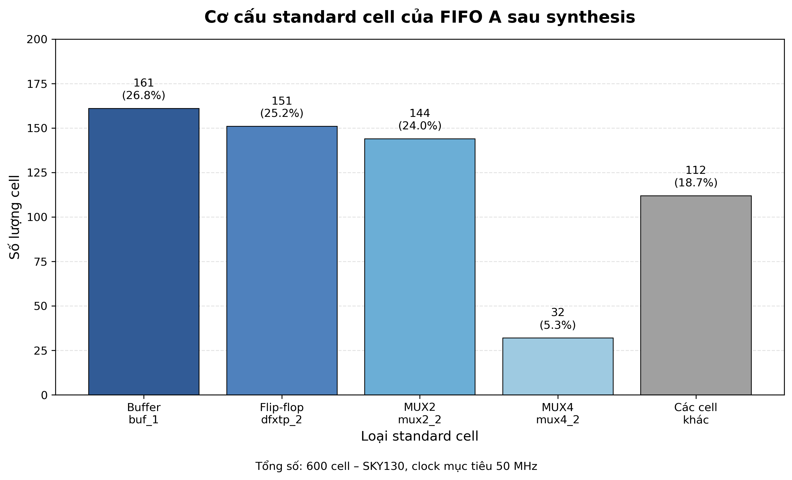
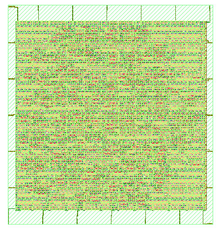
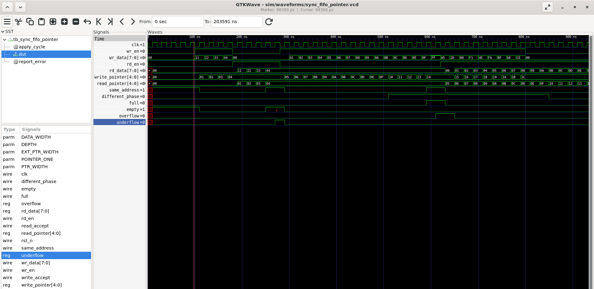
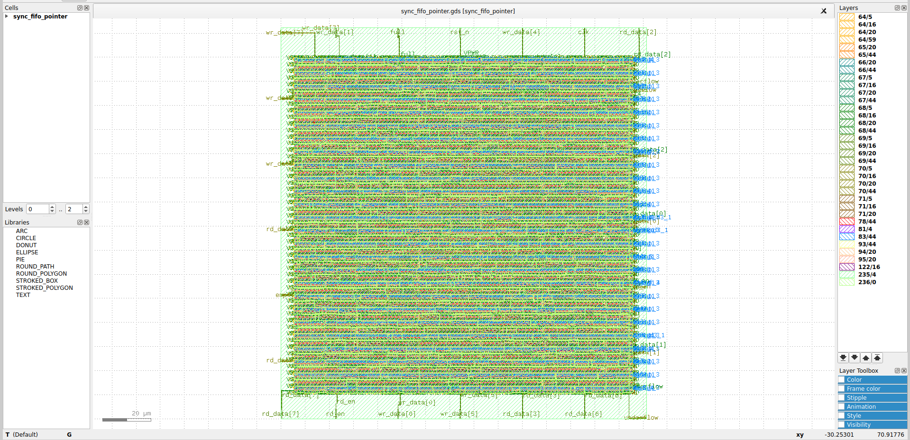

# CHƯƠNG 4 – KẾT QUẢ THỰC NGHIỆM VÀ ĐÁNH GIÁ

Chương này trình bày kết quả thực nghiệm của
hai kiến trúc FIFO đồng bộ 16 x 8 đã mô tả
trong Chương 3.

Các kết quả được phân tích dựa trên
log mô phỏng, báo cáo tổng hợp logic,
phân tích thời gian tĩnh và triển khai vật lý.

Việc đánh giá tập trung vào tính đúng chức năng,
khả năng đáp ứng ràng buộc clock 50 MHz
và các chỉ tiêu liên quan đến PPA.

## 4.1. Kết quả verification kiến trúc A

### 4.1.1. Mục tiêu và phạm vi đánh giá

Kiến trúc A sử dụng bộ đếm data_count
để quản lý số phần tử hợp lệ trong FIFO.

Trước khi thực hiện tổng hợp logic và
triển khai vật lý, thiết kế được kiểm chứng
bằng testbench SystemVerilog.

Module được kiểm tra là sync_fifo_count
trong tệp rtl/sync_fifo_count.v.

Testbench tương ứng được lưu tại:

- tb/tb_sync_fifo_count.sv.

Phương pháp kiểm chứng sử dụng mô hình
Reference Memory Scoreboard để dự đoán
dữ liệu và trạng thái mong đợi.

Các phép kiểm tra tập trung vào
thứ tự dữ liệu, trạng thái full và empty,
các cờ overflow, underflow
và chính sách xử lý đọc, ghi.

### 4.1.2. Kết quả kiểm thử có định hướng

Testbench tổ chức các bài kiểm thử
theo nhóm trường hợp T01 đến T13.

Các nhóm kiểm thử chính được liệt kê trong Bảng 4.1.

**Bảng 4.1. Các nhóm kiểm thử có định hướng của FIFO A**

| Mã | Nội dung |
|---|---|
| T01 | Kiểm tra reset |
| T02–T04 | Ghi, đọc và thứ tự dữ liệu |
| T05 | Ghi đến trạng thái đầy |
| T06 | Overflow khi đầy |
| T07 | Đọc đến trạng thái rỗng |
| T08 | Underflow khi rỗng |
| T09 | Đọc và ghi đồng thời |
| T10 | Đọc và ghi đồng thời khi đầy |
| T11 | Đọc và ghi đồng thời khi rỗng |
| T12 | Con trỏ quay vòng nhiều lần |
| T13 | Reset khi FIFO đang chứa dữ liệu |

Trong log tiêu biểu, các nhóm kiểm thử
điều kiện biên được ghi nhận,
bao gồm kiểm tra reset, overflow,
underflow, đọc/ghi đồng thời
và con trỏ quay vòng.

Các trường hợp khi đầy hoặc rỗng
được kiểm tra theo chính sách đã xác định:

- FIFO đầy: từ chối ghi.
- FIFO rỗng: từ chối đọc.
- Đầy và yêu cầu đồng thời: chỉ đọc hợp lệ.
- Rỗng và yêu cầu đồng thời: chỉ ghi hợp lệ.

Các bài kiểm thử có định hướng
được thực hiện trước phần random regression.

### 4.1.3. Kết quả random regression

Kiểm thử ngẫu nhiên được thực hiện
với sáu seed đầu vào khác nhau.

Danh sách seed gồm:

- 1, 2, 3, 4, 5 và 20260924.

Mỗi lượt chạy gồm 10.000 chu kỳ
kích thích ngẫu nhiên, bên cạnh
các chu kỳ kiểm thử có định hướng.

Kết quả random regression của FIFO A được tổng hợp trong Bảng 4.2.

**Bảng 4.2. Kết quả random regression của FIFO A**

| Seed đầu vào | Chu kỳ | Checks | Lỗi | Kết quả |
|---|---:|---:|---:|---|
| 1 | 10168 | 30508 | 0 | PASS |
| 2 | 10163 | 30493 | 0 | PASS |
| 3 | 10160 | 30484 | 0 | PASS |
| 4 | 10169 | 30511 | 0 | PASS |
| 5 | 10161 | 30487 | 0 | PASS |
| 20260924 | 10171 | 30517 | 0 | PASS |
| Tổng | 60992 | 183000 | 0 | 6/6 PASS |

Tổng cộng, sáu lượt regression của
kiến trúc A thực hiện 60.992 chu kỳ
và 183.000 lần kiểm tra.

Không ghi nhận lỗi trong các lượt chạy
được tổng hợp tại báo cáo regression.

Kết quả kiểm chứng chức năng
của kiến trúc A đạt 6/6 lượt PASS.

### 4.1.4. Phân tích log mô phỏng tiêu biểu

Lượt regression với seed đầu vào
20260924 được sử dụng làm ví dụ
để đánh giá các sự kiện hoạt động.

Các chỉ tiêu trong log được trình bày trong Bảng 4.3.

**Bảng 4.3. Thống kê sự kiện từ log mô phỏng FIFO A**

| Chỉ tiêu | Giá trị |
|---|---:|
| Tổng chu kỳ | 10171 |
| Tổng checks | 30517 |
| Ghi hợp lệ | 4899 |
| Đọc hợp lệ | 4891 |
| Sự kiện overflow | 134 |
| Sự kiện underflow | 162 |
| Đọc/ghi đồng thời hợp lệ | 2260 |
| Số lỗi | 0 |

Các bộ đếm cho thấy những sự kiện
overflow, underflow và đọc/ghi đồng thời
đã xuất hiện trong quá trình mô phỏng.

Điều này bổ sung bằng chứng
cho việc các điều kiện biên
không chỉ được mô tả về mặt lý thuyết.

Log của lượt chạy kết thúc
bằng thông báo ALL TESTS PASSED.

Cần phân biệt seed đầu vào
với giá trị trạng thái của bộ sinh
số ngẫu nhiên được in trong log.

Tệp log tương ứng hiển thị
Random seed bằng -757578739,
trong khi tên lượt regression
sử dụng seed đầu vào 20260924.

Sự khác nhau này cần được đối chiếu
với mã khởi tạo bộ sinh số ngẫu nhiên
khi đánh giá khả năng tái lập chi tiết.

### 4.1.5. Bằng chứng waveform và khả năng tái lập

Dự án lưu các tệp waveform của
kiến trúc A tại các đường dẫn:

- sim/waveforms/sync_fifo_count.vcd.
- sim/waveforms/fifo_a_view.gtkw.

Tệp VCD lưu dấu vết tín hiệu mô phỏng.

Tệp GTKW hỗ trợ cấu hình hiển thị
các tín hiệu bằng công cụ GTKWave.

Sự tồn tại của hai tệp này
là cơ sở để kiểm tra trực quan
những diễn biến tín hiệu quan trọng.

Tuy nhiên, nội dung waveform cần
được xem trực tiếp trước khi
đưa hình minh họa vào luận văn.

Báo cáo regression được lưu tại:

- results/verification_summary/regression_summary.txt.
- results/verification_summary/verification_summary.md.

Các log tương ứng được lưu trong
results/verification_summary/logs.

Script phục vụ tái lập kết quả là:

- scripts/run_evidence_regression.py.

Hình 4.1 minh họa các tín hiệu trong quá trình kiểm chứng chức năng của kiến trúc Count-based.

**Hình 4.1. Dạng sóng kiểm chứng chức năng FIFO A**

### 4.1.6. Đánh giá và giới hạn kết quả

Kết quả 6/6 PASS cho thấy
môi trường kiểm chứng không phát hiện
sai khác chức năng đối với
các chuỗi kiểm thử đã thực hiện.

Các sự kiện overflow, underflow
và đọc/ghi đồng thời đã được ghi nhận
trong log mô phỏng tiêu biểu.

Kết quả này hỗ trợ việc sử dụng
kiến trúc A trong các bước tổng hợp
và triển khai vật lý tiếp theo.

Tuy nhiên, số lỗi bằng 0
không đồng nghĩa với việc đã
chứng minh thiết kế đúng tuyệt đối.

Phạm vi kết luận giới hạn trong
cấu hình FIFO 16 x 8 và
các trường hợp kiểm thử đã chạy.

Kết quả kiểm chứng chức năng
cũng không thay thế cho phân tích
thời gian và kiểm tra vật lý.

## 4.2. Kết quả synthesis và STA kiến trúc A

### 4.2.1. Mục tiêu đánh giá

Sau khi hoàn thành kiểm chứng chức năng,
kiến trúc A được tổng hợp logic
trên công nghệ SKY130A.

Mục tiêu của giai đoạn synthesis là
chuyển đổi RTL thành netlist gồm
các standard cell của thư viện công nghệ.

Kết quả được đánh giá thông qua
số lượng cell và diện tích logic.

Bên cạnh synthesis, đề tài sử dụng
phân tích thời gian tĩnh sau routing
để đánh giá khả năng đáp ứng
ràng buộc clock mục tiêu 50 MHz.

Hai nhóm kết quả này được trình bày
riêng vì chúng thuộc các giai đoạn
khác nhau của quy trình ASIC.

### 4.2.2. Cấu hình và nguồn báo cáo synthesis

Module được tổng hợp là sync_fifo_count.

Thiết kế sử dụng các thông số:

- DATA_WIDTH = 8 bit.
- DEPTH = 16 phần tử.
- CLOCK_PERIOD = 20 ns.
- PDK = sky130A.
- STD_CELL_LIBRARY = sky130_fd_sc_hd.
- SYNTH_STRATEGY = AREA 0.

Một báo cáo tổng hợp được lưu tại:

- openlane/sync_fifo_count/runs/SYNTH_A_50MHZ/
  reports/synthesis/1-synthesis.AREA_0.stat.rpt.

Báo cáo này cung cấp số lượng cell
sau công đoạn ánh xạ công nghệ
và diện tích cell tương ứng.

Các lần chạy tổng hợp được lưu khác
cũng ghi nhận cùng số lượng 600 cell
và diện tích 7130.588800 µm².

Điều này hỗ trợ tính nhất quán
của các số liệu synthesis được sử dụng.

### 4.2.3. Kết quả tổng hợp logic

Theo báo cáo Yosys/OpenLane,
kiến trúc A có 600 standard cell
sau quá trình tổng hợp logic.

Tổng diện tích cell được báo cáo là
7130.588800 µm².

Các loại standard cell tiêu biểu được thống kê trong Bảng 4.4.

**Bảng 4.4. Phân bố standard cell của FIFO A sau synthesis**

| Loại standard cell | Số lượng |
|---|---:|
| sky130_fd_sc_hd__dfxtp_2 | 151 |
| sky130_fd_sc_hd__buf_1 | 161 |
| sky130_fd_sc_hd__mux2_2 | 144 |
| sky130_fd_sc_hd__mux4_2 | 32 |
| Tổng số cell các loại | 600 |

Trong kết quả này, dfxtp là
một loại phần tử tuần tự dạng flip-flop.

Các cell mux được sử dụng trong
mạch lựa chọn dữ liệu và đường tín hiệu.

Số lượng buffer phản ánh các phần tử
được công cụ đưa vào netlist tổng hợp.

Các loại cell trên chỉ là một phần
trong tổng số 600 standard cell.

Diện tích synthesis là tổng diện tích
cell logic được báo cáo ở giai đoạn này.

Không đồng nhất diện tích cell synthesis
với diện tích core hoặc diện tích die.

Diện tích core và die còn phụ thuộc
vào floorplan và quá trình triển khai vật lý.

Biểu đồ Hình 4.2 tổng hợp 600 cell sau synthesis. Các nhóm buf_1, dfxtp_2, mux2_2 và mux4_2 được đối chiếu với báo cáo thống kê synthesis.

**Hình 4.2. Phân bố standard cell FIFO A sau synthesis**

### 4.2.4. Môi trường phân tích STA sau routing

Để đánh giá timing sau triển khai vật lý,
đề tài thực hiện một bước STA độc lập.

Công cụ được sử dụng là
OpenROAD/OpenSTA.

Các dữ liệu đầu vào gồm:

- DEF sau routing.
- SDC chứa ràng buộc thời gian.
- SPEF nominal mô tả ký sinh đường dây.
- Thư viện Liberty tại corner TT.

Điều kiện phân tích là:

- Process corner: TT.
- Nhiệt độ: 25°C.
- Điện áp: 1.8 V.
- Clock mục tiêu: 50 MHz.
- Chu kỳ clock: 20 ns.

Kết quả được tổng hợp trong:

- results/sta_summary/sta_comparison.md.

STA này sử dụng dữ liệu vật lý
đã được tạo từ quá trình triển khai.

Nó không phải quá trình synthesis
và không thực hiện lại routing.

### 4.2.5. Kết quả setup và hold timing

Kết quả STA độc lập sau routing
của kiến trúc A được tổng hợp trong Bảng 4.5.

**Bảng 4.5. Kết quả STA setup và hold của FIFO A**

| Chỉ tiêu | FIFO A |
|---|---:|
| Clock mục tiêu | 20 ns |
| Setup worst slack | +13.380897 ns |
| Setup TNS | 0 ns |
| Hold worst slack | +0.340383 ns |
| Hold TNS | 0 ns |
| Minimum clock period | 2.84 ns |
| Fmax được báo cáo | 352.34 MHz |
| Setup tại 50 MHz | MET |
| Hold tại 50 MHz | MET |

Setup worst slack dương cho thấy
không phát hiện vi phạm setup
trong các đường được phân tích.

Setup TNS bằng 0 xác nhận
không có tổng slack setup âm
theo kết quả được báo cáo.

Tương tự, hold worst slack dương
và hold TNS bằng 0 cho thấy
không phát hiện vi phạm hold
trong phạm vi phân tích này.

Đường setup có slack nhỏ nhất
được báo cáo bắt đầu từ _1045_
và kết thúc tại đầu ra empty.

Báo cáo STA cũng ghi nhận
một số đường liên quan đến
full và tín hiệu wr_en.

Vì các tên như _1045_ được tạo
trong netlist sau ánh xạ công nghệ,
chúng không phải tên tín hiệu RTL gốc.

### 4.2.6. Đánh giá khả năng đáp ứng 50 MHz

OpenSTA báo cáo minimum clock period
của kiến trúc A là 2.84 ns.

Giá trị Fmax được công cụ báo cáo
tương ứng là 352.34 MHz.

Fmax này lớn hơn tần số mục tiêu 50 MHz
trong điều kiện STA đang khảo sát.

Các báo cáo setup và hold cũng
ghi nhận trạng thái MET tại 50 MHz.

Do đó, có thể kết luận kiến trúc A
đáp ứng yêu cầu timing mục tiêu
trong điều kiện TT, 25°C và 1.8 V
với dữ liệu ký sinh SPEF nominal.

Tuy nhiên, đây là kết quả STA ước lượng,
không phải tần số đo trực tiếp trên silicon.

Kết quả chưa đại diện cho phân tích
đầy đủ nhiều corner công nghệ,
nhiệt độ và điện áp hoạt động.

Bên cạnh đó, việc không có cảnh báo
trong check_setup -verbose chưa đủ
để chứng minh mọi đường timing
đã được ràng buộc hoàn toàn.

Đề tài cũng không sử dụng trực tiếp
độ trễ critical path trong báo cáo
physical flow để suy ra Fmax.

Sự khác biệt giữa kết quả synthesis
và kết quả sau routing cần được
duy trì rõ ràng khi phân tích PPA.

Những thông số triển khai vật lý
của kiến trúc A được trình bày
trong Mục 4.3 tiếp theo.

## 4.3. Physical implementation kiến trúc A

### 4.3.1. Mục tiêu và phạm vi triển khai vật lý

Sau khi tổng hợp logic, kiến trúc A
được triển khai vật lý bằng quy trình
OpenLane/OpenROAD trên công nghệ SKY130A.

Đối tượng triển khai là module
sync_fifo_count với cấu hình FIFO 16 x 8.

Mục tiêu của giai đoạn này là
chuyển netlist standard cell thành
dữ liệu bố trí và kết nối vật lý.

Quy trình gồm các giai đoạn chính:

- Floorplan.
- Placement.
- Clock Tree Synthesis (CTS).
- Routing.
- Trích xuất dữ liệu ký sinh.
- Kiểm tra layout và kết nối.
- Tạo dữ liệu GDSII.

Run được sử dụng để đánh giá là:

- PHYS_A_50MHZ.

Thư mục kết quả tương ứng:

- openlane/sync_fifo_count_phys/runs/PHYS_A_50MHZ.

Trạng thái được ghi trong metrics.csv là
flow completed.

Điều này xác nhận run đã hoàn thành
các bước được cấu hình trong flow.

Tuy nhiên, trạng thái hoàn thành flow
không đồng nghĩa với việc mọi chỉ tiêu
QoR đều không có ngoại lệ.

### 4.3.2. Kết quả floorplan

Giai đoạn floorplan xác định
ranh giới die, vùng core
và các điều kiện bố trí cơ bản.

Thiết kế sử dụng các cấu hình:

- FP_SIZING = relative.
- FP_CORE_UTIL = 35.
- FP_ASPECT_RATIO = 1.0.
- FP_PDN_AUTO_ADJUST = true.

Mức core utilization mục tiêu
được đặt ở giá trị 35 phần trăm.

Báo cáo physical comparison ghi nhận
placement utilization thực tế
của kiến trúc A là 36.68 phần trăm.

Diện tích core sau triển khai là
20169.344 µm².

Diện tích die sau triển khai là
0.025295218625 mm².

Cần phân biệt diện tích core,
diện tích die và tổng diện tích
standard cell sau synthesis.

Diện tích core là vùng dành cho
bố trí các thành phần của thiết kế.

Diện tích die bao gồm vùng vật lý
được xác định bởi ranh giới die.

Vì vậy, hai đại lượng này
không có cùng ý nghĩa với
cell area trong báo cáo tổng hợp logic.

### 4.3.3. Kết quả placement và CTS

Placement thực hiện bố trí
các standard cell vào vùng core.

Cấu hình placement sử dụng:

- PL_TARGET_DENSITY = 0.45.
- PL_TIME_DRIVEN = true.
- PL_ROUTABILITY_DRIVEN = true.

Công cụ được cấu hình để xem xét
timing và khả năng định tuyến
trong quá trình bố trí cell.

Sau placement, quy trình tiếp tục
thực hiện Clock Tree Synthesis.

CTS xây dựng hệ thống phân phối clock
tới những phần tử tuần tự trong mạch.

Các báo cáo STA theo từng giai đoạn
được lưu trong thư mục reports/placement
và reports/cts của run vật lý.

Sự tồn tại của các báo cáo này
hỗ trợ truy vết quá trình triển khai.

Kết quả cuối sau CTS và routing
có thể bao gồm thêm các cell
phục vụ phân phối clock và tối ưu vật lý.

Do đó, số lượng cell trong layout
không nhất thiết bằng số cell synthesis.

### 4.3.4. Kết quả routing và kết nối vật lý

Giai đoạn routing tạo đường kết nối
giữa các thành phần của thiết kế.

Báo cáo metrics.csv ghi nhận:

- Tổng chiều dài dây: 18677 µm.
- Số lượng via: 4905.
- TritonRoute violations: 0.

Via được sử dụng để kết nối
giữa các lớp kim loại khác nhau.

Wire length và số via phản ánh
một phần đặc điểm của hệ thống kết nối.

Các đại lượng này có thể thay đổi
theo cấu trúc netlist và kết quả placement.

Tại run đang xét, báo cáo ghi nhận
không có TritonRoute violation.

File báo cáo drt.drc trong run
không chứa dòng vi phạm nào.

Bên cạnh dữ liệu routing,
flow còn tạo ra dữ liệu ký sinh SPEF
để phục vụ những bước phân tích tiếp theo.

Không sử dụng riêng wire length
hoặc số via để kết luận trực tiếp
về công suất hay timing tối ưu.

### 4.3.5. Diện tích và số lượng cell vật lý

Các chỉ tiêu chính được tổng hợp
từ báo cáo metrics.csv trong Bảng 4.6.

**Bảng 4.6. Các chỉ tiêu diện tích và tài nguyên vật lý FIFO A**

| Chỉ tiêu | Giá trị |
|---|---:|
| Die area (mm²) | 0.025295218625 |
| Core area (µm²) | 20169.344 |
| Placement utilization | 36.68% |
| Synthesis cells | 600 |
| Total physical cells | 2425 |
| Wire length (µm) | 18677 |
| Via count | 4905 |

Sau synthesis, kiến trúc A
được ghi nhận có 600 standard cell.

Sau physical implementation,
báo cáo ghi nhận 2425 cell tổng cộng.

TotalCells bao gồm các thành phần
phục vụ quá trình triển khai vật lý,
không chỉ các logic cell của netlist.

Một số nhóm cell được thống kê trong Bảng 4.7.

**Bảng 4.7. Phân loại cell sau triển khai vật lý của FIFO A**

| Nhóm cell | Số lượng |
|---|---:|
| DecapCells | 1002 |
| WelltapCells | 270 |
| FillCells | 372 |
| NonPhysCells | 781 |
| TotalCells | 2425 |

Các nhóm thống kê này có tổng
bằng giá trị TotalCells trong metrics.csv.

Những cell như welltap, decap và filler
phục vụ các yêu cầu triển khai vật lý.

Vì vậy, không thể diễn giải
chênh lệch giữa 600 và 2425 cell
là số logic gate đã tăng tương ứng.

Diện tích die của kiến trúc A
tương đương khoảng 25295.219 µm².

Giá trị này khác với diện tích
cell synthesis 7130.588800 µm²
được trình bày ở Mục 4.2.

### 4.3.6. Kết quả timing trong physical flow

Báo cáo physical comparison ghi nhận:

- Post-route WNS: 0.0 ns.
- Post-route TNS: 0.0 ns.
- Reported path delay: 2.37 ns.

Báo cáo không ghi nhận
đường setup có slack âm
theo các ràng buộc đã áp dụng.

Giá trị 2.37 ns liên quan
đến đường được báo cáo
với endpoint empty.

Không xem giá trị 2.37 ns
là minimum clock period
của toàn bộ thiết kế.

Do đó, không suy trực tiếp Fmax
từ giá trị path delay này.

Kết quả STA độc lập sau routing
ở Mục 4.2 ghi nhận
setup WNS dương +13.380897 ns.

WNS bằng 0 trong báo cáo physical flow
phản ánh cách tổng hợp thông tin
không có slack âm.

Điều đó không mâu thuẫn với
giá trị worst slack dương
trong phân tích OpenSTA riêng.

Kết quả timing vẫn phụ thuộc
vào điều kiện PVT,
dữ liệu ký sinh và các ràng buộc SDC.

### 4.3.7. Kiểm tra DRC, LVS và antenna

Sau routing, thiết kế được kiểm tra
bằng các công cụ và báo cáo vật lý.

Kết quả được tổng hợp trong Bảng 4.8.

**Bảng 4.8. Kết quả DRC, LVS và antenna trong OpenLane của FIFO A**

| Chỉ tiêu | Giá trị |
|---|---:|
| TritonRoute violations | 0 |
| Magic DRC violations | 0 |
| LVS total errors | 0 |
| Antenna net violations | 0 |
| Antenna pin violations | 0 |
| KLayout violations (OpenLane gốc) | -1 |
| KLayout DRC độc lập | 0 |

Báo cáo Magic DRC ghi nhận
COUNT bằng 0.

Báo cáo LVS cho biết
không có sai khác net,
device, pin hoặc property.

Tổng số lỗi LVS là 0.

Báo cáo antenna không ghi nhận
net violation hoặc pin violation.

Trong run OpenLane gốc,
RUN_KLAYOUT_DRC có giá trị 0.

Do đó, trường klayout_violations
trong metrics.csv có giá trị -1.

Giá trị -1 không biểu thị
một vi phạm DRC cụ thể.

Để kiểm tra bổ sung,
đề tài thực hiện KLayout DRC độc lập
trên file GDSII đã tạo
của kiến trúc A.

Công cụ sử dụng là KLayout 0.30.0
với bộ quy tắc sky130A_mr.drc
thuộc công nghệ SKY130A.

Các tùy chọn kiểm tra gồm:

- feol = 1.
- beol = 1.
- offgrid = 1.
- seal = 1.
- floating_metal = 0.

Báo cáo KLayout DRC độc lập
ghi nhận 248 nhóm quy tắc
và không phát hiện vi phạm nào, như trình bày trong Bảng 4.9.

**Bảng 4.9. Kết quả KLayout DRC độc lập của FIFO A**

| Chỉ tiêu KLayout độc lập | Kết quả |
|---|---:|
| Số nhóm quy tắc báo cáo | 248 |
| Số violation items | 0 |
| Kết quả | PASS |

File báo cáo được lưu tại:

- results/klayout_drc_validation/
  A_full_drc_a2bbg29x/klayout_A_full.lydrc.

Log kiểm tra tương ứng:

- results/klayout_drc_validation/
  A_full_drc_a2bbg29x/klayout_A_full.log.

Các đường dẫn trên được tính
tương đối từ thư mục gốc dự án.

Kết quả độc lập này bổ sung
bằng chứng kiểm tra layout
mà không thay đổi metrics.csv gốc.

Như vậy, kiến trúc A đạt
0 vi phạm được báo cáo
theo bộ quy tắc KLayout đã chạy.

Kết quả này được phân biệt
với Magic DRC và LVS
trong run OpenLane ban đầu.

Những kết luận DRC và LVS
dựa trên các báo cáo cụ thể
đã được kiểm tra và lưu lại.

Không xem việc đạt các kiểm tra
đã thực hiện là bằng chứng
sign-off đầy đủ để sản xuất chip.

### 4.3.8. QoR waiver, GDSII và giới hạn kết quả

Bên cạnh các kiểm tra vật lý,
đề tài xem xét các ràng buộc QoR.

Báo cáo cho biết:

- MAX_FANOUT_CONSTRAINT = 10.
- Max fanout violations = 6.
- Max slew violations = 0.
- Max capacitance violations = 0.

Sáu vi phạm max fanout liên quan
đến mạng phân phối clock.

Trong bộ báo cáo được lưu,
chúng được phân loại
là ACCEPTED_QOR_WAIVER.

Điều này có nghĩa các vi phạm
được chấp nhận trong phạm vi
đánh giá hiện tại.

Không có nghĩa những vi phạm
đã được loại bỏ khỏi thiết kế.

Run vật lý đã tạo các file
phục vụ tái lập và phân tích.

Các dữ liệu cuối được lưu tại:

- results/final/gds/sync_fifo_count.gds.
- results/final/def/sync_fifo_count.def.
- results/final/spef/sync_fifo_count.spef.

Các đường dẫn này tính tương đối
từ thư mục run PHYS_A_50MHZ.

GDSII biểu diễn dữ liệu layout
sau quá trình triển khai vật lý.

DEF cung cấp thông tin bố trí
và kết nối tại các giai đoạn thiết kế.

SPEF lưu thông tin ký sinh
phục vụ phân tích thời gian
và công suất trong mô hình tương ứng.

Kết quả physical implementation
cho thấy kiến trúc A đã hoàn thành
flow theo cấu hình được lựa chọn.

Tuy nhiên, sáu max-fanout violations
vẫn tồn tại dưới dạng QoR waiver.

KLayout DRC độc lập đã ghi nhận
0 vi phạm với bộ quy tắc
và các tùy chọn được sử dụng.

Kết quả này không thay thế
các điều kiện sign-off khác.

Đề tài chưa thực hiện
sign-off đầy đủ cho sản xuất.

Những kết quả này được sử dụng
làm cơ sở đối chiếu với kiến trúc B
trong các mục tiếp theo.

Hình 4.3 thể hiện ảnh layout đã lưu của kiến trúc A. File GDSII gốc được lưu trong kết quả physical design.

**Hình 4.3. Ảnh layout GDSII của FIFO A**

## 4.4. Kết quả verification kiến trúc B

### 4.4.1. Mục tiêu verification kiến trúc B

Kiến trúc B sử dụng phương pháp
Extended-pointer FIFO để quản lý
trạng thái đầy và rỗng.

Khác với kiến trúc A sử dụng
bộ đếm data_count, kiến trúc B
sử dụng hai con trỏ mở rộng.

Mỗi con trỏ gồm phần địa chỉ
và một bit pha bổ sung.

Bit pha được sử dụng để phân biệt
trường hợp hai con trỏ có cùng
phần địa chỉ nhưng khác trạng thái vòng.

Module RTL được kiểm chứng là:

- rtl/sync_fifo_pointer.v.

Testbench tương ứng là:

- tb/tb_sync_fifo_pointer.sv.

Mục tiêu verification là kiểm tra
khả năng lưu trữ và đọc dữ liệu
đúng thứ tự FIFO.

Các trạng thái full, empty,
overflow và underflow cũng
được kiểm tra theo đặc tả chung.

Do hai kiến trúc có tổ chức
logic quản lý trạng thái khác nhau,
việc kiểm chứng riêng kiến trúc B
là cần thiết trước khi so sánh PPA.

### 4.4.2. Kết quả kiểm thử có định hướng

Testbench kiến trúc B sử dụng
các trường hợp kiểm thử T01 đến T13.

Những nhóm kiểm thử chính được liệt kê trong Bảng 4.10.

**Bảng 4.10. Các nhóm kiểm thử có định hướng của FIFO B**

| Nhóm | Nội dung |
|---|---|
| T01 | Kiểm tra reset |
| T02–T04 | Ghi, đọc và thứ tự dữ liệu |
| T05–T06 | Full và overflow |
| T07–T08 | Empty và underflow |
| T09 | Đọc và ghi đồng thời |
| T10 | Đọc và ghi khi FIFO đầy |
| T11 | Đọc và ghi khi FIFO rỗng |
| T12 | Con trỏ quay vòng nhiều lần |
| T13 | Reset khi đang chứa dữ liệu |

Các trường hợp kiểm thử này
được xây dựng theo cùng đặc tả
đã áp dụng cho kiến trúc A.

Đối với kiến trúc B,
kiểm tra con trỏ quay vòng
có ý nghĩa đặc biệt quan trọng.

Khi con trỏ đọc và con trỏ ghi
quay vòng qua vùng nhớ,
bit pha phải cho phép phân biệt
chính xác full và empty.

Log tiêu biểu ghi nhận việc
thực hiện các trường hợp reset,
overflow, underflow và wrap-around.

Các trường hợp đọc/ghi đồng thời
tại trạng thái đầy và rỗng
cũng được ghi nhận trong log.

Sau các bài directed tests,
môi trường kiểm chứng tiếp tục
thực hiện random regression.

### 4.4.3. Kết quả random regression

Kiến trúc B được kiểm thử
bằng sáu seed đầu vào:

- 1, 2, 3, 4, 5 và 20260924.

Mỗi lượt thực hiện 10.000 chu kỳ
kích thích ngẫu nhiên,
ngoài các chu kỳ directed tests.

Kết quả được trích trực tiếp
từ báo cáo regression của dự án và tổng hợp trong Bảng 4.11.

**Bảng 4.11. Kết quả random regression của FIFO B**

| Seed | Chu kỳ | Checks | Lỗi | Kết quả |
|---|---:|---:|---:|---|
| 1 | 10168 | 30508 | 0 | PASS |
| 2 | 10163 | 30493 | 0 | PASS |
| 3 | 10160 | 30484 | 0 | PASS |
| 4 | 10169 | 30511 | 0 | PASS |
| 5 | 10161 | 30487 | 0 | PASS |
| 20260924 | 10171 | 30517 | 0 | PASS |
| Tổng | 60992 | 183000 | 0 | 6/6 PASS |

Tổng cộng, kiến trúc B
thực hiện 60.992 chu kỳ mô phỏng.

Số lần kiểm tra được ghi nhận
là 183.000 checks.

Cả sáu lượt regression
đều đạt trạng thái PASS.

Tổng số lỗi được phát hiện bằng 0.

Các kết quả trên cho thấy
môi trường verification không phát hiện
sai khác chức năng trong những
chuỗi kiểm thử đã thực hiện.

### 4.4.4. Phân tích log mô phỏng tiêu biểu

Lượt chạy sử dụng seed đầu vào
20260924 được chọn làm ví dụ.

Các chỉ tiêu từ log được tổng hợp trong Bảng 4.12.

**Bảng 4.12. Thống kê sự kiện từ log mô phỏng FIFO B**

| Chỉ tiêu | Giá trị |
|---|---:|
| Tổng chu kỳ | 10171 |
| Tổng checks | 30517 |
| Ghi hợp lệ | 4899 |
| Đọc hợp lệ | 4891 |
| Sự kiện overflow | 134 |
| Sự kiện underflow | 162 |
| Đọc/ghi đồng thời hợp lệ | 2260 |
| Số lỗi | 0 |

Các bộ đếm sự kiện cho thấy
FIFO đã được kích thích
ở nhiều trạng thái hoạt động.

Các yêu cầu ghi và đọc hợp lệ
được xử lý trong quá trình mô phỏng.

Sự xuất hiện của overflow
và underflow cho thấy các
điều kiện biên đã được kích thích.

Log cũng ghi nhận các trường hợp
đọc và ghi đồng thời.

Lượt chạy kết thúc bằng thông báo:

- ALL TESTS PASSED.

Cũng như kiến trúc A,
log hiển thị giá trị Random seed
là -757578739.

Đây là giá trị hiển thị trong log,
không nên đồng nhất với seed đầu vào
20260924 khi chưa phân tích
cơ chế khởi tạo và cập nhật
bộ sinh số ngẫu nhiên.

### 4.4.5. Đối chiếu verification A và B

Hai kiến trúc được đánh giá
bằng cùng danh sách seed đầu vào.

Kết quả đối chiếu được tổng hợp trong Bảng 4.13.

**Bảng 4.13. Đối chiếu kết quả verification FIFO A và FIFO B**

| Chỉ tiêu | FIFO A | FIFO B |
|---|---:|---:|
| Số seed | 6 | 6 |
| Tổng chu kỳ | 60992 | 60992 |
| Tổng checks | 183000 | 183000 |
| Tổng lỗi | 0 | 0 |
| Regression PASS | 6/6 | 6/6 |

Đối với từng seed,
báo cáo regression ghi nhận
cùng số chu kỳ, checks và lỗi.

Các số liệu của seed 20260924
cũng giống nhau ở hai kiến trúc,
bao gồm số lần ghi, đọc hợp lệ
và các sự kiện điều kiện biên.

Điều này cho thấy hai môi trường
kiểm chứng đã đánh giá
các kiến trúc theo điều kiện
thực nghiệm tương ứng.

Hai thiết kế đều được kiểm tra
bằng Reference Memory Scoreboard.

Kết quả PASS của mỗi thiết kế
cho thấy không phát hiện
sai khác so với mô hình tham chiếu
trong tập kích thích đã thực hiện.

Tuy nhiên, đây không phải
bằng chứng formal equivalence
giữa hai netlist hoặc hai module RTL.

Kết quả chỉ được sử dụng
để hỗ trợ tính tương đương chức năng
trong phạm vi regression đã chạy.

### 4.4.6. Bằng chứng và giới hạn kết quả

Bằng chứng của kiến trúc B
được lưu tại các đường dẫn:

- results/verification_summary/regression_summary.txt.
- results/verification_summary/verification_summary.md.
- results/verification_summary/logs/B_seed_20260924.txt.

Dữ liệu waveform của kiến trúc B
được lưu tại:

- sim/waveforms/sync_fifo_pointer.vcd.
- sim/waveforms/fifo_b_view.gtkw.

Tệp VCD lưu hoạt động tín hiệu mô phỏng.

Tệp GTKW phục vụ cấu hình
hiển thị tín hiệu trong GTKWave.

Các file này tạo điều kiện
kiểm tra trực quan hoạt động FIFO.

Tuy nhiên, cần kiểm tra trực tiếp
nội dung waveform trước khi
sử dụng làm hình minh họa chính thức.

Kết quả 6/6 PASS và 0 lỗi
là bằng chứng verification
trong phạm vi các testcase đã chạy.

Kết quả không chứng minh
toàn bộ không gian trạng thái
đã được bao phủ hoặc
thiết kế đúng tuyệt đối.

Do đó, hai kiến trúc được xem là
đạt yêu cầu kiểm chứng chức năng
đối với bộ thử nghiệm hiện tại.

Các kết quả này là cơ sở
để tiếp tục đánh giá sự khác biệt
về diện tích và thời gian
trong quá trình triển khai ASIC.

Hình 4.4 minh họa hoạt động kiểm chứng của kiến trúc Extended-pointer.

**Hình 4.4. Dạng sóng kiểm chứng chức năng FIFO B**

## 4.5. Physical implementation kiến trúc B

### 4.5.1. Mục tiêu và phạm vi triển khai vật lý

Sau khi hoàn thành verification,
kiến trúc B được triển khai vật lý
bằng quy trình OpenLane/OpenROAD.

Thiết kế sử dụng công nghệ SKY130A
và thư viện sky130_fd_sc_hd.

Module được triển khai là:

- sync_fifo_pointer.

Cấu hình FIFO được giữ cố định:

- DATA_WIDTH = 8 bit.
- DEPTH = 16 phần tử.
- CLOCK_PERIOD = 20 ns.
- Tần số mục tiêu = 50 MHz.

Khác với kiến trúc A,
kiến trúc B sử dụng hai con trỏ mở rộng
để xác định trạng thái full và empty.

Việc thay đổi phương pháp quản lý
trạng thái có thể dẫn đến
sự khác biệt về cấu trúc logic
và kết quả triển khai vật lý.

Run vật lý được sử dụng là:

- PHYS_B_50MHZ.

Thư mục tương ứng:

- openlane/sync_fifo_pointer_phys/
  runs/PHYS_B_50MHZ.

Báo cáo metrics.csv ghi nhận
trạng thái flow completed.

Điều này cho thấy quy trình
đã hoàn thành các bước
được cấu hình trong run.

Tuy nhiên, việc hoàn thành flow
không đồng nghĩa với việc
mọi chỉ tiêu QoR đều không có ngoại lệ.

### 4.5.2. Kết quả floorplan

Floorplan xác định vùng die,
vùng core và các điều kiện
bố trí phần tử của thiết kế.

Các cấu hình chính gồm:

- FP_SIZING = relative.
- FP_CORE_UTIL = 35.
- FP_ASPECT_RATIO = 1.0.
- FP_PDN_AUTO_ADJUST = true.

Cấu hình này tương ứng
với kiến trúc A trong thí nghiệm.

Diện tích core của kiến trúc B
được báo cáo là 19462.416 µm².

Diện tích die được ghi nhận là
0.0245731929 mm².

Placement utilization thực tế
đạt 36.83 phần trăm.

Giá trị placement utilization
không hoàn toàn trùng với
FP_CORE_UTIL mục tiêu.

Hai đại lượng được xác định
ở những giai đoạn khác nhau
của quá trình triển khai.

So với kiến trúc A,
kiến trúc B có diện tích core
và die nhỏ hơn.

Điều này phản ánh kết quả
của hai cấu trúc logic khác nhau
trong điều kiện thực nghiệm đã chọn.

### 4.5.3. Kết quả placement và CTS

Placement thực hiện bố trí
các standard cell trong vùng core.

Các tham số chính được sử dụng:

- PL_TARGET_DENSITY = 0.45.
- PL_TIME_DRIVEN = true.
- PL_ROUTABILITY_DRIVEN = true.

Công cụ được cấu hình
để xem xét cả timing
và khả năng định tuyến.

Sau placement, thiết kế
tiếp tục được xử lý bằng
Clock Tree Synthesis (CTS).

CTS xây dựng mạng phân phối clock
đến những phần tử tuần tự.

Trong kiến trúc B,
hai con trỏ mở rộng
được cập nhật theo clock chung.

Các phần tử tuần tự của con trỏ,
mảng nhớ và dữ liệu đầu ra
đều nằm trong phạm vi
triển khai mạng clock.

Sự khác biệt giữa logic con trỏ
và logic đếm của kiến trúc A
có thể ảnh hưởng đến
cấu trúc netlist và placement.

Tuy nhiên, không thể chỉ dựa
vào tổng số physical cells
để xác định chính xác
ảnh hưởng của từng khối logic.

Điều này đòi hỏi
phân tích netlist chi tiết hơn.

### 4.5.4. Kết quả routing và kết nối vật lý

Sau placement và CTS,
quy trình tiếp tục thực hiện routing.

Báo cáo metrics.csv ghi nhận:

- Tổng chiều dài dây: 18170 µm.
- Số lượng via: 4609.
- TritonRoute violations: 0.

Via được sử dụng để kết nối
các lớp kim loại khác nhau.

Wire length và via count
phản ánh một phần đặc điểm
của hệ thống liên kết vật lý.

So với kiến trúc A,
FIFO B sử dụng ít chiều dài dây
và ít via hơn trong run được khảo sát.

Tuy nhiên, các đại lượng này
không đủ để kết luận trực tiếp
về công suất hoặc timing tối ưu.

Báo cáo routing không ghi nhận
TritonRoute violation.

Sau routing, thiết kế
được trích xuất dữ liệu ký sinh
phục vụ phân tích STA
và ước lượng công suất.

Dữ liệu ký sinh được lưu
dưới định dạng SPEF.

### 4.5.5. Diện tích và số lượng cell vật lý

Các chỉ tiêu chính
của kiến trúc B được tổng hợp
từ báo cáo metrics.csv và trình bày trong Bảng 4.14.

**Bảng 4.14. Các chỉ tiêu diện tích và tài nguyên vật lý FIFO B**

| Chỉ tiêu | Giá trị |
|---|---:|
| Die area (mm²) | 0.0245731929 |
| Core area (µm²) | 19462.416 |
| Placement utilization | 36.83% |
| Synthesis cells | 573 |
| Total physical cells | 2345 |
| Wire length (µm) | 18170 |
| Via count | 4609 |

Sau synthesis,
thiết kế được ghi nhận có 573 cell.

Sau physical implementation,
TotalCells được báo cáo là 2345.

Các nhóm cell được thống kê trong Bảng 4.15.

**Bảng 4.15. Phân loại cell sau triển khai vật lý của FIFO B**

| Nhóm cell | Số lượng |
|---|---:|
| DecapCells | 952 |
| WelltapCells | 265 |
| FillCells | 375 |
| NonPhysCells | 753 |
| TotalCells | 2345 |

Tổng các nhóm thống kê
bằng giá trị TotalCells.

Các nhóm welltap,
decap và filler
phục vụ yêu cầu triển khai vật lý.

Do đó, số lượng physical cells
không được đồng nhất
với số logic cells sau synthesis.

Kết quả đối chiếu với kiến trúc A được trình bày trong Bảng 4.16.

**Bảng 4.16. Đối chiếu diện tích và số lượng cell của hai kiến trúc**

| Chỉ tiêu | FIFO A | FIFO B |
|---|---:|---:|
| Synthesis cells | 600 | 573 |
| Physical cells | 2425 | 2345 |
| Core area (µm²) | 20169.344 | 19462.416 |
| Die area (mm²) | 0.025295218625 | 0.0245731929 |
| Wire length (µm) | 18677 | 18170 |
| Via count | 4905 | 4609 |

Kết quả cho thấy kiến trúc B
có diện tích core và die nhỏ hơn.

Số lượng cell tổng cộng,
chiều dài dây và số via
cũng thấp hơn kiến trúc A.

Những khác biệt này
là kết quả thực nghiệm
trên hai run đang khảo sát.

Chưa thể khái quát
rằng extended-pointer luôn
sử dụng ít tài nguyên hơn
trong mọi cấu hình FIFO.

### 4.5.6. Kết quả timing trong physical flow

Báo cáo physical comparison ghi nhận:

- Post-route WNS: 0.0 ns.
- Post-route TNS: 0.0 ns.
- Reported path delay: 2.34 ns.

Theo báo cáo physical flow,
thiết kế không có slack setup âm
trong phạm vi phân tích được ghi nhận.

Đường timing được báo cáo
có endpoint liên quan đến full.

Giá trị 2.34 ns
nhỏ hơn mức 2.37 ns
được báo cáo cho kiến trúc A.

Tuy nhiên, không được
đồng nhất reported path delay
với minimum clock period.

Do đó, không suy trực tiếp
Fmax bằng nghịch đảo
của giá trị 2.34 ns.

Kết quả STA độc lập sau routing
được trình bày riêng tại Mục 4.6.

Phân tích đó sử dụng
dữ liệu ký sinh và điều kiện
thực nghiệm được xác định cụ thể.

Việc đánh giá timing cần
phân biệt rõ báo cáo physical flow
và kết quả STA độc lập.

### 4.5.7. Kiểm tra DRC, LVS và antenna

Sau routing,
kiến trúc B được kiểm tra
bằng các công cụ physical verification.

Kết quả từ run OpenLane gốc được tổng hợp trong Bảng 4.17.

**Bảng 4.17. Kết quả DRC, LVS và antenna trong OpenLane của FIFO B**

| Chỉ tiêu | Giá trị |
|---|---:|
| TritonRoute violations | 0 |
| Magic DRC violations | 0 |
| LVS total errors | 0 |
| Antenna net violations | 0 |
| Antenna pin violations | 0 |
| KLayout violations (OpenLane gốc) | -1 |

Báo cáo Magic DRC
ghi nhận COUNT bằng 0.

Báo cáo LVS không ghi nhận
sai khác net, device,
pin hoặc property.

Tổng số lỗi LVS là 0.

Các chỉ tiêu antenna
không ghi nhận net violation
hoặc pin violation.

Tuy nhiên, trong run OpenLane gốc,
RUN_KLAYOUT_DRC có giá trị 0.

Do đó, trường klayout_violations
trong metrics.csv có giá trị -1.

Giá trị này không được
diễn giải thành lỗi DRC
hoặc bằng chứng KLayout PASS.

Để bổ sung kiểm tra,
đề tài chạy KLayout DRC độc lập
trên dữ liệu GDSII cuối
của kiến trúc B.

Công cụ được sử dụng:

- KLayout 0.30.0.

Bộ quy tắc được sử dụng:

- sky130A_mr.drc thuộc SKY130A.

Các tùy chọn khi chạy gồm:

- feol = 1.
- beol = 1.
- offgrid = 1.
- seal = 1.
- floating_metal = 0.

Đây là cùng bộ quy tắc
và nhóm tùy chọn đã áp dụng
cho kiến trúc A.

Kết quả kiểm tra độc lập được tổng hợp trong Bảng 4.18.

**Bảng 4.18. Kết quả KLayout DRC độc lập của FIFO B**

| Chỉ tiêu KLayout độc lập | Giá trị |
|---|---:|
| Số nhóm quy tắc báo cáo | 248 |
| Số violation items | 0 |
| Kết quả | PASS |

File bằng chứng của kiến trúc B:

- results/klayout_drc_validation/
  B_full_drc_xxhh4ub6/klayout_B_full.lydrc.

Log tương ứng:

- results/klayout_drc_validation/
  B_full_drc_xxhh4ub6/klayout_B_full.log.

Những đường dẫn này
được tính từ thư mục gốc dự án.

Kết quả cho thấy
KLayout không phát hiện
vi phạm nào theo bộ quy tắc
và tùy chọn được áp dụng.

Báo cáo DRC độc lập
được giữ riêng
với metrics.csv của run OpenLane.

Việc đạt các kiểm tra đã thực hiện
không đồng nghĩa với
sign-off sản xuất đầy đủ.

### 4.5.8. QoR waiver, GDSII và giới hạn kết quả

Ngoài DRC và LVS,
đề tài kiểm tra những chỉ tiêu QoR
của kiến trúc B.

Các kết quả được ghi nhận:

- MAX_FANOUT_CONSTRAINT = 10.
- Max fanout violations = 6.
- Max slew violations = 0.
- Max capacitance violations = 0.

Sáu vi phạm max-fanout
liên quan đến mạng clock.

Báo cáo physical comparison
ghi nhận những ngoại lệ này
dưới trạng thái ACCEPTED_QOR_WAIVER.

Đây là ngoại lệ được chấp nhận
trong phạm vi thí nghiệm,
không có nghĩa vi phạm đã được sửa.

Sau physical implementation,
run B tạo ra các dữ liệu cuối:

- results/final/gds/sync_fifo_pointer.gds.
- results/final/def/sync_fifo_pointer.def.
- results/final/spef/sync_fifo_pointer.spef.

Các đường dẫn trên
được tính tương đối
từ thư mục run PHYS_B_50MHZ.

GDSII biểu diễn kết quả layout
sau các bước triển khai vật lý.

DEF cung cấp dữ liệu bố trí
và kết nối thiết kế.

SPEF lưu thông tin ký sinh
để phục vụ phân tích tương ứng.

Kết quả thực nghiệm cho thấy
kiến trúc B hoàn thành physical flow.

Kiến trúc B có diện tích
và số lượng cell ít hơn A
trong hai run được so sánh.

Bên cạnh đó,
Magic DRC và LVS có kết quả 0 lỗi.

Kiểm tra KLayout DRC độc lập
cũng ghi nhận 0 vi phạm.

Tuy nhiên, sáu max-fanout violations
vẫn tồn tại dưới dạng QoR waiver.

Do đó, không xem các kết quả này
là chứng nhận sign-off đầy đủ.

Để đánh giá sự đánh đổi
giữa hai kiến trúc,
cần tiếp tục xem xét STA độc lập
và kết quả công suất ước lượng.

Hình 4.5 thể hiện ảnh layout đã lưu của kiến trúc B. Kết quả này cần được đọc cùng các báo cáo physical design và physical verification tương ứng.

**Hình 4.5. Ảnh layout GDSII của FIFO B**

## 4.6. Kết quả STA độc lập sau routing kiến trúc B

### 4.6.1. Mục tiêu phân tích STA độc lập

Sau khi hoàn thành physical implementation,
kiến trúc B được phân tích thời gian tĩnh
bằng OpenROAD/OpenSTA.

Mục tiêu của phép phân tích
là xác định khả năng đáp ứng
ràng buộc clock 50 MHz sau routing.

Ngoài việc kiểm tra riêng FIFO B,
đề tài đối chiếu kết quả
với kiến trúc A trong cùng
điều kiện thực nghiệm.

Các chỉ tiêu chính gồm:

- Setup worst slack.
- Setup total negative slack.
- Hold worst slack.
- Hold total negative slack.
- Minimum clock period.
- Fmax được công cụ báo cáo.

STA được thực hiện độc lập
trên dữ liệu triển khai vật lý đã có.

Không thực hiện lại các bước
placement, CTS hoặc routing.

Cách tổ chức này giúp
phân biệt kết quả timing
trong physical flow với
phân tích OpenSTA bổ sung.

### 4.6.2. Môi trường và dữ liệu phân tích

Phân tích được thực hiện
trong điều kiện công nghệ SKY130A.

Các thông số đầu vào được liệt kê trong Bảng 4.19.

**Bảng 4.19. Điều kiện và dữ liệu đầu vào phân tích STA độc lập**

| Thông số | Giá trị |
|---|---|
| Công cụ | OpenROAD / OpenSTA |
| Thư viện | sky130_fd_sc_hd |
| Process corner | TT |
| Nhiệt độ | 25°C |
| Điện áp | 1.8 V |
| Clock mục tiêu | 50 MHz |
| Chu kỳ mục tiêu | 20 ns |
| Dữ liệu bố trí | DEF sau routing |
| Dữ liệu ký sinh | SPEF nominal |
| Ràng buộc thời gian | SDC sau routing |

Phân tích sử dụng
cùng nhóm điều kiện
cho hai kiến trúc FIFO.

Các dữ liệu đầu vào chính gồm
Technology LEF,
Standard Cell LEF,
Liberty tại corner TT,
DEF, SDC và SPEF.

DEF thể hiện thông tin
triển khai vật lý sau routing.

SDC xác định các ràng buộc
thời gian cần phân tích.

SPEF cung cấp thông tin ký sinh
của các kết nối sau định tuyến.

Việc sử dụng SPEF nominal
giúp xem xét ảnh hưởng
của kết nối vật lý
trong mô hình STA đang khảo sát.

### 4.6.3. Phương pháp trích xuất kết quả

Đối với từng kiến trúc,
môi trường phân tích
được thiết lập độc lập.

Các bước chính gồm:

- Nạp các thư viện LEF.
- Nạp Liberty tại corner TT.
- Nạp DEF sau routing.
- Nạp các ràng buộc SDC.
- Nạp SPEF nominal.
- Kiểm tra thiết lập STA.
- Trích xuất setup và hold paths.
- Tổng hợp các chỉ tiêu timing.

Các lệnh kiểm tra
bao gồm check_setup
và check_setup -verbose.

Đường setup và hold
được trích xuất thông qua
các báo cáo report_checks.

Báo cáo kết quả còn sử dụng
worst slack, total negative slack
và minimum clock period.

Log đã lưu không ghi nhận
cảnh báo từ check_setup -verbose.

Tuy nhiên, điều này
không chứng minh tuyệt đối
mọi đường timing của thiết kế
đều đã được ràng buộc đầy đủ.

Vì vậy, kết luận STA
được giới hạn theo SDC
và dữ liệu đã sử dụng.

### 4.6.4. Kết quả setup timing kiến trúc B

Báo cáo STA ghi nhận
setup worst slack của FIFO B là:

- +13.414628 ns.

Setup TNS được ghi nhận là:

- 0 ns.

Worst slack dương cho thấy
đường setup có slack nhỏ nhất
trong báo cáo vẫn đáp ứng
ràng buộc thời gian đã áp dụng.

Đường setup có slack nhỏ nhất
được báo cáo bắt đầu từ
phần tử _984_ và kết thúc
tại đầu ra full.

Những đường tiếp theo
liên quan đến đầu ra empty
và rd_data[4].

Điều này cho thấy logic
tạo trạng thái FIFO
là một phần đáng chú ý
trong báo cáo setup timing.

Tuy nhiên, không suy ra
toàn bộ đường giới hạn Fmax
chỉ từ endpoint full.

So với FIFO A,
setup worst slack của B
lớn hơn khoảng 0.033731 ns.

Chênh lệch này khá nhỏ
so với chu kỳ clock mục tiêu 20 ns.

Cả hai kiến trúc đều
được báo cáo đáp ứng setup
trong điều kiện phân tích hiện tại.

### 4.6.5. Kết quả hold timing kiến trúc B

Báo cáo STA ghi nhận
hold worst slack của FIFO B là:

- +0.301747 ns.

Hold TNS của FIFO B là:

- 0 ns.

Đường hold có slack nhỏ nhất
được báo cáo đi từ
phần tử _980_ đến _981_.

Giá trị worst slack dương
cho thấy không phát hiện
vi phạm hold trong
phạm vi mô hình đang phân tích.

Để đối chiếu,
FIFO A có hold worst slack
bằng +0.340383 ns.

Như vậy, FIFO A
có hold worst slack lớn hơn B
khoảng 0.038636 ns.

Kết quả này không có nghĩa
thiết kế A luôn tốt hơn B
ở mọi điều kiện hold.

Sự đánh giá còn phụ thuộc
vào các corner công nghệ,
mô hình ký sinh và ràng buộc.

Đề tài chưa thực hiện
phân tích hold đa corner
để đánh giá trường hợp xấu nhất
trong toàn bộ điều kiện vận hành.

### 4.6.6. Minimum clock period và Fmax

Bên cạnh các chỉ tiêu slack,
đề tài xem xét minimum clock period
được OpenSTA báo cáo.

Kết quả đối với FIFO B:

- Minimum clock period: 3.02 ns.
- Fmax được báo cáo: 331.60 MHz.

Trong khi đó, FIFO A có:

- Minimum clock period: 2.84 ns.
- Fmax được báo cáo: 352.34 MHz.

Chu kỳ clock nhỏ nhất và Fmax được tổng hợp trong Bảng 4.20.

**Bảng 4.20. Chu kỳ clock nhỏ nhất và Fmax của hai kiến trúc**

| Chỉ tiêu | FIFO A | FIFO B |
|---|---:|---:|
| Minimum period (ns) | 2.84 | 3.02 |
| Fmax (MHz) | 352.34 | 331.60 |

Theo báo cáo,
Fmax của FIFO A cao hơn FIFO B
khoảng 6.26 phần trăm.

Vì vậy, trong thí nghiệm này,
FIFO A có lợi thế
về minimum clock period
được STA báo cáo.

Tuy nhiên, Fmax là kết quả
ước lượng bằng phân tích tĩnh,
không phải tần số
đã đo trên silicon thực tế.

Giá trị Fmax được xét
trong điều kiện corner TT,
25°C, 1.8 V và SPEF nominal.

Không sử dụng các giá trị này
để khẳng định tần số tối đa
trong mọi điều kiện vận hành.

### 4.6.7. Đối chiếu timing giữa hai kiến trúc

Các kết quả STA độc lập
được tổng hợp trong Bảng 4.21.

**Bảng 4.21. Đối chiếu chỉ tiêu STA sau routing giữa hai kiến trúc**

| Chỉ tiêu | FIFO A | FIFO B |
|---|---:|---:|
| Clock target (ns) | 20 | 20 |
| Setup worst slack (ns) | +13.380897 | +13.414628 |
| Setup TNS (ns) | 0 | 0 |
| Hold worst slack (ns) | +0.340383 | +0.301747 |
| Hold TNS (ns) | 0 | 0 |
| Minimum period (ns) | 2.84 | 3.02 |
| Fmax (MHz) | 352.34 | 331.60 |
| Setup tại 50 MHz | MET | MET |
| Hold tại 50 MHz | MET | MET |

Bảng cho thấy cả hai kiến trúc
đều đáp ứng clock mục tiêu 50 MHz
trong điều kiện STA đã sử dụng.

FIFO B có setup worst slack
lớn hơn FIFO A một lượng nhỏ.

Ngược lại, FIFO A
có hold worst slack lớn hơn B.

Đồng thời, minimum clock period
của FIFO A nhỏ hơn FIFO B.

Điều này cho thấy
không thể đánh giá toàn bộ timing
bằng một chỉ tiêu slack duy nhất.

Worst setup slack tổng thể
và minimum clock period
có thể được quyết định
bởi những đường và ràng buộc khác nhau.

Mặt khác, physical flow
ghi nhận reported path delay
của FIFO A là 2.37 ns
và FIFO B là 2.34 ns.

Hai giá trị này
không được đồng nhất
với minimum clock period
trong phân tích OpenSTA độc lập.

Vì vậy, không suy trực tiếp
Fmax từ reported path delay
của physical flow.

Việc giữ riêng hai nhóm số liệu
giúp tránh đưa ra
kết luận sai về ưu thế timing.

### 4.6.8. Bằng chứng, giới hạn và kết luận

Bằng chứng STA độc lập
được lưu trong thư mục:

- results/sta_summary/.

Các tệp chính bao gồm:

- sta_comparison.md.
- A_sta.log.
- B_sta.log.
- A_check_setup.log.
- B_check_setup.log.

Báo cáo sta_comparison.md
tổng hợp điều kiện thực nghiệm,
kết quả setup, hold
và các chỉ tiêu Fmax.

Các log hỗ trợ
kiểm tra quá trình phân tích
và truy vết kết quả.

Tuy nhiên, cần phân biệt
kết quả đạt ràng buộc 50 MHz
với việc hoàn thành
timing sign-off cho sản xuất.

Các giới hạn của phép phân tích gồm:

- Chỉ xét corner TT.
- Nhiệt độ được chọn là 25°C.
- Điện áp được chọn là 1.8 V.
- Sử dụng SPEF nominal.
- Chưa phân tích đa corner đầy đủ.
- Chưa chứng minh bao phủ mọi timing path.
- Chưa đo tần số thực tế trên silicon.

Những kết quả trên
không thay thế quy trình
sign-off STA hoàn chỉnh.

Trong phạm vi đề tài,
cả FIFO A và FIFO B
đều đáp ứng setup và hold
tại tần số clock mục tiêu 50 MHz.

FIFO B có setup worst slack
nhỉnh hơn FIFO A.

FIFO A có hold worst slack lớn hơn
và Fmax được báo cáo cao hơn B.

Như vậy, hai kiến trúc
đều đáp ứng yêu cầu timing
trong điều kiện thực nghiệm hiện tại,
nhưng có các ưu thế khác nhau
ở từng chỉ tiêu được khảo sát.

Kết quả STA này
là một phần cơ sở
để tổng hợp và đánh giá PPA
của hai kiến trúc FIFO.

## 4.7. Kết quả ước lượng công suất hai kiến trúc FIFO

### 4.7.1. Mục tiêu đánh giá công suất

Bên cạnh việc đánh giá
khả năng đáp ứng chức năng,
diện tích và thời gian,
đề tài tiến hành ước lượng
công suất của hai kiến trúc FIFO.

Mục tiêu của thí nghiệm
là xác định sự khác biệt
về công suất giữa FIFO A
và FIFO B trong cùng
điều kiện hoạt động.

FIFO A sử dụng bộ đếm data_count
để quản lý trạng thái FIFO.

FIFO B sử dụng hai con trỏ mở rộng
để xác định full và empty.

Sự khác biệt cấu trúc logic
có thể ảnh hưởng đến
hoạt động chuyển mạch
và công suất ước lượng.

Các thành phần được xem xét gồm:

- Internal Power.
- Switching Power.
- Leakage Power.
- Total Power.

Kết quả được sử dụng
để bổ sung tiêu chí Power
trong đánh giá PPA tổng hợp.

### 4.7.2. Điều kiện thực nghiệm

Hai kiến trúc được phân tích
trong cùng điều kiện công nghệ
và cùng workload.

Các điều kiện thực nghiệm chính được liệt kê trong Bảng 4.22.

**Bảng 4.22. Điều kiện thực nghiệm ước lượng công suất**

| Thông số | Giá trị |
|---|---|
| Công nghệ | SKY130A |
| Thư viện | sky130_fd_sc_hd |
| Process corner | TT |
| Nhiệt độ | 25°C |
| Điện áp | 1.8 V |
| Clock | 50 MHz |
| Chu kỳ clock | 20 ns |
| Workload | Streaming |
| Chu kỳ đo | 10000 |
| Hoạt động chuyển mạch | Gate-level zero-delay VCD |
| Ký sinh đường dây | Nominal SPEF |

Dữ liệu chuyển mạch
được tạo từ mô phỏng gate-level.

Dữ liệu VCD ghi lại
các thay đổi trạng thái tín hiệu
trong khoảng thời gian mô phỏng.

Phân tích công suất
sử dụng hoạt động chuyển mạch
cùng thông tin thư viện
và ký sinh từ SPEF nominal.

Các điều kiện này
được giữ tương ứng
giữa hai kiến trúc.

Do đó, kết quả phù hợp
để thực hiện so sánh A/B
trong phạm vi workload đã chọn.

### 4.7.3. Tạo hoạt động chuyển mạch

Workload được sử dụng
là streaming.

Trong workload này,
các yêu cầu đọc và ghi
được áp dụng liên tục
theo trình tự của testbench.

Mục tiêu là kích thích
hoạt động của FIFO
trong một chuỗi giao dịch
có khả năng tái lập.

Khoảng thời gian đo
bao gồm 10000 chu kỳ clock.

Mô phỏng được thực hiện
cho từng kiến trúc riêng biệt.

Các log tương ứng được lưu tại:

- results/power_streaming/
  run_gLsoCYD1/A_streaming.txt.
- results/power_streaming/
  run_gLsoCYD1/B_streaming.txt.

Hai lượt mô phỏng
đều ghi nhận:

- MEASURED_CYCLES = 10000.
- ERRORS = 0.
- POWER_WORKLOAD_PASS.

Dữ liệu chuyển mạch được lưu:

- results/power_streaming/
  run_gLsoCYD1/A_streaming.vcd.
- results/power_streaming/
  run_gLsoCYD1/B_streaming.vcd.

Những file VCD này
là đầu vào hoạt động
cho quá trình ước lượng công suất.

Tuy nhiên, do mô phỏng
sử dụng mô hình zero-delay,
các glitch do trễ lan truyền
chưa được thể hiện đầy đủ.

### 4.7.4. Kết quả các thành phần công suất

Báo cáo tổng hợp PPA
ghi nhận các kết quả trong Bảng 4.23.

**Bảng 4.23. Các thành phần công suất ước lượng của FIFO A và FIFO B**

| Chỉ tiêu | FIFO A | FIFO B |
|---|---:|---:|
| Internal Power (mW) | 0.493997 | 0.488578 |
| Switching Power (mW) | 0.221753 | 0.223667 |
| Leakage Power (nW) | 5.460372 | 5.384078 |
| Total Power (mW) | 0.715755 | 0.712251 |

Internal Power là thành phần
công suất nội tại của các cell
trong mô hình thư viện.

Switching Power liên quan
đến hoạt động chuyển mạch
trên các kết nối tín hiệu.

Leakage Power là thành phần
công suất rò được mô hình hóa
theo điều kiện phân tích.

Khi so sánh các thành phần,
cần chú ý đơn vị đo.

Internal, Switching
và Total Power sử dụng mW.

Riêng Leakage Power
được báo cáo theo nW.

Không cộng trực tiếp
các giá trị khác đơn vị
mà chưa thực hiện quy đổi.

Theo báo cáo,
tổng công suất của FIFO A
xấp xỉ 0.715755 mW.

Tổng công suất của FIFO B
xấp xỉ 0.712251 mW.

Đây là giá trị ước lượng
trong mô hình EDA hiện tại.

### 4.7.5. So sánh công suất FIFO A và FIFO B

So với FIFO A,
FIFO B có Internal Power
thấp hơn trong workload streaming.

Trong khi đó,
Switching Power của FIFO B
cao hơn một lượng nhỏ.

Leakage Power của FIFO B
cũng thấp hơn FIFO A
theo điều kiện mô hình đã sử dụng.

Xét tổng công suất,
FIFO B có giá trị thấp hơn
khoảng 0.49 phần trăm.

Chênh lệch tuyệt đối
xấp xỉ 0.003504 mW
theo các giá trị đã làm tròn.

Kết quả này cho thấy
kiến trúc B có lợi thế nhỏ
về Total Power ước lượng
trong thí nghiệm streaming.

Tuy nhiên, các thành phần
công suất không thay đổi
theo cùng một chiều.

FIFO B có Switching Power
cao hơn dù Total Power thấp hơn.

Vì vậy, không thể kết luận
mọi thành phần công suất
của extended-pointer FIFO
đều thấp hơn count-based FIFO.

Chênh lệch Total Power nhỏ
cũng cho thấy cần thận trọng
khi diễn giải ưu thế năng lượng.

Kết quả phụ thuộc vào workload,
mức độ chuyển mạch tín hiệu
và mô hình công nghệ.

### 4.7.6. Bằng chứng và giới hạn đánh giá

Báo cáo so sánh chính
được lưu tại:

- results/ppa_summary/ppa_comparison.md.

Dữ liệu workload streaming
được lưu trong thư mục:

- results/power_streaming/.

Các báo cáo và waveform
được sử dụng để truy vết
điều kiện mô phỏng
và kết quả ước lượng.

Phân tích công suất
được thực hiện trong điều kiện:

- Corner TT.
- Nhiệt độ 25°C.
- Điện áp 1.8 V.
- Clock 50 MHz.
- SPEF nominal.
- Streaming trong 10000 chu kỳ.

Các giới hạn quan trọng gồm:

- Chỉ sử dụng một workload.
- Chưa khảo sát nhiều mức hoạt động.
- VCD được tạo theo mô hình zero-delay.
- Chưa mô hình hóa đầy đủ glitch.
- Chưa phân tích công suất đa corner.
- Chưa có phép đo công suất trên silicon.

Vì vậy, kết quả không chứng minh
FIFO B luôn có công suất thấp hơn A
trong mọi điều kiện vận hành.

Trong phạm vi thí nghiệm hiện tại,
cả hai thiết kế đều có
kết quả ước lượng công suất
dưới 1 mW tại clock 50 MHz.

FIFO B có Total Power
thấp hơn FIFO A khoảng 0.49%.

Đây là một dữ liệu định lượng
phục vụ phần so sánh
Power, Performance và Area
giữa hai kiến trúc FIFO.

## 4.8. So sánh PPA tổng hợp và đánh giá hai kiến trúc

### 4.8.1. Mục tiêu và nguyên tắc so sánh

Sau khi hoàn thành kiểm chứng chức năng,
triển khai vật lý và phân tích công suất,
đề tài tiến hành tổng hợp
các kết quả của hai kiến trúc FIFO.

Hai kiến trúc được khảo sát gồm:

- FIFO A: Count-based FIFO.
- FIFO B: Extended-pointer FIFO.

Cả hai có cùng đặc tả chức năng:

- DATA_WIDTH = 8 bit.
- DEPTH = 16 phần tử.
- Sử dụng một miền clock.
- Tần số clock mục tiêu = 50 MHz.

Các kết quả được đánh giá
trên công nghệ SKY130A
và thư viện sky130_fd_sc_hd.

Những tiêu chí chính gồm:

- Power: công suất ước lượng.
- Performance: kết quả STA.
- Area: tài nguyên và diện tích.
- Functional verification.
- Physical verification.

Mục tiêu không phải xác định
một kiến trúc luôn tốt hơn
trong mọi điều kiện.

Thay vào đó, đề tài đánh giá
ưu điểm và sự đánh đổi
giữa hai phương pháp
quản lý trạng thái FIFO.

### 4.8.2. So sánh khả năng đáp ứng chức năng

Hai kiến trúc được kiểm chứng
bằng môi trường testbench
và phương pháp scoreboard.

Các kết quả regression được đối chiếu trong Bảng 4.24.

**Bảng 4.24. So sánh kết quả kiểm chứng chức năng hai kiến trúc**

| Chỉ tiêu | FIFO A | FIFO B |
|---|---:|---:|
| Số seed | 6 | 6 |
| Tổng chu kỳ mô phỏng | 60992 | 60992 |
| Tổng số checks | 183000 | 183000 |
| Tổng số lỗi | 0 | 0 |
| Regression | PASS | PASS |

Tổng cộng hai kiến trúc
đã thực hiện 12 lượt regression.

Các lượt kiểm thử
ghi nhận 366000 checks
và không phát hiện lỗi.

Kết quả này cho thấy
cả hai kiến trúc đáp ứng
các trường hợp chức năng
đã được thực hiện.

Do đó, việc so sánh PPA
được tiến hành trên hai thiết kế
đã vượt qua cùng phạm vi kiểm thử.

Tuy nhiên, regression PASS
không thay thế formal verification
hoặc chứng minh đầy đủ
toàn bộ không gian trạng thái.

### 4.8.3. Bảng kết quả PPA tổng hợp

Các chỉ tiêu chính được tổng hợp
từ những báo cáo thực nghiệm và trình bày trong Bảng 4.25.

**Bảng 4.25. Tổng hợp các chỉ tiêu PPA của hai kiến trúc**

| Chỉ tiêu | FIFO A | FIFO B |
|---|---:|---:|
| Synthesis cells | 600 | 573 |
| Physical cells | 2425 | 2345 |
| Core area (µm²) | 20169.344 | 19462.416 |
| Die area (mm²) | 0.025295 | 0.024573 |
| Wire length (µm) | 18677 | 18170 |
| Via count | 4905 | 4609 |
| Setup worst slack (ns) | +13.380897 | +13.414628 |
| Hold worst slack (ns) | +0.340383 | +0.301747 |
| Minimum period (ns) | 2.84 | 3.02 |
| Fmax STA (MHz) | 352.34 | 331.60 |
| Total Power (mW) | 0.715755 | 0.712251 |

Tỷ lệ thay đổi của FIFO B
so với FIFO A được tổng hợp trong Bảng 4.26.

**Bảng 4.26. Mức thay đổi các chỉ tiêu của FIFO B so với FIFO A**

| Chỉ tiêu | Thay đổi của B so với A |
|---|---:|
| Die area | -2.85% |
| Core area | -3.50% |
| Synthesis cells | -4.50% |
| Physical cells | -3.30% |
| Wire length | -2.71% |
| Via count | -6.03% |
| Total Power | -0.49% |

Dấu âm biểu thị giá trị
của kiến trúc B thấp hơn A.

Về diện tích,
FIFO B sử dụng ít tài nguyên hơn
trong lần triển khai được khảo sát.

Về công suất,
FIFO B có Total Power thấp hơn
trong workload streaming.

Về timing,
FIFO A có minimum clock period
nhỏ hơn và Fmax được báo cáo cao hơn.

Các kết quả này
cần được diễn giải riêng
theo ý nghĩa của từng chỉ tiêu.

### 4.8.4. Đánh giá sự đánh đổi kiến trúc

Kiến trúc Count-based
sử dụng bộ đếm số phần tử
để quản lý trạng thái FIFO.

Kiến trúc Extended-pointer
sử dụng hai con trỏ mở rộng
để xác định full và empty.

Sự thay đổi cách tổ chức logic
dẫn đến kết quả PPA khác nhau
trong hai run đang khảo sát.

Đối với chỉ tiêu Area,
FIFO B có ưu thế hơn.

Diện tích core của B
thấp hơn khoảng 3.50%.

Số cell sau synthesis
cũng giảm khoảng 4.50%.

Điều này cho thấy
kiến trúc B là lựa chọn
đáng xem xét khi ưu tiên diện tích
trong cấu hình FIFO 16 x 8 hiện tại.

Đối với chỉ tiêu Performance,
cả hai kiến trúc đều đáp ứng
ràng buộc clock 50 MHz.

FIFO B có setup worst slack
lớn hơn FIFO A một lượng nhỏ.

Tuy nhiên, minimum clock period
được báo cáo cho FIFO A
là 2.84 ns, thấp hơn
mức 3.02 ns của FIFO B.

Tương ứng, Fmax của FIFO A
được báo cáo cao hơn khoảng 6.26%.

Vì vậy, nếu ưu tiên Fmax
theo mô hình STA đã sử dụng,
kiến trúc A có lợi thế.

Đối với chỉ tiêu Power,
FIFO B có Total Power
ước lượng thấp hơn khoảng 0.49%.

Mức chênh lệch này tương đối nhỏ.

Hơn nữa, FIFO B có
Switching Power cao hơn A
mặc dù tổng công suất thấp hơn.

Do đó, cần thêm workload
để đánh giá tính ổn định
của ưu thế công suất.

Không có đủ bằng chứng
để khẳng định một kiến trúc
tối ưu đồng thời mọi chỉ tiêu PPA.

### 4.8.5. Kiểm tra vật lý và giới hạn thực nghiệm

Cả hai kiến trúc
đều hoàn thành physical flow
và tạo dữ liệu GDSII.

Các kiểm tra trong OpenLane
ghi nhận các kết quả được thống kê trong Bảng 4.27.

**Bảng 4.27. Kết quả kiểm tra vật lý trong OpenLane của hai kiến trúc**

| Kiểm tra | FIFO A | FIFO B |
|---|---:|---:|
| TritonRoute violations | 0 | 0 |
| Magic DRC violations | 0 | 0 |
| LVS errors | 0 | 0 |
| Antenna net violations | 0 | 0 |
| Antenna pin violations | 0 | 0 |
| Max fanout violations | 6 | 6 |

Sáu max-fanout violations
của mỗi kiến trúc
được giữ dưới dạng QoR waiver.

Các ngoại lệ này
chưa được loại bỏ.

Trong run OpenLane gốc,
RUN_KLAYOUT_DRC được đặt bằng 0.

Do đó, trường klayout_violations
trong metrics.csv có giá trị -1.

Đề tài đã bổ sung
KLayout DRC độc lập trên GDSII
với cùng rule deck SKY130A.

Kết quả kiểm tra độc lập được tổng hợp trong Bảng 4.28.

**Bảng 4.28. Kết quả KLayout DRC độc lập của hai kiến trúc**

| Chỉ tiêu | FIFO A | FIFO B |
|---|---:|---:|
| Nhóm quy tắc báo cáo | 248 | 248 |
| Violation items | 0 | 0 |
| KLayout DRC độc lập | PASS | PASS |

Kết quả này bổ sung bằng chứng
kiểm tra layout cho cả hai thiết kế.

Tuy nhiên, kết quả chỉ áp dụng
cho rule deck và các nhóm kiểm tra
được kích hoạt.

Các giới hạn chung của đề tài gồm:

- STA tại corner TT, 25°C, 1.8 V.
- Sử dụng SPEF nominal.
- Chưa phân tích đa corner đầy đủ.
- Power chỉ xét workload streaming.
- VCD sử dụng mô hình zero-delay.
- Còn QoR waiver về max fanout.
- Chưa đo trực tiếp trên silicon.
- Chưa thực hiện sign-off đầy đủ.

Do đó, các kết luận PPA
chỉ áp dụng trong phạm vi
điều kiện thực nghiệm hiện tại.

### 4.8.6. Trả lời câu hỏi nghiên cứu và kết luận

Đối với RQ1,
cả hai kiến trúc đều vượt qua
các trường hợp verification
đã được thực hiện.

Các kết quả regression
ghi nhận không có lỗi
trong phạm vi testbench đã sử dụng.

Đối với RQ2,
cả hai kiến trúc đã hoàn thành
quy trình triển khai đến GDSII.

Các báo cáo STA độc lập
cho thấy cả hai đáp ứng
setup và hold tại clock 50 MHz.

Magic DRC, LVS
và KLayout DRC độc lập
không ghi nhận vi phạm
theo phạm vi kiểm tra tương ứng.

Tuy nhiên, các kết quả này
không đồng nghĩa với
sign-off đầy đủ cho sản xuất.

Đối với RQ3,
sự khác biệt kiến trúc
đã tạo ra các kết quả PPA khác nhau.

Kiến trúc B có lợi thế
về diện tích và công suất ước lượng
trong workload đang khảo sát.

Kiến trúc A có Fmax
được OpenSTA báo cáo cao hơn.

Vì vậy, lựa chọn kiến trúc FIFO
cần phụ thuộc vào chỉ tiêu ưu tiên.

Nếu ưu tiên diện tích
trong điều kiện hiện tại,
kiến trúc B là phương án phù hợp hơn.

Nếu ưu tiên Fmax
theo mô hình STA đã sử dụng,
kiến trúc A có ưu thế hơn.

Đề tài không kết luận
một kiến trúc luôn tốt hơn
ở mọi độ sâu, độ rộng dữ liệu
hoặc mọi điều kiện công nghệ.

Các kết quả là cơ sở
để tổng kết đóng góp,
giới hạn và hướng phát triển
trong chương kết luận của luận văn.
