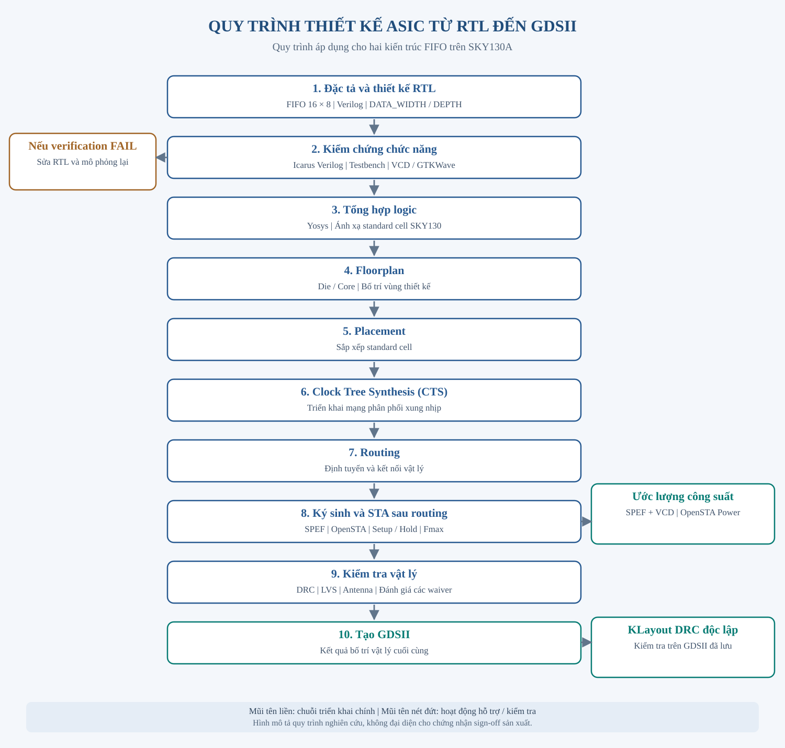
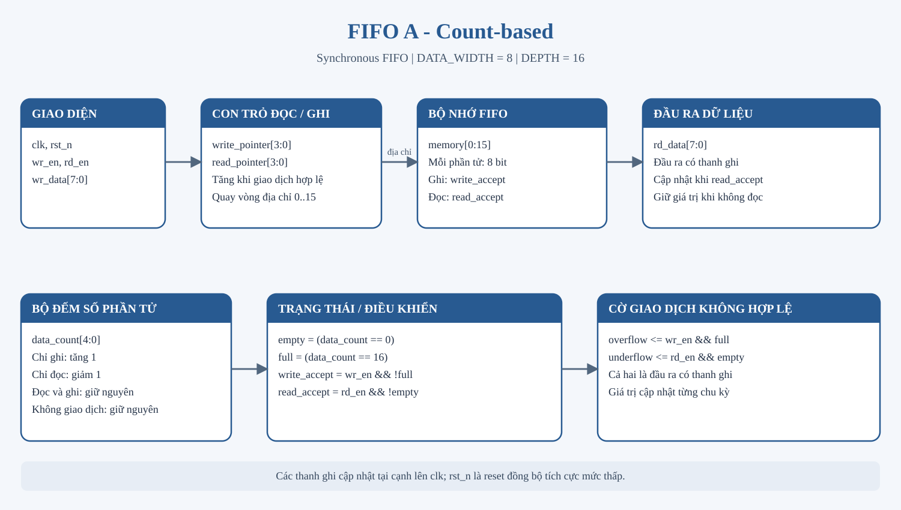
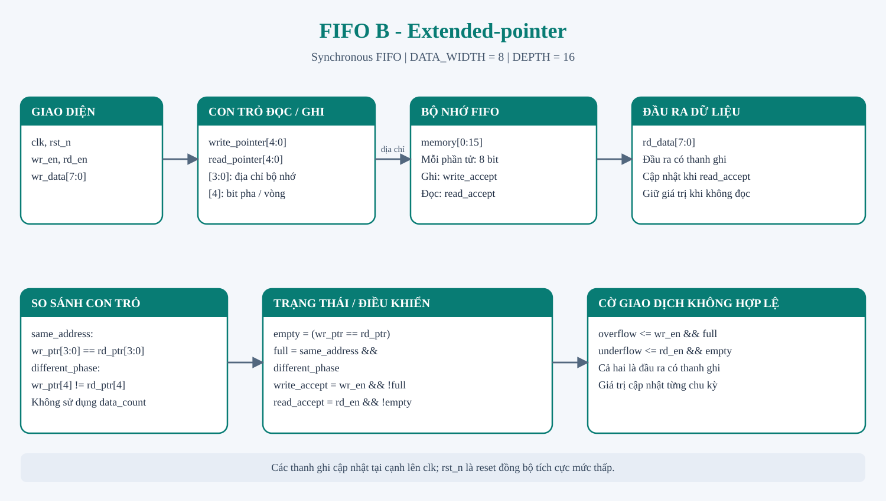
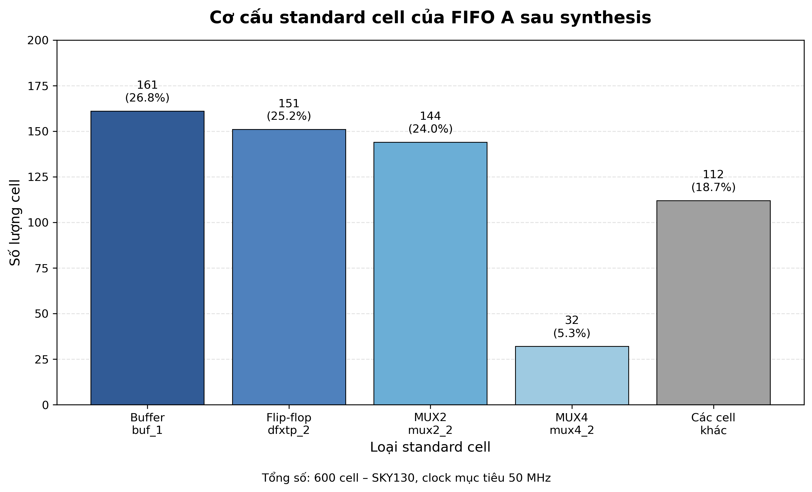
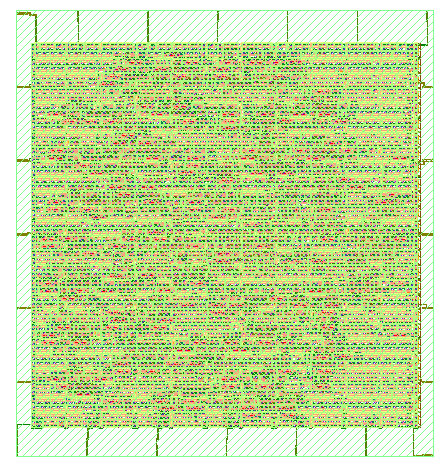
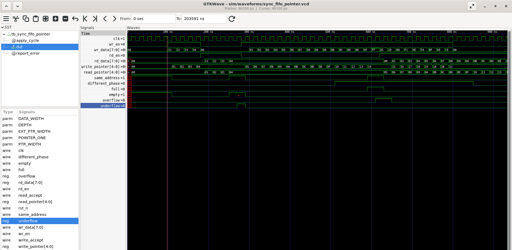
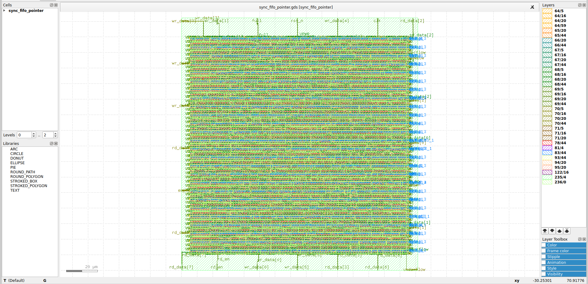
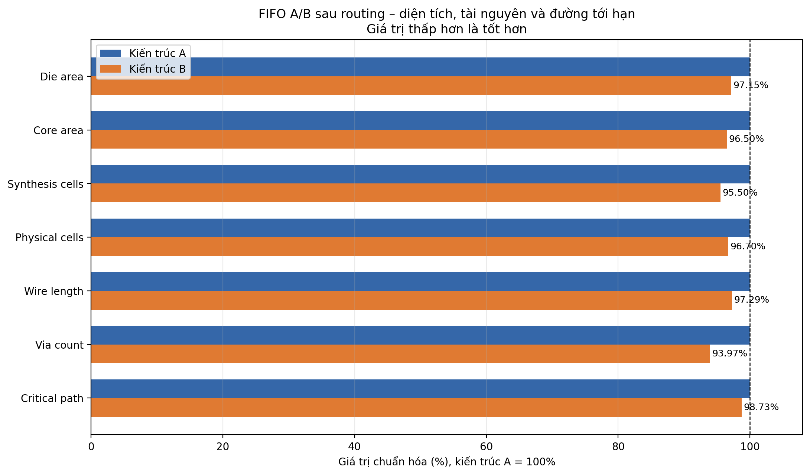

> **BẢN ĐÃ CHUẨN HÓA TRÍCH DẪN – CHƯA PHẢI BẢN NỘP.**
> Cần kiểm tra hình thức, nguồn tham khảo và kết quả dàn trang trước khi nộp.

# CHƯƠNG 1. TỔNG QUAN ĐỀ TÀI

## 1.1. Lý do chọn đề tài

Trong các hệ thống điện tử số hiện đại, việc trao đổi và xử lý dữ liệu
giữa các khối chức năng là một yêu cầu quan trọng nhằm bảo đảm hoạt động
ổn định của toàn hệ thống. Trong quá trình truyền nhận dữ liệu, các khối
phần cứng có thể có tốc độ xử lý khác nhau hoặc phát sinh dữ liệu tại
những thời điểm không đồng đều. Do đó, việc sử dụng các bộ đệm dữ liệu
là cần thiết để lưu trữ tạm thời và điều phối quá trình trao đổi dữ liệu
giữa các khối chức năng.

FIFO (First-In, First-Out) là một cấu trúc bộ đệm hoạt động theo nguyên
tắc dữ liệu được ghi vào trước sẽ được đọc ra trước. Nhờ đặc điểm này,
FIFO được sử dụng trong nhiều hệ thống số như các bộ xử lý, hệ thống
trên chip (System-on-Chip – SoC), bộ điều khiển truyền thông và các khối
xử lý dữ liệu [1]. Đối với FIFO đồng bộ (Synchronous FIFO), các thao tác đọc
và ghi được thực hiện trong cùng một miền xung nhịp, giúp đơn giản hóa
việc điều khiển và kiểm chứng so với các cấu trúc sử dụng nhiều miền
xung nhịp.

Trong quy trình thiết kế vi mạch số, một thiết kế hoạt động đúng ở mức
RTL (Register Transfer Level) chưa đủ để khẳng định khả năng triển khai
thành phần cứng thực tế. Thiết kế còn cần được tổng hợp thành các phần
tử logic, phân tích các ràng buộc thời gian và triển khai qua các bước
thiết kế vật lý như floorplan, placement, clock tree synthesis và
routing. Bên cạnh tính đúng đắn chức năng, các chỉ số về công suất tiêu
thụ (Power), hiệu năng thời gian (Performance) và diện tích (Area),
gọi chung là PPA, có vai trò quan trọng trong việc đánh giá chất lượng
thiết kế [2], [3].

Đối với cùng một chức năng FIFO, việc lựa chọn kiến trúc điều khiển có
thể ảnh hưởng đến tài nguyên logic, đường truyền tín hiệu và các chỉ số
PPA sau khi triển khai. Chẳng hạn, một phương án thiết kế sử dụng
bộ đếm số phần tử để theo dõi mức sử dụng FIFO và xác định trạng thái
đầy, rỗng [1].
Một phương án khác sử dụng các con trỏ đọc, ghi mở rộng để phân biệt
trạng thái đầy và rỗng [4]. Hai phương pháp có cùng mục tiêu chức năng
nhưng khác nhau về tổ chức logic điều khiển. Vì vậy, việc xây dựng và so sánh hai
kiến trúc trong cùng điều kiện công nghệ và ràng buộc thời gian có ý
nghĩa trong việc tìm hiểu mối liên hệ giữa lựa chọn kiến trúc RTL và
kết quả triển khai vật lý.

Bên cạnh đó, sự phát triển của các công cụ thiết kế điện tử tự động hóa
(Electronic Design Automation – EDA) mã nguồn mở tạo điều kiện cho việc
nghiên cứu và thực hành quy trình thiết kế ASIC từ RTL đến GDSII. Khi
kết hợp với bộ công nghệ SKY130A, các công cụ này cho phép thực hiện
những bước cơ bản của quy trình thiết kế vi mạch số, thu thập báo cáo
kỹ thuật và phân tích kết quả mà không yêu cầu chế tạo chip thực tế [2], [5].

Xuất phát từ những cơ sở trên, đề tài “Thiết kế và đánh giá một IP FIFO
số từ RTL đến GDSII bằng quy trình EDA mã nguồn mở” được lựa chọn nhằm
thiết kế, kiểm chứng và triển khai hai kiến trúc FIFO đồng bộ có độ rộng
dữ liệu 8 bit và độ sâu 16 phần tử. Trên cơ sở sử dụng cùng thư viện
công nghệ và ràng buộc xung nhịp mục tiêu 50 MHz, đề tài tập trung đánh
giá tính đúng đắn chức năng, khả năng đáp ứng thời gian, diện tích, công
suất ước lượng và chất lượng thiết kế vật lý. Qua đó, đề tài góp phần
làm rõ ảnh hưởng của kiến trúc RTL đến kết quả thiết kế ASIC, đồng thời
xây dựng quy trình thực nghiệm có khả năng tái lập phục vụ học tập và
nghiên cứu.

## 1.2. Vấn đề cần giải quyết

Trong thiết kế vi mạch số, việc xây dựng một khối chức năng hoạt động
đúng ở mức mô tả RTL mới chỉ là bước đầu của quá trình phát triển phần
cứng. Để một IP số có thể được triển khai trong quy trình thiết kế ASIC,
thiết kế cần đáp ứng đồng thời các yêu cầu về chức năng, khả năng tổng
hợp, ràng buộc thời gian, tài nguyên phần cứng và tính hợp lệ của kết
quả thiết kế vật lý. Do đó, bài toán đặt ra không chỉ là xây dựng một
bộ đệm FIFO hoạt động đúng nguyên tắc First-In, First-Out mà còn phải
đánh giá được chất lượng của thiết kế sau khi trải qua các công đoạn
từ RTL đến GDSII [2].

Trước hết, về mặt chức năng, FIFO phải bảo đảm dữ liệu được đọc ra theo
đúng thứ tự đã ghi vào. Các thao tác ghi, đọc, ghi và đọc đồng thời,
cũng như các trường hợp FIFO đầy hoặc rỗng cần được xử lý theo đặc tả.
Ngoài ra, thiết kế phải có cơ chế reset và các tín hiệu trạng thái phù
hợp để tránh làm sai lệch dữ liệu khi xuất hiện những yêu cầu thao tác
không hợp lệ. Việc kiểm chứng các trường hợp này đòi hỏi xây dựng
testbench tự kiểm tra, mô hình tham chiếu và các kịch bản kiểm thử bao
gồm cả những điều kiện biên.

Tiếp theo, cùng một chức năng FIFO có thể được thực hiện bằng những
kiến trúc điều khiển khác nhau. Trong phạm vi đề tài, hai phương án
được lựa chọn là kiến trúc sử dụng bộ đếm số phần tử (count-based FIFO)
và kiến trúc sử dụng con trỏ mở rộng (extended-pointer FIFO). Sự khác
biệt trong cách xác định trạng thái đầy, rỗng và tổ chức logic điều
khiển có thể dẫn đến sự khác biệt về số lượng phần tử logic, đường
truyền tín hiệu, diện tích và đặc tính thời gian sau tổng hợp cũng như
thiết kế vật lý. Vì vậy, cần xây dựng một phương pháp thực nghiệm thống
nhất để so sánh hai kiến trúc trong cùng điều kiện công nghệ và ràng
buộc thiết kế.

Bên cạnh đó, việc triển khai từ RTL đến GDSII đặt ra yêu cầu thực hiện
đầy đủ các bước cơ bản của quy trình thiết kế ASIC, bao gồm tổng hợp
logic, phân tích thời gian tĩnh, floorplan, placement, tổng hợp cây xung
nhịp và định tuyến. Kết quả thiết kế cần được kiểm tra bằng các phương
pháp như Design Rule Checking (DRC), Layout Versus Schematic (LVS) và
kiểm tra antenna. Các báo cáo sau triển khai phải cung cấp được thông
tin phục vụ đánh giá thời gian, diện tích, tài nguyên định tuyến và các
vấn đề chất lượng thiết kế còn tồn tại [2], [6].

Một vấn đề quan trọng khác là đánh giá các chỉ số Power, Performance
và Area (PPA) một cách có cơ sở. Việc so sánh hai kiến trúc cần dựa
trên cùng bộ công nghệ, thư viện standard cell, cấu hình FIFO và ràng
buộc xung nhịp. Các số liệu về thời gian phải được phân biệt rõ giữa
báo cáo thiết kế vật lý và kết quả phân tích thời gian tĩnh sau định
tuyến [3]. Đối với công suất, kết quả ước lượng phụ thuộc vào hoạt động
chuyển mạch và điều kiện phân tích nên cần xác định rõ phạm vi áp dụng,
tránh đồng nhất kết quả mô phỏng với công suất đo được trên chip thực tế [7].

Từ những vấn đề trên, đề tài tập trung giải quyết bài toán thiết kế,
kiểm chứng và triển khai hai kiến trúc FIFO đồng bộ 16×8 trên công nghệ
SKY130A với ràng buộc xung nhịp mục tiêu 50 MHz. Trên cơ sở các kết
quả thu được, đề tài tiến hành so sánh và phân tích những khác biệt về
chức năng, thời gian, diện tích, công suất ước lượng và chất lượng thiết
kế vật lý, qua đó đánh giá ảnh hưởng của lựa chọn kiến trúc RTL trong
một quy trình ASIC mã nguồn mở có khả năng tái lập.

## 1.3. Mục tiêu nghiên cứu

### 1.3.1. Mục tiêu tổng quát

Mục tiêu tổng quát của đề tài là thiết kế, kiểm chứng và đánh giá hai
kiến trúc IP FIFO đồng bộ thông qua quy trình thiết kế vi mạch số sử
dụng các công cụ EDA mã nguồn mở, từ mức mô tả RTL đến kết quả thiết
kế vật lý GDSII.

Trên cơ sở triển khai hai kiến trúc FIFO có cùng chức năng và cấu hình,
đề tài hướng đến việc phân tích ảnh hưởng của phương pháp tổ chức logic
điều khiển đến các chỉ số công suất, hiệu năng thời gian và diện tích
(PPA). Đồng thời, đề tài xây dựng quy trình thực nghiệm có khả năng tái
lập, phục vụ việc đánh giá và so sánh các phương án thiết kế IP số.

### 1.3.2. Mục tiêu cụ thể

Để đạt được mục tiêu tổng quát, đề tài tập trung thực hiện các mục tiêu
cụ thể sau:

1. **Xây dựng đặc tả IP FIFO đồng bộ:** Xác định giao diện, tham số,
nguyên tắc hoạt động và các điều kiện biên của FIFO với độ rộng dữ liệu
8 bit và độ sâu 16 phần tử, sử dụng chung một miền xung nhịp.

2. **Thiết kế hai kiến trúc FIFO bằng RTL:** Triển khai kiến trúc A sử
dụng bộ đếm số phần tử (count-based FIFO) và kiến trúc B sử dụng con
trỏ mở rộng (extended-pointer FIFO) bằng Verilog/SystemVerilog, bảo đảm
cùng chức năng và cấu hình để phục vụ so sánh.

3. **Kiểm chứng tính đúng đắn chức năng:** Xây dựng testbench tự kiểm
tra kết hợp mô hình tham chiếu, thực hiện các kịch bản ghi, đọc, ghi và
đọc đồng thời, reset, trạng thái đầy/rỗng và các điều kiện biên. Thực
hiện kiểm thử hồi quy với nhiều seed để đánh giá tính ổn định của hai
thiết kế.

4. **Thực hiện tổng hợp logic và phân tích thời gian:** Sử dụng thư viện
standard cell `sky130_fd_sc_hd` thuộc công nghệ SKY130A để tổng hợp hai
kiến trúc, phân tích các chỉ số tài nguyên logic và thời gian, đồng thời
kiểm tra khả năng đáp ứng ràng buộc xung nhịp mục tiêu 50 MHz.

5. **Triển khai thiết kế vật lý từ RTL đến GDSII:** Thực hiện các công
đoạn floorplan, placement, clock tree synthesis và routing; tạo dữ liệu
GDSII và đánh giá kết quả kiểm tra DRC, LVS, antenna cùng các vấn đề
chất lượng thiết kế còn tồn tại.

6. **Đánh giá và so sánh các chỉ số PPA:** Thu thập và phân tích các chỉ
số diện tích, hiệu năng thời gian, tài nguyên định tuyến và công suất
ước lượng của hai kiến trúc trong cùng điều kiện thí nghiệm. Phân biệt
rõ kết quả phân tích sau định tuyến, công suất ước lượng và các giới
hạn của phương pháp đánh giá.

7. **Xây dựng tài liệu và quy trình tái lập:** Lưu trữ mã nguồn RTL,
testbench, script, báo cáo và các bằng chứng thực nghiệm; xây dựng
hướng dẫn để có thể kiểm tra lại những kết quả chính của đề tài.

Thông qua các mục tiêu trên, đề tài hướng đến việc hình thành một quy
trình thiết kế và đánh giá IP số tương đối hoàn chỉnh ở quy mô học
thuật, đồng thời cung cấp cơ sở thực nghiệm để nhận xét về ưu điểm và
hạn chế của từng kiến trúc FIFO trong điều kiện triển khai đã lựa chọn.

## 1.4. Phạm vi nghiên cứu

### 1.4.1. Đối tượng nghiên cứu

Đối tượng nghiên cứu của đề tài là IP FIFO đồng bộ (Synchronous FIFO)
được mô tả bằng ngôn ngữ Verilog/SystemVerilog và triển khai thông qua
quy trình thiết kế ASIC sử dụng các công cụ EDA mã nguồn mở.

Đề tài tập trung vào hai phương án tổ chức logic điều khiển FIFO, bao
gồm kiến trúc sử dụng bộ đếm số phần tử (count-based FIFO) và kiến trúc
sử dụng con trỏ mở rộng (extended-pointer FIFO). Hai kiến trúc được
thiết kế với cùng cấu hình và chức năng nhằm tạo cơ sở so sánh các đặc
tính sau tổng hợp và thiết kế vật lý.

### 1.4.2. Phạm vi thiết kế và triển khai

Trong phạm vi thực nghiệm, FIFO được cấu hình với độ rộng dữ liệu 8 bit
và độ sâu 16 phần tử, tương ứng dung lượng lưu trữ 128 bit. Thiết kế sử
dụng một miền xung nhịp chung cho thao tác đọc và ghi, tín hiệu reset
tích cực mức thấp và các tín hiệu điều khiển, trạng thái theo đặc tả
chức năng.

Hai kiến trúc được triển khai trên bộ công nghệ SKY130A với thư viện
standard cell `sky130_fd_sc_hd` và ràng buộc xung nhịp mục tiêu 50 MHz,
tương ứng chu kỳ 20 ns. Phần lưu trữ dữ liệu được mô tả bằng RTL và ánh
xạ sang các phần tử logic của thư viện standard cell; đề tài không sử
dụng SRAM macro chuyên dụng.

Quy trình triển khai bao gồm kiểm chứng chức năng, tổng hợp logic, phân
tích thời gian tĩnh (STA), thiết kế vật lý qua các bước floorplan,
placement, clock tree synthesis và routing, kiểm tra DRC/LVS, kiểm tra
antenna và xuất dữ liệu GDSII.

### 1.4.3. Phạm vi kiểm chứng và đánh giá

Về chức năng, đề tài sử dụng testbench tự kiểm tra kết hợp mô hình tham
chiếu để đánh giá hai kiến trúc FIFO. Các trường hợp kiểm thử bao gồm
ghi, đọc, ghi và đọc đồng thời, reset, trạng thái đầy/rỗng, các yêu cầu
thao tác không hợp lệ và những điều kiện biên. Việc kiểm thử hồi quy
được thực hiện với nhiều seed nhằm tăng khả năng phát hiện lỗi trong
các chuỗi thao tác khác nhau.

Về thời gian, đề tài phân tích các chỉ số setup/hold WNS, TNS, chu kỳ
xung nhịp tối thiểu và tần số hoạt động tối đa ước tính từ báo cáo STA
sau định tuyến. Kết quả STA được đánh giá tại điều kiện danh định TT,
nhiệt độ 25°C và điện áp 1,8 V, sử dụng dữ liệu ký sinh danh định.

Về diện tích và chất lượng thiết kế vật lý, đề tài thu thập các chỉ số
số lượng standard cell, diện tích vùng die/core, chiều dài dây dẫn, số
lượng via và kết quả kiểm tra DRC, LVS, antenna. Các vấn đề chất lượng
thiết kế còn tồn tại, bao gồm ngoại lệ liên quan đến max-fanout của
mạng xung nhịp, được ghi nhận riêng thay vì coi toàn bộ thiết kế đã đạt
sign-off đầy đủ.

Về công suất, đề tài thực hiện ước lượng dựa trên hoạt động chuyển mạch
của workload streaming trong 10.000 chu kỳ, với dữ liệu VCD từ mô phỏng
gate-level zero-delay và dữ liệu ký sinh SPEF danh định. Các thành phần
công suất được phân tích bao gồm internal power, switching power,
leakage power và total power tại điều kiện TT, 25°C, 1,8 V và tần số
50 MHz.

Việc so sánh hai kiến trúc được thực hiện trên cùng cấu hình FIFO, bộ
công nghệ, thư viện standard cell, ràng buộc thời gian và điều kiện
phân tích tương ứng nhằm hạn chế ảnh hưởng của các yếu tố không thuộc
kiến trúc.

### 1.4.4. Giới hạn của đề tài

Đề tài được thực hiện ở quy mô nghiên cứu và thực nghiệm học thuật,
với những giới hạn sau:

- Không nghiên cứu FIFO bất đồng bộ hoặc các vấn đề đồng bộ dữ liệu
  giữa nhiều miền xung nhịp (Clock Domain Crossing – CDC).
- Không sử dụng SRAM macro chuyên dụng và không khảo sát đầy đủ các
  cấu hình độ rộng dữ liệu, độ sâu FIFO khác ngoài cấu hình thực nghiệm
  16×8.
- Không thực hiện chế tạo chip, đóng gói, đo kiểm trên silicon hoặc
  đánh giá độ tin cậy của chip sau sản xuất.
- Phân tích thời gian và công suất tập trung vào điều kiện danh định;
  chưa thực hiện sign-off đa góc công nghệ, điện áp và nhiệt độ
  (multi-corner sign-off).
- Kết quả công suất chỉ phản ánh workload streaming và phương pháp
  ước lượng đã lựa chọn. Mô phỏng gate-level zero-delay không phản ánh
  đầy đủ các chuyển mạch phát sinh do trễ lan truyền.
- Kết quả thiết kế vật lý còn các ngoại lệ chất lượng liên quan đến
  max-fanout của mạng xung nhịp, được ghi nhận và xem xét trong phạm
  vi đánh giá.
- Các kết luận so sánh PPA chỉ áp dụng cho hai kiến trúc và điều kiện
  thí nghiệm đã khảo sát, không được khái quát thành ưu thế tuyệt đối
  của một kiến trúc trong mọi trường hợp.

Việc xác định rõ các giới hạn trên giúp bảo đảm tính nhất quán giữa mục
tiêu nghiên cứu, phương pháp thực nghiệm và các kết luận được rút ra từ
kết quả thiết kế.

## 1.5. Phương pháp nghiên cứu

Đề tài sử dụng phương pháp nghiên cứu kết hợp giữa nghiên cứu lý thuyết,
thiết kế hệ thống số và thực nghiệm mô phỏng trên các công cụ EDA mã
nguồn mở. Trong đó, phương pháp thực nghiệm có kiểm soát được sử dụng
để triển khai và so sánh hai kiến trúc FIFO đồng bộ dưới cùng điều kiện
công nghệ và ràng buộc thiết kế.

### 1.5.1. Nghiên cứu lý thuyết và xây dựng đặc tả

Trước tiên, đề tài nghiên cứu nguyên lý hoạt động của bộ đệm FIFO,
phương pháp quản lý trạng thái đầy/rỗng, các thao tác đọc và ghi dữ liệu,
cũng như các trường hợp hoạt động tại điều kiện biên. Đồng thời, các
kiến thức liên quan đến thiết kế vi mạch số, quy trình ASIC, phân tích
thời gian tĩnh và đánh giá PPA được tổng hợp để làm cơ sở cho việc
triển khai thực nghiệm.

Từ những nội dung lý thuyết đã nghiên cứu, đề tài xây dựng đặc tả cho
IP FIFO đồng bộ với độ rộng dữ liệu 8 bit và độ sâu 16 phần tử, xác định
các tín hiệu giao tiếp, nguyên tắc hoạt động và kế hoạch kiểm chứng
chức năng.

### 1.5.2. Thiết kế RTL và kiểm chứng chức năng

Trên cơ sở đặc tả đã xây dựng, hai kiến trúc FIFO được triển khai bằng
Verilog/SystemVerilog. Kiến trúc A sử dụng bộ đếm số phần tử để xác định
trạng thái đầy và rỗng, trong khi kiến trúc B sử dụng con trỏ đọc và
ghi mở rộng.

Để kiểm chứng chức năng, đề tài xây dựng testbench tự kiểm tra kết hợp
mô hình tham chiếu nhằm đối chiếu dữ liệu và trạng thái hoạt động của
FIFO. Các trường hợp kiểm thử bao gồm ghi, đọc, ghi và đọc đồng thời,
reset, trạng thái đầy/rỗng, thao tác không hợp lệ và các điều kiện biên.

Ngoài các kịch bản kiểm thử xác định trước, phương pháp kiểm thử hồi
quy với nhiều seed được áp dụng để đánh giá hai kiến trúc qua những
chuỗi thao tác khác nhau. Kết quả kiểm thử được ghi nhận bằng log, số
lượng lỗi và trạng thái PASS/FAIL.

### 1.5.3. Tổng hợp logic và phân tích thời gian

Sau khi hoàn thành kiểm chứng chức năng, hai thiết kế được tổng hợp với
cùng bộ công nghệ SKY130A và thư viện standard cell `sky130_fd_sc_hd`.

Các báo cáo tổng hợp được sử dụng để phân tích số lượng phần tử logic
và diện tích của thiết kế. Đồng thời, phương pháp phân tích thời gian
tĩnh (Static Timing Analysis – STA) được áp dụng để kiểm tra khả năng
đáp ứng ràng buộc xung nhịp mục tiêu 50 MHz.

Đối với kết quả sau định tuyến, các chỉ số setup/hold WNS, TNS, chu kỳ
xung nhịp tối thiểu và tần số hoạt động tối đa ước tính được sử dụng để
đánh giá đặc tính thời gian của từng kiến trúc.

### 1.5.4. Triển khai thiết kế vật lý

Hai kiến trúc FIFO được đưa qua quy trình thiết kế vật lý ASIC gồm các
công đoạn floorplan, placement, clock tree synthesis và routing.

Sau khi hoàn thành triển khai, đề tài thu thập các báo cáo về diện tích
die/core, số lượng standard cell, chiều dài dây dẫn và số lượng via.
Các bước kiểm tra DRC, LVS và antenna được thực hiện để đánh giá
mức độ đáp ứng các yêu cầu kiểm tra vật lý. Kết quả của từng phép kiểm
tra và những ngoại lệ chất lượng thiết kế còn tồn tại được ghi nhận
riêng, không đồng nhất với việc đạt sign-off đầy đủ.

Dữ liệu GDSII được tạo ra cho cả hai kiến trúc. Những vấn đề chất lượng
thiết kế còn tồn tại, đặc biệt là các ngoại lệ max-fanout của mạng xung
nhịp, được ghi nhận trong quá trình đánh giá.

### 1.5.5. Ước lượng công suất và so sánh PPA

Đề tài sử dụng hoạt động chuyển mạch thu được từ mô phỏng gate-level
zero-delay với workload streaming để thực hiện ước lượng công suất.
Quá trình phân tích sử dụng dữ liệu VCD, dữ liệu ký sinh SPEF danh định
và điều kiện công nghệ TT, 25°C, 1,8 V tại tần số 50 MHz.

Các thành phần công suất internal, switching, leakage và total power
được thu thập để phục vụ so sánh. Kết quả được xem là công suất ước
lượng trong điều kiện thực nghiệm đã lựa chọn, không phải số liệu đo
trên silicon.

Trên cơ sở các báo cáo kiểm chứng, tổng hợp, STA, thiết kế vật lý và
công suất, đề tài xây dựng bảng so sánh hai kiến trúc FIFO. Các chỉ số
được đối chiếu theo từng nhóm nhằm xác định sự khác biệt về diện tích,
hiệu năng thời gian, tài nguyên định tuyến và công suất ước lượng.

### 1.5.6. Tổng hợp kết quả và đánh giá

Cuối cùng, đề tài sử dụng phương pháp phân tích và đối chiếu kết quả
thực nghiệm để nhận xét ưu điểm, hạn chế của từng kiến trúc. Việc đánh
giá được thực hiện trên cùng cấu hình FIFO, bộ công nghệ, thư viện
standard cell và ràng buộc thiết kế.

Các kết luận được xây dựng dựa trên báo cáo và bằng chứng thực nghiệm,
đồng thời xem xét những giới hạn liên quan đến điều kiện STA danh định,
phương pháp ước lượng công suất và các ngoại lệ chất lượng thiết kế vật
lý.

Toàn bộ mã nguồn, script, log và báo cáo được tổ chức trong repository
nhằm hỗ trợ việc kiểm tra và tái lập các kết quả chính của đề tài.

## 1.6. Đóng góp của đề tài

Trong phạm vi nghiên cứu và thực nghiệm học thuật, đề tài đạt được
các kết quả kỹ thuật chính sau:

**Thứ nhất, xây dựng và triển khai hai kiến trúc IP FIFO đồng bộ có
cùng chức năng.** Đề tài thiết kế FIFO với cấu hình 16 phần tử, mỗi
phần tử có độ rộng 8 bit, sử dụng một miền xung nhịp chung. Hai kiến
trúc được triển khai gồm kiến trúc A sử dụng bộ đếm số phần tử
(count-based FIFO) và kiến trúc B sử dụng con trỏ mở rộng
(extended-pointer FIFO). Việc sử dụng cùng đặc tả chức năng tạo cơ sở
để đánh giá ảnh hưởng của cách tổ chức logic điều khiển đến kết quả
thiết kế.

**Thứ hai, xây dựng môi trường kiểm chứng chức năng có khả năng tự
động đánh giá kết quả.** Đề tài sử dụng testbench tự kiểm tra kết hợp
mô hình tham chiếu để kiểm chứng dữ liệu và trạng thái của FIFO. Các
trường hợp kiểm thử bao gồm thao tác ghi, đọc, ghi và đọc đồng thời,
reset, trạng thái đầy/rỗng và các điều kiện biên. Kiểm thử hồi quy với
nhiều seed được thực hiện cho cả hai kiến trúc nhằm cung cấp bằng chứng
về tính đúng đắn chức năng trong phạm vi các kịch bản đã khảo sát.

**Thứ ba, triển khai quy trình thiết kế ASIC từ RTL đến GDSII bằng
công cụ EDA mã nguồn mở.** Hai kiến trúc FIFO được tổng hợp và triển
khai vật lý trên công nghệ SKY130A với thư viện standard cell
`sky130_fd_sc_hd`. Quy trình bao gồm tổng hợp logic, phân tích thời
gian, floorplan, placement, clock tree synthesis, routing và kiểm tra
kết quả thiết kế vật lý. Các báo cáo DRC, LVS, antenna và dữ liệu
GDSII được sử dụng làm bằng chứng đánh giá kết quả triển khai.

**Thứ tư, xây dựng bộ kết quả thực nghiệm để so sánh PPA giữa hai
kiến trúc.** Đề tài thu thập và đối chiếu các chỉ số diện tích, số
lượng standard cell, thời gian sau định tuyến, tài nguyên định tuyến
và công suất ước lượng. Kết quả cho phép phân tích sự đánh đổi giữa
các kiến trúc trong cùng điều kiện thiết kế, thay vì chỉ đánh giá dựa
trên số lượng phần tử logic ở mức RTL hoặc tổng hợp.

**Thứ năm, ghi nhận rõ các giới hạn và điều kiện áp dụng của kết quả
đánh giá.** Đề tài phân biệt các chỉ số từ báo cáo thiết kế vật lý với
kết quả STA sau định tuyến; xác định phạm vi của ước lượng công suất
dựa trên hoạt động chuyển mạch; đồng thời ghi nhận những ngoại lệ
chất lượng thiết kế còn tồn tại. Điều này giúp các kết luận so sánh có
cơ sở và tránh khái quát vượt quá điều kiện thực nghiệm.

**Thứ sáu, tổ chức mã nguồn và bằng chứng thực nghiệm theo hướng có
khả năng tái lập.** Các thiết kế RTL, testbench, script, log và báo
cáo được lưu trữ trong repository, tạo điều kiện để kiểm tra lại các
bước thực hiện và đối chiếu những kết quả chính của đồ án.

Những đóng góp trên chủ yếu mang tính triển khai, kiểm chứng và đánh
giá thực nghiệm đối với một IP số quy mô nhỏ. Đề tài không đặt mục
tiêu đề xuất một kiến trúc FIFO hoàn toàn mới, mà tập trung làm rõ
mối liên hệ giữa lựa chọn kiến trúc RTL và kết quả triển khai ASIC
trong điều kiện nghiên cứu đã xác định.

## 1.7. Cấu trúc luận văn

Ngoài phần mở đầu, kết luận, tài liệu tham khảo và phụ lục, nội dung
chính của luận văn được tổ chức thành sáu chương như sau:

**Chương 1 – Tổng quan đề tài:** Trình bày lý do lựa chọn đề tài,
vấn đề cần giải quyết, mục tiêu nghiên cứu, phạm vi thực hiện, phương
pháp nghiên cứu và những đóng góp chính của đồ án.

**Chương 2 – Cơ sở lý thuyết:** Trình bày các kiến thức nền tảng về
thiết kế vi mạch số, IP FIFO đồng bộ, hai phương pháp quản lý trạng
thái FIFO, quy trình thiết kế ASIC từ RTL đến GDSII và các chỉ số
đánh giá PPA.

**Chương 3 – Phương pháp và thiết kế hệ thống:** Trình bày
các câu hỏi nghiên cứu, đặc tả chức năng, kiến trúc RTL của hai phương
án FIFO và môi trường kiểm chứng. Đồng thời, chương giới thiệu cấu
hình ASIC flow và phương pháp thiết kế thí nghiệm nhằm bảo đảm điều
kiện so sánh thống nhất giữa hai kiến trúc.

**Chương 4 – Kết quả thực nghiệm:** Trình bày kết quả kiểm chứng
chức năng, tổng hợp logic, phân tích thời gian tĩnh và triển khai
thiết kế vật lý của từng kiến trúc FIFO. Các báo cáo kỹ thuật, kết
quả kiểm tra DRC, LVS, antenna và dữ liệu GDSII được sử dụng để
đánh giá kết quả triển khai.

**Chương 5 – So sánh và thảo luận:** Đối chiếu kết quả thực nghiệm
giữa hai kiến trúc về diện tích, hiệu năng thời gian, tài nguyên
định tuyến và công suất ước lượng. Trên cơ sở đó, chương phân tích
những sự đánh đổi giữa các kiến trúc và trình bày giới hạn của
phương pháp đánh giá.

**Chương 6 – Kết luận và hướng phát triển:** Tổng kết các kết quả
đạt được so với mục tiêu ban đầu, nêu những hạn chế của đề tài và
đề xuất các hướng nghiên cứu, cải tiến hoặc mở rộng trong tương lai.

Cách tổ chức trên nhằm bảo đảm nội dung luận văn được trình bày theo
trình tự từ cơ sở lý thuyết, thiết kế, kiểm chứng đến triển khai vật
lý và phân tích kết quả, giúp người đọc theo dõi được toàn bộ quá
trình thực hiện đề tài.

# CHƯƠNG 2. CƠ SỞ LÝ THUYẾT

## 2.1. Khái niệm FIFO

FIFO (First-In First-Out) là một cấu trúc lưu trữ dữ liệu hoạt động
theo nguyên tắc dữ liệu được đưa vào trước sẽ được lấy ra trước.
Cấu trúc này thường được sử dụng làm bộ đệm trung gian giữa các
khối xử lý hoặc truyền nhận dữ liệu trong hệ thống số. FIFO cho phép
tạm thời lưu trữ dữ liệu khi quá trình tạo dữ liệu và quá trình
tiêu thụ dữ liệu không diễn ra đồng thời hoặc có tốc độ xử lý
khác nhau [1].

Về nguyên lý hoạt động, FIFO tiếp nhận dữ liệu thông qua thao tác
ghi (write) và cung cấp dữ liệu thông qua thao tác đọc (read).
Dữ liệu được ghi vào vùng lưu trữ theo thứ tự thời gian và được
đọc ra theo đúng thứ tự đó. Khác với cơ chế ngăn xếp
Last-In First-Out (LIFO), FIFO không ưu tiên phần tử được đưa
vào gần nhất mà ưu tiên phần tử đã được lưu trữ lâu nhất.

Một FIFO thường được đặc trưng bởi hai tham số cơ bản là độ rộng
dữ liệu (data width) và độ sâu lưu trữ (depth). Độ rộng dữ liệu
xác định số bit của mỗi phần tử, trong khi độ sâu biểu thị số
phần tử tối đa có thể lưu trữ tại cùng một thời điểm.
Dung lượng lưu trữ danh nghĩa được xác định bởi:

Dung lượng (bit) = Data Width × Depth.

Ví dụ, FIFO có độ rộng dữ liệu 8 bit và độ sâu 16 phần tử
có khả năng lưu trữ tối đa 16 phần tử dữ liệu, tương ứng
128 bit. Khi FIFO chưa chứa phần tử nào, bộ đệm ở trạng thái
rỗng (empty). Khi toàn bộ 16 vị trí lưu trữ đều được sử dụng,
FIFO ở trạng thái đầy (full). Các trạng thái này được sử dụng
để kiểm soát việc chấp nhận thao tác đọc và ghi.

Trong các hệ thống số, FIFO có thể được sử dụng để đệm dữ liệu
giữa các khối chức năng, hỗ trợ giao tiếp truyền nhận dữ liệu
và điều hòa sự khác biệt về thời điểm phát sinh hoặc xử lý dữ liệu.
Việc sử dụng FIFO giúp tách biệt tương đối hoạt động của khối
tạo dữ liệu và khối tiếp nhận dữ liệu, nhưng khả năng đệm vẫn
bị giới hạn bởi dung lượng lưu trữ đã thiết kế.

Trong phạm vi đề tài, FIFO được lựa chọn làm IP số để nghiên cứu
vì có chức năng rõ ràng, có thể kiểm chứng bằng mô phỏng và
cho phép triển khai nhiều phương pháp quản lý trạng thái.
Cấu hình thực nghiệm được lựa chọn là FIFO 16×8, tương ứng
16 phần tử với độ rộng mỗi phần tử là 8 bit. Những đặc điểm
về xung nhịp, con trỏ và cơ chế xác định trạng thái sẽ được
trình bày trong các mục tiếp theo.

## 2.2. FIFO đồng bộ (Synchronous FIFO)

FIFO đồng bộ (Synchronous FIFO) là loại FIFO trong đó các thao tác
đọc và ghi được điều khiển bởi cùng một tín hiệu xung nhịp.
Các thành phần quản lý dữ liệu và trạng thái hoạt động trong cùng
một miền xung nhịp, nhờ đó việc phối hợp giữa quá trình đọc và ghi
không yêu cầu cơ chế đồng bộ tín hiệu giữa hai miền clock độc lập.

Trong FIFO đồng bộ, tín hiệu yêu cầu ghi và yêu cầu đọc thường
được lấy mẫu tại cạnh tác động của xung nhịp. Khi điều kiện
cho phép được thỏa mãn, thao tác ghi đưa dữ liệu đầu vào vào
vị trí lưu trữ tương ứng, còn thao tác đọc lấy dữ liệu theo
thứ tự đã được ghi trước đó. Việc cập nhật con trỏ và trạng
thái FIFO cũng được thực hiện theo quy tắc đồng bộ của thiết kế.

Một FIFO đồng bộ thường bao gồm vùng lưu trữ dữ liệu, logic
điều khiển ghi, logic điều khiển đọc và logic xác định trạng
thái đầy hoặc rỗng. Các tín hiệu full và empty có vai trò
thông báo khả năng tiếp nhận dữ liệu mới hoặc cung cấp dữ liệu
đã lưu trữ. Tùy theo đặc tả, yêu cầu thao tác tại trạng thái
không cho phép có thể bị chặn để bảo vệ dữ liệu và trạng thái
bên trong FIFO [1].

Đặc điểm quan trọng của FIFO đồng bộ là toàn bộ quá trình điều
khiển đọc và ghi sử dụng cùng một miền thời gian. Điều này
khác với FIFO bất đồng bộ (Asynchronous FIFO), trong đó
phía ghi và phía đọc có thể sử dụng hai xung nhịp độc lập.
FIFO bất đồng bộ vì vậy cần có phương pháp trao đổi và đồng
bộ thông tin trạng thái giữa các miền xung nhịp để hạn chế
những vấn đề liên quan đến truyền tín hiệu qua ranh giới
clock domain [4].

Việc sử dụng một xung nhịp chung giúp đơn giản hóa bài toán
điều khiển và kiểm chứng so với trường hợp có nhiều miền
xung nhịp. Tuy nhiên, FIFO đồng bộ vẫn cần xử lý chính xác
các điều kiện biên như đầy, rỗng, đọc và ghi đồng thời,
cũng như cập nhật trạng thái khi con trỏ quay vòng.

Trong đề tài này, hai kiến trúc FIFO đều sử dụng một tín hiệu
clock chung với tần số mục tiêu 50 MHz, tương ứng chu kỳ
20 ns. Tín hiệu reset tích cực mức thấp được sử dụng để
đưa các thành phần điều khiển về trạng thái ban đầu theo
đặc tả thiết kế. Hai kiến trúc có cùng nguyên tắc hoạt động
đồng bộ nhưng khác nhau ở phương pháp xác định trạng thái
đầy và rỗng.

Các thành phần lưu trữ, con trỏ đọc và con trỏ ghi sẽ được
trình bày trong Mục 2.3. Cơ chế xác định trạng thái full
và empty của hai phương pháp được phân tích ở Mục 2.4.

## 2.3. Mảng nhớ và con trỏ

### 2.3.1. Tổ chức vùng lưu trữ dữ liệu

Trong cấu trúc FIFO, vùng lưu trữ dữ liệu có nhiệm vụ tiếp nhận
các phần tử được ghi vào và duy trì chúng cho đến khi được đọc
ra. Vùng lưu trữ thường được mô tả dưới dạng một mảng gồm
nhiều phần tử có cùng độ rộng dữ liệu.

Với FIFO có độ sâu DEPTH và độ rộng DATA_WIDTH, số bit lưu
trữ danh nghĩa được xác định bởi tích của hai tham số này.
Đối với cấu hình FIFO 16×8 trong đề tài, vùng lưu trữ gồm
16 phần tử, mỗi phần tử có độ rộng 8 bit, tương ứng tổng
dung lượng dữ liệu 128 bit.

Ở mức RTL, vùng lưu trữ có thể được mô tả bằng mảng thanh
ghi. Khi triển khai ASIC, cấu trúc lưu trữ thực tế phụ thuộc
vào công nghệ, thư viện phần tử và phương pháp tổng hợp.
Trong phạm vi đề tài, dữ liệu FIFO được ánh xạ sang các
phần tử standard cell thay vì sử dụng SRAM macro chuyên dụng.

### 2.3.2. Con trỏ ghi và con trỏ đọc

FIFO sử dụng con trỏ ghi (write pointer) để xác định vị trí
tiếp nhận phần tử dữ liệu mới và con trỏ đọc (read pointer)
để xác định vị trí chứa phần tử sẽ được lấy ra tiếp theo.

Khi một thao tác ghi hợp lệ được chấp nhận, dữ liệu đầu vào
được lưu vào vị trí do con trỏ ghi chỉ định. Sau đó, con trỏ
ghi được cập nhật để chuẩn bị cho lần ghi tiếp theo.

Tương tự, khi một thao tác đọc hợp lệ được chấp nhận, dữ liệu
tại vị trí do con trỏ đọc chỉ định được đưa đến đường dữ liệu
đầu ra theo quy tắc thời gian của thiết kế. Con trỏ đọc sau
đó được cập nhật để trỏ đến phần tử tiếp theo.

Hai con trỏ được điều khiển độc lập theo các thao tác đọc
và ghi được chấp nhận. Nhờ đó, FIFO duy trì thứ tự dữ liệu
theo nguyên tắc First-In First-Out.

### 2.3.3. Cơ chế quay vòng của con trỏ

Do vùng lưu trữ có số lượng vị trí hữu hạn, các con trỏ
cần quay trở lại vị trí đầu tiên sau khi đi qua vị trí
cuối cùng. Cơ chế này được gọi là quay vòng (wrap-around).

Đối với FIFO có độ sâu 16 phần tử, địa chỉ lưu trữ có
giá trị từ 0 đến 15. Vì 2^4 = 16, cần 4 bit để biểu diễn
toàn bộ các địa chỉ của vùng lưu trữ.

Khi một con trỏ đang chỉ đến địa chỉ 15 và được tăng thêm
một đơn vị, địa chỉ tiếp theo trở về 0. Quá trình quay vòng
cho phép tái sử dụng các vị trí lưu trữ đã được đọc mà
không làm thay đổi thứ tự dữ liệu của FIFO.

Tuy nhiên, việc hai con trỏ cùng chỉ đến một địa chỉ
không đủ để xác định FIFO đang đầy hay rỗng. Tùy theo
kiến trúc điều khiển, trạng thái FIFO cần được xác định
bằng thông tin bổ sung như bộ đếm số phần tử hoặc bit vòng.

### 2.3.4. Bit vòng trong con trỏ mở rộng

Trong phương pháp sử dụng con trỏ mở rộng
(extended-pointer), mỗi con trỏ gồm phần địa chỉ lưu trữ
và một bit bổ sung dùng để theo dõi trạng thái quay vòng.

Đối với FIFO có độ sâu 16 phần tử, phần địa chỉ cần 4 bit.
Khi bổ sung một bit vòng, độ rộng con trỏ mở rộng là 5 bit.

Bit vòng thay đổi trạng thái khi con trỏ đi qua cuối vùng
địa chỉ và quay về đầu. Nhờ đó, hai con trỏ có thể có
cùng phần địa chỉ nhưng khác nhau về thông tin vòng.

Thông tin này cho phép phân biệt trường hợp hai con trỏ
cùng vị trí do FIFO rỗng với trường hợp cùng vị trí sau
khi phía ghi đã đi trước phía đọc một vòng lưu trữ.
Nguyên tắc sử dụng thông tin vòng cũng xuất hiện trong
các phương pháp quản lý con trỏ FIFO [4].

Đối với FIFO đồng bộ của đề tài, các con trỏ hoạt động
trong cùng một miền xung nhịp. Vì vậy, bit vòng được
sử dụng để xác định trạng thái đầy và rỗng, không phải
để thực hiện đồng bộ tín hiệu giữa các miền clock.

Cách xác định cụ thể hai trạng thái full và empty bằng
bộ đếm hoặc con trỏ mở rộng sẽ được trình bày trong
Mục 2.4.

## 2.4. Trạng thái full và empty

### 2.4.1. Ý nghĩa của trạng thái đầy và rỗng

Hai trạng thái cơ bản của FIFO là đầy (full) và rỗng (empty).
Trạng thái empty cho biết bộ đệm không chứa phần tử dữ liệu
hợp lệ để đọc. Trạng thái full cho biết toàn bộ vị trí lưu
trữ đã được sử dụng và không còn chỗ để tiếp nhận dữ liệu
mới nếu không có phần tử được giải phóng.

Việc xác định chính xác hai trạng thái này có vai trò quan
trọng trong điều khiển đọc và ghi. Khi FIFO rỗng, yêu cầu
đọc thông thường không được chấp nhận. Tương tự, khi FIFO
đầy, yêu cầu ghi thông thường bị chặn để tránh ghi đè dữ
liệu chưa được đọc.

Đối với FIFO có độ sâu 16 phần tử, trạng thái empty tương
ứng số phần tử hợp lệ bằng 0, còn trạng thái full tương
ứng số phần tử hợp lệ bằng 16. Hai trạng thái có thể được
xác định bằng nhiều phương pháp tổ chức logic điều khiển.

### 2.4.2. Phương pháp sử dụng bộ đếm số phần tử

Trong phương pháp count-based, một bộ đếm được sử dụng để
theo dõi số phần tử dữ liệu hợp lệ hiện có trong FIFO.
Giá trị bộ đếm tăng khi có thao tác ghi hợp lệ mà không
có thao tác đọc hợp lệ tương ứng. Ngược lại, giá trị
giảm khi có thao tác đọc hợp lệ mà không có thao tác ghi
hợp lệ tương ứng.

Khi cả thao tác đọc và ghi đều được chấp nhận trong cùng
một chu kỳ, số phần tử hợp lệ không thay đổi. Khi không
có thao tác nào được chấp nhận, bộ đếm cũng giữ nguyên.

Với độ sâu FIFO là DEPTH và số phần tử hiện tại là count,
hai trạng thái được xác định theo các điều kiện:

- empty = (count == 0).
- full = (count == DEPTH).

Đối với FIFO 16×8, bộ đếm cần biểu diễn các giá trị từ
0 đến 16. Do đó, độ rộng tối thiểu của bộ đếm là 5 bit,
được xác định bằng công thức ceil(log2(DEPTH + 1)).

Phương pháp sử dụng bộ đếm cho phép xác định trực tiếp
số phần tử đang lưu trữ. Tuy nhiên, việc duy trì bộ đếm
đòi hỏi logic cập nhật và logic so sánh trạng thái.
Cách sử dụng số phần tử để quản lý trạng thái FIFO cũng
được thể hiện trong các tài liệu kỹ thuật về FIFO [1].

### 2.4.3. Phương pháp sử dụng con trỏ mở rộng

Trong phương pháp extended-pointer, trạng thái đầy và
rỗng được xác định thông qua quan hệ giữa con trỏ ghi
và con trỏ đọc. Mỗi con trỏ gồm phần địa chỉ lưu trữ
và một bit bổ sung để phân biệt trạng thái quay vòng.

Đối với FIFO có độ sâu 16 phần tử, mỗi con trỏ mở rộng
có độ rộng 5 bit. Trong đó, 4 bit thấp biểu diễn địa
chỉ từ 0 đến 15, còn bit cao nhất biểu diễn thông tin
vòng của con trỏ.

Trạng thái empty xuất hiện khi toàn bộ giá trị con trỏ
ghi bằng toàn bộ giá trị con trỏ đọc. Khi đó, hai con
trỏ có cùng phần địa chỉ và cùng bit vòng.

Trạng thái full xuất hiện khi phần địa chỉ của hai con
trỏ bằng nhau nhưng bit vòng khác nhau. Điều này biểu
thị phía ghi đã đi trước phía đọc đúng một vòng dung
lượng lưu trữ.

Có thể biểu diễn các điều kiện như sau:

- empty = (write_pointer == read_pointer).
- same_address = (write_address == read_address).
- different_phase = (write_phase != read_phase).
- full = same_address && different_phase.

Nguyên tắc phân biệt trạng thái bằng thông tin con trỏ
và bit vòng cũng được trình bày trong các nghiên cứu
về kỹ thuật FIFO [4]. Trong đề tài này, nguyên tắc
được áp dụng cho FIFO đồng bộ, không sử dụng cơ chế
đồng bộ con trỏ giữa các miền xung nhịp khác nhau.

### 2.4.4. So sánh nguyên lý hai phương pháp

Cả hai phương pháp đều nhằm xác định chính xác khả năng
tiếp nhận và cung cấp dữ liệu của FIFO. Sự khác biệt
chủ yếu nằm ở thông tin được sử dụng để quản lý trạng
thái và cách tổ chức logic điều khiển.

Phương pháp count-based sử dụng bộ đếm để biểu diễn
trực tiếp số phần tử đang lưu trữ. Vì vậy, điều kiện
full và empty được xác định bằng phép so sánh bộ đếm
với các giá trị giới hạn.

Ngược lại, phương pháp extended-pointer không cần bộ
đếm số phần tử riêng để xác định hai trạng thái cơ bản.
Thông tin trạng thái được suy ra từ quan hệ giữa con
trỏ ghi và con trỏ đọc, bao gồm phần địa chỉ và bit vòng.

Sự khác biệt về tổ chức logic có thể ảnh hưởng đến số
lượng phần tử logic, đường truyền tín hiệu, thời gian
và công suất sau tổng hợp và triển khai vật lý.
Tuy nhiên, không thể kết luận một phương pháp luôn
tốt hơn phương pháp còn lại nếu chưa xem xét kết quả
thực nghiệm trong cùng điều kiện thiết kế.

Trong đề tài, phương pháp count-based được sử dụng cho
kiến trúc A, còn phương pháp extended-pointer được sử
dụng cho kiến trúc B. Hai phương pháp được triển khai
với cùng cấu hình FIFO 16×8 để phục vụ việc so sánh
ở các chương tiếp theo.

## 2.5. Overflow và underflow

### 2.5.1. Hiện tượng overflow

Overflow là tình huống liên quan đến việc ghi dữ liệu khi
FIFO không còn vị trí lưu trữ khả dụng. Nếu một thao tác
ghi được thực hiện không đúng tại trạng thái đầy, dữ liệu
chưa được đọc có thể bị ghi đè hoặc trạng thái quản lý
FIFO có thể trở nên không chính xác.

Trong FIFO đồng bộ, tín hiệu full được sử dụng để xác định
khả năng tiếp nhận dữ liệu mới. Khi full được xác lập,
yêu cầu ghi cần được xử lý theo chính sách điều khiển
đã quy định trong đặc tả thiết kế.

Đối với phương án chặn ghi khi đầy, yêu cầu ghi tại
trạng thái full không làm cập nhật vùng lưu trữ hoặc
con trỏ ghi. Nhờ đó, dữ liệu chưa được đọc vẫn được
bảo toàn.

Cần phân biệt yêu cầu ghi khi đầy với sự cố overflow
thực sự. Nếu yêu cầu bị từ chối đúng theo đặc tả,
thiết kế đã ngăn chặn việc ghi vượt dung lượng.

### 2.5.2. Hiện tượng underflow

Underflow là tình huống liên quan đến việc đọc dữ liệu
khi FIFO không chứa phần tử hợp lệ. Nếu thao tác đọc
không được kiểm soát, hệ thống có thể sử dụng dữ liệu
không hợp lệ hoặc cập nhật sai trạng thái FIFO.

Tín hiệu empty được sử dụng để thông báo rằng FIFO
không có phần tử hợp lệ để đọc. Trong phương án chặn
đọc khi rỗng, yêu cầu đọc tại trạng thái empty không
làm thay đổi con trỏ đọc hoặc số phần tử hợp lệ.

Giống như trường hợp overflow, yêu cầu đọc khi rỗng
không đồng nghĩa với việc thiết kế đã xảy ra lỗi
underflow. Nếu logic điều khiển từ chối thao tác
đúng theo đặc tả, trạng thái FIFO vẫn được bảo toàn.

### 2.5.3. Cơ chế phòng tránh trong FIFO đồng bộ

Một phương pháp phổ biến để phòng tránh overflow và
underflow là chỉ chấp nhận thao tác khi trạng thái
FIFO cho phép.

Đối với chính sách điều khiển cơ bản, điều kiện
chấp nhận thao tác có thể được biểu diễn như sau:

- write_accept = wr_en && !full.
- read_accept = rd_en && !empty.

Trong đó, wr_en và rd_en là tín hiệu yêu cầu từ
bên ngoài; write_accept và read_accept biểu diễn
thao tác thực sự được chấp nhận.

Các điều kiện trên mô tả phương án điều khiển cơ bản.
Đối với một số thiết kế, chính sách chấp nhận đọc
và ghi đồng thời tại trạng thái đầy hoặc rỗng có
thể khác nhau. Vì vậy, hành vi chính xác cần được
xác định theo RTL và đặc tả của từng kiến trúc.

Trong phạm vi đề tài, việc kiểm chứng các yêu cầu
ghi khi đầy và đọc khi rỗng được thực hiện nhằm
đánh giá khả năng bảo toàn dữ liệu và trạng thái
FIFO. Các trường hợp này được đưa vào testbench
tự kiểm tra và quá trình kiểm thử hồi quy.

Trong hai kiến trúc FIFO của đề tài, các tín hiệu
overflow và underflow được triển khai dưới dạng
cờ báo yêu cầu thao tác không hợp lệ. Hai tín hiệu
được cập nhật tại cạnh lên của xung nhịp theo
các điều kiện sau:

- overflow = wr_en && full.
- underflow = rd_en && empty.

Khi điều kiện tương ứng xuất hiện, cờ được xác lập
trong chu kỳ clock tiếp theo và trở về mức thấp
nếu điều kiện không còn tồn tại. Nếu yêu cầu không
hợp lệ tiếp tục xuất hiện ở các chu kỳ liên tiếp,
cờ có thể duy trì mức cao qua nhiều chu kỳ.

Các cờ này phản ánh yêu cầu bị từ chối theo
trạng thái FIFO, không đồng nghĩa với việc dữ liệu
đã bị ghi đè hoặc trạng thái lưu trữ bị sai lệch.

Cơ chế xử lý khi đọc và ghi đồng thời, bao gồm
các trường hợp tại ranh giới đầy và rỗng, sẽ
được phân tích trong Mục 2.6.

## 2.6. Đọc và ghi đồng thời

### 2.6.1. Nguyên tắc chấp nhận thao tác

Trong FIFO đồng bộ, yêu cầu đọc và ghi có thể xuất hiện
độc lập hoặc đồng thời tại cùng một cạnh tác động của
xung nhịp. Tuy nhiên, yêu cầu từ bên ngoài không đồng
nghĩa với việc thao tác luôn được thực hiện.

Đối với hai kiến trúc được sử dụng trong đề tài,
điều kiện chấp nhận thao tác được xác định như sau:

- write_accept = wr_en && !full.
- read_accept = rd_en && !empty.

Các điều kiện trên được xác định từ trạng thái FIFO
trước cạnh xung nhịp đang xét. Do đó, thao tác đọc
và ghi được quyết định dựa trên khả năng lưu trữ
hiện tại của FIFO.

### 2.6.2. Trường hợp chỉ ghi

Khi wr_en được xác lập và rd_en không được xác lập,
FIFO thực hiện ghi nếu trạng thái full bằng 0.

Dữ liệu đầu vào được lưu tại địa chỉ do con trỏ ghi
chỉ định. Sau thao tác hợp lệ, con trỏ ghi được
cập nhật đến vị trí tiếp theo.

Trong kiến trúc count-based, bộ đếm số phần tử
tăng thêm một đơn vị. Trong kiến trúc extended-pointer,
con trỏ ghi mở rộng được tăng tương ứng.

Nếu FIFO đang đầy, yêu cầu ghi bị từ chối.
Tại cạnh lên clock, overflow được cập nhật theo
điều kiện wr_en && full.

### 2.6.3. Trường hợp chỉ đọc

Khi rd_en được xác lập và wr_en không được xác lập,
FIFO thực hiện đọc nếu trạng thái empty bằng 0.

Dữ liệu tại vị trí con trỏ đọc được lấy từ vùng
lưu trữ và cập nhật vào thanh ghi đầu ra rd_data
tại cạnh lên của xung nhịp.

Sau thao tác đọc hợp lệ, con trỏ đọc được cập nhật.
Đối với kiến trúc count-based, bộ đếm số phần tử
giảm một đơn vị.

Nếu FIFO đang rỗng, yêu cầu đọc bị từ chối.
Thanh ghi rd_data không được cập nhật bởi thao tác
đọc không hợp lệ. Tại cạnh lên clock, underflow
được cập nhật theo điều kiện rd_en && empty.

### 2.6.4. Đọc và ghi đồng thời khi FIFO hoạt động bình thường

Khi wr_en và rd_en cùng được xác lập, đồng thời
FIFO không đầy và không rỗng, cả hai thao tác
được chấp nhận trong cùng một chu kỳ clock.

Dữ liệu mới được ghi vào vị trí do con trỏ ghi
chỉ định, trong khi dữ liệu cũ được đọc từ vị trí
do con trỏ đọc chỉ định.

Sau cạnh xung nhịp, cả con trỏ ghi và con trỏ đọc
đều được cập nhật. Trong kiến trúc count-based,
số phần tử hợp lệ không thay đổi vì có một phần
tử được thêm vào và một phần tử được lấy ra.

Trong kiến trúc extended-pointer, cả hai con trỏ
được tăng một đơn vị. Quan hệ giữa hai con trỏ
vì vậy vẫn biểu diễn cùng mức sử dụng dung lượng
sau khi hai thao tác hợp lệ hoàn thành.

### 2.6.5. Đọc và ghi đồng thời khi FIFO đầy

Khi FIFO đang đầy, full bằng 1 nên write_accept
bằng 0, kể cả khi wr_en được xác lập.

Nếu rd_en cũng được xác lập, thao tác đọc vẫn
được chấp nhận vì FIFO không rỗng.

Do đó, trong thiết kế của đề tài, yêu cầu đọc
và ghi đồng thời khi FIFO đầy chỉ dẫn đến
một thao tác đọc hợp lệ. Thao tác ghi bị chặn,
và overflow được cập nhật tại cạnh lên clock.

Sau thao tác đọc, FIFO có thêm một vị trí
lưu trữ khả dụng. Thiết kế không thực hiện
ghi thay thế ngay trong cùng chu kỳ đang đầy.

### 2.6.6. Đọc và ghi đồng thời khi FIFO rỗng

Khi FIFO đang rỗng, empty bằng 1 nên read_accept
bằng 0, kể cả khi rd_en được xác lập.

Nếu wr_en cũng được xác lập, thao tác ghi được
chấp nhận vì FIFO chưa đầy.

Do đó, trong thiết kế của đề tài, yêu cầu đọc
và ghi đồng thời khi FIFO rỗng chỉ dẫn đến
một thao tác ghi hợp lệ. Thao tác đọc bị chặn,
và underflow được cập nhật tại cạnh lên clock.

Dữ liệu vừa ghi không được chuyển trực tiếp
đến rd_data trong cùng chu kỳ theo cơ chế
bypass hoặc fall-through.

### 2.6.7. Ý nghĩa đối với kiểm chứng chức năng

Các trường hợp đọc và ghi đồng thời cần được
kiểm chứng để bảo đảm FIFO duy trì đúng thứ
tự dữ liệu và trạng thái lưu trữ.

Đối với hai kiến trúc của đề tài, testbench
cần kiểm tra các trường hợp chỉ ghi, chỉ đọc,
đọc và ghi đồng thời khi FIFO không đầy/rỗng,
cũng như các yêu cầu tại ranh giới đầy và rỗng.

Ngoài việc so sánh dữ liệu đầu ra, quá trình
kiểm chứng cần theo dõi trạng thái full,
empty và các tín hiệu overflow, underflow
để đánh giá tính nhất quán giữa đặc tả
và hoạt động thực tế của RTL.

## 2.7. Quy trình thiết kế ASIC

### 2.7.1. Tổng quan quy trình RTL đến GDSII

Quy trình thiết kế ASIC số bao gồm nhiều giai đoạn liên tiếp,
bắt đầu từ việc xác định yêu cầu chức năng và kết thúc bằng
dữ liệu bố trí vật lý của mạch tích hợp. Mỗi giai đoạn sử dụng
kết quả của giai đoạn trước làm đầu vào và tạo ra các dữ liệu
cần thiết cho quá trình thiết kế tiếp theo.

Một quy trình triển khai ASIC số thường bao gồm đặc tả thiết
kế, mô tả RTL, kiểm chứng chức năng, tổng hợp logic, phân tích
thời gian, quy hoạch mặt bằng, bố trí phần tử, xây dựng mạng
clock, định tuyến và kiểm tra vật lý.

Trong đề tài, quy trình mã nguồn mở được sử dụng để triển khai
hai kiến trúc FIFO từ RTL đến GDSII trên công nghệ SKY130A.
Các công cụ và bước triển khai cụ thể được trình bày trong
chương phương pháp thiết kế.

Hình 2.1 minh họa các giai đoạn chính của quy trình thiết kế ASIC số được áp dụng trong đề tài. Bên cạnh luồng triển khai từ RTL đến GDSII, sơ đồ thể hiện riêng hoạt động ước lượng công suất từ dữ liệu chuyển mạch và ký sinh, cũng như bước kiểm tra DRC độc lập bằng KLayout. Các hoạt động này được phân biệt với chuỗi triển khai vật lý chính.

**Hình 2.1. Quy trình thiết kế ASIC số từ RTL đến GDSII**

### 2.7.2. Đặc tả và thiết kế RTL

Đặc tả thiết kế (Specification) xác định chức năng, giao diện,
tham số cấu hình và các điều kiện hoạt động của IP. Đây là
cơ sở để triển khai RTL và xây dựng kế hoạch kiểm chứng.

Thiết kế RTL (Register Transfer Level) mô tả hoạt động của
mạch số thông qua các thanh ghi, tín hiệu điều khiển và
phép toán logic. Ngôn ngữ mô tả phần cứng như Verilog được
sử dụng để biểu diễn hành vi của mạch theo xung nhịp.

Đối với FIFO, đặc tả cần quy định độ rộng dữ liệu, độ sâu,
điều kiện đọc và ghi, cơ chế reset, trạng thái full và
empty cùng cách xử lý các yêu cầu không hợp lệ.

### 2.7.3. Kiểm chứng chức năng

Kiểm chứng chức năng (Functional Verification) nhằm đánh giá
xem RTL có thực hiện đúng hành vi đã được đặc tả hay không.

Quá trình kiểm chứng thường sử dụng testbench để tạo tín
hiệu kích thích, theo dõi kết quả đầu ra và so sánh với
mô hình tham chiếu. Các trường hợp kiểm tra cần bao gồm
hoạt động bình thường và những điều kiện biên.

Đối với FIFO, các trường hợp quan trọng bao gồm ghi đến
đầy, đọc đến rỗng, đọc và ghi đồng thời, quay vòng con
trỏ, reset, overflow và underflow.

Việc kiểm chứng RTL giúp phát hiện lỗi chức năng trước
khi thực hiện các giai đoạn tổng hợp và thiết kế vật lý.

### 2.7.4. Tổng hợp logic

Tổng hợp logic (Logic Synthesis) là quá trình chuyển mô tả
RTL thành mạng kết nối các phần tử logic phù hợp với
thư viện công nghệ mục tiêu.

Kết quả tổng hợp thường bao gồm netlist ở mức cổng logic
và các báo cáo về số lượng phần tử, diện tích và những
đặc điểm liên quan đến ràng buộc thiết kế.

Quá trình tổng hợp có thể tối ưu logic theo những mục
tiêu như diện tích và thời gian. Kết quả phụ thuộc
vào mã RTL, thư viện standard cell và các ràng buộc
được cung cấp cho công cụ.

### 2.7.5. Phân tích thời gian tĩnh

Phân tích thời gian tĩnh (Static Timing Analysis - STA)
được sử dụng để đánh giá các đường truyền tín hiệu
trong thiết kế mà không cần mô phỏng từng tổ hợp
dữ liệu đầu vào.

STA kiểm tra khả năng đáp ứng các ràng buộc thời gian,
bao gồm các yêu cầu setup và hold. Kết quả phân tích
giúp nhận diện những đường truyền có nguy cơ vi phạm
thời gian và hỗ trợ quá trình tối ưu thiết kế.

STA có thể được thực hiện tại nhiều giai đoạn.
Ở giai đoạn trước định tuyến, thời gian đường dây
có thể được ước lượng. Sau định tuyến, thông tin
ký sinh được trích xuất để phục vụ phân tích
thời gian sát hơn với kết quả bố trí vật lý.

Các khái niệm setup, hold, slack, WNS và TNS
được trình bày chi tiết trong Mục 2.9.

### 2.7.6. Quy hoạch mặt bằng và bố trí phần tử

Quy hoạch mặt bằng (Floorplanning) xác định kích thước
vùng thiết kế, khu vực bố trí phần tử và những điều
kiện cơ bản cho quá trình triển khai vật lý.

Bố trí phần tử (Placement) là quá trình xác định vị trí
của các standard cell trong vùng thiết kế. Vị trí
các phần tử ảnh hưởng đến chiều dài kết nối, khả năng
định tuyến và đặc điểm thời gian của mạch.

Trong quá trình này, công cụ có thể thực hiện những
bước tối ưu để cải thiện tính khả thi của bố trí
và đáp ứng các ràng buộc thiết kế.

### 2.7.7. Xây dựng mạng clock và định tuyến

Xây dựng mạng phân phối clock (Clock Tree Synthesis - CTS)
nhằm phân phối tín hiệu xung nhịp đến các phần tử tuần
tự trong thiết kế.

Mạng clock cần được tổ chức để kiểm soát độ trễ và
độ lệch thời gian đến giữa các điểm nhận clock,
đồng thời đáp ứng các giới hạn của thư viện công nghệ.

Định tuyến (Routing) xác định đường kết nối vật lý
giữa các phần tử của mạch thông qua những lớp kim
loại được công nghệ hỗ trợ.

Sau định tuyến, hình học đường dây và các kết nối
được sử dụng để đánh giá các đặc điểm vật lý
và phục vụ quá trình trích xuất ký sinh.

### 2.7.8. Trích xuất ký sinh và kiểm tra sau định tuyến

Trích xuất ký sinh (Parasitic Extraction) xác định
các đặc tính điện liên quan đến kết nối vật lý,
chẳng hạn điện trở và điện dung của đường dây.

Thông tin ký sinh được đưa vào phân tích thời gian
sau định tuyến để đánh giá ảnh hưởng của kết nối
vật lý đến hoạt động của mạch.

Kết quả phân tích sau định tuyến có thể khác với
ước lượng ở giai đoạn tổng hợp do ảnh hưởng của
bố trí phần tử, mạng clock và các đường kết nối.

### 2.7.9. Kiểm tra vật lý và tạo GDSII

Sau khi hoàn thành thiết kế vật lý, các bước kiểm
tra được thực hiện nhằm đánh giá mức độ đáp ứng
các yêu cầu công nghệ và tính nhất quán của thiết kế.

DRC (Design Rule Check) kiểm tra những quy tắc hình
học của layout. LVS (Layout Versus Schematic) so
sánh kết nối được trích xuất từ layout với netlist
tham chiếu. Kiểm tra antenna đánh giá những điều
kiện liên quan đến hiệu ứng antenna trong chế tạo.

Các phép kiểm tra này có vai trò khác nhau và cần
được báo cáo riêng. Việc không phát hiện lỗi trong
một phép kiểm tra không tự động chứng minh toàn bộ
thiết kế đã đạt sign-off đầy đủ.

GDSII là định dạng dữ liệu chứa thông tin hình học
của các lớp layout, được sử dụng để trao đổi dữ liệu
thiết kế vật lý trong quy trình chế tạo vi mạch.

Trong phạm vi đề tài, GDSII và các báo cáo liên
quan được sử dụng làm kết quả triển khai vật lý
của hai kiến trúc FIFO. Đề tài không bao gồm
chế tạo chip thực tế hoặc xác nhận sign-off
đầy đủ ở nhiều điều kiện công nghệ.

Quy trình RTL đến GDSII được hỗ trợ bởi các công
cụ EDA mã nguồn mở, trong đó OpenLane cung cấp
một môi trường tích hợp cho nhiều giai đoạn
triển khai thiết kế số [2].

## 2.8. Standard cell và PDK

### 2.8.1. Khái niệm standard cell

Standard cell là các phần tử mạch tích hợp đã được thiết kế
và đặc trưng hóa trước để phục vụ quá trình triển khai
mạch số theo phương pháp thiết kế dựa trên thư viện.

Một thư viện standard cell thường bao gồm các cổng logic
cơ bản như AND, OR, NAND, NOR, các bộ đảo, bộ đệm và
những phần tử tuần tự như flip-flop.

Các phần tử trong cùng thư viện thường tuân theo những
quy ước về chiều cao và cấu trúc bố trí, giúp công cụ
EDA thực hiện placement và routing theo các quy tắc
của công nghệ mục tiêu.

Trong quy trình ASIC, RTL được tổng hợp thành mạng kết
nối các phần tử standard cell. Vì vậy, cùng một mô tả
RTL có thể tạo ra kết quả diện tích và thời gian khác
nhau khi sử dụng thư viện công nghệ khác nhau.

### 2.8.2. Khái niệm Process Design Kit

Process Design Kit (PDK) là tập hợp dữ liệu công nghệ
và các quy tắc cần thiết để thiết kế mạch tích hợp
trên một quy trình chế tạo bán dẫn cụ thể.

PDK cung cấp thông tin về các lớp vật liệu, quy tắc
hình học, đặc tính điện và những dữ liệu phục vụ
quá trình thiết kế, phân tích và kiểm tra vật lý.

Các công cụ EDA sử dụng dữ liệu từ PDK để ánh xạ
logic, đánh giá thời gian, bố trí phần tử, định
tuyến và thực hiện các phép kiểm tra công nghệ.

Trong đề tài, SKY130A được sử dụng làm nền tảng
công nghệ cho quá trình triển khai hai kiến trúc
FIFO. SKY130 là bộ công nghệ mở có tài liệu
và dữ liệu phục vụ thiết kế vi mạch [5].

### 2.8.3. Thư viện Liberty

Liberty là định dạng mô tả đặc tính của các phần
tử logic trong thư viện công nghệ. Tệp Liberty
thường có phần mở rộng .lib.

Dữ liệu Liberty có thể chứa thông tin về chức
năng logic, điện dung đầu vào, thời gian lan
truyền, yêu cầu setup và hold, cũng như những
đặc tính liên quan đến công suất của phần tử.

Trong quá trình tổng hợp, công cụ sử dụng thư
viện Liberty để lựa chọn và ánh xạ các phần
tử logic phù hợp.

Trong phân tích thời gian tĩnh, Liberty cung
cấp các đặc tính cần thiết để tính toán độ trễ
và kiểm tra những ràng buộc thời gian của mạch.

Kết quả phân tích phụ thuộc vào bộ thư viện
và điều kiện công nghệ được lựa chọn, do đó
cần ghi nhận rõ các điều kiện sử dụng khi
so sánh kết quả giữa những thiết kế.

### 2.8.4. Định dạng LEF

LEF (Library Exchange Format) cung cấp thông
tin hình học trừu tượng phục vụ quá trình
triển khai thiết kế vật lý.

Đối với standard cell, dữ liệu LEF có thể
mô tả kích thước phần tử, vị trí chân kết
nối và những vùng cản trở định tuyến.

Các công cụ placement và routing sử dụng
thông tin này để bố trí các phần tử và
xây dựng kết nối phù hợp với công nghệ.

LEF không thay thế cho dữ liệu hình học
chi tiết của layout trong GDSII. Hai định
dạng phục vụ những mục đích khác nhau
trong quy trình thiết kế vật lý.

### 2.8.5. Định dạng GDSII

GDSII là định dạng biểu diễn dữ liệu hình
học của layout mạch tích hợp, bao gồm các
hình dạng trên những lớp công nghệ khác nhau.

Trong thư viện standard cell, dữ liệu GDSII
chứa hình học chi tiết của các phần tử
đã được thiết kế trước.

Sau khi hoàn thành quy trình triển khai
vật lý, công cụ có thể tạo dữ liệu GDSII
cho toàn bộ thiết kế bằng cách kết hợp
vị trí các phần tử và các kết nối vật lý.

Dữ liệu GDSII được sử dụng trong các bước
kiểm tra layout và trao đổi dữ liệu thiết
kế phục vụ quy trình chế tạo.

### 2.8.6. Công nghệ SKY130A trong đề tài

Trong đề tài, hai kiến trúc FIFO được triển
khai trên công nghệ SKY130A với thư viện
standard cell sky130_fd_sc_hd.

Thư viện này cung cấp các phần tử logic
và tuần tự phục vụ quá trình tổng hợp
và triển khai vật lý của thiết kế số.

Cả hai kiến trúc sử dụng cùng nền tảng
công nghệ và thư viện standard cell nhằm
duy trì điều kiện so sánh nhất quán.

Vùng lưu trữ dữ liệu của FIFO được triển
khai bằng các phần tử standard cell,
không sử dụng SRAM macro chuyên dụng.

Do đó, diện tích và công suất của thiết
kế cần được hiểu trong bối cảnh cấu trúc
lưu trữ dựa trên standard cell, không
được suy rộng trực tiếp sang thiết kế
FIFO sử dụng SRAM macro.

Các đặc tính công nghệ và quy tắc thiết
kế của SKY130 được công bố trong tài
liệu PDK tương ứng [5].

## 2.9. Phân tích thời gian tĩnh (STA)

### 2.9.1. Khái niệm phân tích thời gian tĩnh

Phân tích thời gian tĩnh (Static Timing Analysis - STA)
là phương pháp đánh giá các ràng buộc thời gian của
mạch số dựa trên cấu trúc kết nối và đặc tính độ trễ.

Khác với mô phỏng chức năng, STA không cần tạo các
chuỗi dữ liệu kích thích để kiểm tra từng trường hợp.
Thay vào đó, công cụ phân tích các đường truyền tín
hiệu dựa trên mô hình thời gian của phần tử logic,
đường kết nối và những ràng buộc đã được khai báo.

STA được sử dụng trong nhiều giai đoạn của quy trình
ASIC nhằm phát hiện các đường truyền có nguy cơ
không đáp ứng yêu cầu thời gian [3].

### 2.9.2. Đường truyền thời gian và critical path

Một đường truyền thời gian (timing path) thường bắt
đầu tại một điểm phát tín hiệu và kết thúc tại
một điểm nhận tín hiệu.

Đối với đường truyền giữa hai thanh ghi, tín hiệu
được phát từ thanh ghi nguồn, đi qua logic tổ hợp
và được nhận tại thanh ghi đích.

Độ trễ của đường truyền phụ thuộc vào độ trễ
phần tử logic, tải điện và kết nối giữa các phần tử.

Critical path thường được hiểu là đường truyền
giới hạn khả năng đáp ứng yêu cầu thời gian
của thiết kế trong một nhóm kiểm tra xác định.

Cần phân biệt độ trễ đường truyền được báo cáo
ở một giai đoạn thiết kế với chu kỳ clock tối
thiểu suy ra từ phân tích thời gian đầy đủ.

Hai đại lượng này không nhất thiết có cùng giá trị
do còn chịu ảnh hưởng của setup time, clock skew,
clock uncertainty và các điều kiện phân tích.

### 2.9.3. Ràng buộc setup

Setup time là khoảng thời gian tối thiểu mà dữ liệu
cần ổn định trước cạnh clock dùng để thu nhận dữ liệu.

Kiểm tra setup đánh giá liệu dữ liệu có đến đủ sớm
để thanh ghi đích thu nhận đúng tại cạnh clock
được yêu cầu hay không.

Trong một mô hình đơn giản, điều kiện setup có
thể được biểu diễn như sau:

- Data arrival time <= Data required time.

Setup slack được xác định bằng hiệu giữa thời điểm
dữ liệu phải đến và thời điểm dữ liệu thực tế đến:

- Setup slack = Required time - Arrival time.

Setup slack âm biểu thị đường truyền không đáp ứng
yêu cầu setup trong điều kiện phân tích tương ứng.

### 2.9.4. Ràng buộc hold

Hold time là khoảng thời gian tối thiểu mà dữ liệu
cần tiếp tục ổn định sau cạnh clock thu nhận.

Kiểm tra hold đánh giá liệu dữ liệu mới có đến
quá sớm và làm ảnh hưởng đến dữ liệu cần được
giữ tại thanh ghi đích hay không.

Đối với kiểm tra hold, slack có thể được biểu diễn
theo dạng tổng quát như sau:

- Hold slack = Arrival time - Required time.

Hold slack âm biểu thị nguy cơ vi phạm yêu cầu
hold trong điều kiện phân tích tương ứng.

Khác với setup, vi phạm hold không thể được xử lý
đơn giản bằng cách giảm tần số clock. Việc khắc
phục thường liên quan đến điều chỉnh độ trễ
đường dữ liệu hoặc mạng clock.

### 2.9.5. Slack, WNS và TNS

Slack là đại lượng phản ánh mức chênh lệch giữa
thời điểm dữ liệu đến và thời điểm yêu cầu.

Worst Negative Slack (WNS) thường được sử dụng
để chỉ giá trị slack xấu nhất trong nhóm đường
truyền được phân tích.

Total Negative Slack (TNS) là tổng các giá trị
slack âm theo quy ước thống kê của công cụ.

Khi WNS không âm và TNS bằng 0, các đường truyền
được kiểm tra không có vi phạm thời gian trong
phạm vi ràng buộc và điều kiện phân tích đó.

Tuy nhiên, kết quả này không tự động chứng minh
thiết kế đáp ứng mọi điều kiện điện áp, nhiệt độ
và biến thiên công nghệ.

### 2.9.6. Chu kỳ clock và tần số hoạt động

Chu kỳ clock là khoảng thời gian giữa hai cạnh
clock liên tiếp có cùng chiều tác động.

Tần số clock được xác định từ chu kỳ theo công thức:

- f = 1 / T.

Nếu T được biểu diễn bằng đơn vị giây thì
f có đơn vị hertz.

Trong đề tài, tần số mục tiêu là 50 MHz,
tương ứng chu kỳ clock 20 ns.

Tần số tối đa ước tính từ kết quả STA có thể
được tính theo chu kỳ clock tối thiểu mà thiết
kế đáp ứng trong điều kiện phân tích tương ứng.

Giá trị tần số tối đa này là kết quả phân tích
thời gian, không phải tần số đã được đo trên
một chip chế tạo thực tế.

### 2.9.7. Clock uncertainty và clock skew

Clock uncertainty biểu diễn phần dự phòng thời
gian cho những yếu tố không chắc chắn liên quan
đến tín hiệu clock trong mô hình ràng buộc.

Clock skew là chênh lệch thời điểm clock đến
giữa các điểm nhận trong thiết kế.

Hai yếu tố này có thể ảnh hưởng đến thời gian
dành cho đường dữ liệu và kết quả kiểm tra
setup hoặc hold.

Vì vậy, khi đánh giá thời gian của ASIC,
không thể chỉ xét độ trễ logic tổ hợp mà
bỏ qua mạng clock và các ràng buộc liên quan.

### 2.9.8. STA trước và sau định tuyến

Trước khi hoàn thành định tuyến, độ trễ kết nối
có thể được ước lượng từ thông tin công nghệ
và trạng thái triển khai hiện tại.

Sau định tuyến, công cụ có thể sử dụng dữ liệu
ký sinh đã trích xuất để phân tích ảnh hưởng
của điện trở và điện dung đường dây.

Dữ liệu SPEF (Standard Parasitic Exchange Format)
là một trong các định dạng được sử dụng để
biểu diễn thông tin ký sinh của kết nối.

STA sau định tuyến vì vậy có cơ sở hình học
chi tiết hơn so với phân tích chỉ dựa trên
ước lượng kết nối ở giai đoạn đầu.

### 2.9.9. Phạm vi STA trong đề tài

Trong đề tài, kết quả STA sau định tuyến
được sử dụng để so sánh hai kiến trúc FIFO
trong cùng điều kiện phân tích danh định.

Các kết quả được xem xét bao gồm setup WNS,
hold WNS, TNS, chu kỳ clock tối thiểu
và tần số tối đa ước tính.

Điều kiện phân tích sử dụng góc công nghệ
TT, nhiệt độ 25 độ C và điện áp 1,8 V,
kết hợp dữ liệu ký sinh danh định sau
định tuyến.

Kết quả được đối chiếu với yêu cầu clock
50 MHz để đánh giá mức độ đáp ứng thời gian.

Phạm vi này chưa tương đương với kiểm tra
sign-off đa góc công nghệ và đa điều kiện
vận hành. Vì vậy, các kết luận về thời gian
chỉ áp dụng cho cấu hình STA đã sử dụng.

OpenSTA là công cụ phân tích thời gian tĩnh
được sử dụng trong hệ sinh thái thiết kế
ASIC mã nguồn mở [3].

## 2.10. Các chỉ số PPA

### 2.10.1. Khái niệm PPA

PPA là viết tắt của Power, Performance và Area, tương ứng
với công suất tiêu thụ, hiệu năng thời gian và diện tích
triển khai của một thiết kế mạch tích hợp.

Ba chỉ số này thường được sử dụng để đánh giá và so sánh
các phương án kiến trúc trong thiết kế ASIC số.

Việc tối ưu một chỉ số có thể ảnh hưởng đến những chỉ số
còn lại. Vì vậy, đánh giá PPA cần xem xét đồng thời
các kết quả trong cùng điều kiện công nghệ và ràng buộc.

### 2.10.2. Chỉ số Power

Power biểu diễn công suất tiêu thụ của mạch trong
một điều kiện hoạt động và phân tích xác định.

Trong thiết kế số, công suất thường được xem xét
thông qua các thành phần công suất chuyển mạch,
công suất nội bộ và công suất rò.

Công suất chuyển mạch (switching power) liên quan
đến quá trình nạp và xả điện dung khi tín hiệu
thay đổi trạng thái.

Trong mô hình đơn giản, công suất chuyển mạch
có thể được biểu diễn như sau:

- P_switching = alpha * C * V^2 * f.

Trong đó, alpha là hệ số hoạt động chuyển mạch,
C là điện dung tải tương đương, V là điện áp
nguồn và f là tần số hoạt động.

Công suất nội bộ (internal power) liên quan
đến năng lượng tiêu thụ bên trong các phần tử
standard cell khi chúng hoạt động.

Công suất rò (leakage power) là thành phần
công suất do dòng rò của các phần tử bán dẫn.

Theo cách phân loại của công cụ phân tích,
công suất tổng có thể được biểu diễn:

- P_total = P_internal + P_switching + P_leakage.

Kết quả công suất phụ thuộc vào dữ liệu hoạt
động của mạch, điện áp, tần số, nhiệt độ,
thư viện công nghệ và mô hình kết nối.

### 2.10.3. Chỉ số Performance

Performance trong đề tài được đánh giá chủ yếu
thông qua khả năng đáp ứng ràng buộc thời gian.

Các chỉ số quan trọng bao gồm setup slack,
hold slack, chu kỳ clock tối thiểu và
tần số hoạt động tối đa ước tính từ STA.

Với chu kỳ clock tối thiểu T_min, tần số
tối đa ước tính được xác định như sau:

- F_max = 1 / T_min.

Khi T_min được tính bằng ns, có thể đổi
sang đơn vị MHz theo công thức:

- F_max(MHz) = 1000 / T_min(ns).

Trong đề tài, hai kiến trúc được kiểm tra
với mục tiêu clock 50 MHz, tương ứng 20 ns.

Một kiến trúc có F_max cao hơn trong cùng
điều kiện STA có thể có lợi thế về thời
gian, nhưng không đồng nghĩa với việc
luôn có diện tích hoặc công suất thấp hơn.

### 2.10.4. Chỉ số Area

Area biểu diễn diện tích của thiết kế theo
một cách đo được xác định cụ thể.

Diện tích standard cell là tổng diện tích
của các phần tử thuộc thư viện công nghệ
được sử dụng trong thiết kế.

Diện tích core là diện tích vùng lõi dành
cho bố trí các phần tử của mạch.

Diện tích die là diện tích vùng chip được
xác định trong kết quả triển khai vật lý.

Các đại lượng này không đồng nhất và
không được sử dụng thay thế cho nhau.

Ngoài diện tích, số lượng standard cell,
chiều dài dây nối và số lượng via cũng
có thể được sử dụng làm các chỉ số
bổ sung khi phân tích kết quả vật lý.

### 2.10.5. Phương pháp đánh giá công suất

Trong đề tài, công suất được ước tính từ
hoạt động của netlist sau triển khai
vật lý và mô hình công nghệ tương ứng.

Dữ liệu chuyển mạch được thu thập thông
qua mô phỏng gate-level không có độ trễ
và ghi lại dưới dạng tệp VCD.

VCD (Value Change Dump) chứa thông tin
thay đổi trạng thái của các tín hiệu
trong khoảng thời gian mô phỏng.

Thông tin chuyển mạch được kết hợp với
thư viện công nghệ và dữ liệu ký sinh
SPEF danh định để phục vụ phân tích
công suất ở điều kiện đã lựa chọn.

Phương pháp phân tích dựa trên dữ liệu
hoạt động được hỗ trợ trong hệ sinh
thái OpenSTA và OpenROAD [7].

Kết quả này là ước tính dựa trên mô hình
và dữ liệu mô phỏng, không phải kết quả
đo trực tiếp trên chip chế tạo thực tế.

### 2.10.6. Workload streaming

Workload là tập hợp các điều kiện kích
thích được sử dụng để tạo hoạt động
cho thiết kế trong quá trình đánh giá.

Trong đề tài, workload streaming được
sử dụng để đánh giá công suất của
hai kiến trúc FIFO.

Workload này thực hiện các yêu cầu
đọc và ghi liên tục trong giai đoạn
đo với 10.000 chu kỳ clock.

Việc sử dụng cùng workload và điều
kiện phân tích giúp tạo cơ sở so
sánh nhất quán giữa hai kiến trúc.

Tuy nhiên, công suất của FIFO có thể
thay đổi theo mức sử dụng bộ đệm,
mẫu dữ liệu và tỷ lệ đọc hoặc ghi.

Vì vậy, kết quả của một workload
không đại diện cho mọi trường hợp
hoạt động có thể xảy ra.

### 2.10.7. Điều kiện và giới hạn đánh giá PPA

Trong đề tài, hai kiến trúc FIFO
được triển khai với cùng cấu hình
dữ liệu 8 bit và độ sâu 16 phần tử.

Cả hai sử dụng công nghệ SKY130A,
thư viện sky130_fd_sc_hd và
ràng buộc clock mục tiêu 50 MHz.

Phân tích thời gian và công suất
được thực hiện tại điều kiện
danh định TT, 25 độ C và 1,8 V.

Đối với công suất, dữ liệu hoạt
động được lấy từ mô phỏng
gate-level không có độ trễ,
với workload streaming.

Các kết quả được sử dụng để
so sánh tương đối hai kiến
trúc trong cùng điều kiện.

Do chưa thực hiện đầy đủ phân
tích đa góc công nghệ và
đánh giá nhiều workload,
không thể kết luận một kiến
trúc tối ưu tuyệt đối trong
mọi điều kiện sử dụng.

### 2.10.8. Ý nghĩa của đánh giá PPA

Đánh giá PPA cho phép xác định
những khác biệt giữa các phương
án tổ chức logic của cùng một IP.

Đối với FIFO, việc thay đổi
phương pháp xác định trạng thái
full và empty có thể dẫn đến
khác biệt về số lượng phần tử,
đường truyền tín hiệu và
hoạt động chuyển mạch.

Trong đề tài, kiến trúc A
sử dụng bộ đếm số phần tử,
còn kiến trúc B sử dụng
con trỏ mở rộng.

Kết quả PPA sau triển khai
vật lý được sử dụng để
đánh giá sự đánh đổi giữa
hai kiến trúc, thay vì
chỉ lựa chọn theo một
chỉ số riêng lẻ.

## 2.11. DRC, LVS và antenna

### 2.11.1. Vai trò của kiểm tra vật lý

Sau khi hoàn thành các bước bố trí và định tuyến,
thiết kế ASIC cần được kiểm tra để đánh giá mức
độ tuân thủ các yêu cầu của công nghệ chế tạo.

Các phép kiểm tra vật lý giúp phát hiện những
vấn đề không thể xác định chỉ bằng mô phỏng
chức năng hoặc phân tích thời gian tĩnh.

Trong đó, DRC, LVS và antenna là các nhóm
kiểm tra có mục đích khác nhau.

Kết quả của từng nhóm cần được xem xét
riêng biệt và đối chiếu với phạm vi
kiểm tra thực tế đã thực hiện.

### 2.11.2. Design Rule Check

Design Rule Check (DRC) là quá trình kiểm tra
hình học của layout dựa trên các quy tắc
thiết kế do công nghệ quy định.

Các quy tắc có thể liên quan đến chiều rộng
tối thiểu, khoảng cách giữa các hình dạng,
diện tích và những điều kiện hình học khác.

Mục đích của DRC là phát hiện các cấu trúc
layout không đáp ứng quy tắc được áp dụng.

Nếu báo cáo DRC không ghi nhận vi phạm,
có thể kết luận layout đáp ứng tập quy
tắc đã được công cụ kiểm tra trong
cấu hình tương ứng.

Tuy nhiên, kết quả DRC bằng 0 không
tự động chứng minh mạch đúng chức năng
hoặc toàn bộ yêu cầu chế tạo đã được
xác nhận đầy đủ.

Các quy tắc thiết kế SKY130 được trình
bày trong tài liệu công nghệ tương ứng [6].

### 2.11.3. Layout Versus Schematic

Layout Versus Schematic (LVS) là quá trình
so sánh kết nối điện được trích xuất
từ layout với netlist tham chiếu.

LVS nhằm xác định tính nhất quán giữa
cấu trúc kết nối của thiết kế vật lý
và cấu trúc logic cần được triển khai.

Các sai khác có thể bao gồm thiếu
kết nối, kết nối không đúng hoặc
khác biệt về phần tử được nhận diện.

Khi LVS không phát hiện sai khác,
kết quả cho thấy hai biểu diễn được
so sánh là tương đương theo quy tắc
và cấu hình kiểm tra đã sử dụng.

LVS không thay thế cho kiểm chứng
chức năng của RTL và cũng không
thay thế cho phân tích thời gian.

### 2.11.4. Kiểm tra antenna

Hiệu ứng antenna liên quan đến khả năng
tích tụ điện tích trên các cấu trúc
dẫn điện trong một số giai đoạn chế tạo.

Điện tích tích tụ có thể gây ra
điện áp không mong muốn và ảnh hưởng
đến cấu trúc cổng transistor.

Kiểm tra antenna đánh giá các điều
kiện hình học và kết nối có liên quan
đến nguy cơ này theo bộ quy tắc
công nghệ được áp dụng.

Khi công cụ không ghi nhận vi phạm
antenna, có thể kết luận thiết kế
đáp ứng các quy tắc antenna đã
được kiểm tra trong cấu hình đó.

Kết quả này không đồng nghĩa với
việc mọi rủi ro chế tạo khác
đã được loại trừ.

### 2.11.5. Phân biệt DRC, LVS và antenna

DRC tập trung vào tính hợp lệ hình
học của layout theo quy tắc công nghệ.

LVS tập trung vào tính nhất quán
của kết nối giữa layout và netlist.

Kiểm tra antenna tập trung vào
những điều kiện có nguy cơ gây
tích tụ điện tích trong chế tạo.

Vì các mục tiêu khác nhau,
một thiết kế có thể vượt qua
DRC nhưng vẫn không đạt LVS
hoặc kiểm tra antenna.

Do đó, cần báo cáo kết quả
của từng phép kiểm tra thay
vì gộp thành một trạng thái
PASS chung không có giải thích.

### 2.11.6. Kiểm tra vật lý trong đề tài

Trong đề tài, hai kiến trúc FIFO
được triển khai trên SKY130A
và thực hiện các bước kiểm tra
vật lý theo quy trình EDA
mã nguồn mở đã lựa chọn.

Các báo cáo được xem xét bao
gồm DRC, LVS, antenna và
những vi phạm được ghi nhận
trong quá trình định tuyến.

Kết quả của từng kiến trúc
được tổng hợp và đối chiếu
để đánh giá khả năng hoàn
thành quy trình vật lý.

Ngoài số lượng vi phạm,
các cảnh báo và ngoại lệ
trong báo cáo cũng cần
được xem xét riêng.

Một trường hợp được công cụ
chấp nhận dưới dạng waiver
không nên được mô tả như
thể hoàn toàn không tồn
tại vấn đề hoặc cảnh báo.

### 2.11.7. Giới hạn của kết luận sign-off

Sign-off là quá trình đánh giá
thiết kế theo những yêu cầu
và điều kiện kiểm tra được
xác định trước khi đưa vào
các bước chế tạo tiếp theo.

Việc hoàn thành một số bước
DRC, LVS và antenna không
tự động tương đương với
sign-off đầy đủ cho sản xuất.

Trong phạm vi đề tài,
kết quả kiểm tra vật lý
được sử dụng để chứng minh
khả năng triển khai hai
kiến trúc FIFO qua quy
trình RTL đến GDSII.

Đề tài không tuyên bố đã
hoàn thành mọi kiểm tra
sign-off ở tất cả góc
công nghệ, điều kiện
vận hành và yêu cầu
của quy trình chế tạo.

Vì vậy, các kết luận
được giới hạn trong
phạm vi công cụ,
bộ quy tắc và điều
kiện đã thực hiện.

# CHƯƠNG 3 – PHƯƠNG PHÁP VÀ THIẾT KẾ HỆ THỐNG

## 3.1. Câu hỏi nghiên cứu

### 3.1.1. Định hướng nghiên cứu

Đề tài tập trung vào quá trình thiết kế, kiểm chứng
và triển khai vật lý một IP FIFO đồng bộ từ mô tả
RTL đến dữ liệu layout GDSII bằng công cụ EDA
mã nguồn mở.

Đối tượng nghiên cứu là FIFO có độ rộng dữ liệu
8 bit, độ sâu 16 phần tử và sử dụng một miền
xung nhịp chung cho thao tác đọc và ghi.

Đề tài triển khai hai phương án kiến trúc có cùng
giao diện và yêu cầu chức năng nhưng khác nhau
về cách xác định trạng thái full và empty.

Kiến trúc A sử dụng bộ đếm số phần tử hợp lệ
(count-based), trong khi kiến trúc B sử dụng
con trỏ mở rộng (extended-pointer).

Việc xây dựng hai kiến trúc nhằm đánh giá
ảnh hưởng của phương pháp tổ chức logic điều
khiển đến kết quả triển khai ASIC.

Trên cơ sở đó, đề tài xác định ba câu hỏi
nghiên cứu chính, ký hiệu RQ1, RQ2 và RQ3.

### 3.1.2. RQ1 – Khả năng đáp ứng đặc tả chức năng

Câu hỏi nghiên cứu thứ nhất được đặt ra:

RQ1: Hai kiến trúc FIFO có đáp ứng đúng
đặc tả chức năng đã xác định hay không?

Để trả lời câu hỏi này, hai kiến trúc được
kiểm chứng bằng môi trường testbench tự
kiểm tra với mô hình tham chiếu.

Các trường hợp kiểm chứng bao gồm ghi dữ
liệu, đọc dữ liệu, đọc và ghi đồng thời,
quay vòng con trỏ, reset và các điều kiện
biên khi FIFO đầy hoặc rỗng.

Bên cạnh các kịch bản có định hướng,
đề tài sử dụng kiểm thử hồi quy với
nhiều seed để mở rộng phạm vi kích thích.

Kết quả được đánh giá thông qua trạng
thái PASS/FAIL, số lỗi được phát hiện
và sự phù hợp giữa đầu ra RTL với
mô hình tham chiếu.

Việc kiểm chứng giúp cung cấp bằng chứng
về tính đúng chức năng trong phạm vi
các trường hợp đã thực hiện.

### 3.1.3. RQ2 – Khả năng triển khai ASIC

Câu hỏi nghiên cứu thứ hai được đặt ra:

RQ2: Hai kiến trúc FIFO có thể được
triển khai đến GDSII và đáp ứng
mục tiêu clock 50 MHz hay không?

Để trả lời, cả hai kiến trúc được đưa
qua quy trình thiết kế ASIC số sử dụng
các công cụ EDA mã nguồn mở.

Quy trình bao gồm tổng hợp logic,
phân tích thời gian, quy hoạch mặt bằng,
bố trí phần tử, xây dựng mạng clock,
định tuyến và các bước kiểm tra vật lý.

Công nghệ sử dụng là SKY130A cùng
thư viện standard cell sky130_fd_sc_hd.

Ràng buộc clock mục tiêu là 50 MHz,
tương ứng chu kỳ 20 ns.

Kết quả được xem xét thông qua khả năng
hoàn thành các giai đoạn triển khai,
báo cáo thời gian sau định tuyến,
trạng thái DRC, LVS, antenna và
khả năng tạo dữ liệu GDSII.

Các kết luận về thời gian và kiểm tra
vật lý được giới hạn trong cấu hình
công cụ, PDK và điều kiện thực nghiệm
đã sử dụng, không đồng nghĩa với
sign-off đầy đủ cho sản xuất.

### 3.1.4. RQ3 – Ảnh hưởng của lựa chọn kiến trúc

Câu hỏi nghiên cứu thứ ba được đặt ra:

RQ3: Phương pháp xác định trạng thái
full và empty ảnh hưởng như thế nào
đến diện tích và hiệu năng thời gian
của hai kiến trúc FIFO?

Để trả lời, đề tài so sánh hai kiến
trúc trong cùng điều kiện công nghệ,
thư viện standard cell và ràng buộc
thiết kế.

Các chỉ số diện tích bao gồm số lượng
phần tử sau tổng hợp, số lượng phần
tử sau triển khai và diện tích vật lý
được báo cáo bởi quy trình ASIC.

Hiệu năng thời gian được đánh giá
thông qua kết quả STA, bao gồm slack,
chu kỳ clock tối thiểu và tần số
tối đa ước tính trong điều kiện
phân tích đã xác định.

Ngoài hai nhóm chỉ số chính,
đề tài xem xét công suất ước lượng
để bổ sung góc nhìn về đánh đổi PPA.

Việc đánh giá công suất được giới hạn
trong workload streaming và điều kiện
phân tích danh định đã lựa chọn.

Kết quả so sánh được sử dụng để nhận
diện ưu điểm, hạn chế và sự đánh đổi
của từng kiến trúc trong phạm vi
thực nghiệm, thay vì khẳng định
một phương án luôn tối ưu.

### 3.1.5. Phương pháp trả lời các câu hỏi nghiên cứu

Ba câu hỏi nghiên cứu được giải quyết
theo trình tự từ kiểm chứng chức năng
đến triển khai vật lý và đánh giá
kết quả thực nghiệm.

Trước hết, RTL của hai kiến trúc cần
được kiểm chứng theo cùng đặc tả
để tạo cơ sở so sánh.

Tiếp theo, hai kiến trúc được triển
khai qua cùng quy trình ASIC để đánh
giá khả năng đáp ứng các yêu cầu
thiết kế và kiểm tra vật lý.

Cuối cùng, các báo cáo được tổng hợp
và đối chiếu để phân tích tác động
của lựa chọn kiến trúc đến diện tích,
thời gian và công suất ước lượng.

Cách tiếp cận này giúp phân biệt
rõ ba nội dung: tính đúng chức năng,
khả năng triển khai và hiệu quả
của từng phương án kiến trúc.

## 3.2. Đặc tả FIFO

### 3.2.1. Tổng quan đặc tả thiết kế

IP được thiết kế là FIFO đồng bộ (Synchronous FIFO)
thực hiện lưu trữ và cung cấp dữ liệu theo nguyên
tắc vào trước, ra trước (First-In First-Out) [1].

FIFO sử dụng một tín hiệu clock chung để điều khiển
các thao tác đọc, ghi và cập nhật trạng thái.

Trong phạm vi thực nghiệm, IP được cấu hình với
độ rộng dữ liệu 8 bit và độ sâu 16 phần tử,
tương ứng dung lượng lưu trữ logic 128 bit.

Hai kiến trúc được thiết kế với cùng giao diện
và cùng quy tắc hoạt động để bảo đảm cơ sở
so sánh về chức năng và kết quả triển khai ASIC.

Kiến trúc A sử dụng module sync_fifo_count,
còn kiến trúc B sử dụng module sync_fifo_pointer.

Khác biệt giữa hai kiến trúc nằm chủ yếu ở
cơ chế theo dõi mức sử dụng FIFO và xác định
hai trạng thái full và empty.

### 3.2.2. Tham số cấu hình

Hai tham số cấu hình chính của IP bao gồm:

- DATA_WIDTH: độ rộng của mỗi phần tử dữ liệu.
- DEPTH: số phần tử tối đa được lưu trong FIFO.

Cấu hình được lựa chọn trong đề tài là:

- DATA_WIDTH = 8 bit.
- DEPTH = 16 phần tử.
- Dung lượng lưu trữ = 8 x 16 = 128 bit.

Độ rộng địa chỉ được xác định bằng biểu thức:

- PTR_WIDTH = ceil(log2(DEPTH)).

Đối với DEPTH bằng 16, PTR_WIDTH bằng 4 bit,
cho phép biểu diễn các địa chỉ từ 0 đến 15.

Trong kiến trúc A, bộ đếm số phần tử sử dụng
độ rộng được xác định theo biểu thức:

- CNT_WIDTH = ceil(log2(DEPTH + 1)).

Do cần biểu diễn các giá trị từ 0 đến 16,
bộ đếm data_count có độ rộng 5 bit.

Trong kiến trúc B, mỗi con trỏ có thêm một
bit pha để phân biệt các lần quay vòng:

- EXT_PTR_WIDTH = PTR_WIDTH + 1 = 5 bit.

RTL hiện tại được xây dựng với giả định
DEPTH là lũy thừa của 2 và không nhỏ hơn 2.

Mặc dù RTL có tham số cấu hình, kết quả kiểm chứng
và triển khai vật lý trong đề tài tập trung
vào cấu hình FIFO 16 x 8.

Các giá trị tham số khác không mặc nhiên được
xem là đã kiểm chứng tương đương.

### 3.2.3. Giao diện tín hiệu

Hai kiến trúc có cùng các tín hiệu vào và ra,
bao gồm:

- clk: tín hiệu clock đầu vào, độ rộng 1 bit.
- rst_n: tín hiệu reset mức thấp, độ rộng 1 bit.
- wr_en: tín hiệu yêu cầu ghi, độ rộng 1 bit.
- wr_data: dữ liệu ghi đầu vào, rộng DATA_WIDTH bit.
- rd_en: tín hiệu yêu cầu đọc, độ rộng 1 bit.
- rd_data: dữ liệu đọc đầu ra, rộng DATA_WIDTH bit.
- full: cờ thông báo FIFO đầy, độ rộng 1 bit.
- empty: cờ thông báo FIFO rỗng, độ rộng 1 bit.
- overflow: cờ báo yêu cầu ghi khi đầy, rộng 1 bit.
- underflow: cờ báo yêu cầu đọc khi rỗng, rộng 1 bit.

Tín hiệu wr_en và rd_en biểu diễn yêu cầu thao tác,
không đồng nghĩa với việc thao tác luôn được thực hiện.

Hai tín hiệu full và empty phản ánh trạng thái
lưu trữ hiện tại, được xác định bằng logic tổ hợp
từ bộ đếm hoặc các con trỏ tương ứng.

Các tín hiệu rd_data, overflow và underflow
được cập nhật bằng logic tuần tự tại cạnh lên clock.

### 3.2.4. Cơ chế reset

Cả hai kiến trúc sử dụng reset đồng bộ,
tác động ở mức thấp thông qua tín hiệu rst_n.

Trong RTL, reset được xử lý bên trong khối
always @(posedge clk). Vì vậy, trạng thái reset
được cập nhật tại cạnh lên clock khi rst_n bằng 0.

Khi reset có hiệu lực, các con trỏ ghi và đọc
được đưa về giá trị 0.

Đối với kiến trúc A, bộ đếm data_count cũng
được đưa về giá trị 0.

Cả hai kiến trúc đưa thanh ghi rd_data về 0,
đồng thời xóa hai cờ overflow và underflow.

Sau khi trạng thái được khởi tạo, FIFO rỗng:

- empty = 1.
- full = 0.

Reset không thực hiện xóa từng phần tử của
mảng memory trong RTL hiện tại.

Dữ liệu cũ còn tồn tại trong phần tử nhớ
không được xem là dữ liệu FIFO hợp lệ
sau khi các con trỏ và trạng thái được reset.

### 3.2.5. Quy tắc ghi dữ liệu

Một yêu cầu ghi được tạo khi wr_en bằng 1.

Thao tác ghi chỉ được chấp nhận khi FIFO
chưa ở trạng thái đầy.

Điều kiện chấp nhận ghi được biểu diễn:

- write_accept = wr_en && !full.

Khi write_accept bằng 1, dữ liệu wr_data
được ghi vào vị trí memory tương ứng
với địa chỉ của con trỏ ghi.

Sau thao tác ghi hợp lệ, con trỏ ghi
được cập nhật đến vị trí tiếp theo.

Nếu FIFO đang đầy, yêu cầu ghi không được
chấp nhận và không làm thay đổi nội dung
mảng nhớ hoặc con trỏ ghi.

Trong trường hợp này, overflow được cập nhật
tại cạnh lên clock dựa trên wr_en và full.

### 3.2.6. Quy tắc đọc dữ liệu

Một yêu cầu đọc được tạo khi rd_en bằng 1.

Thao tác đọc chỉ được chấp nhận khi FIFO
không ở trạng thái rỗng.

Điều kiện chấp nhận đọc được biểu diễn:

- read_accept = rd_en && !empty.

Khi read_accept bằng 1, dữ liệu tại vị trí
memory do con trỏ đọc chỉ định được cập nhật
vào thanh ghi rd_data tại cạnh lên clock.

Sau thao tác đọc hợp lệ, con trỏ đọc
được chuyển đến vị trí tiếp theo.

Do rd_data là đầu ra có đăng ký,
dữ liệu đọc được cập nhật theo cạnh clock,
không phải đầu ra tổ hợp trực tiếp từ memory.

Nếu FIFO đang rỗng, yêu cầu đọc bị từ chối.
Con trỏ đọc và rd_data không được cập nhật
bởi thao tác đọc không hợp lệ.

Khi đó, underflow được cập nhật tại cạnh
lên clock theo điều kiện rd_en và empty.

### 3.2.7. Xác định trạng thái full và empty

Trong kiến trúc A, trạng thái FIFO được
xác định từ bộ đếm data_count:

- empty = (data_count == 0).
- full = (data_count == DEPTH).

Khi chỉ ghi hợp lệ, data_count tăng một đơn vị.

Khi chỉ đọc hợp lệ, data_count giảm một đơn vị.

Nếu cả hai thao tác cùng được chấp nhận
hoặc không thao tác nào được chấp nhận,
giá trị data_count được giữ nguyên.

Trong kiến trúc B, trạng thái được xác định
thông qua quan hệ giữa con trỏ ghi và con trỏ đọc.

Trạng thái empty xuất hiện khi toàn bộ
hai con trỏ mở rộng bằng nhau.

Trạng thái full xuất hiện khi phần địa chỉ
của hai con trỏ bằng nhau nhưng bit pha khác nhau.

Các biểu thức tương ứng là:

- empty = (write_pointer == read_pointer).
- full = same_address && different_phase.

Hai phương pháp được trình bày chi tiết
trong Mục 3.3 và Mục 3.4.

### 3.2.8. Xử lý yêu cầu đọc và ghi đồng thời

Khi wr_en và rd_en cùng bằng 1,
các thao tác được xét độc lập dựa trên
trạng thái FIFO trước cạnh clock.

Nếu FIFO không đầy và không rỗng,
cả thao tác ghi và đọc đều được chấp nhận.

Trong trường hợp này, con trỏ ghi và con trỏ đọc
đều được cập nhật, còn số phần tử hợp lệ
trong FIFO không thay đổi.

Nếu FIFO đang đầy, yêu cầu ghi bị chặn,
nhưng yêu cầu đọc được chấp nhận.

Thiết kế không thực hiện ghi thay thế
trong cùng chu kỳ khi FIFO đang đầy.

Nếu FIFO đang rỗng, yêu cầu ghi được
chấp nhận nhưng yêu cầu đọc bị chặn.

Thiết kế không sử dụng cơ chế bypass
hoặc fall-through để chuyển trực tiếp
dữ liệu vừa ghi sang rd_data.

Những quy tắc này được áp dụng giống nhau
cho cả hai kiến trúc FIFO.

### 3.2.9. Cờ overflow và underflow

Hai cờ overflow và underflow cho biết
yêu cầu thao tác bị từ chối do trạng thái FIFO.

Các điều kiện cập nhật được mô tả:

- overflow <= wr_en && full.
- underflow <= rd_en && empty.

Các cờ được cập nhật tại cạnh lên clock,
và được xóa khi reset có hiệu lực.

Nếu điều kiện tương ứng không còn xuất hiện
ở cạnh clock tiếp theo, cờ trở về mức thấp.

Ngược lại, nếu yêu cầu không hợp lệ kéo dài
qua nhiều chu kỳ liên tiếp, cờ tương ứng
có thể duy trì mức cao trong nhiều chu kỳ.

Do đó, cờ phản ánh yêu cầu không được chấp nhận,
không có nghĩa dữ liệu đã bị ghi đè hoặc
trạng thái lưu trữ bị hỏng.

### 3.2.10. Giới hạn của đặc tả thực nghiệm

Đặc tả chức năng được áp dụng cho FIFO đồng bộ,
sử dụng một miền clock và cấu hình 16 x 8.

Thiết kế không xử lý truyền dữ liệu giữa
các miền clock độc lập và không triển khai
kiến trúc asynchronous FIFO.

Mảng dữ liệu được mô tả trong RTL và được
triển khai bằng các phần tử standard cell,
không sử dụng SRAM macro chuyên dụng.

Hai kiến trúc được kiểm chứng và triển khai
trong cùng cấu hình để phục vụ phân tích
tác động của phương pháp quản lý trạng thái.

Các giới hạn về công nghệ, ràng buộc clock
và điều kiện thí nghiệm ASIC được trình
bày trong Mục 3.6 và Mục 3.7.

## 3.3. Kiến trúc A – Count based

Sơ đồ kiến trúc FIFO A được trình bày ở Hình 3.1. Thiết kế sử dụng bộ nhớ 16 × 8 bit, hai con trỏ địa chỉ 4 bit và bộ đếm `data_count` 5 bit để xác định trạng thái `full` và `empty`. Các đường kết nối trong hình minh họa quan hệ chức năng giữa những khối RTL.

**Hình 3.1. Sơ đồ khối kiến trúc FIFO A sử dụng bộ đếm số phần tử**

### 3.3.1. Tổng quan kiến trúc A

Kiến trúc A được triển khai bằng module
sync_fifo_count trong tệp rtl/sync_fifo_count.v.

Đây là phương án FIFO đồng bộ sử dụng một bộ đếm
để theo dõi trực tiếp số phần tử dữ liệu hợp lệ
đang được lưu trữ trong bộ đệm.

Khối thiết kế gồm các thành phần chính:

- Mảng nhớ lưu trữ dữ liệu.
- Con trỏ ghi write_pointer.
- Con trỏ đọc read_pointer.
- Bộ đếm số phần tử data_count.
- Logic xác định trạng thái full và empty.
- Logic chấp nhận thao tác đọc và ghi.
- Thanh ghi đầu ra rd_data.
- Các cờ overflow và underflow.

Tất cả thành phần tuần tự sử dụng cùng tín hiệu
clk và được cập nhật tại cạnh lên của xung nhịp.

Đối với cấu hình FIFO 16 x 8, kiến trúc sử dụng
16 phần tử nhớ, mỗi phần tử có độ rộng 8 bit.

Điểm đặc trưng của kiến trúc A là hai trạng thái
full và empty được suy ra từ data_count,
không phải từ phép so sánh trực tiếp hai con trỏ.

### 3.3.2. Tổ chức mảng nhớ

Vùng lưu trữ dữ liệu được mô tả trong RTL
bằng mảng có tên memory.

Cấu trúc khai báo tương ứng là:

- memory [0:DEPTH-1].
- Mỗi phần tử có độ rộng DATA_WIDTH bit.

Với DATA_WIDTH bằng 8 và DEPTH bằng 16,
mảng memory chứa 16 từ dữ liệu 8 bit.

Tổng dung lượng lưu trữ logic là 128 bit.

Mỗi vị trí được đánh địa chỉ từ 0 đến 15,
tương ứng với giá trị của con trỏ đọc
hoặc con trỏ ghi tại thời điểm thực hiện thao tác.

Khi một yêu cầu ghi được chấp nhận, dữ liệu wr_data
được lưu vào vị trí do write_pointer xác định.

Khi một yêu cầu đọc được chấp nhận, dữ liệu tại
vị trí read_pointer được đưa vào thanh ghi rd_data.

Mảng nhớ không được xóa toàn bộ khi reset.
Việc xác định phần tử nào hợp lệ được thực hiện
thông qua trạng thái bộ đếm và các con trỏ.

Trong quá trình triển khai ASIC của đề tài,
vùng lưu trữ này được ánh xạ bằng các phần tử
standard cell, không sử dụng SRAM macro.

### 3.3.3. Tổ chức con trỏ ghi và con trỏ đọc

Kiến trúc A sử dụng hai con trỏ độc lập,
bao gồm write_pointer và read_pointer.

Độ rộng của mỗi con trỏ được xác định bởi:

- PTR_WIDTH = ceil(log2(DEPTH)).

Với DEPTH bằng 16, hai con trỏ có độ rộng 4 bit.

Con trỏ ghi xác định địa chỉ lưu dữ liệu mới,
trong khi con trỏ đọc xác định địa chỉ lấy dữ liệu.

Khi thao tác tương ứng được chấp nhận,
con trỏ được chuyển đến địa chỉ tiếp theo.

Trong RTL, giới hạn địa chỉ cuối được xác định
bằng hằng LAST_ADDRESS có giá trị DEPTH - 1.

Nếu con trỏ đang ở địa chỉ cuối, lần tăng hợp lệ
tiếp theo sẽ đưa con trỏ trở về giá trị 0.

Nếu chưa đạt địa chỉ cuối, con trỏ tăng một đơn vị.

Nhờ cơ chế này, các vị trí lưu trữ được sử dụng
theo thứ tự tuần hoàn từ 0 đến 15 rồi quay về 0.

Việc quay vòng con trỏ không tự động cho biết
FIFO đang đầy hay rỗng, vì hai trạng thái này
được theo dõi bằng bộ đếm data_count.

### 3.3.4. Bộ đếm số phần tử data_count

Bộ đếm data_count là thành phần đặc trưng
của kiến trúc count-based.

Bộ đếm phản ánh số phần tử dữ liệu hợp lệ
đang có trong FIFO tại một thời điểm xác định.

Độ rộng của bộ đếm được tính theo công thức:

- CNT_WIDTH = ceil(log2(DEPTH + 1)).

Với DEPTH bằng 16, CNT_WIDTH bằng 5 bit.

Độ rộng này cho phép data_count biểu diễn
đầy đủ các mức sử dụng từ 0 đến 16.

Giá trị data_count được cập nhật từ hai tín hiệu
write_accept và read_accept.

Các trường hợp cập nhật bao gồm:

- Chỉ ghi hợp lệ: data_count tăng 1.
- Chỉ đọc hợp lệ: data_count giảm 1.
- Cả hai hợp lệ: data_count giữ nguyên.
- Không thao tác nào hợp lệ: data_count giữ nguyên.

Trong RTL, các trường hợp này được triển khai
bằng cấu trúc case xét cặp tín hiệu
{write_accept, read_accept}.

Giá trị 2'b10 tương ứng với chỉ ghi hợp lệ,
còn giá trị 2'b01 tương ứng với chỉ đọc hợp lệ.

Các trường hợp khác không làm thay đổi
số phần tử dữ liệu hợp lệ trong FIFO.

Khi reset đồng bộ có hiệu lực,
data_count được đưa về giá trị 0.

### 3.3.5. Logic xác định full và empty

Trạng thái full và empty được xác định
bằng logic tổ hợp từ data_count.

Hai biểu thức sử dụng trong RTL là:

- empty = (data_count == 0).
- full = (data_count == DEPTH).

Khi data_count bằng 0, FIFO không chứa
phần tử dữ liệu hợp lệ và empty bằng 1.

Khi data_count bằng 16, toàn bộ 16 vị trí
được sử dụng và full bằng 1.

Khi data_count nằm trong khoảng từ 1 đến 15,
cả full và empty đều bằng 0.

Phương pháp này cho phép xác định trạng thái
dựa trên mức sử dụng FIFO một cách trực tiếp.

Đổi lại, thiết kế cần duy trì bộ đếm
và các phép so sánh với giá trị giới hạn.

Ảnh hưởng cụ thể của logic bộ đếm đến
diện tích và thời gian được đánh giá
bằng kết quả triển khai ASIC ở chương sau.

### 3.3.6. Logic chấp nhận thao tác đọc và ghi

Kiến trúc A sử dụng hai tín hiệu nội bộ
write_accept và read_accept để quyết định
thao tác thực sự được thực hiện.

Các điều kiện được xác định như sau:

- write_accept = wr_en && !full.
- read_accept = rd_en && !empty.

Yêu cầu ghi được chấp nhận khi wr_en bằng 1
và FIFO chưa ở trạng thái đầy.

Yêu cầu đọc được chấp nhận khi rd_en bằng 1
và FIFO chưa ở trạng thái rỗng.

Hai tín hiệu được xác định từ trạng thái FIFO
trước cạnh clock đang xét.

Khi FIFO đang hoạt động bình thường,
việc chấp nhận đồng thời đọc và ghi
không làm thay đổi data_count.

Khi FIFO đầy, thao tác ghi bị từ chối
ngay cả khi có yêu cầu đọc trong cùng chu kỳ.

Khi FIFO rỗng, thao tác đọc bị từ chối
ngay cả khi có yêu cầu ghi trong cùng chu kỳ.

Do đó, kiến trúc A không hỗ trợ ghi thay thế
ngay khi đầy hoặc đọc dữ liệu vừa ghi
trực tiếp khi rỗng.

### 3.3.7. Dữ liệu đọc và các cờ trạng thái

Đầu ra rd_data được khai báo dưới dạng
thanh ghi có độ rộng DATA_WIDTH bit.

Khi read_accept bằng 1, rd_data được cập nhật
từ phần tử memory tại địa chỉ read_pointer.

Việc cập nhật diễn ra tại cạnh lên clock.

Nếu thao tác đọc không được chấp nhận,
rd_data giữ nguyên giá trị trước đó,
trừ trường hợp reset có hiệu lực.

Trong kiến trúc A, hai cờ overflow
và underflow cũng được cập nhật
bằng logic tuần tự.

Điều kiện cập nhật tương ứng là:

- overflow <= wr_en && full.
- underflow <= rd_en && empty.

Khi xuất hiện yêu cầu ghi tại trạng thái đầy,
overflow được đưa lên mức 1 tại cạnh lên clock.

Tương tự, yêu cầu đọc tại trạng thái rỗng
làm underflow được đưa lên mức 1.

Nếu điều kiện không hợp lệ tiếp tục tồn tại
qua nhiều chu kỳ, cờ tương ứng có thể
duy trì mức cao qua nhiều chu kỳ liên tiếp.

Khi reset có hiệu lực, rd_data cùng hai cờ
được đưa về giá trị 0.

### 3.3.8. Hoạt động tại các điều kiện biên

Các điều kiện biên là những tình huống
quan trọng đối với tính đúng đắn của FIFO.

Trường hợp thứ nhất là ghi đến khi đầy.

Bắt đầu từ trạng thái rỗng, các yêu cầu ghi
hợp lệ làm data_count tăng dần từ 0 đến 16.

Khi đạt giá trị 16, full bằng 1
và mọi yêu cầu ghi tiếp theo bị chặn.

Trường hợp thứ hai là đọc đến khi rỗng.

Các yêu cầu đọc hợp lệ làm data_count
giảm dần đến giá trị 0.

Khi data_count bằng 0, empty bằng 1
và những yêu cầu đọc tiếp theo bị chặn.

Trường hợp thứ ba là đọc và ghi đồng thời
khi FIFO chưa đầy và chưa rỗng.

Cả hai thao tác được chấp nhận,
hai con trỏ tiến lên và data_count
giữ nguyên giá trị.

Trường hợp thứ tư là yêu cầu đồng thời
khi FIFO đang đầy hoặc đang rỗng.

Ở trạng thái đầy, chỉ thao tác đọc hợp lệ
được thực hiện; thao tác ghi bị từ chối.

Ở trạng thái rỗng, chỉ thao tác ghi hợp lệ
được thực hiện; thao tác đọc bị từ chối.

Các tình huống này cần được đối chiếu
với mô hình tham chiếu trong testbench
để xác nhận thứ tự dữ liệu và trạng thái FIFO.

### 3.3.9. Đặc điểm triển khai và vai trò so sánh

Kiến trúc count-based cung cấp một cách quản lý
trạng thái FIFO dựa trên số phần tử hợp lệ.

Ưu điểm về mặt tổ chức là logic full và empty
được mô tả trực tiếp bằng các phép so sánh
giá trị của bộ đếm.

Tuy nhiên, bộ đếm cần được cập nhật theo
các thao tác ghi và đọc hợp lệ, tạo thêm
đường logic điều khiển trong thiết kế.

Các khối logic này có thể ảnh hưởng đến
số lượng standard cell, diện tích và
đường truyền thời gian sau tổng hợp.

Tác động thực tế còn phụ thuộc vào công cụ,
thư viện công nghệ và cách tối ưu netlist.

Trong đề tài, kiến trúc A được sử dụng
làm một phương án tham chiếu để so sánh
với kiến trúc B sử dụng con trỏ mở rộng.

Hai kiến trúc duy trì cùng giao diện,
dung lượng lưu trữ và chính sách xử lý
đọc, ghi và các yêu cầu không hợp lệ.

Sự khác biệt trong kết quả triển khai
được phân tích dựa trên các báo cáo
thực nghiệm thay vì suy đoán từ RTL.

## 3.4. Kiến trúc B – Extended pointer

Sơ đồ kiến trúc FIFO B được trình bày ở Hình 3.2. Thiết kế sử dụng hai con trỏ mở rộng 5 bit, trong đó 4 bit thấp xác định địa chỉ bộ nhớ và bit cao nhất biểu diễn thông tin vòng. Trong hình, `wr_ptr` và `rd_ptr` là ký hiệu viết tắt của `write_pointer` và `read_pointer` trong RTL. Đây vẫn là FIFO đồng bộ sử dụng chung một xung nhịp.

**Hình 3.2. Sơ đồ khối kiến trúc FIFO B sử dụng con trỏ mở rộng**

### 3.4.1. Tổng quan kiến trúc B

Kiến trúc B được triển khai bằng module
sync_fifo_pointer trong tệp rtl/sync_fifo_pointer.v.

Đây là phương án FIFO đồng bộ sử dụng
con trỏ mở rộng để quản lý trạng thái
đầy và rỗng của bộ đệm.

Khác với kiến trúc A, kiến trúc B không
duy trì bộ đếm data_count riêng để
xác định số phần tử hiện có trong FIFO.

Thay vào đó, thông tin trạng thái được
suy ra từ quan hệ giữa con trỏ ghi
và con trỏ đọc.

Các thành phần chính bao gồm:

- Mảng nhớ memory.
- Con trỏ ghi mở rộng write_pointer.
- Con trỏ đọc mở rộng read_pointer.
- Logic so sánh địa chỉ và bit pha.
- Logic xác định full và empty.
- Logic chấp nhận đọc và ghi.
- Thanh ghi dữ liệu đầu ra rd_data.
- Hai cờ overflow và underflow.

Cả hai kiến trúc sử dụng cùng giao diện,
cấu hình lưu trữ và quy tắc giao dịch.

Sự khác biệt chủ yếu nằm ở tổ chức logic
quản lý trạng thái của FIFO.

### 3.4.2. Tổ chức mảng nhớ

Tương tự kiến trúc A, kiến trúc B
sử dụng mảng memory để lưu dữ liệu.

Trong RTL, mảng được khai báo
với DEPTH phần tử và mỗi phần tử
có độ rộng DATA_WIDTH bit.

Với cấu hình được lựa chọn:

- DATA_WIDTH = 8 bit.
- DEPTH = 16 phần tử.
- Tổng dung lượng logic = 128 bit.

Các địa chỉ lưu trữ được đánh số
từ 0 đến 15.

Dữ liệu wr_data được lưu vào memory
khi yêu cầu ghi được chấp nhận.

Khi đọc hợp lệ, phần tử tại địa chỉ
con trỏ đọc được cập nhật vào rd_data
tại cạnh lên clock.

Mảng nhớ không được xóa toàn bộ
khi reset đồng bộ có hiệu lực.

Trạng thái dữ liệu hợp lệ được quản lý
thông qua quan hệ giữa các con trỏ,
không phụ thuộc việc xóa nội dung memory.

Trong quá trình triển khai ASIC,
mảng lưu trữ không sử dụng SRAM macro.

### 3.4.3. Cấu trúc con trỏ mở rộng

Kiến trúc B sử dụng hai con trỏ mở rộng,
bao gồm write_pointer và read_pointer.

Mỗi con trỏ có hai thành phần:

- Phần địa chỉ lưu trữ.
- Một bit pha hoặc bit vòng bổ sung.

Độ rộng địa chỉ được xác định:

- PTR_WIDTH = ceil(log2(DEPTH)).

Độ rộng con trỏ mở rộng là:

- EXT_PTR_WIDTH = PTR_WIDTH + 1.

Với DEPTH bằng 16, mỗi con trỏ
có tổng độ rộng 5 bit.

Trong đó, 4 bit thấp dùng làm địa chỉ,
còn bit cao nhất là thông tin pha.

Phần địa chỉ biểu diễn các vị trí
từ 0 đến 15 trong mảng memory.

Bit pha thay đổi khi con trỏ đi qua
ranh giới cuối của vùng địa chỉ.

Nhờ bit này, thiết kế có thể phân biệt
hai con trỏ cùng địa chỉ nhưng
khác nhau về số vòng đã đi qua.

Cấu trúc con trỏ mở rộng được sử dụng
để xác định full và empty mà không cần
bộ đếm số phần tử riêng.

Nguyên lý sử dụng bit pha để phân biệt
trạng thái đầy và rỗng có liên hệ với
phương pháp con trỏ được trình bày trong [4].

Tuy nhiên, [4] nghiên cứu FIFO bất đồng bộ;
thiết kế của đề tài vẫn là FIFO đồng bộ
và không sử dụng cơ chế đồng bộ CDC.

### 3.4.4. Cơ chế cập nhật con trỏ

Trong RTL, hai con trỏ được khai báo
với độ rộng EXT_PTR_WIDTH.

Giá trị tăng một đơn vị được biểu diễn
bằng hằng POINTER_ONE.

Khi thao tác ghi hợp lệ, write_pointer
được tăng thêm một đơn vị.

Khi thao tác đọc hợp lệ, read_pointer
được tăng thêm một đơn vị.

Với con trỏ 5 bit, phép tăng hoạt động
theo số học nhị phân và quay vòng
sau khi đạt giá trị lớn nhất.

Ví dụ, phần địa chỉ của con trỏ
thay đổi theo trình tự từ 0 đến 15.

Sau bước tăng tiếp theo, phần địa chỉ
quay lại 0 và bit pha đổi trạng thái.

Sau hai vòng qua không gian 16 địa chỉ,
con trỏ mở rộng quay về giá trị ban đầu.

Chỉ phần địa chỉ 4 bit thấp được sử dụng
để truy cập mảng memory.

Bit pha không tham gia lựa chọn
vị trí dữ liệu trong mảng nhớ.

Hai con trỏ được cập nhật độc lập
theo các thao tác thực sự được chấp nhận.

### 3.4.5. Xác định trạng thái empty

Trạng thái empty được xác định bằng
phép so sánh toàn bộ hai con trỏ mở rộng.

Biểu thức RTL tương ứng là:

- empty = (write_pointer == read_pointer).

Khi hai con trỏ bằng nhau hoàn toàn,
FIFO được xác định là đang rỗng.

Điều kiện này bao gồm việc phần
địa chỉ và bit pha đều bằng nhau.

Sau reset, cả hai con trỏ được đưa về 0.

Do đó, empty được xác lập sau khi
trạng thái reset được cập nhật.

Khi chỉ ghi hợp lệ, con trỏ ghi tiến lên
và FIFO chuyển sang trạng thái không rỗng.

Khi các thao tác đọc làm con trỏ đọc
đuổi kịp con trỏ ghi, hai con trỏ
bằng nhau và empty được xác lập.

Logic này không yêu cầu duy trì
giá trị data_count như kiến trúc A.

### 3.4.6. Xác định trạng thái full

Trạng thái full được xác định bằng
hai điều kiện xảy ra đồng thời.

Điều kiện thứ nhất là phần địa chỉ
của con trỏ ghi bằng phần địa chỉ
của con trỏ đọc.

Điều kiện thứ hai là bit pha
của hai con trỏ khác nhau.

Các tín hiệu logic nội bộ bao gồm:

- same_address.
- different_phase.

Điều kiện xác định full là:

- full = same_address && different_phase.

Trong đó, same_address là kết quả
so sánh các bit địa chỉ của hai con trỏ.

different_phase phản ánh sự khác nhau
giữa hai bit pha.

Khi cả hai điều kiện đều đúng,
con trỏ ghi đã đi trước con trỏ đọc
một vòng dung lượng lưu trữ hợp lệ.

Trong cấu hình DEPTH bằng 16,
điều này tương ứng FIFO đang chứa
đầy 16 phần tử dữ liệu.

Việc kết hợp địa chỉ và bit pha
giúp phân biệt trạng thái đầy
với trạng thái rỗng.

Cả hai trạng thái đều có thể xuất hiện
khi phần địa chỉ hai con trỏ bằng nhau.

Tuy nhiên, empty yêu cầu hai bit pha
bằng nhau, còn full yêu cầu chúng khác nhau.

### 3.4.7. Logic chấp nhận đọc và ghi

Kiến trúc B duy trì cùng chính sách
chấp nhận giao dịch với kiến trúc A.

Hai tín hiệu nội bộ được xác định:

- write_accept = wr_en && !full.
- read_accept = rd_en && !empty.

Khi write_accept bằng 1, dữ liệu đầu vào
được ghi vào địa chỉ do write_pointer
xác định và con trỏ ghi tiến lên.

Khi read_accept bằng 1, dữ liệu từ memory
được đưa vào rd_data và con trỏ đọc tiến lên.

Nếu FIFO đầy, thao tác ghi bị chặn.

Nếu FIFO rỗng, thao tác đọc bị chặn.

Khi cả đọc và ghi được yêu cầu
trong trạng thái không đầy và không rỗng,
cả hai thao tác đều được chấp nhận.

Khi FIFO đầy và có cả hai yêu cầu,
chỉ thao tác đọc được thực hiện.

Khi FIFO rỗng và có cả hai yêu cầu,
chỉ thao tác ghi được thực hiện.

Thiết kế không sử dụng cơ chế bypass
hoặc fall-through cho dữ liệu vừa ghi.

### 3.4.8. Reset, dữ liệu đọc và cờ trạng thái

Kiến trúc B sử dụng reset đồng bộ mức thấp.

Trong RTL, trạng thái reset được cập nhật
tại cạnh lên clock khi rst_n bằng 0.

Khi reset có hiệu lực:

- write_pointer được đưa về 0.
- read_pointer được đưa về 0.
- rd_data được đưa về 0.
- overflow được đưa về 0.
- underflow được đưa về 0.

Sau reset, hai con trỏ bằng nhau,
do đó empty bằng 1 và full bằng 0.

Mảng memory không bị xóa toàn bộ.

Đầu ra rd_data được cập nhật
theo thao tác đọc hợp lệ tại cạnh lên clock.

Khi không có thao tác đọc hợp lệ,
rd_data giữ nguyên giá trị trước đó,
trừ trường hợp reset.

Hai cờ overflow và underflow
được cập nhật theo các điều kiện:

- overflow <= wr_en && full.
- underflow <= rd_en && empty.

Các cờ phản ánh yêu cầu bị từ chối
tại thời điểm cập nhật tuần tự.

Nếu điều kiện không hợp lệ kéo dài
qua nhiều chu kỳ liên tiếp,
cờ tương ứng có thể duy trì mức cao.

Cách xử lý này tương tự kiến trúc A.

### 3.4.9. So sánh tổ chức logic với kiến trúc A

Hai kiến trúc có chung các đặc điểm:

- FIFO đồng bộ một miền clock.
- Dữ liệu rộng 8 bit.
- Độ sâu 16 phần tử.
- Dung lượng logic 128 bit.
- Giao diện đọc và ghi tương đương.
- Cùng chính sách xử lý đầy và rỗng.
- Đầu ra rd_data được đăng ký.
- Reset đồng bộ mức thấp.

Khác biệt chính nằm ở cơ chế xác định
trạng thái lưu trữ.

Kiến trúc A sử dụng bộ đếm data_count
để theo dõi trực tiếp mức sử dụng FIFO.

Trạng thái full và empty của kiến trúc A
được xác định bằng phép so sánh
bộ đếm với các giá trị 0 và DEPTH.

Kiến trúc B sử dụng hai con trỏ mở rộng.

Trạng thái empty được xác định
bằng phép so sánh toàn bộ hai con trỏ.

Trạng thái full được xác định
bằng phép so sánh phần địa chỉ
và sự khác nhau giữa hai bit pha.

Vì vậy, kiến trúc B không cần
một bộ đếm số phần tử riêng
để xác định hai trạng thái cơ bản.

Tuy nhiên, kiến trúc B cần thêm bit pha
trong mỗi con trỏ và logic so sánh
giữa hai con trỏ mở rộng.

Không thể kết luận trước rằng việc
loại bỏ bộ đếm luôn giúp giảm diện tích,
giảm công suất hoặc cải thiện thời gian.

Những ảnh hưởng này phụ thuộc vào
quá trình tổng hợp và triển khai vật lý.

### 3.4.10. Vai trò kiến trúc B trong thí nghiệm

Kiến trúc B được sử dụng làm phương án
đối chiếu với kiến trúc A để đánh giá
tác động của cách tổ chức logic trạng thái.

Hai kiến trúc được kiểm chứng theo cùng
đặc tả và triển khai trên cùng nền tảng
công nghệ SKY130A.

Cùng cấu hình lưu trữ và ràng buộc clock
được áp dụng trong quá trình đánh giá.

Các kết quả được xem xét bao gồm
khả năng đáp ứng chức năng,
tình trạng triển khai vật lý,
diện tích và đặc điểm thời gian.

Ngoài ra, kết quả công suất ước lượng
được sử dụng làm chỉ số bổ sung
trong đánh giá sự đánh đổi PPA.

Việc so sánh phải dựa trên báo cáo
thực nghiệm của mỗi kiến trúc
trong những điều kiện xác định.

Chương kết quả sẽ trình bày các số liệu
và phân tích cụ thể, thay vì đưa ra
kết luận tối ưu ngay từ mô tả RTL.

## 3.5. Môi trường verification

### 3.5.1. Mục tiêu kiểm chứng chức năng

Kiểm chứng chức năng được thực hiện nhằm đánh giá
mức độ đáp ứng đặc tả của hai kiến trúc FIFO
trước khi đưa thiết kế vào quy trình ASIC.

Hai kiến trúc có cùng giao diện và chính sách
đọc, ghi nhưng khác nhau về cách xác định
trạng thái full và empty.

Do đó, môi trường kiểm chứng cần xác nhận
không chỉ dữ liệu đọc ra mà còn cả trạng thái
và hành vi khi xuất hiện các điều kiện biên.

Các nội dung kiểm chứng chính bao gồm:

- Thứ tự dữ liệu theo nguyên tắc FIFO.
- Hoạt động đọc và ghi hợp lệ.
- Trạng thái full và empty.
- Yêu cầu ghi khi đầy và đọc khi rỗng.
- Các cờ overflow và underflow.
- Đọc và ghi đồng thời.
- Cơ chế quay vòng con trỏ.
- Reset và khôi phục trạng thái ban đầu.

Phương pháp kiểm chứng kết hợp directed tests
và random regression để mở rộng phạm vi
các tình huống hoạt động được kiểm tra.

### 3.5.2. Công cụ và tổ chức testbench

Môi trường mô phỏng chức năng sử dụng
Icarus Verilog để biên dịch và chạy testbench
được xây dựng bằng SystemVerilog.

Hai testbench chính của đề tài gồm:

- tb/tb_sync_fifo_count.sv cho kiến trúc A.
- tb/tb_sync_fifo_pointer.sv cho kiến trúc B.

Mỗi testbench kết nối với một DUT tương ứng
và sử dụng mô hình FIFO tham chiếu để
dự đoán các kết quả cần quan sát.

Testbench quản lý các bộ đếm chu kỳ,
số lần kiểm tra, số lỗi và số sự kiện
liên quan đến hoạt động đọc, ghi.

Clock mô phỏng có chu kỳ 20 ns,
tương ứng tần số 50 MHz.

Hai testbench sử dụng cùng phương pháp
tạo kích thích và đánh giá đầu ra
để duy trì tính nhất quán giữa A và B.

### 3.5.3. Mô hình tham chiếu và scoreboard

Mô hình tham chiếu được triển khai
độc lập với logic xác định trạng thái
bên trong từng kiến trúc DUT.

Các thành phần của mô hình gồm:

- reference_memory: mảng dữ liệu tham chiếu.
- reference_write_pointer: con trỏ ghi tham chiếu.
- reference_read_pointer: con trỏ đọc tham chiếu.
- reference_count: số phần tử hợp lệ tham chiếu.

reference_memory lưu dữ liệu dự kiến
theo thứ tự mà FIFO cần duy trì.

Hai con trỏ tham chiếu xác định địa chỉ
ghi và đọc trong mảng dữ liệu mô hình.

reference_count được dùng để theo dõi
mức sử dụng bộ đệm, từ 0 đến DEPTH.

Trạng thái tham chiếu được xác định:

- expected_empty = (reference_count == 0).
- expected_full = (reference_count == DEPTH).

Mặc dù kiến trúc B sử dụng con trỏ mở rộng
thay vì data_count, scoreboard vẫn dùng
reference_count làm cơ sở xác định
trạng thái mong đợi.

Cách tổ chức này cho phép đánh giá kết quả
hai DUT theo cùng một mô hình chức năng
mà không phụ thuộc vào cấu trúc nội bộ.

### 3.5.4. Trình tự tạo kích thích và kiểm tra

Trong testbench, các tín hiệu kích thích
được thay đổi tại cạnh xuống của clock.

Trước cạnh lên, mô hình tham chiếu
xác định trạng thái full và empty hiện tại
để quyết định thao tác nào được chấp nhận.

Các điều kiện tham chiếu tương ứng là:

- expected_write = wr_en && !expected_full.
- expected_read = rd_en && !expected_empty.

Khi thao tác ghi hợp lệ, dữ liệu đầu vào
được bổ sung vào mô hình tham chiếu.

Khi thao tác đọc hợp lệ, dữ liệu mong đợi
được xác định từ vị trí đọc tham chiếu.

Các con trỏ và reference_count được cập nhật
theo số thao tác thực sự được chấp nhận.

Sau cạnh lên clock, testbench chờ 1 ns
trước khi kiểm tra kết quả đầu ra.

Các nội dung được đối chiếu bao gồm
dữ liệu đọc, full, empty, overflow
và underflow.

Testbench cũng kiểm tra khả năng giữ
nguyên rd_data khi không có
thao tác đọc hợp lệ.

Nếu kết quả DUT khác giá trị dự kiến,
bộ đếm lỗi tăng và thông tin sai khác
được ghi vào log mô phỏng.

### 3.5.5. Kiểm thử có định hướng

Directed tests được xây dựng để kiểm tra
các tình huống chức năng cụ thể
và các điều kiện biên của FIFO.

Nhóm T01 kiểm tra trạng thái sau reset.

Nhóm T02 đến T04 kiểm tra ghi, đọc
và thứ tự dữ liệu được lấy ra.

T05 kiểm tra quá trình ghi cho đến
khi FIFO đạt trạng thái full.

T06 kiểm tra yêu cầu ghi khi đầy
và khả năng báo cờ overflow.

T07 kiểm tra quá trình đọc đến
khi FIFO chuyển sang trạng thái empty.

T08 kiểm tra yêu cầu đọc khi rỗng
và khả năng báo cờ underflow.

T09 kiểm tra hoạt động đọc và ghi
đồng thời trong điều kiện thông thường.

T10 kiểm tra yêu cầu đọc và ghi đồng thời
khi FIFO đang ở trạng thái đầy.

T11 kiểm tra yêu cầu đọc và ghi đồng thời
khi FIFO đang ở trạng thái rỗng.

T12 kiểm tra hoạt động quay vòng con trỏ
qua nhiều lần sử dụng vùng lưu trữ.

T13 kiểm tra reset khi FIFO đang
chứa dữ liệu hợp lệ.

Các bài kiểm thử có định hướng được
thực hiện trước giai đoạn random regression.

### 3.5.6. Kiểm thử ngẫu nhiên và seed

Bên cạnh directed tests, đề tài
sử dụng random regression để kiểm tra
nhiều chuỗi yêu cầu đọc và ghi.

Giai đoạn kiểm thử ngẫu nhiên được ký hiệu T14.

Mỗi lượt chạy sử dụng một seed làm đầu vào
để điều khiển quá trình tạo kích thích.

Testbench hỗ trợ truyền seed thông qua
tham số mô phỏng SEED.

Danh sách seed được sử dụng gồm:

- 1.
- 2.
- 3.
- 4.
- 5.
- 20260924.

Mỗi seed tạo ra 10.000 chu kỳ
kiểm thử ngẫu nhiên theo cấu hình
regression của đề tài.

Cùng danh sách seed được áp dụng
cho hai kiến trúc A và B.

Việc này tạo cơ sở đối chiếu hai phương án
trên các điều kiện kích thích tương ứng.

Tuy nhiên, random regression không đồng nghĩa
với việc đã kiểm tra tất cả trạng thái
hoặc tất cả chuỗi đầu vào có thể xảy ra.

### 3.5.7. Tiêu chí PASS và FAIL

Mỗi lượt mô phỏng được đánh giá dựa trên
kết quả so sánh DUT với mô hình tham chiếu.

Các kiểm tra bao gồm tính đúng đắn
của dữ liệu, trạng thái FIFO
và các cờ báo yêu cầu không hợp lệ.

Testbench sử dụng error_count để ghi nhận
những sai khác phát hiện trong mô phỏng.

Khi các bài kiểm tra hoàn thành
mà không ghi nhận lỗi, testbench
phát thông báo ALL TESTS PASSED.

Ngược lại, khi có sai khác,
testbench ghi nhận trạng thái thất bại
và số lỗi tương ứng.

Script regression kiểm tra trạng thái
kết thúc của trình mô phỏng,
thông báo PASS và số lỗi bằng 0.

Vì vậy, một lượt được xem là đạt
khi các tiêu chí kiểm tra do
môi trường regression quy định
đều được thỏa mãn.

### 3.5.8. Tổ chức regression và bằng chứng

Script điều phối kiểm thử được lưu tại:

- scripts/run_evidence_regression.py.

Script thực hiện biên dịch RTL và testbench
cho từng kiến trúc, chạy các seed đã chọn
và thu thập kết quả mô phỏng.

Các thông tin được tổng hợp bao gồm:

- Số chu kỳ mô phỏng.
- Số lần kiểm tra.
- Số lỗi được phát hiện.
- Trạng thái PASS hoặc FAIL.
- Log của từng lượt chạy.

Quy trình cũng lưu thông tin SHA256
của mã nguồn và các tệp liên quan
để hỗ trợ việc đối chiếu phiên bản.

Các kết quả được tổ chức trong
thư mục results/verification_summary.

Báo cáo tổng hợp được lưu tại:

- results/verification_summary/verification_summary.md.
- results/verification_summary/regression_summary.txt.

Việc lưu log, thông tin kiểm tra
và dấu vết mã nguồn giúp tăng
khả năng tái lập kết quả thực nghiệm.

### 3.5.9. Phạm vi và giới hạn kiểm chứng

Môi trường verification tập trung vào
tính đúng chức năng của RTL đối với
cấu hình FIFO đồng bộ 16 x 8.

Hai kiến trúc được kiểm tra trên
cùng đặc tả, cùng danh sách seed
và phương pháp so sánh đầu ra.

Kết quả PASS cho thấy các trường hợp
được thực hiện không phát hiện sai khác
so với mô hình tham chiếu.

Điều này không tương đương với việc
đã chứng minh tính đúng đắn tuyệt đối
cho mọi tổ hợp dữ liệu và trạng thái.

Kiểm chứng chức năng cũng không thay thế
cho phân tích thời gian tĩnh,
kiểm tra DRC, LVS và antenna.

Các kết quả định lượng của regression
được trình bày trong chương kết quả
và đánh giá thực nghiệm.

## 3.6. Cấu hình ASIC flow

### 3.6.1. Mục tiêu và phạm vi triển khai

Sau khi hoàn thành kiểm chứng chức năng,
hai kiến trúc FIFO được đưa vào quy trình
thiết kế ASIC số sử dụng công cụ EDA mã nguồn mở.

Mục tiêu của quy trình là chuyển đổi mô tả RTL
thành netlist standard cell và tiếp tục triển khai
đến dữ liệu bố trí vật lý GDSII.

Quá trình thực nghiệm cũng tạo ra các báo cáo
về diện tích, thời gian và kiểm tra vật lý
để phục vụ so sánh hai kiến trúc.

Hai thiết kế được triển khai độc lập
nhưng sử dụng cùng nền tảng công nghệ
và các thông số cấu hình tương ứng.

Phạm vi thực nghiệm tập trung vào
cấu hình FIFO đồng bộ 16 x 8,
với clock mục tiêu 50 MHz.

### 3.6.2. Các công cụ trong quy trình ASIC

OpenLane được sử dụng để điều phối
các giai đoạn của quy trình thiết kế ASIC.

Cơ sở tổ chức RTL-to-GDSII của OpenLane
được tham khảo từ tài liệu dự án [2].

Các công cụ và thành phần liên quan gồm:

- Yosys: tổng hợp logic từ RTL.
- OpenROAD: triển khai và tối ưu thiết kế vật lý.
- OpenSTA: phân tích thời gian tĩnh.
- Magic: xử lý layout và kiểm tra DRC.
- Netgen: phục vụ đối chiếu LVS.
- KLayout: xử lý và kiểm tra dữ liệu layout.

Trong quy trình, kết quả của giai đoạn trước
được sử dụng làm đầu vào cho giai đoạn sau.

Ngoài các bước triển khai trong OpenLane,
đề tài thực hiện phân tích STA sau định tuyến
để đánh giá timing với dữ liệu ký sinh
được trích xuất từ thiết kế vật lý.

Các kết luận thực nghiệm dựa trên báo cáo
và cấu hình đã sử dụng, không mặc nhiên
đại diện cho mọi phiên bản công cụ.

### 3.6.3. Công nghệ SKY130A và thư viện standard cell

Công nghệ được lựa chọn là SKY130A.

Thông tin về nền tảng công nghệ và
các thư viện SKY130 được tham khảo
từ tài liệu PDK [5].

Thư viện standard cell được sử dụng
trong quá trình tổng hợp và triển khai
là sky130_fd_sc_hd.

Các phần tử logic, thanh ghi và
mạch điều khiển của FIFO được ánh xạ
sang những cell phù hợp trong thư viện.

Vùng lưu trữ memory của FIFO được
triển khai thông qua phần tử standard cell.

Đề tài không sử dụng SRAM macro chuyên dụng
cho mảng lưu trữ 16 x 8.

Cùng một PDK và thư viện được sử dụng
cho hai kiến trúc để hạn chế ảnh hưởng
của khác biệt công nghệ đến kết quả so sánh.

Các kết quả về diện tích và thời gian
chỉ được diễn giải trong phạm vi
thư viện và điều kiện phân tích đã chọn.

### 3.6.4. Cấu hình tổng hợp logic

Kiến trúc A sử dụng module sync_fifo_count,
còn kiến trúc B sử dụng sync_fifo_pointer.

Hai thiết kế sử dụng các tham số tổng hợp:

- DATA_WIDTH = 8.
- DEPTH = 16.

Tên clock đầu vào là clk.

Chu kỳ clock được cấu hình bằng 20 ns,
tương ứng tần số mục tiêu 50 MHz.

Chiến lược tổng hợp được lựa chọn là:

- SYNTH_STRATEGY = AREA 0.

Các thông số tổng hợp chung bao gồm:

- SYNTH_CLOCK_UNCERTAINTY = 0.25.
- SYNTH_CLOCK_TRANSITION = 0.15.
- SYNTH_TIMING_DERATE = 0.05.
- IO_PCT = 0.20.

Các giá trị được lấy từ cấu hình OpenLane
của hai thiết kế triển khai vật lý.

Việc sử dụng cùng thông số tổng hợp
giúp giảm sự khác biệt do lựa chọn
ràng buộc và chiến lược công cụ.

Tuy nhiên, netlist sau tổng hợp
có thể khác nhau do cấu trúc RTL khác nhau.

### 3.6.5. Cấu hình floorplan và placement

Hai kiến trúc được cấu hình floorplan
theo phương pháp xác định kích thước tương đối.

Các tham số chính bao gồm:

- FP_SIZING = relative.
- FP_CORE_UTIL = 35.
- FP_ASPECT_RATIO = 1.0.
- FP_PDN_AUTO_ADJUST = true.
- DESIGN_IS_CORE = false.

Mức sử dụng core mục tiêu được đặt
ở giá trị 35 phần trăm.

Tỷ lệ khung hình mục tiêu bằng 1.0
nhằm thiết lập dạng bố trí gần vuông.

Các thông số placement chung gồm:

- PL_TARGET_DENSITY = 0.45.
- PL_TIME_DRIVEN = true.
- PL_ROUTABILITY_DRIVEN = true.

Placement được cấu hình theo hướng
xem xét thời gian và khả năng định tuyến.

Dù sử dụng cùng cấu hình mục tiêu,
kích thước die và core thực tế của
hai thiết kế có thể khác nhau
do số lượng và loại cell sau tổng hợp.

Những khác biệt vật lý được đánh giá
bằng các báo cáo của từng kiến trúc.

### 3.6.6. Các giai đoạn triển khai vật lý

Sau tổng hợp, thiết kế tiếp tục được
xử lý qua các giai đoạn triển khai vật lý.

Giai đoạn floorplan xác định vùng bố trí,
cấu trúc nguồn và các tham số liên quan.

Placement thực hiện bố trí standard cell
vào những vị trí phù hợp trong vùng core.

Clock Tree Synthesis, viết tắt CTS,
xây dựng mạng phân phối clock
đến các phần tử tuần tự.

Giai đoạn routing tạo các kết nối
vật lý giữa những phần tử trong mạch.

Sau routing, dữ liệu ký sinh đường dây
có thể được trích xuất để phục vụ
phân tích thời gian sau định tuyến.

Quy trình cũng tạo các dữ liệu
trung gian như netlist, DEF
và những báo cáo triển khai.

Kết quả cuối của nhánh thiết kế vật lý
bao gồm dữ liệu layout GDSII
và các tài liệu kiểm tra liên quan.

### 3.6.7. Phân tích thời gian sau định tuyến

Phân tích thời gian tĩnh được sử dụng
để đánh giá khả năng đáp ứng
ràng buộc clock của thiết kế.

Cơ sở phương pháp STA và sử dụng
dữ liệu ký sinh được tham khảo
từ tài liệu OpenSTA [3].

Chu kỳ clock mục tiêu là 20 ns.

Đề tài có bước phân tích STA sau định tuyến
với netlist và dữ liệu ký sinh
được tạo trong quá trình triển khai vật lý.

Các báo cáo được tổng hợp trong thư mục:

- results/sta_summary.

Những chỉ tiêu timing được xem xét gồm:

- Setup Worst Negative Slack, WNS.
- Setup Total Negative Slack, TNS.
- Hold WNS và Hold TNS.
- Chu kỳ clock tối thiểu ước tính.
- Tần số hoạt động tối đa ước tính.

Phân tích sau định tuyến sử dụng
điều kiện danh định TT, 25 độ C
và điện áp 1.8 V.

Dữ liệu ký sinh danh định được
sử dụng để xét ảnh hưởng của kết nối vật lý.

Cần phân biệt chỉ tiêu critical path
được trích từ báo cáo physical flow
với chu kỳ tối thiểu và Fmax
được xác định trong phân tích STA riêng.

Các kết quả không được xem là
chứng nhận timing sign-off đa góc
cho một chip sản xuất thực tế.

### 3.6.8. Kiểm tra DRC, LVS và antenna

Sau khi triển khai vật lý,
thiết kế được kiểm tra nhằm đánh giá
các điều kiện liên quan đến layout.

DRC được sử dụng để kiểm tra
sự tuân thủ những quy tắc thiết kế
được áp dụng bởi công nghệ.

Bộ quy tắc thiết kế của công nghệ
SKY130 được tham khảo từ [6].

LVS đối chiếu kết nối của layout
với biểu diễn mạch tham chiếu.

Kiểm tra antenna đánh giá các điều kiện
liên quan đến hiệu ứng tích điện
trong một số công đoạn chế tạo.

Cấu hình triển khai bật các tùy chọn:

- RUN_MAGIC = true.
- RUN_MAGIC_DRC = true.
- RUN_KLAYOUT = true.
- RUN_KLAYOUT_XOR = true.
- RUN_LVS = true.

Hai cấu hình cũng đặt:

- RUN_IRDROP_REPORT = false.
- RUN_CVC = false.

Việc bật tùy chọn không tự động
chứng minh một kiểm tra đã hoàn tất
hoặc đã đạt tất cả tiêu chí.

Trạng thái thực tế cần được đánh giá
từ log và báo cáo của từng lần chạy.

Các báo cáo của đề tài ghi nhận
kết quả DRC, LVS và antenna,
đồng thời có những trường hợp
clock max-fanout được chấp nhận
dưới dạng QoR waiver.

Do đó, cần trình bày rõ
các ngoại lệ được chấp nhận,
thay vì khẳng định không tồn tại
bất kỳ vấn đề nào trong toàn bộ thiết kế.

**Kiểm tra KLayout DRC độc lập sau triển khai**

Ngoài kiểm tra DRC bằng Magic trong OpenLane,
đề tài thực hiện thêm KLayout DRC độc lập
trên dữ liệu GDSII sau triển khai vật lý.

Trong hai run OpenLane gốc,
RUN_KLAYOUT và RUN_KLAYOUT_XOR
được kích hoạt.

Tuy nhiên, biến RUN_KLAYOUT_DRC
trong cấu hình run có giá trị 0.

Vì vậy, trường klayout_violations
trong metrics.csv có giá trị -1.

Giá trị này không được diễn giải
là một vi phạm DRC,
cũng không phải bằng chứng KLayout PASS.

Để bổ sung kiểm tra vật lý,
đề tài sử dụng KLayout phiên bản 0.30.0
chạy độc lập trên GDSII
của từng kiến trúc FIFO.

Bộ quy tắc được sử dụng là:

- sky130A_mr.drc thuộc PDK SKY130A.

Các tùy chọn được truyền khi chạy:

- feol = 1.
- beol = 1.
- offgrid = 1.
- seal = 1.
- floating_metal = 0.

Trong đó, FEOL và BEOL
tương ứng với hai nhóm kiểm tra
ở các giai đoạn công nghệ khác nhau.

OFFGRID phục vụ kiểm tra
các ràng buộc liên quan
đến lưới hình học chế tạo.

SEAL kích hoạt nhóm kiểm tra
liên quan đến seal ring.

Tùy chọn floating_metal được giữ bằng 0
theo cấu hình DRC đã ghi nhận.

Đầu vào kiểm tra là hai tệp:

- results/final/gds/sync_fifo_count.gds
  của run PHYS_A_50MHZ.
- results/final/gds/sync_fifo_pointer.gds
  của run PHYS_B_50MHZ.

Các đường dẫn trên được tính
tương đối từ thư mục run tương ứng.

KLayout chạy ở chế độ batch,
đọc GDSII và xuất báo cáo DRC
dưới định dạng .lydrc.

Báo cáo được kiểm tra
bằng cách phân tích cấu trúc XML,
xác nhận top cell,
số nhóm quy tắc được báo cáo
và số phần tử vi phạm.

Log được kiểm tra để phát hiện
lỗi thực thi hoặc lỗi ghi báo cáo.

Bằng chứng độc lập được lưu tại:

- results/klayout_drc_validation/.

Phương pháp này không chỉnh sửa
RTL, netlist, DEF hoặc GDSII
của các run triển khai đã hoàn thành.

Các chỉ tiêu trong metrics.csv gốc
cũng được giữ nguyên để bảo toàn
khả năng truy vết thực nghiệm.

Kết quả KLayout DRC độc lập
được phân biệt với Magic DRC
và các kết quả LVS, antenna.

Các số liệu DRC của hai kiến trúc
được trình bày trong Chương 4.

Việc không phát hiện vi phạm
trong bộ quy tắc đã chạy
không đồng nghĩa với
sign-off đầy đủ cho sản xuất.

### 3.6.9. Tổ chức cấu hình cho hai kiến trúc

Hai cấu hình triển khai vật lý
được lưu tại những đường dẫn riêng:

- openlane/sync_fifo_count_phys/config.json.
- openlane/sync_fifo_pointer_phys/config.json.

Các thư mục này tương ứng
với module RTL của từng kiến trúc.

Các lần chạy thực nghiệm vật lý
được ghi nhận với định danh:

- PHYS_A_50MHZ.
- PHYS_B_50MHZ.

Trong dự án còn có các lần chạy
tổng hợp riêng và chạy tái lập.

Khi đối chiếu kết quả vật lý A/B,
đề tài sử dụng cấu hình triển khai
vật lý tương ứng của hai kiến trúc.

Không sử dụng giá trị mặc định
trong một lần chạy tổng hợp riêng
để thay thế cho thông số của
lần chạy physical implementation.

Việc lưu cấu hình và định danh run
hỗ trợ truy vết các điều kiện
được áp dụng cho từng thiết kế.

### 3.6.10. Phạm vi và giới hạn kết quả ASIC flow

Quy trình ASIC trong đề tài phục vụ
nghiên cứu và đánh giá một IP FIFO số
bằng các công cụ mã nguồn mở.

Các kết quả được sử dụng bao gồm
netlist tổng hợp, báo cáo vật lý,
dữ liệu layout và phân tích timing.

Các chỉ tiêu PPA được đánh giá
trong phạm vi cấu hình công nghệ,
ràng buộc và workload đã lựa chọn.

Kết quả công suất được xem là ước lượng
theo điều kiện thực nghiệm,
không phải số liệu đo trên silicon.

Việc đạt các tiêu chí kiểm tra
trong flow hiện tại không đồng nghĩa
với sign-off đầy đủ cho sản xuất.

Những giới hạn về đa góc công nghệ,
điều kiện vận hành và QoR waiver
cần được nêu rõ khi đưa ra kết luận.

Mục tiếp theo trình bày cách tổ chức
thí nghiệm nhằm so sánh công bằng
hai kiến trúc FIFO A và B.

## 3.7. Thiết kế thí nghiệm công bằng

### 3.7.1. Mục tiêu so sánh hai kiến trúc

Mục tiêu của thí nghiệm là đánh giá
ảnh hưởng của phương pháp tổ chức logic
quản lý trạng thái đến kết quả thiết kế ASIC.

Hai đối tượng được so sánh gồm:

- Kiến trúc A: Count-based FIFO.
- Kiến trúc B: Extended-pointer FIFO.

Kiến trúc A sử dụng bộ đếm data_count
để xác định trạng thái full và empty.

Kiến trúc B sử dụng hai con trỏ mở rộng,
bao gồm phần địa chỉ và bit pha.

Để kết quả có ý nghĩa, hai thiết kế
cần được kiểm chứng và triển khai
trên những điều kiện thực nghiệm tương ứng.

Cách tiếp cận của đề tài là
giữ cố định các tham số chức năng,
công nghệ và ràng buộc chính.

Biến được khảo sát là cách tổ chức
logic xác định trạng thái FIFO.

Sau đó, các chỉ tiêu diện tích,
thời gian và công suất ước lượng
được thu thập để đánh giá sự khác biệt.

### 3.7.2. Các tham số chức năng được giữ cố định

Hai kiến trúc sử dụng cùng đặc tả FIFO
và cùng phạm vi chức năng cần thực hiện.

Các thông số chung bao gồm:

- Loại thiết kế: Synchronous FIFO.
- Số miền clock: 1.
- DATA_WIDTH = 8.
- DEPTH = 16.
- Dung lượng logic = 128 bit.
- Clock mục tiêu = 50 MHz.
- Chu kỳ clock = 20 ns.
- Reset đồng bộ, tác động mức thấp.

Hai thiết kế có cùng giao diện đầu vào,
đầu ra và các cờ báo trạng thái.

Chính sách chấp nhận thao tác được
giữ giống nhau ở cả hai kiến trúc.

Cụ thể, thao tác ghi chỉ được chấp nhận
khi FIFO chưa đầy.

Thao tác đọc chỉ được chấp nhận
khi FIFO chưa rỗng.

Khi đồng thời có yêu cầu đọc và ghi
ở trạng thái đầy, chỉ đọc được chấp nhận.

Khi đồng thời có yêu cầu đọc và ghi
ở trạng thái rỗng, chỉ ghi được chấp nhận.

Cả hai kiến trúc sử dụng rd_data
dạng đầu ra có đăng ký.

Không kiến trúc nào sử dụng cơ chế
bypass hoặc fall-through.

Việc duy trì chính sách giống nhau
giúp hạn chế khác biệt chức năng
khi đối chiếu các chỉ số triển khai.

### 3.7.3. Biến độc lập trong thí nghiệm

Biến độc lập chính của thí nghiệm
là phương pháp xác định trạng thái
full và empty của FIFO.

Đối với kiến trúc A, hai trạng thái
được xác định từ bộ đếm data_count.

Bộ đếm được cập nhật dựa trên
các thao tác ghi và đọc hợp lệ.

Đối với kiến trúc B, hai trạng thái
được xác định từ quan hệ giữa
write_pointer và read_pointer.

Kiến trúc B không cần duy trì
bộ đếm số phần tử riêng.

Do hai phương án có cấu trúc logic khác nhau,
quá trình tổng hợp có thể tạo ra
các mạng cell và đường truyền khác nhau.

Những khác biệt về số lượng phần tử,
diện tích hoặc thời gian được phân tích
từ dữ liệu thực nghiệm.

Việc thiết kế chỉ khảo sát hai phương án
không đủ để khẳng định một kiến trúc
tối ưu cho tất cả cấu hình FIFO.

### 3.7.4. Điều kiện tổng hợp và triển khai vật lý

Hai kiến trúc được triển khai
trên cùng công nghệ SKY130A.

Thư viện standard cell được lựa chọn
là sky130_fd_sc_hd.

Các cấu hình tổng hợp chính được giữ chung:

- SYNTH_PARAMETERS = DATA_WIDTH=8 DEPTH=16.
- SYNTH_STRATEGY = AREA 0.
- CLOCK_PERIOD = 20.0.
- SYNTH_CLOCK_UNCERTAINTY = 0.25.
- SYNTH_CLOCK_TRANSITION = 0.15.
- SYNTH_TIMING_DERATE = 0.05.
- IO_PCT = 0.20.

Các thông số floorplan và placement
cũng được cấu hình tương ứng:

- FP_SIZING = relative.
- FP_CORE_UTIL = 35.
- FP_ASPECT_RATIO = 1.0.
- FP_PDN_AUTO_ADJUST = true.
- DESIGN_IS_CORE = false.
- PL_TARGET_DENSITY = 0.45.
- PL_TIME_DRIVEN = true.
- PL_ROUTABILITY_DRIVEN = true.

Hai thiết kế không sử dụng SRAM macro.

Các cấu hình triển khai vật lý
được lưu trong những tệp riêng
để thuận tiện cho việc truy vết.

Cần phân biệt các tham số mục tiêu
với giá trị thực tế sau triển khai.

Ví dụ, sử dụng cùng FP_CORE_UTIL
không có nghĩa diện tích core
của hai thiết kế sẽ bằng nhau.

Kết quả thực tế phụ thuộc vào
netlist, số lượng cell và quá trình
bố trí, tối ưu của công cụ.

### 3.7.5. Điều kiện kiểm chứng chức năng

Trước khi phân tích PPA,
hai kiến trúc được kiểm chứng
theo cùng một đặc tả chức năng.

Mỗi kiến trúc có testbench SystemVerilog
với phương pháp kiểm tra tương ứng.

Hai testbench sử dụng mô hình FIFO
tham chiếu gồm mảng nhớ, con trỏ
và bộ đếm số phần tử hợp lệ.

Các bài directed tests được tổ chức
theo cùng nhóm trường hợp T01 đến T13.

Giai đoạn random regression T14
sử dụng cùng danh sách seed:

- 1, 2, 3, 4, 5 và 20260924.

Mỗi lượt regression sử dụng
10.000 chu kỳ kiểm thử ngẫu nhiên.

Các chỉ tiêu được ghi nhận gồm
số chu kỳ, số checks, số lỗi
và trạng thái PASS hoặc FAIL.

Sử dụng cùng seed và phương pháp
tạo kích thích giúp tăng khả năng
đối chiếu kết quả kiểm chứng A/B.

Tuy nhiên, kết quả PASS chỉ chứng minh
không phát hiện sai khác trong những
trường hợp kiểm thử đã thực hiện.

### 3.7.6. Chỉ tiêu đánh giá diện tích và thời gian

Nhóm chỉ tiêu diện tích được
thu thập từ các báo cáo tổng hợp
và triển khai vật lý.

Những thông số được xem xét gồm:

- Số lượng cell sau tổng hợp.
- Số lượng cell sau triển khai vật lý.
- Diện tích core.
- Diện tích die.
- Tổng chiều dài dây kết nối.
- Số lượng via trong thiết kế vật lý.

Các thông số được đối chiếu
theo cùng loại báo cáo và giai đoạn.

Không so sánh trực tiếp số cell
sau tổng hợp của kiến trúc này
với số cell sau layout của kiến trúc khác.

Nhóm chỉ tiêu thời gian được
đánh giá thông qua kết quả STA
sau định tuyến của mỗi kiến trúc.

Các thông số bao gồm:

- Setup WNS và TNS.
- Hold WNS và TNS.
- Chu kỳ clock tối thiểu ước tính.
- Fmax ước tính.

Hai thiết kế được đánh giá
theo cùng chu kỳ mục tiêu 20 ns.

Kết quả STA riêng sử dụng
điều kiện danh định TT, 25 độ C
và điện áp nguồn 1.8 V.

Việc đáp ứng 50 MHz được xét
trong phạm vi điều kiện phân tích
và ràng buộc timing đã sử dụng.

Không sử dụng một chỉ tiêu critical path
trong báo cáo physical flow để thay thế
cho giá trị Fmax từ STA riêng.

### 3.7.7. Phương pháp so sánh công suất

Ngoài diện tích và thời gian,
đề tài đánh giá công suất ước lượng
để bổ sung phân tích PPA.

Hai kiến trúc được kiểm tra
bằng workload streaming tương ứng.

Workload được thiết kế nhằm tạo
hoạt động đọc và ghi liên tục
trong phạm vi mô phỏng đã lựa chọn.

Hoạt động của mạch được ghi lại
bằng tệp VCD từ mô phỏng gate-level.

Dữ liệu VCD được kết hợp với
netlist và dữ liệu SPEF danh định
để phục vụ phân tích công suất.

Phương pháp sử dụng hoạt động chuyển mạch
và mô hình công suất được tham khảo
từ tài liệu OpenSTA [7].

Điều kiện đánh giá bao gồm:

- Công nghệ SKY130A.
- Thư viện sky130_fd_sc_hd.
- Clock 50 MHz.
- Điện áp 1.8 V.
- Góc công nghệ TT.
- Nhiệt độ 25 độ C.
- Workload streaming 10.000 chu kỳ đo.

Mô phỏng gate-level sử dụng
mô hình zero-delay để ghi nhận
hoạt động chuyển trạng thái.

Các thành phần công suất gồm:

- Internal power.
- Switching power.
- Leakage power.
- Total power.

So sánh công suất chỉ được thực hiện
giữa các kết quả có cùng phương pháp
và điều kiện đánh giá tương ứng.

Dữ liệu công suất là kết quả ước lượng,
không phải phép đo trực tiếp
trên chip đã được chế tạo.

Một workload không đại diện
cho mọi mô hình sử dụng thực tế.

### 3.7.8. Phương pháp tổng hợp và đối chiếu kết quả

Kết quả kiểm chứng, tổng hợp,
STA và triển khai vật lý được
thu thập theo từng kiến trúc.

Các nhóm báo cáo chính gồm:

- results/verification_summary.
- results/ppa_summary.
- results/sta_summary.
- results/power_summary.
- results/power_streaming.

Riêng dữ liệu hoạt động chuyển mạch
cho phép ước lượng công suất
được lưu trong results/power_streaming.

Thư mục này chứa log mô phỏng
và các tệp VCD của hai kiến trúc
với workload streaming.

Hai lượt mô phỏng đều ghi nhận
10000 chu kỳ đo, không có lỗi
và trạng thái POWER_WORKLOAD_PASS.

Các kết quả công suất ước lượng
được đối chiếu với báo cáo
trong results/power_summary
và results/ppa_summary.

Việc lưu riêng log và VCD
giúp truy vết nguồn hoạt động
chuyển mạch được sử dụng
trong quá trình đánh giá Power.

Trước khi so sánh, dữ liệu cần
được kiểm tra về nguồn gốc,
đơn vị và điều kiện thực nghiệm.

Các đại lượng cùng loại được
trình bày trong bảng so sánh A/B.

Với những chỉ tiêu có thể so sánh
theo phần trăm, mức chênh lệch
được xác định dựa trên giá trị A.

Biểu thức tính được sử dụng:

- Delta_percent = (B - A) / A x 100%.

Trong biểu thức này, A là giá trị
của kiến trúc count-based.

B là giá trị của kiến trúc
extended-pointer.

Chỉ tính tỷ lệ khi A khác 0
và hai giá trị sử dụng cùng đơn vị.

Dấu âm biểu thị B có giá trị nhỏ hơn A,
không tự động đồng nghĩa với cải thiện.

Ví dụ, giảm diện tích thường có lợi,
nhưng giảm Fmax có thể là bất lợi.

Vì vậy, mỗi chỉ tiêu phải được
diễn giải theo ý nghĩa kỹ thuật
và mục tiêu của thiết kế.

Kết luận được đưa ra từ tập hợp
các chỉ số, không chỉ dựa
trên một số liệu riêng lẻ.

### 3.7.9. Giới hạn tính công bằng và phạm vi kết luận

Việc sử dụng cùng tham số cấu hình
giúp xây dựng cơ sở so sánh tương ứng
giữa hai kiến trúc FIFO.

Tuy nhiên, công bằng về cấu hình
không đồng nghĩa với việc hai thiết kế
được ánh xạ thành các netlist giống nhau.

Sự khác biệt của logic RTL có thể
ảnh hưởng đến lựa chọn cell,
đường truyền và kết quả tối ưu.

Các số liệu được ghi nhận trong
môi trường công cụ, PDK và thư viện
đã lựa chọn tại thời điểm thực nghiệm.

Kết quả timing sau định tuyến
được giới hạn trong điều kiện STA
danh định được sử dụng.

Đề tài không thực hiện đánh giá
đầy đủ mọi góc công nghệ
và điều kiện vận hành.

Các kết quả kiểm tra vật lý
cần được báo cáo cùng những
QoR waiver đã được chấp nhận.

Công suất chỉ được ước lượng
trong workload streaming đã chọn.

Vì vậy, kết luận của thí nghiệm
tập trung vào đánh đổi giữa
hai kiến trúc đối với FIFO 16 x 8
trong điều kiện triển khai cụ thể.

Không suy rộng kết quả thành
khẳng định một kiến trúc luôn
tốt hơn ở mọi kích thước FIFO,
mọi công nghệ hoặc mọi workload.

# CHƯƠNG 4 – KẾT QUẢ THỰC NGHIỆM VÀ ĐÁNH GIÁ

Chương này trình bày kết quả thực nghiệm của
hai kiến trúc FIFO đồng bộ 16 x 8 đã mô tả
trong Chương 3.

Các kết quả được phân tích dựa trên
log mô phỏng, báo cáo tổng hợp logic,
phân tích thời gian tĩnh và triển khai vật lý.

Việc đánh giá tập trung vào tính đúng chức năng,
khả năng đáp ứng ràng buộc clock 50 MHz
và các chỉ tiêu liên quan đến PPA.

## 4.1. Kết quả verification kiến trúc A

### 4.1.1. Mục tiêu và phạm vi đánh giá

Kiến trúc A sử dụng bộ đếm data_count
để quản lý số phần tử hợp lệ trong FIFO.

Trước khi thực hiện tổng hợp logic và
triển khai vật lý, thiết kế được kiểm chứng
bằng testbench SystemVerilog.

Module được kiểm tra là sync_fifo_count
trong tệp rtl/sync_fifo_count.v.

Testbench tương ứng được lưu tại:

- tb/tb_sync_fifo_count.sv.

Phương pháp kiểm chứng sử dụng mô hình
Reference Memory Scoreboard để dự đoán
dữ liệu và trạng thái mong đợi.

Các phép kiểm tra tập trung vào
thứ tự dữ liệu, trạng thái full và empty,
các cờ overflow, underflow
và chính sách xử lý đọc, ghi.

### 4.1.2. Kết quả kiểm thử có định hướng

Testbench tổ chức các bài kiểm thử
theo nhóm trường hợp T01 đến T13.

Các nhóm kiểm thử chính được liệt kê trong Bảng 4.1.

**Bảng 4.1. Các nhóm kiểm thử có định hướng của FIFO A**

| Mã | Nội dung |
|---|---|
| T01 | Kiểm tra reset |
| T02–T04 | Ghi, đọc và thứ tự dữ liệu |
| T05 | Ghi đến trạng thái đầy |
| T06 | Overflow khi đầy |
| T07 | Đọc đến trạng thái rỗng |
| T08 | Underflow khi rỗng |
| T09 | Đọc và ghi đồng thời |
| T10 | Đọc và ghi đồng thời khi đầy |
| T11 | Đọc và ghi đồng thời khi rỗng |
| T12 | Con trỏ quay vòng nhiều lần |
| T13 | Reset khi FIFO đang chứa dữ liệu |

Trong log tiêu biểu, các nhóm kiểm thử
điều kiện biên được ghi nhận,
bao gồm kiểm tra reset, overflow,
underflow, đọc/ghi đồng thời
và con trỏ quay vòng.

Các trường hợp khi đầy hoặc rỗng
được kiểm tra theo chính sách đã xác định:

- FIFO đầy: từ chối ghi.
- FIFO rỗng: từ chối đọc.
- Đầy và yêu cầu đồng thời: chỉ đọc hợp lệ.
- Rỗng và yêu cầu đồng thời: chỉ ghi hợp lệ.

Các bài kiểm thử có định hướng
được thực hiện trước phần random regression.

### 4.1.3. Kết quả random regression

Kiểm thử ngẫu nhiên được thực hiện
với sáu seed đầu vào khác nhau.

Danh sách seed gồm:

- 1, 2, 3, 4, 5 và 20260924.

Mỗi lượt chạy gồm 10.000 chu kỳ
kích thích ngẫu nhiên, bên cạnh
các chu kỳ kiểm thử có định hướng.

Kết quả random regression của FIFO A được tổng hợp trong Bảng 4.2.

**Bảng 4.2. Kết quả random regression của FIFO A**

| Seed đầu vào | Chu kỳ | Checks | Lỗi | Kết quả |
|---|---:|---:|---:|---|
| 1 | 10168 | 30508 | 0 | PASS |
| 2 | 10163 | 30493 | 0 | PASS |
| 3 | 10160 | 30484 | 0 | PASS |
| 4 | 10169 | 30511 | 0 | PASS |
| 5 | 10161 | 30487 | 0 | PASS |
| 20260924 | 10171 | 30517 | 0 | PASS |
| Tổng | 60992 | 183000 | 0 | 6/6 PASS |

Tổng cộng, sáu lượt regression của
kiến trúc A thực hiện 60.992 chu kỳ
và 183.000 lần kiểm tra.

Không ghi nhận lỗi trong các lượt chạy
được tổng hợp tại báo cáo regression.

Kết quả kiểm chứng chức năng
của kiến trúc A đạt 6/6 lượt PASS.

### 4.1.4. Phân tích log mô phỏng tiêu biểu

Lượt regression với seed đầu vào
20260924 được sử dụng làm ví dụ
để đánh giá các sự kiện hoạt động.

Các chỉ tiêu trong log được trình bày trong Bảng 4.3.

**Bảng 4.3. Thống kê sự kiện từ log mô phỏng FIFO A**

| Chỉ tiêu | Giá trị |
|---|---:|
| Tổng chu kỳ | 10171 |
| Tổng checks | 30517 |
| Ghi hợp lệ | 4899 |
| Đọc hợp lệ | 4891 |
| Sự kiện overflow | 134 |
| Sự kiện underflow | 162 |
| Đọc/ghi đồng thời hợp lệ | 2260 |
| Số lỗi | 0 |

Các bộ đếm cho thấy những sự kiện
overflow, underflow và đọc/ghi đồng thời
đã xuất hiện trong quá trình mô phỏng.

Điều này bổ sung bằng chứng
cho việc các điều kiện biên
không chỉ được mô tả về mặt lý thuyết.

Log của lượt chạy kết thúc
bằng thông báo ALL TESTS PASSED.

Cần phân biệt seed đầu vào
với giá trị trạng thái của bộ sinh
số ngẫu nhiên được in trong log.

Tệp log tương ứng hiển thị
Random seed bằng -757578739,
trong khi tên lượt regression
sử dụng seed đầu vào 20260924.

Sự khác nhau này cần được đối chiếu
với mã khởi tạo bộ sinh số ngẫu nhiên
khi đánh giá khả năng tái lập chi tiết.

### 4.1.5. Bằng chứng waveform và khả năng tái lập

Dự án lưu các tệp waveform của
kiến trúc A tại các đường dẫn:

- sim/waveforms/sync_fifo_count.vcd.
- sim/waveforms/fifo_a_view.gtkw.

Tệp VCD lưu dấu vết tín hiệu mô phỏng.

Tệp GTKW hỗ trợ cấu hình hiển thị
các tín hiệu bằng công cụ GTKWave.

Sự tồn tại của hai tệp này
là cơ sở để kiểm tra trực quan
những diễn biến tín hiệu quan trọng.

Tuy nhiên, nội dung waveform cần
được xem trực tiếp trước khi
đưa hình minh họa vào luận văn.

Báo cáo regression được lưu tại:

- results/verification_summary/regression_summary.txt.
- results/verification_summary/verification_summary.md.

Các log tương ứng được lưu trong
results/verification_summary/logs.

Script phục vụ tái lập kết quả là:

- scripts/run_evidence_regression.py.

Hình 4.1 minh họa các tín hiệu trong quá trình kiểm chứng chức năng của kiến trúc Count-based.

**Hình 4.1. Dạng sóng kiểm chứng chức năng FIFO A**

### 4.1.6. Đánh giá và giới hạn kết quả

Kết quả 6/6 PASS cho thấy
môi trường kiểm chứng không phát hiện
sai khác chức năng đối với
các chuỗi kiểm thử đã thực hiện.

Các sự kiện overflow, underflow
và đọc/ghi đồng thời đã được ghi nhận
trong log mô phỏng tiêu biểu.

Kết quả này hỗ trợ việc sử dụng
kiến trúc A trong các bước tổng hợp
và triển khai vật lý tiếp theo.

Tuy nhiên, số lỗi bằng 0
không đồng nghĩa với việc đã
chứng minh thiết kế đúng tuyệt đối.

Phạm vi kết luận giới hạn trong
cấu hình FIFO 16 x 8 và
các trường hợp kiểm thử đã chạy.

Kết quả kiểm chứng chức năng
cũng không thay thế cho phân tích
thời gian và kiểm tra vật lý.

## 4.2. Kết quả synthesis và STA kiến trúc A

### 4.2.1. Mục tiêu đánh giá

Sau khi hoàn thành kiểm chứng chức năng,
kiến trúc A được tổng hợp logic
trên công nghệ SKY130A.

Mục tiêu của giai đoạn synthesis là
chuyển đổi RTL thành netlist gồm
các standard cell của thư viện công nghệ.

Kết quả được đánh giá thông qua
số lượng cell và diện tích logic.

Bên cạnh synthesis, đề tài sử dụng
phân tích thời gian tĩnh sau routing
để đánh giá khả năng đáp ứng
ràng buộc clock mục tiêu 50 MHz.

Hai nhóm kết quả này được trình bày
riêng vì chúng thuộc các giai đoạn
khác nhau của quy trình ASIC.

### 4.2.2. Cấu hình và nguồn báo cáo synthesis

Module được tổng hợp là sync_fifo_count.

Thiết kế sử dụng các thông số:

- DATA_WIDTH = 8 bit.
- DEPTH = 16 phần tử.
- CLOCK_PERIOD = 20 ns.
- PDK = sky130A.
- STD_CELL_LIBRARY = sky130_fd_sc_hd.
- SYNTH_STRATEGY = AREA 0.

Một báo cáo tổng hợp được lưu tại:

- openlane/sync_fifo_count/runs/SYNTH_A_50MHZ/
  reports/synthesis/1-synthesis.AREA_0.stat.rpt.

Báo cáo này cung cấp số lượng cell
sau công đoạn ánh xạ công nghệ
và diện tích cell tương ứng.

Các lần chạy tổng hợp được lưu khác
cũng ghi nhận cùng số lượng 600 cell
và diện tích 7130.588800 µm².

Điều này hỗ trợ tính nhất quán
của các số liệu synthesis được sử dụng.

### 4.2.3. Kết quả tổng hợp logic

Theo báo cáo Yosys/OpenLane,
kiến trúc A có 600 standard cell
sau quá trình tổng hợp logic.

Tổng diện tích cell được báo cáo là
7130.588800 µm².

Các loại standard cell tiêu biểu được thống kê trong Bảng 4.4.

**Bảng 4.4. Phân bố standard cell của FIFO A sau synthesis**

| Loại standard cell | Số lượng |
|---|---:|
| sky130_fd_sc_hd__dfxtp_2 | 151 |
| sky130_fd_sc_hd__buf_1 | 161 |
| sky130_fd_sc_hd__mux2_2 | 144 |
| sky130_fd_sc_hd__mux4_2 | 32 |
| Tổng số cell các loại | 600 |

Trong kết quả này, dfxtp là
một loại phần tử tuần tự dạng flip-flop.

Các cell mux được sử dụng trong
mạch lựa chọn dữ liệu và đường tín hiệu.

Số lượng buffer phản ánh các phần tử
được công cụ đưa vào netlist tổng hợp.

Các loại cell trên chỉ là một phần
trong tổng số 600 standard cell.

Diện tích synthesis là tổng diện tích
cell logic được báo cáo ở giai đoạn này.

Không đồng nhất diện tích cell synthesis
với diện tích core hoặc diện tích die.

Diện tích core và die còn phụ thuộc
vào floorplan và quá trình triển khai vật lý.

Biểu đồ Hình 4.2 tổng hợp 600 cell sau synthesis. Các nhóm buf_1, dfxtp_2, mux2_2 và mux4_2 được đối chiếu với báo cáo thống kê synthesis.

**Hình 4.2. Phân bố standard cell FIFO A sau synthesis**

### 4.2.4. Môi trường phân tích STA sau routing

Để đánh giá timing sau triển khai vật lý,
đề tài thực hiện một bước STA độc lập.

Công cụ được sử dụng là
OpenROAD/OpenSTA.

Các dữ liệu đầu vào gồm:

- DEF sau routing.
- SDC chứa ràng buộc thời gian.
- SPEF nominal mô tả ký sinh đường dây.
- Thư viện Liberty tại corner TT.

Điều kiện phân tích là:

- Process corner: TT.
- Nhiệt độ: 25°C.
- Điện áp: 1.8 V.
- Clock mục tiêu: 50 MHz.
- Chu kỳ clock: 20 ns.

Kết quả được tổng hợp trong:

- results/sta_summary/sta_comparison.md.

STA này sử dụng dữ liệu vật lý
đã được tạo từ quá trình triển khai.

Nó không phải quá trình synthesis
và không thực hiện lại routing.

### 4.2.5. Kết quả setup và hold timing

Kết quả STA độc lập sau routing
của kiến trúc A được tổng hợp trong Bảng 4.5.

**Bảng 4.5. Kết quả STA setup và hold của FIFO A**

| Chỉ tiêu | FIFO A |
|---|---:|
| Clock mục tiêu | 20 ns |
| Setup worst slack | +13.380897 ns |
| Setup TNS | 0 ns |
| Hold worst slack | +0.340383 ns |
| Hold TNS | 0 ns |
| Minimum clock period | 2.84 ns |
| Fmax được báo cáo | 352.34 MHz |
| Setup tại 50 MHz | MET |
| Hold tại 50 MHz | MET |

Setup worst slack dương cho thấy
không phát hiện vi phạm setup
trong các đường được phân tích.

Setup TNS bằng 0 xác nhận
không có tổng slack setup âm
theo kết quả được báo cáo.

Tương tự, hold worst slack dương
và hold TNS bằng 0 cho thấy
không phát hiện vi phạm hold
trong phạm vi phân tích này.

Đường setup có slack nhỏ nhất
được báo cáo bắt đầu từ _1045_
và kết thúc tại đầu ra empty.

Báo cáo STA cũng ghi nhận
một số đường liên quan đến
full và tín hiệu wr_en.

Vì các tên như _1045_ được tạo
trong netlist sau ánh xạ công nghệ,
chúng không phải tên tín hiệu RTL gốc.

### 4.2.6. Đánh giá khả năng đáp ứng 50 MHz

OpenSTA báo cáo minimum clock period
của kiến trúc A là 2.84 ns.

Giá trị Fmax được công cụ báo cáo
tương ứng là 352.34 MHz.

Fmax này lớn hơn tần số mục tiêu 50 MHz
trong điều kiện STA đang khảo sát.

Các báo cáo setup và hold cũng
ghi nhận trạng thái MET tại 50 MHz.

Do đó, có thể kết luận kiến trúc A
đáp ứng yêu cầu timing mục tiêu
trong điều kiện TT, 25°C và 1.8 V
với dữ liệu ký sinh SPEF nominal.

Tuy nhiên, đây là kết quả STA ước lượng,
không phải tần số đo trực tiếp trên silicon.

Kết quả chưa đại diện cho phân tích
đầy đủ nhiều corner công nghệ,
nhiệt độ và điện áp hoạt động.

Bên cạnh đó, việc không có cảnh báo
trong check_setup -verbose chưa đủ
để chứng minh mọi đường timing
đã được ràng buộc hoàn toàn.

Đề tài cũng không sử dụng trực tiếp
độ trễ critical path trong báo cáo
physical flow để suy ra Fmax.

Sự khác biệt giữa kết quả synthesis
và kết quả sau routing cần được
duy trì rõ ràng khi phân tích PPA.

Những thông số triển khai vật lý
của kiến trúc A được trình bày
trong Mục 4.3 tiếp theo.

## 4.3. Physical implementation kiến trúc A

### 4.3.1. Mục tiêu và phạm vi triển khai vật lý

Sau khi tổng hợp logic, kiến trúc A
được triển khai vật lý bằng quy trình
OpenLane/OpenROAD trên công nghệ SKY130A.

Đối tượng triển khai là module
sync_fifo_count với cấu hình FIFO 16 x 8.

Mục tiêu của giai đoạn này là
chuyển netlist standard cell thành
dữ liệu bố trí và kết nối vật lý.

Quy trình gồm các giai đoạn chính:

- Floorplan.
- Placement.
- Clock Tree Synthesis (CTS).
- Routing.
- Trích xuất dữ liệu ký sinh.
- Kiểm tra layout và kết nối.
- Tạo dữ liệu GDSII.

Run được sử dụng để đánh giá là:

- PHYS_A_50MHZ.

Thư mục kết quả tương ứng:

- openlane/sync_fifo_count_phys/runs/PHYS_A_50MHZ.

Trạng thái được ghi trong metrics.csv là
flow completed.

Điều này xác nhận run đã hoàn thành
các bước được cấu hình trong flow.

Tuy nhiên, trạng thái hoàn thành flow
không đồng nghĩa với việc mọi chỉ tiêu
QoR đều không có ngoại lệ.

### 4.3.2. Kết quả floorplan

Giai đoạn floorplan xác định
ranh giới die, vùng core
và các điều kiện bố trí cơ bản.

Thiết kế sử dụng các cấu hình:

- FP_SIZING = relative.
- FP_CORE_UTIL = 35.
- FP_ASPECT_RATIO = 1.0.
- FP_PDN_AUTO_ADJUST = true.

Mức core utilization mục tiêu
được đặt ở giá trị 35 phần trăm.

Báo cáo physical comparison ghi nhận
placement utilization thực tế
của kiến trúc A là 36.68 phần trăm.

Diện tích core sau triển khai là
20169.344 µm².

Diện tích die sau triển khai là
0.025295218625 mm².

Cần phân biệt diện tích core,
diện tích die và tổng diện tích
standard cell sau synthesis.

Diện tích core là vùng dành cho
bố trí các thành phần của thiết kế.

Diện tích die bao gồm vùng vật lý
được xác định bởi ranh giới die.

Vì vậy, hai đại lượng này
không có cùng ý nghĩa với
cell area trong báo cáo tổng hợp logic.

### 4.3.3. Kết quả placement và CTS

Placement thực hiện bố trí
các standard cell vào vùng core.

Cấu hình placement sử dụng:

- PL_TARGET_DENSITY = 0.45.
- PL_TIME_DRIVEN = true.
- PL_ROUTABILITY_DRIVEN = true.

Công cụ được cấu hình để xem xét
timing và khả năng định tuyến
trong quá trình bố trí cell.

Sau placement, quy trình tiếp tục
thực hiện Clock Tree Synthesis.

CTS xây dựng hệ thống phân phối clock
tới những phần tử tuần tự trong mạch.

Các báo cáo STA theo từng giai đoạn
được lưu trong thư mục reports/placement
và reports/cts của run vật lý.

Sự tồn tại của các báo cáo này
hỗ trợ truy vết quá trình triển khai.

Kết quả cuối sau CTS và routing
có thể bao gồm thêm các cell
phục vụ phân phối clock và tối ưu vật lý.

Do đó, số lượng cell trong layout
không nhất thiết bằng số cell synthesis.

### 4.3.4. Kết quả routing và kết nối vật lý

Giai đoạn routing tạo đường kết nối
giữa các thành phần của thiết kế.

Báo cáo metrics.csv ghi nhận:

- Tổng chiều dài dây: 18677 µm.
- Số lượng via: 4905.
- TritonRoute violations: 0.

Via được sử dụng để kết nối
giữa các lớp kim loại khác nhau.

Wire length và số via phản ánh
một phần đặc điểm của hệ thống kết nối.

Các đại lượng này có thể thay đổi
theo cấu trúc netlist và kết quả placement.

Tại run đang xét, báo cáo ghi nhận
không có TritonRoute violation.

File báo cáo drt.drc trong run
không chứa dòng vi phạm nào.

Bên cạnh dữ liệu routing,
flow còn tạo ra dữ liệu ký sinh SPEF
để phục vụ những bước phân tích tiếp theo.

Không sử dụng riêng wire length
hoặc số via để kết luận trực tiếp
về công suất hay timing tối ưu.

### 4.3.5. Diện tích và số lượng cell vật lý

Các chỉ tiêu chính được tổng hợp
từ báo cáo metrics.csv trong Bảng 4.6.

**Bảng 4.6. Các chỉ tiêu diện tích và tài nguyên vật lý FIFO A**

| Chỉ tiêu | Giá trị |
|---|---:|
| Die area (mm²) | 0.025295218625 |
| Core area (µm²) | 20169.344 |
| Placement utilization | 36.68% |
| Synthesis cells | 600 |
| Total physical cells | 2425 |
| Wire length (µm) | 18677 |
| Via count | 4905 |

Sau synthesis, kiến trúc A
được ghi nhận có 600 standard cell.

Sau physical implementation,
báo cáo ghi nhận 2425 cell tổng cộng.

TotalCells bao gồm các thành phần
phục vụ quá trình triển khai vật lý,
không chỉ các logic cell của netlist.

Một số nhóm cell được thống kê trong Bảng 4.7.

**Bảng 4.7. Phân loại cell sau triển khai vật lý của FIFO A**

| Nhóm cell | Số lượng |
|---|---:|
| DecapCells | 1002 |
| WelltapCells | 270 |
| FillCells | 372 |
| NonPhysCells | 781 |
| TotalCells | 2425 |

Các nhóm thống kê này có tổng
bằng giá trị TotalCells trong metrics.csv.

Những cell như welltap, decap và filler
phục vụ các yêu cầu triển khai vật lý.

Vì vậy, không thể diễn giải
chênh lệch giữa 600 và 2425 cell
là số logic gate đã tăng tương ứng.

Diện tích die của kiến trúc A
tương đương khoảng 25295.219 µm².

Giá trị này khác với diện tích
cell synthesis 7130.588800 µm²
được trình bày ở Mục 4.2.

### 4.3.6. Kết quả timing trong physical flow

Báo cáo physical comparison ghi nhận:

- Post-route WNS: 0.0 ns.
- Post-route TNS: 0.0 ns.
- Reported path delay: 2.37 ns.

Báo cáo không ghi nhận
đường setup có slack âm
theo các ràng buộc đã áp dụng.

Giá trị 2.37 ns liên quan
đến đường được báo cáo
với endpoint empty.

Không xem giá trị 2.37 ns
là minimum clock period
của toàn bộ thiết kế.

Do đó, không suy trực tiếp Fmax
từ giá trị path delay này.

Kết quả STA độc lập sau routing
ở Mục 4.2 ghi nhận
setup WNS dương +13.380897 ns.

WNS bằng 0 trong báo cáo physical flow
phản ánh cách tổng hợp thông tin
không có slack âm.

Điều đó không mâu thuẫn với
giá trị worst slack dương
trong phân tích OpenSTA riêng.

Kết quả timing vẫn phụ thuộc
vào điều kiện PVT,
dữ liệu ký sinh và các ràng buộc SDC.

### 4.3.7. Kiểm tra DRC, LVS và antenna

Sau routing, thiết kế được kiểm tra
bằng các công cụ và báo cáo vật lý.

Kết quả được tổng hợp trong Bảng 4.8.

**Bảng 4.8. Kết quả DRC, LVS và antenna trong OpenLane của FIFO A**

| Chỉ tiêu | Giá trị |
|---|---:|
| TritonRoute violations | 0 |
| Magic DRC violations | 0 |
| LVS total errors | 0 |
| Antenna net violations | 0 |
| Antenna pin violations | 0 |
| KLayout violations (OpenLane gốc) | -1 |
| KLayout DRC độc lập | 0 |

Báo cáo Magic DRC ghi nhận
COUNT bằng 0.

Báo cáo LVS cho biết
không có sai khác net,
device, pin hoặc property.

Tổng số lỗi LVS là 0.

Báo cáo antenna không ghi nhận
net violation hoặc pin violation.

Trong run OpenLane gốc,
RUN_KLAYOUT_DRC có giá trị 0.

Do đó, trường klayout_violations
trong metrics.csv có giá trị -1.

Giá trị -1 không biểu thị
một vi phạm DRC cụ thể.

Để kiểm tra bổ sung,
đề tài thực hiện KLayout DRC độc lập
trên file GDSII đã tạo
của kiến trúc A.

Công cụ sử dụng là KLayout 0.30.0
với bộ quy tắc sky130A_mr.drc
thuộc công nghệ SKY130A.

Các tùy chọn kiểm tra gồm:

- feol = 1.
- beol = 1.
- offgrid = 1.
- seal = 1.
- floating_metal = 0.

Báo cáo KLayout DRC độc lập
ghi nhận 248 nhóm quy tắc
và không phát hiện vi phạm nào, như trình bày trong Bảng 4.9.

**Bảng 4.9. Kết quả KLayout DRC độc lập của FIFO A**

| Chỉ tiêu KLayout độc lập | Kết quả |
|---|---:|
| Số nhóm quy tắc báo cáo | 248 |
| Số violation items | 0 |
| Kết quả | PASS |

File báo cáo được lưu tại:

- results/klayout_drc_validation/
  A_full_drc_a2bbg29x/klayout_A_full.lydrc.

Log kiểm tra tương ứng:

- results/klayout_drc_validation/
  A_full_drc_a2bbg29x/klayout_A_full.log.

Các đường dẫn trên được tính
tương đối từ thư mục gốc dự án.

Kết quả độc lập này bổ sung
bằng chứng kiểm tra layout
mà không thay đổi metrics.csv gốc.

Như vậy, kiến trúc A đạt
0 vi phạm được báo cáo
theo bộ quy tắc KLayout đã chạy.

Kết quả này được phân biệt
với Magic DRC và LVS
trong run OpenLane ban đầu.

Những kết luận DRC và LVS
dựa trên các báo cáo cụ thể
đã được kiểm tra và lưu lại.

Không xem việc đạt các kiểm tra
đã thực hiện là bằng chứng
sign-off đầy đủ để sản xuất chip.

### 4.3.8. QoR waiver, GDSII và giới hạn kết quả

Bên cạnh các kiểm tra vật lý,
đề tài xem xét các ràng buộc QoR.

Báo cáo cho biết:

- MAX_FANOUT_CONSTRAINT = 10.
- Max fanout violations = 6.
- Max slew violations = 0.
- Max capacitance violations = 0.

Sáu vi phạm max fanout liên quan
đến mạng phân phối clock.

Trong bộ báo cáo được lưu,
chúng được phân loại
là ACCEPTED_QOR_WAIVER.

Điều này có nghĩa các vi phạm
được chấp nhận trong phạm vi
đánh giá hiện tại.

Không có nghĩa những vi phạm
đã được loại bỏ khỏi thiết kế.

Run vật lý đã tạo các file
phục vụ tái lập và phân tích.

Các dữ liệu cuối được lưu tại:

- results/final/gds/sync_fifo_count.gds.
- results/final/def/sync_fifo_count.def.
- results/final/spef/sync_fifo_count.spef.

Các đường dẫn này tính tương đối
từ thư mục run PHYS_A_50MHZ.

GDSII biểu diễn dữ liệu layout
sau quá trình triển khai vật lý.

DEF cung cấp thông tin bố trí
và kết nối tại các giai đoạn thiết kế.

SPEF lưu thông tin ký sinh
phục vụ phân tích thời gian
và công suất trong mô hình tương ứng.

Kết quả physical implementation
cho thấy kiến trúc A đã hoàn thành
flow theo cấu hình được lựa chọn.

Tuy nhiên, sáu max-fanout violations
vẫn tồn tại dưới dạng QoR waiver.

KLayout DRC độc lập đã ghi nhận
0 vi phạm với bộ quy tắc
và các tùy chọn được sử dụng.

Kết quả này không thay thế
các điều kiện sign-off khác.

Đề tài chưa thực hiện
sign-off đầy đủ cho sản xuất.

Những kết quả này được sử dụng
làm cơ sở đối chiếu với kiến trúc B
trong các mục tiếp theo.

Hình 4.3 thể hiện ảnh layout đã lưu của kiến trúc A. File GDSII gốc được lưu trong kết quả physical design.

**Hình 4.3. Ảnh layout GDSII của FIFO A**

## 4.4. Kết quả verification kiến trúc B

### 4.4.1. Mục tiêu verification kiến trúc B

Kiến trúc B sử dụng phương pháp
Extended-pointer FIFO để quản lý
trạng thái đầy và rỗng.

Khác với kiến trúc A sử dụng
bộ đếm data_count, kiến trúc B
sử dụng hai con trỏ mở rộng.

Mỗi con trỏ gồm phần địa chỉ
và một bit pha bổ sung.

Bit pha được sử dụng để phân biệt
trường hợp hai con trỏ có cùng
phần địa chỉ nhưng khác trạng thái vòng.

Module RTL được kiểm chứng là:

- rtl/sync_fifo_pointer.v.

Testbench tương ứng là:

- tb/tb_sync_fifo_pointer.sv.

Mục tiêu verification là kiểm tra
khả năng lưu trữ và đọc dữ liệu
đúng thứ tự FIFO.

Các trạng thái full, empty,
overflow và underflow cũng
được kiểm tra theo đặc tả chung.

Do hai kiến trúc có tổ chức
logic quản lý trạng thái khác nhau,
việc kiểm chứng riêng kiến trúc B
là cần thiết trước khi so sánh PPA.

### 4.4.2. Kết quả kiểm thử có định hướng

Testbench kiến trúc B sử dụng
các trường hợp kiểm thử T01 đến T13.

Những nhóm kiểm thử chính được liệt kê trong Bảng 4.10.

**Bảng 4.10. Các nhóm kiểm thử có định hướng của FIFO B**

| Nhóm | Nội dung |
|---|---|
| T01 | Kiểm tra reset |
| T02–T04 | Ghi, đọc và thứ tự dữ liệu |
| T05–T06 | Full và overflow |
| T07–T08 | Empty và underflow |
| T09 | Đọc và ghi đồng thời |
| T10 | Đọc và ghi khi FIFO đầy |
| T11 | Đọc và ghi khi FIFO rỗng |
| T12 | Con trỏ quay vòng nhiều lần |
| T13 | Reset khi đang chứa dữ liệu |

Các trường hợp kiểm thử này
được xây dựng theo cùng đặc tả
đã áp dụng cho kiến trúc A.

Đối với kiến trúc B,
kiểm tra con trỏ quay vòng
có ý nghĩa đặc biệt quan trọng.

Khi con trỏ đọc và con trỏ ghi
quay vòng qua vùng nhớ,
bit pha phải cho phép phân biệt
chính xác full và empty.

Log tiêu biểu ghi nhận việc
thực hiện các trường hợp reset,
overflow, underflow và wrap-around.

Các trường hợp đọc/ghi đồng thời
tại trạng thái đầy và rỗng
cũng được ghi nhận trong log.

Sau các bài directed tests,
môi trường kiểm chứng tiếp tục
thực hiện random regression.

### 4.4.3. Kết quả random regression

Kiến trúc B được kiểm thử
bằng sáu seed đầu vào:

- 1, 2, 3, 4, 5 và 20260924.

Mỗi lượt thực hiện 10.000 chu kỳ
kích thích ngẫu nhiên,
ngoài các chu kỳ directed tests.

Kết quả được trích trực tiếp
từ báo cáo regression của dự án và tổng hợp trong Bảng 4.11.

**Bảng 4.11. Kết quả random regression của FIFO B**

| Seed | Chu kỳ | Checks | Lỗi | Kết quả |
|---|---:|---:|---:|---|
| 1 | 10168 | 30508 | 0 | PASS |
| 2 | 10163 | 30493 | 0 | PASS |
| 3 | 10160 | 30484 | 0 | PASS |
| 4 | 10169 | 30511 | 0 | PASS |
| 5 | 10161 | 30487 | 0 | PASS |
| 20260924 | 10171 | 30517 | 0 | PASS |
| Tổng | 60992 | 183000 | 0 | 6/6 PASS |

Tổng cộng, kiến trúc B
thực hiện 60.992 chu kỳ mô phỏng.

Số lần kiểm tra được ghi nhận
là 183.000 checks.

Cả sáu lượt regression
đều đạt trạng thái PASS.

Tổng số lỗi được phát hiện bằng 0.

Các kết quả trên cho thấy
môi trường verification không phát hiện
sai khác chức năng trong những
chuỗi kiểm thử đã thực hiện.

### 4.4.4. Phân tích log mô phỏng tiêu biểu

Lượt chạy sử dụng seed đầu vào
20260924 được chọn làm ví dụ.

Các chỉ tiêu từ log được tổng hợp trong Bảng 4.12.

**Bảng 4.12. Thống kê sự kiện từ log mô phỏng FIFO B**

| Chỉ tiêu | Giá trị |
|---|---:|
| Tổng chu kỳ | 10171 |
| Tổng checks | 30517 |
| Ghi hợp lệ | 4899 |
| Đọc hợp lệ | 4891 |
| Sự kiện overflow | 134 |
| Sự kiện underflow | 162 |
| Đọc/ghi đồng thời hợp lệ | 2260 |
| Số lỗi | 0 |

Các bộ đếm sự kiện cho thấy
FIFO đã được kích thích
ở nhiều trạng thái hoạt động.

Các yêu cầu ghi và đọc hợp lệ
được xử lý trong quá trình mô phỏng.

Sự xuất hiện của overflow
và underflow cho thấy các
điều kiện biên đã được kích thích.

Log cũng ghi nhận các trường hợp
đọc và ghi đồng thời.

Lượt chạy kết thúc bằng thông báo:

- ALL TESTS PASSED.

Cũng như kiến trúc A,
log hiển thị giá trị Random seed
là -757578739.

Đây là giá trị hiển thị trong log,
không nên đồng nhất với seed đầu vào
20260924 khi chưa phân tích
cơ chế khởi tạo và cập nhật
bộ sinh số ngẫu nhiên.

### 4.4.5. Đối chiếu verification A và B

Hai kiến trúc được đánh giá
bằng cùng danh sách seed đầu vào.

Kết quả đối chiếu được tổng hợp trong Bảng 4.13.

**Bảng 4.13. Đối chiếu kết quả verification FIFO A và FIFO B**

| Chỉ tiêu | FIFO A | FIFO B |
|---|---:|---:|
| Số seed | 6 | 6 |
| Tổng chu kỳ | 60992 | 60992 |
| Tổng checks | 183000 | 183000 |
| Tổng lỗi | 0 | 0 |
| Regression PASS | 6/6 | 6/6 |

Đối với từng seed,
báo cáo regression ghi nhận
cùng số chu kỳ, checks và lỗi.

Các số liệu của seed 20260924
cũng giống nhau ở hai kiến trúc,
bao gồm số lần ghi, đọc hợp lệ
và các sự kiện điều kiện biên.

Điều này cho thấy hai môi trường
kiểm chứng đã đánh giá
các kiến trúc theo điều kiện
thực nghiệm tương ứng.

Hai thiết kế đều được kiểm tra
bằng Reference Memory Scoreboard.

Kết quả PASS của mỗi thiết kế
cho thấy không phát hiện
sai khác so với mô hình tham chiếu
trong tập kích thích đã thực hiện.

Tuy nhiên, đây không phải
bằng chứng formal equivalence
giữa hai netlist hoặc hai module RTL.

Kết quả chỉ được sử dụng
để hỗ trợ tính tương đương chức năng
trong phạm vi regression đã chạy.

### 4.4.6. Bằng chứng và giới hạn kết quả

Bằng chứng của kiến trúc B
được lưu tại các đường dẫn:

- results/verification_summary/regression_summary.txt.
- results/verification_summary/verification_summary.md.
- results/verification_summary/logs/B_seed_20260924.txt.

Dữ liệu waveform của kiến trúc B
được lưu tại:

- sim/waveforms/sync_fifo_pointer.vcd.
- sim/waveforms/fifo_b_view.gtkw.

Tệp VCD lưu hoạt động tín hiệu mô phỏng.

Tệp GTKW phục vụ cấu hình
hiển thị tín hiệu trong GTKWave.

Các file này tạo điều kiện
kiểm tra trực quan hoạt động FIFO.

Tuy nhiên, cần kiểm tra trực tiếp
nội dung waveform trước khi
sử dụng làm hình minh họa chính thức.

Kết quả 6/6 PASS và 0 lỗi
là bằng chứng verification
trong phạm vi các testcase đã chạy.

Kết quả không chứng minh
toàn bộ không gian trạng thái
đã được bao phủ hoặc
thiết kế đúng tuyệt đối.

Do đó, hai kiến trúc được xem là
đạt yêu cầu kiểm chứng chức năng
đối với bộ thử nghiệm hiện tại.

Các kết quả này là cơ sở
để tiếp tục đánh giá sự khác biệt
về diện tích và thời gian
trong quá trình triển khai ASIC.

Hình 4.4 minh họa hoạt động kiểm chứng của kiến trúc Extended-pointer.

**Hình 4.4. Dạng sóng kiểm chứng chức năng FIFO B**

## 4.5. Physical implementation kiến trúc B

### 4.5.1. Mục tiêu và phạm vi triển khai vật lý

Sau khi hoàn thành verification,
kiến trúc B được triển khai vật lý
bằng quy trình OpenLane/OpenROAD.

Thiết kế sử dụng công nghệ SKY130A
và thư viện sky130_fd_sc_hd.

Module được triển khai là:

- sync_fifo_pointer.

Cấu hình FIFO được giữ cố định:

- DATA_WIDTH = 8 bit.
- DEPTH = 16 phần tử.
- CLOCK_PERIOD = 20 ns.
- Tần số mục tiêu = 50 MHz.

Khác với kiến trúc A,
kiến trúc B sử dụng hai con trỏ mở rộng
để xác định trạng thái full và empty.

Việc thay đổi phương pháp quản lý
trạng thái có thể dẫn đến
sự khác biệt về cấu trúc logic
và kết quả triển khai vật lý.

Run vật lý được sử dụng là:

- PHYS_B_50MHZ.

Thư mục tương ứng:

- openlane/sync_fifo_pointer_phys/
  runs/PHYS_B_50MHZ.

Báo cáo metrics.csv ghi nhận
trạng thái flow completed.

Điều này cho thấy quy trình
đã hoàn thành các bước
được cấu hình trong run.

Tuy nhiên, việc hoàn thành flow
không đồng nghĩa với việc
mọi chỉ tiêu QoR đều không có ngoại lệ.

### 4.5.2. Kết quả floorplan

Floorplan xác định vùng die,
vùng core và các điều kiện
bố trí phần tử của thiết kế.

Các cấu hình chính gồm:

- FP_SIZING = relative.
- FP_CORE_UTIL = 35.
- FP_ASPECT_RATIO = 1.0.
- FP_PDN_AUTO_ADJUST = true.

Cấu hình này tương ứng
với kiến trúc A trong thí nghiệm.

Diện tích core của kiến trúc B
được báo cáo là 19462.416 µm².

Diện tích die được ghi nhận là
0.0245731929 mm².

Placement utilization thực tế
đạt 36.83 phần trăm.

Giá trị placement utilization
không hoàn toàn trùng với
FP_CORE_UTIL mục tiêu.

Hai đại lượng được xác định
ở những giai đoạn khác nhau
của quá trình triển khai.

So với kiến trúc A,
kiến trúc B có diện tích core
và die nhỏ hơn.

Điều này phản ánh kết quả
của hai cấu trúc logic khác nhau
trong điều kiện thực nghiệm đã chọn.

### 4.5.3. Kết quả placement và CTS

Placement thực hiện bố trí
các standard cell trong vùng core.

Các tham số chính được sử dụng:

- PL_TARGET_DENSITY = 0.45.
- PL_TIME_DRIVEN = true.
- PL_ROUTABILITY_DRIVEN = true.

Công cụ được cấu hình
để xem xét cả timing
và khả năng định tuyến.

Sau placement, thiết kế
tiếp tục được xử lý bằng
Clock Tree Synthesis (CTS).

CTS xây dựng mạng phân phối clock
đến những phần tử tuần tự.

Trong kiến trúc B,
hai con trỏ mở rộng
được cập nhật theo clock chung.

Các phần tử tuần tự của con trỏ,
mảng nhớ và dữ liệu đầu ra
đều nằm trong phạm vi
triển khai mạng clock.

Sự khác biệt giữa logic con trỏ
và logic đếm của kiến trúc A
có thể ảnh hưởng đến
cấu trúc netlist và placement.

Tuy nhiên, không thể chỉ dựa
vào tổng số physical cells
để xác định chính xác
ảnh hưởng của từng khối logic.

Điều này đòi hỏi
phân tích netlist chi tiết hơn.

### 4.5.4. Kết quả routing và kết nối vật lý

Sau placement và CTS,
quy trình tiếp tục thực hiện routing.

Báo cáo metrics.csv ghi nhận:

- Tổng chiều dài dây: 18170 µm.
- Số lượng via: 4609.
- TritonRoute violations: 0.

Via được sử dụng để kết nối
các lớp kim loại khác nhau.

Wire length và via count
phản ánh một phần đặc điểm
của hệ thống liên kết vật lý.

So với kiến trúc A,
FIFO B sử dụng ít chiều dài dây
và ít via hơn trong run được khảo sát.

Tuy nhiên, các đại lượng này
không đủ để kết luận trực tiếp
về công suất hoặc timing tối ưu.

Báo cáo routing không ghi nhận
TritonRoute violation.

Sau routing, thiết kế
được trích xuất dữ liệu ký sinh
phục vụ phân tích STA
và ước lượng công suất.

Dữ liệu ký sinh được lưu
dưới định dạng SPEF.

### 4.5.5. Diện tích và số lượng cell vật lý

Các chỉ tiêu chính
của kiến trúc B được tổng hợp
từ báo cáo metrics.csv và trình bày trong Bảng 4.14.

**Bảng 4.14. Các chỉ tiêu diện tích và tài nguyên vật lý FIFO B**

| Chỉ tiêu | Giá trị |
|---|---:|
| Die area (mm²) | 0.0245731929 |
| Core area (µm²) | 19462.416 |
| Placement utilization | 36.83% |
| Synthesis cells | 573 |
| Total physical cells | 2345 |
| Wire length (µm) | 18170 |
| Via count | 4609 |

Sau synthesis,
thiết kế được ghi nhận có 573 cell.

Sau physical implementation,
TotalCells được báo cáo là 2345.

Các nhóm cell được thống kê trong Bảng 4.15.

**Bảng 4.15. Phân loại cell sau triển khai vật lý của FIFO B**

| Nhóm cell | Số lượng |
|---|---:|
| DecapCells | 952 |
| WelltapCells | 265 |
| FillCells | 375 |
| NonPhysCells | 753 |
| TotalCells | 2345 |

Tổng các nhóm thống kê
bằng giá trị TotalCells.

Các nhóm welltap,
decap và filler
phục vụ yêu cầu triển khai vật lý.

Do đó, số lượng physical cells
không được đồng nhất
với số logic cells sau synthesis.

Kết quả đối chiếu với kiến trúc A được trình bày trong Bảng 4.16.

**Bảng 4.16. Đối chiếu diện tích và số lượng cell của hai kiến trúc**

| Chỉ tiêu | FIFO A | FIFO B |
|---|---:|---:|
| Synthesis cells | 600 | 573 |
| Physical cells | 2425 | 2345 |
| Core area (µm²) | 20169.344 | 19462.416 |
| Die area (mm²) | 0.025295218625 | 0.0245731929 |
| Wire length (µm) | 18677 | 18170 |
| Via count | 4905 | 4609 |

Kết quả cho thấy kiến trúc B
có diện tích core và die nhỏ hơn.

Số lượng cell tổng cộng,
chiều dài dây và số via
cũng thấp hơn kiến trúc A.

Những khác biệt này
là kết quả thực nghiệm
trên hai run đang khảo sát.

Chưa thể khái quát
rằng extended-pointer luôn
sử dụng ít tài nguyên hơn
trong mọi cấu hình FIFO.

### 4.5.6. Kết quả timing trong physical flow

Báo cáo physical comparison ghi nhận:

- Post-route WNS: 0.0 ns.
- Post-route TNS: 0.0 ns.
- Reported path delay: 2.34 ns.

Theo báo cáo physical flow,
thiết kế không có slack setup âm
trong phạm vi phân tích được ghi nhận.

Đường timing được báo cáo
có endpoint liên quan đến full.

Giá trị 2.34 ns
nhỏ hơn mức 2.37 ns
được báo cáo cho kiến trúc A.

Tuy nhiên, không được
đồng nhất reported path delay
với minimum clock period.

Do đó, không suy trực tiếp
Fmax bằng nghịch đảo
của giá trị 2.34 ns.

Kết quả STA độc lập sau routing
được trình bày riêng tại Mục 4.6.

Phân tích đó sử dụng
dữ liệu ký sinh và điều kiện
thực nghiệm được xác định cụ thể.

Việc đánh giá timing cần
phân biệt rõ báo cáo physical flow
và kết quả STA độc lập.

### 4.5.7. Kiểm tra DRC, LVS và antenna

Sau routing,
kiến trúc B được kiểm tra
bằng các công cụ physical verification.

Kết quả từ run OpenLane gốc được tổng hợp trong Bảng 4.17.

**Bảng 4.17. Kết quả DRC, LVS và antenna trong OpenLane của FIFO B**

| Chỉ tiêu | Giá trị |
|---|---:|
| TritonRoute violations | 0 |
| Magic DRC violations | 0 |
| LVS total errors | 0 |
| Antenna net violations | 0 |
| Antenna pin violations | 0 |
| KLayout violations (OpenLane gốc) | -1 |

Báo cáo Magic DRC
ghi nhận COUNT bằng 0.

Báo cáo LVS không ghi nhận
sai khác net, device,
pin hoặc property.

Tổng số lỗi LVS là 0.

Các chỉ tiêu antenna
không ghi nhận net violation
hoặc pin violation.

Tuy nhiên, trong run OpenLane gốc,
RUN_KLAYOUT_DRC có giá trị 0.

Do đó, trường klayout_violations
trong metrics.csv có giá trị -1.

Giá trị này không được
diễn giải thành lỗi DRC
hoặc bằng chứng KLayout PASS.

Để bổ sung kiểm tra,
đề tài chạy KLayout DRC độc lập
trên dữ liệu GDSII cuối
của kiến trúc B.

Công cụ được sử dụng:

- KLayout 0.30.0.

Bộ quy tắc được sử dụng:

- sky130A_mr.drc thuộc SKY130A.

Các tùy chọn khi chạy gồm:

- feol = 1.
- beol = 1.
- offgrid = 1.
- seal = 1.
- floating_metal = 0.

Đây là cùng bộ quy tắc
và nhóm tùy chọn đã áp dụng
cho kiến trúc A.

Kết quả kiểm tra độc lập được tổng hợp trong Bảng 4.18.

**Bảng 4.18. Kết quả KLayout DRC độc lập của FIFO B**

| Chỉ tiêu KLayout độc lập | Giá trị |
|---|---:|
| Số nhóm quy tắc báo cáo | 248 |
| Số violation items | 0 |
| Kết quả | PASS |

File bằng chứng của kiến trúc B:

- results/klayout_drc_validation/
  B_full_drc_xxhh4ub6/klayout_B_full.lydrc.

Log tương ứng:

- results/klayout_drc_validation/
  B_full_drc_xxhh4ub6/klayout_B_full.log.

Những đường dẫn này
được tính từ thư mục gốc dự án.

Kết quả cho thấy
KLayout không phát hiện
vi phạm nào theo bộ quy tắc
và tùy chọn được áp dụng.

Báo cáo DRC độc lập
được giữ riêng
với metrics.csv của run OpenLane.

Việc đạt các kiểm tra đã thực hiện
không đồng nghĩa với
sign-off sản xuất đầy đủ.

### 4.5.8. QoR waiver, GDSII và giới hạn kết quả

Ngoài DRC và LVS,
đề tài kiểm tra những chỉ tiêu QoR
của kiến trúc B.

Các kết quả được ghi nhận:

- MAX_FANOUT_CONSTRAINT = 10.
- Max fanout violations = 6.
- Max slew violations = 0.
- Max capacitance violations = 0.

Sáu vi phạm max-fanout
liên quan đến mạng clock.

Báo cáo physical comparison
ghi nhận những ngoại lệ này
dưới trạng thái ACCEPTED_QOR_WAIVER.

Đây là ngoại lệ được chấp nhận
trong phạm vi thí nghiệm,
không có nghĩa vi phạm đã được sửa.

Sau physical implementation,
run B tạo ra các dữ liệu cuối:

- results/final/gds/sync_fifo_pointer.gds.
- results/final/def/sync_fifo_pointer.def.
- results/final/spef/sync_fifo_pointer.spef.

Các đường dẫn trên
được tính tương đối
từ thư mục run PHYS_B_50MHZ.

GDSII biểu diễn kết quả layout
sau các bước triển khai vật lý.

DEF cung cấp dữ liệu bố trí
và kết nối thiết kế.

SPEF lưu thông tin ký sinh
để phục vụ phân tích tương ứng.

Kết quả thực nghiệm cho thấy
kiến trúc B hoàn thành physical flow.

Kiến trúc B có diện tích
và số lượng cell ít hơn A
trong hai run được so sánh.

Bên cạnh đó,
Magic DRC và LVS có kết quả 0 lỗi.

Kiểm tra KLayout DRC độc lập
cũng ghi nhận 0 vi phạm.

Tuy nhiên, sáu max-fanout violations
vẫn tồn tại dưới dạng QoR waiver.

Do đó, không xem các kết quả này
là chứng nhận sign-off đầy đủ.

Để đánh giá sự đánh đổi
giữa hai kiến trúc,
cần tiếp tục xem xét STA độc lập
và kết quả công suất ước lượng.

Hình 4.5 thể hiện ảnh layout đã lưu của kiến trúc B. Kết quả này cần được đọc cùng các báo cáo physical design và physical verification tương ứng.

**Hình 4.5. Ảnh layout GDSII của FIFO B**

## 4.6. Kết quả STA độc lập sau routing kiến trúc B

### 4.6.1. Mục tiêu phân tích STA độc lập

Sau khi hoàn thành physical implementation,
kiến trúc B được phân tích thời gian tĩnh
bằng OpenROAD/OpenSTA.

Mục tiêu của phép phân tích
là xác định khả năng đáp ứng
ràng buộc clock 50 MHz sau routing.

Ngoài việc kiểm tra riêng FIFO B,
đề tài đối chiếu kết quả
với kiến trúc A trong cùng
điều kiện thực nghiệm.

Các chỉ tiêu chính gồm:

- Setup worst slack.
- Setup total negative slack.
- Hold worst slack.
- Hold total negative slack.
- Minimum clock period.
- Fmax được công cụ báo cáo.

STA được thực hiện độc lập
trên dữ liệu triển khai vật lý đã có.

Không thực hiện lại các bước
placement, CTS hoặc routing.

Cách tổ chức này giúp
phân biệt kết quả timing
trong physical flow với
phân tích OpenSTA bổ sung.

### 4.6.2. Môi trường và dữ liệu phân tích

Phân tích được thực hiện
trong điều kiện công nghệ SKY130A.

Các thông số đầu vào được liệt kê trong Bảng 4.19.

**Bảng 4.19. Điều kiện và dữ liệu đầu vào phân tích STA độc lập**

| Thông số | Giá trị |
|---|---|
| Công cụ | OpenROAD / OpenSTA |
| Thư viện | sky130_fd_sc_hd |
| Process corner | TT |
| Nhiệt độ | 25°C |
| Điện áp | 1.8 V |
| Clock mục tiêu | 50 MHz |
| Chu kỳ mục tiêu | 20 ns |
| Dữ liệu bố trí | DEF sau routing |
| Dữ liệu ký sinh | SPEF nominal |
| Ràng buộc thời gian | SDC sau routing |

Phân tích sử dụng
cùng nhóm điều kiện
cho hai kiến trúc FIFO.

Các dữ liệu đầu vào chính gồm
Technology LEF,
Standard Cell LEF,
Liberty tại corner TT,
DEF, SDC và SPEF.

DEF thể hiện thông tin
triển khai vật lý sau routing.

SDC xác định các ràng buộc
thời gian cần phân tích.

SPEF cung cấp thông tin ký sinh
của các kết nối sau định tuyến.

Việc sử dụng SPEF nominal
giúp xem xét ảnh hưởng
của kết nối vật lý
trong mô hình STA đang khảo sát.

### 4.6.3. Phương pháp trích xuất kết quả

Đối với từng kiến trúc,
môi trường phân tích
được thiết lập độc lập.

Các bước chính gồm:

- Nạp các thư viện LEF.
- Nạp Liberty tại corner TT.
- Nạp DEF sau routing.
- Nạp các ràng buộc SDC.
- Nạp SPEF nominal.
- Kiểm tra thiết lập STA.
- Trích xuất setup và hold paths.
- Tổng hợp các chỉ tiêu timing.

Các lệnh kiểm tra
bao gồm check_setup
và check_setup -verbose.

Đường setup và hold
được trích xuất thông qua
các báo cáo report_checks.

Báo cáo kết quả còn sử dụng
worst slack, total negative slack
và minimum clock period.

Log đã lưu không ghi nhận
cảnh báo từ check_setup -verbose.

Tuy nhiên, điều này
không chứng minh tuyệt đối
mọi đường timing của thiết kế
đều đã được ràng buộc đầy đủ.

Vì vậy, kết luận STA
được giới hạn theo SDC
và dữ liệu đã sử dụng.

### 4.6.4. Kết quả setup timing kiến trúc B

Báo cáo STA ghi nhận
setup worst slack của FIFO B là:

- +13.414628 ns.

Setup TNS được ghi nhận là:

- 0 ns.

Worst slack dương cho thấy
đường setup có slack nhỏ nhất
trong báo cáo vẫn đáp ứng
ràng buộc thời gian đã áp dụng.

Đường setup có slack nhỏ nhất
được báo cáo bắt đầu từ
phần tử _984_ và kết thúc
tại đầu ra full.

Những đường tiếp theo
liên quan đến đầu ra empty
và rd_data[4].

Điều này cho thấy logic
tạo trạng thái FIFO
là một phần đáng chú ý
trong báo cáo setup timing.

Tuy nhiên, không suy ra
toàn bộ đường giới hạn Fmax
chỉ từ endpoint full.

So với FIFO A,
setup worst slack của B
lớn hơn khoảng 0.033731 ns.

Chênh lệch này khá nhỏ
so với chu kỳ clock mục tiêu 20 ns.

Cả hai kiến trúc đều
được báo cáo đáp ứng setup
trong điều kiện phân tích hiện tại.

### 4.6.5. Kết quả hold timing kiến trúc B

Báo cáo STA ghi nhận
hold worst slack của FIFO B là:

- +0.301747 ns.

Hold TNS của FIFO B là:

- 0 ns.

Đường hold có slack nhỏ nhất
được báo cáo đi từ
phần tử _980_ đến _981_.

Giá trị worst slack dương
cho thấy không phát hiện
vi phạm hold trong
phạm vi mô hình đang phân tích.

Để đối chiếu,
FIFO A có hold worst slack
bằng +0.340383 ns.

Như vậy, FIFO A
có hold worst slack lớn hơn B
khoảng 0.038636 ns.

Kết quả này không có nghĩa
thiết kế A luôn tốt hơn B
ở mọi điều kiện hold.

Sự đánh giá còn phụ thuộc
vào các corner công nghệ,
mô hình ký sinh và ràng buộc.

Đề tài chưa thực hiện
phân tích hold đa corner
để đánh giá trường hợp xấu nhất
trong toàn bộ điều kiện vận hành.

### 4.6.6. Minimum clock period và Fmax

Bên cạnh các chỉ tiêu slack,
đề tài xem xét minimum clock period
được OpenSTA báo cáo.

Kết quả đối với FIFO B:

- Minimum clock period: 3.02 ns.
- Fmax được báo cáo: 331.60 MHz.

Trong khi đó, FIFO A có:

- Minimum clock period: 2.84 ns.
- Fmax được báo cáo: 352.34 MHz.

Chu kỳ clock nhỏ nhất và Fmax được tổng hợp trong Bảng 4.20.

**Bảng 4.20. Chu kỳ clock nhỏ nhất và Fmax của hai kiến trúc**

| Chỉ tiêu | FIFO A | FIFO B |
|---|---:|---:|
| Minimum period (ns) | 2.84 | 3.02 |
| Fmax (MHz) | 352.34 | 331.60 |

Theo báo cáo,
Fmax của FIFO A cao hơn FIFO B
khoảng 6.26 phần trăm.

Vì vậy, trong thí nghiệm này,
FIFO A có lợi thế
về minimum clock period
được STA báo cáo.

Tuy nhiên, Fmax là kết quả
ước lượng bằng phân tích tĩnh,
không phải tần số
đã đo trên silicon thực tế.

Giá trị Fmax được xét
trong điều kiện corner TT,
25°C, 1.8 V và SPEF nominal.

Không sử dụng các giá trị này
để khẳng định tần số tối đa
trong mọi điều kiện vận hành.

### 4.6.7. Đối chiếu timing giữa hai kiến trúc

Các kết quả STA độc lập
được tổng hợp trong Bảng 4.21.

**Bảng 4.21. Đối chiếu chỉ tiêu STA sau routing giữa hai kiến trúc**

| Chỉ tiêu | FIFO A | FIFO B |
|---|---:|---:|
| Clock target (ns) | 20 | 20 |
| Setup worst slack (ns) | +13.380897 | +13.414628 |
| Setup TNS (ns) | 0 | 0 |
| Hold worst slack (ns) | +0.340383 | +0.301747 |
| Hold TNS (ns) | 0 | 0 |
| Minimum period (ns) | 2.84 | 3.02 |
| Fmax (MHz) | 352.34 | 331.60 |
| Setup tại 50 MHz | MET | MET |
| Hold tại 50 MHz | MET | MET |

Bảng cho thấy cả hai kiến trúc
đều đáp ứng clock mục tiêu 50 MHz
trong điều kiện STA đã sử dụng.

FIFO B có setup worst slack
lớn hơn FIFO A một lượng nhỏ.

Ngược lại, FIFO A
có hold worst slack lớn hơn B.

Đồng thời, minimum clock period
của FIFO A nhỏ hơn FIFO B.

Điều này cho thấy
không thể đánh giá toàn bộ timing
bằng một chỉ tiêu slack duy nhất.

Worst setup slack tổng thể
và minimum clock period
có thể được quyết định
bởi những đường và ràng buộc khác nhau.

Mặt khác, physical flow
ghi nhận reported path delay
của FIFO A là 2.37 ns
và FIFO B là 2.34 ns.

Hai giá trị này
không được đồng nhất
với minimum clock period
trong phân tích OpenSTA độc lập.

Vì vậy, không suy trực tiếp
Fmax từ reported path delay
của physical flow.

Việc giữ riêng hai nhóm số liệu
giúp tránh đưa ra
kết luận sai về ưu thế timing.

### 4.6.8. Bằng chứng, giới hạn và kết luận

Bằng chứng STA độc lập
được lưu trong thư mục:

- results/sta_summary/.

Các tệp chính bao gồm:

- sta_comparison.md.
- A_sta.log.
- B_sta.log.
- A_check_setup.log.
- B_check_setup.log.

Báo cáo sta_comparison.md
tổng hợp điều kiện thực nghiệm,
kết quả setup, hold
và các chỉ tiêu Fmax.

Các log hỗ trợ
kiểm tra quá trình phân tích
và truy vết kết quả.

Tuy nhiên, cần phân biệt
kết quả đạt ràng buộc 50 MHz
với việc hoàn thành
timing sign-off cho sản xuất.

Các giới hạn của phép phân tích gồm:

- Chỉ xét corner TT.
- Nhiệt độ được chọn là 25°C.
- Điện áp được chọn là 1.8 V.
- Sử dụng SPEF nominal.
- Chưa phân tích đa corner đầy đủ.
- Chưa chứng minh bao phủ mọi timing path.
- Chưa đo tần số thực tế trên silicon.

Những kết quả trên
không thay thế quy trình
sign-off STA hoàn chỉnh.

Trong phạm vi đề tài,
cả FIFO A và FIFO B
đều đáp ứng setup và hold
tại tần số clock mục tiêu 50 MHz.

FIFO B có setup worst slack
nhỉnh hơn FIFO A.

FIFO A có hold worst slack lớn hơn
và Fmax được báo cáo cao hơn B.

Như vậy, hai kiến trúc
đều đáp ứng yêu cầu timing
trong điều kiện thực nghiệm hiện tại,
nhưng có các ưu thế khác nhau
ở từng chỉ tiêu được khảo sát.

Kết quả STA này
là một phần cơ sở
để tổng hợp và đánh giá PPA
của hai kiến trúc FIFO.

## 4.7. Kết quả ước lượng công suất hai kiến trúc FIFO

### 4.7.1. Mục tiêu đánh giá công suất

Bên cạnh việc đánh giá
khả năng đáp ứng chức năng,
diện tích và thời gian,
đề tài tiến hành ước lượng
công suất của hai kiến trúc FIFO.

Mục tiêu của thí nghiệm
là xác định sự khác biệt
về công suất giữa FIFO A
và FIFO B trong cùng
điều kiện hoạt động.

FIFO A sử dụng bộ đếm data_count
để quản lý trạng thái FIFO.

FIFO B sử dụng hai con trỏ mở rộng
để xác định full và empty.

Sự khác biệt cấu trúc logic
có thể ảnh hưởng đến
hoạt động chuyển mạch
và công suất ước lượng.

Các thành phần được xem xét gồm:

- Internal Power.
- Switching Power.
- Leakage Power.
- Total Power.

Kết quả được sử dụng
để bổ sung tiêu chí Power
trong đánh giá PPA tổng hợp.

### 4.7.2. Điều kiện thực nghiệm

Hai kiến trúc được phân tích
trong cùng điều kiện công nghệ
và cùng workload.

Các điều kiện thực nghiệm chính được liệt kê trong Bảng 4.22.

**Bảng 4.22. Điều kiện thực nghiệm ước lượng công suất**

| Thông số | Giá trị |
|---|---|
| Công nghệ | SKY130A |
| Thư viện | sky130_fd_sc_hd |
| Process corner | TT |
| Nhiệt độ | 25°C |
| Điện áp | 1.8 V |
| Clock | 50 MHz |
| Chu kỳ clock | 20 ns |
| Workload | Streaming |
| Chu kỳ đo | 10000 |
| Hoạt động chuyển mạch | Gate-level zero-delay VCD |
| Ký sinh đường dây | Nominal SPEF |

Dữ liệu chuyển mạch
được tạo từ mô phỏng gate-level.

Dữ liệu VCD ghi lại
các thay đổi trạng thái tín hiệu
trong khoảng thời gian mô phỏng.

Phân tích công suất
sử dụng hoạt động chuyển mạch
cùng thông tin thư viện
và ký sinh từ SPEF nominal.

Các điều kiện này
được giữ tương ứng
giữa hai kiến trúc.

Do đó, kết quả phù hợp
để thực hiện so sánh A/B
trong phạm vi workload đã chọn.

### 4.7.3. Tạo hoạt động chuyển mạch

Workload được sử dụng
là streaming.

Trong workload này,
các yêu cầu đọc và ghi
được áp dụng liên tục
theo trình tự của testbench.

Mục tiêu là kích thích
hoạt động của FIFO
trong một chuỗi giao dịch
có khả năng tái lập.

Khoảng thời gian đo
bao gồm 10000 chu kỳ clock.

Mô phỏng được thực hiện
cho từng kiến trúc riêng biệt.

Các log tương ứng được lưu tại:

- results/power_streaming/
  run_gLsoCYD1/A_streaming.txt.
- results/power_streaming/
  run_gLsoCYD1/B_streaming.txt.

Hai lượt mô phỏng
đều ghi nhận:

- MEASURED_CYCLES = 10000.
- ERRORS = 0.
- POWER_WORKLOAD_PASS.

Dữ liệu chuyển mạch được lưu:

- results/power_streaming/
  run_gLsoCYD1/A_streaming.vcd.
- results/power_streaming/
  run_gLsoCYD1/B_streaming.vcd.

Những file VCD này
là đầu vào hoạt động
cho quá trình ước lượng công suất.

Tuy nhiên, do mô phỏng
sử dụng mô hình zero-delay,
các glitch do trễ lan truyền
chưa được thể hiện đầy đủ.

### 4.7.4. Kết quả các thành phần công suất

Báo cáo tổng hợp PPA
ghi nhận các kết quả trong Bảng 4.23.

**Bảng 4.23. Các thành phần công suất ước lượng của FIFO A và FIFO B**

| Chỉ tiêu | FIFO A | FIFO B |
|---|---:|---:|
| Internal Power (mW) | 0.493997 | 0.488578 |
| Switching Power (mW) | 0.221753 | 0.223667 |
| Leakage Power (nW) | 5.460372 | 5.384078 |
| Total Power (mW) | 0.715755 | 0.712251 |

Internal Power là thành phần
công suất nội tại của các cell
trong mô hình thư viện.

Switching Power liên quan
đến hoạt động chuyển mạch
trên các kết nối tín hiệu.

Leakage Power là thành phần
công suất rò được mô hình hóa
theo điều kiện phân tích.

Khi so sánh các thành phần,
cần chú ý đơn vị đo.

Internal, Switching
và Total Power sử dụng mW.

Riêng Leakage Power
được báo cáo theo nW.

Không cộng trực tiếp
các giá trị khác đơn vị
mà chưa thực hiện quy đổi.

Theo báo cáo,
tổng công suất của FIFO A
xấp xỉ 0.715755 mW.

Tổng công suất của FIFO B
xấp xỉ 0.712251 mW.

Đây là giá trị ước lượng
trong mô hình EDA hiện tại.

### 4.7.5. So sánh công suất FIFO A và FIFO B

So với FIFO A,
FIFO B có Internal Power
thấp hơn trong workload streaming.

Trong khi đó,
Switching Power của FIFO B
cao hơn một lượng nhỏ.

Leakage Power của FIFO B
cũng thấp hơn FIFO A
theo điều kiện mô hình đã sử dụng.

Xét tổng công suất,
FIFO B có giá trị thấp hơn
khoảng 0.49 phần trăm.

Chênh lệch tuyệt đối
xấp xỉ 0.003504 mW
theo các giá trị đã làm tròn.

Kết quả này cho thấy
kiến trúc B có lợi thế nhỏ
về Total Power ước lượng
trong thí nghiệm streaming.

Tuy nhiên, các thành phần
công suất không thay đổi
theo cùng một chiều.

FIFO B có Switching Power
cao hơn dù Total Power thấp hơn.

Vì vậy, không thể kết luận
mọi thành phần công suất
của extended-pointer FIFO
đều thấp hơn count-based FIFO.

Chênh lệch Total Power nhỏ
cũng cho thấy cần thận trọng
khi diễn giải ưu thế năng lượng.

Kết quả phụ thuộc vào workload,
mức độ chuyển mạch tín hiệu
và mô hình công nghệ.

### 4.7.6. Bằng chứng và giới hạn đánh giá

Báo cáo so sánh chính
được lưu tại:

- results/ppa_summary/ppa_comparison.md.

Dữ liệu workload streaming
được lưu trong thư mục:

- results/power_streaming/.

Các báo cáo và waveform
được sử dụng để truy vết
điều kiện mô phỏng
và kết quả ước lượng.

Phân tích công suất
được thực hiện trong điều kiện:

- Corner TT.
- Nhiệt độ 25°C.
- Điện áp 1.8 V.
- Clock 50 MHz.
- SPEF nominal.
- Streaming trong 10000 chu kỳ.

Các giới hạn quan trọng gồm:

- Chỉ sử dụng một workload.
- Chưa khảo sát nhiều mức hoạt động.
- VCD được tạo theo mô hình zero-delay.
- Chưa mô hình hóa đầy đủ glitch.
- Chưa phân tích công suất đa corner.
- Chưa có phép đo công suất trên silicon.

Vì vậy, kết quả không chứng minh
FIFO B luôn có công suất thấp hơn A
trong mọi điều kiện vận hành.

Trong phạm vi thí nghiệm hiện tại,
cả hai thiết kế đều có
kết quả ước lượng công suất
dưới 1 mW tại clock 50 MHz.

FIFO B có Total Power
thấp hơn FIFO A khoảng 0.49%.

Đây là một dữ liệu định lượng
phục vụ phần so sánh
Power, Performance và Area
giữa hai kiến trúc FIFO.

## 4.8. So sánh PPA tổng hợp và đánh giá hai kiến trúc

### 4.8.1. Mục tiêu và nguyên tắc so sánh

Sau khi hoàn thành kiểm chứng chức năng,
triển khai vật lý và phân tích công suất,
đề tài tiến hành tổng hợp
các kết quả của hai kiến trúc FIFO.

Hai kiến trúc được khảo sát gồm:

- FIFO A: Count-based FIFO.
- FIFO B: Extended-pointer FIFO.

Cả hai có cùng đặc tả chức năng:

- DATA_WIDTH = 8 bit.
- DEPTH = 16 phần tử.
- Sử dụng một miền clock.
- Tần số clock mục tiêu = 50 MHz.

Các kết quả được đánh giá
trên công nghệ SKY130A
và thư viện sky130_fd_sc_hd.

Những tiêu chí chính gồm:

- Power: công suất ước lượng.
- Performance: kết quả STA.
- Area: tài nguyên và diện tích.
- Functional verification.
- Physical verification.

Mục tiêu không phải xác định
một kiến trúc luôn tốt hơn
trong mọi điều kiện.

Thay vào đó, đề tài đánh giá
ưu điểm và sự đánh đổi
giữa hai phương pháp
quản lý trạng thái FIFO.

### 4.8.2. So sánh khả năng đáp ứng chức năng

Hai kiến trúc được kiểm chứng
bằng môi trường testbench
và phương pháp scoreboard.

Các kết quả regression được đối chiếu trong Bảng 4.24.

**Bảng 4.24. So sánh kết quả kiểm chứng chức năng hai kiến trúc**

| Chỉ tiêu | FIFO A | FIFO B |
|---|---:|---:|
| Số seed | 6 | 6 |
| Tổng chu kỳ mô phỏng | 60992 | 60992 |
| Tổng số checks | 183000 | 183000 |
| Tổng số lỗi | 0 | 0 |
| Regression | PASS | PASS |

Tổng cộng hai kiến trúc
đã thực hiện 12 lượt regression.

Các lượt kiểm thử
ghi nhận 366000 checks
và không phát hiện lỗi.

Kết quả này cho thấy
cả hai kiến trúc đáp ứng
các trường hợp chức năng
đã được thực hiện.

Do đó, việc so sánh PPA
được tiến hành trên hai thiết kế
đã vượt qua cùng phạm vi kiểm thử.

Tuy nhiên, regression PASS
không thay thế formal verification
hoặc chứng minh đầy đủ
toàn bộ không gian trạng thái.

### 4.8.3. Bảng kết quả PPA tổng hợp

Các chỉ tiêu chính được tổng hợp
từ những báo cáo thực nghiệm và trình bày trong Bảng 4.25.

**Bảng 4.25. Tổng hợp các chỉ tiêu PPA của hai kiến trúc**

| Chỉ tiêu | FIFO A | FIFO B |
|---|---:|---:|
| Synthesis cells | 600 | 573 |
| Physical cells | 2425 | 2345 |
| Core area (µm²) | 20169.344 | 19462.416 |
| Die area (mm²) | 0.025295 | 0.024573 |
| Wire length (µm) | 18677 | 18170 |
| Via count | 4905 | 4609 |
| Setup worst slack (ns) | +13.380897 | +13.414628 |
| Hold worst slack (ns) | +0.340383 | +0.301747 |
| Minimum period (ns) | 2.84 | 3.02 |
| Fmax STA (MHz) | 352.34 | 331.60 |
| Total Power (mW) | 0.715755 | 0.712251 |

Tỷ lệ thay đổi của FIFO B
so với FIFO A được tổng hợp trong Bảng 4.26.

**Bảng 4.26. Mức thay đổi các chỉ tiêu của FIFO B so với FIFO A**

| Chỉ tiêu | Thay đổi của B so với A |
|---|---:|
| Die area | -2.85% |
| Core area | -3.50% |
| Synthesis cells | -4.50% |
| Physical cells | -3.30% |
| Wire length | -2.71% |
| Via count | -6.03% |
| Total Power | -0.49% |

Dấu âm biểu thị giá trị
của kiến trúc B thấp hơn A.

Về diện tích,
FIFO B sử dụng ít tài nguyên hơn
trong lần triển khai được khảo sát.

Về công suất,
FIFO B có Total Power thấp hơn
trong workload streaming.

Về timing,
FIFO A có minimum clock period
nhỏ hơn và Fmax được báo cáo cao hơn.

Các kết quả này
cần được diễn giải riêng
theo ý nghĩa của từng chỉ tiêu.

### 4.8.4. Đánh giá sự đánh đổi kiến trúc

Kiến trúc Count-based
sử dụng bộ đếm số phần tử
để quản lý trạng thái FIFO.

Kiến trúc Extended-pointer
sử dụng hai con trỏ mở rộng
để xác định full và empty.

Sự thay đổi cách tổ chức logic
dẫn đến kết quả PPA khác nhau
trong hai run đang khảo sát.

Đối với chỉ tiêu Area,
FIFO B có ưu thế hơn.

Diện tích core của B
thấp hơn khoảng 3.50%.

Số cell sau synthesis
cũng giảm khoảng 4.50%.

Điều này cho thấy
kiến trúc B là lựa chọn
đáng xem xét khi ưu tiên diện tích
trong cấu hình FIFO 16 x 8 hiện tại.

Đối với chỉ tiêu Performance,
cả hai kiến trúc đều đáp ứng
ràng buộc clock 50 MHz.

FIFO B có setup worst slack
lớn hơn FIFO A một lượng nhỏ.

Tuy nhiên, minimum clock period
được báo cáo cho FIFO A
là 2.84 ns, thấp hơn
mức 3.02 ns của FIFO B.

Tương ứng, Fmax của FIFO A
được báo cáo cao hơn khoảng 6.26%.

Vì vậy, nếu ưu tiên Fmax
theo mô hình STA đã sử dụng,
kiến trúc A có lợi thế.

Đối với chỉ tiêu Power,
FIFO B có Total Power
ước lượng thấp hơn khoảng 0.49%.

Mức chênh lệch này tương đối nhỏ.

Hơn nữa, FIFO B có
Switching Power cao hơn A
mặc dù tổng công suất thấp hơn.

Do đó, cần thêm workload
để đánh giá tính ổn định
của ưu thế công suất.

Không có đủ bằng chứng
để khẳng định một kiến trúc
tối ưu đồng thời mọi chỉ tiêu PPA.

### 4.8.5. Kiểm tra vật lý và giới hạn thực nghiệm

Cả hai kiến trúc
đều hoàn thành physical flow
và tạo dữ liệu GDSII.

Các kiểm tra trong OpenLane
ghi nhận các kết quả được thống kê trong Bảng 4.27.

**Bảng 4.27. Kết quả kiểm tra vật lý trong OpenLane của hai kiến trúc**

| Kiểm tra | FIFO A | FIFO B |
|---|---:|---:|
| TritonRoute violations | 0 | 0 |
| Magic DRC violations | 0 | 0 |
| LVS errors | 0 | 0 |
| Antenna net violations | 0 | 0 |
| Antenna pin violations | 0 | 0 |
| Max fanout violations | 6 | 6 |

Sáu max-fanout violations
của mỗi kiến trúc
được giữ dưới dạng QoR waiver.

Các ngoại lệ này
chưa được loại bỏ.

Trong run OpenLane gốc,
RUN_KLAYOUT_DRC được đặt bằng 0.

Do đó, trường klayout_violations
trong metrics.csv có giá trị -1.

Đề tài đã bổ sung
KLayout DRC độc lập trên GDSII
với cùng rule deck SKY130A.

Kết quả kiểm tra độc lập được tổng hợp trong Bảng 4.28.

**Bảng 4.28. Kết quả KLayout DRC độc lập của hai kiến trúc**

| Chỉ tiêu | FIFO A | FIFO B |
|---|---:|---:|
| Nhóm quy tắc báo cáo | 248 | 248 |
| Violation items | 0 | 0 |
| KLayout DRC độc lập | PASS | PASS |

Kết quả này bổ sung bằng chứng
kiểm tra layout cho cả hai thiết kế.

Tuy nhiên, kết quả chỉ áp dụng
cho rule deck và các nhóm kiểm tra
được kích hoạt.

Các giới hạn chung của đề tài gồm:

- STA tại corner TT, 25°C, 1.8 V.
- Sử dụng SPEF nominal.
- Chưa phân tích đa corner đầy đủ.
- Power chỉ xét workload streaming.
- VCD sử dụng mô hình zero-delay.
- Còn QoR waiver về max fanout.
- Chưa đo trực tiếp trên silicon.
- Chưa thực hiện sign-off đầy đủ.

Do đó, các kết luận PPA
chỉ áp dụng trong phạm vi
điều kiện thực nghiệm hiện tại.

### 4.8.6. Trả lời câu hỏi nghiên cứu và kết luận

Đối với RQ1,
cả hai kiến trúc đều vượt qua
các trường hợp verification
đã được thực hiện.

Các kết quả regression
ghi nhận không có lỗi
trong phạm vi testbench đã sử dụng.

Đối với RQ2,
cả hai kiến trúc đã hoàn thành
quy trình triển khai đến GDSII.

Các báo cáo STA độc lập
cho thấy cả hai đáp ứng
setup và hold tại clock 50 MHz.

Magic DRC, LVS
và KLayout DRC độc lập
không ghi nhận vi phạm
theo phạm vi kiểm tra tương ứng.

Tuy nhiên, các kết quả này
không đồng nghĩa với
sign-off đầy đủ cho sản xuất.

Đối với RQ3,
sự khác biệt kiến trúc
đã tạo ra các kết quả PPA khác nhau.

Kiến trúc B có lợi thế
về diện tích và công suất ước lượng
trong workload đang khảo sát.

Kiến trúc A có Fmax
được OpenSTA báo cáo cao hơn.

Vì vậy, lựa chọn kiến trúc FIFO
cần phụ thuộc vào chỉ tiêu ưu tiên.

Nếu ưu tiên diện tích
trong điều kiện hiện tại,
kiến trúc B là phương án phù hợp hơn.

Nếu ưu tiên Fmax
theo mô hình STA đã sử dụng,
kiến trúc A có ưu thế hơn.

Đề tài không kết luận
một kiến trúc luôn tốt hơn
ở mọi độ sâu, độ rộng dữ liệu
hoặc mọi điều kiện công nghệ.

Các kết quả là cơ sở
để tổng kết đóng góp,
giới hạn và hướng phát triển
trong chương kết luận của luận văn.

# CHƯƠNG 5. SO SÁNH VÀ THẢO LUẬN

## 5.1. Điều kiện so sánh

### 5.1.1. Nguyên tắc xây dựng phép so sánh

Mục tiêu của chương này là đánh giá
sự khác biệt PPA giữa hai kiến trúc FIFO
trong điều kiện thực nghiệm tương ứng.

Hai kiến trúc được khảo sát gồm:

- FIFO A: Count-based FIFO.
- FIFO B: Extended-pointer FIFO.

FIFO A sử dụng bộ đếm số phần tử
để quản lý trạng thái full và empty.

FIFO B sử dụng hai con trỏ mở rộng
để quản lý các trạng thái tương ứng.

Hai thiết kế có cùng đặc tả chức năng:

- DATA_WIDTH = 8 bit.
- DEPTH = 16 phần tử.
- Một miền clock đồng bộ.
- Clock mục tiêu = 50 MHz.
- Chu kỳ clock = 20 ns.

Các thí nghiệm được thực hiện
trên công nghệ SKY130A,
sử dụng thư viện sky130_fd_sc_hd.

Việc giữ tương ứng các thông số
giúp hạn chế sự khác biệt
do điều kiện triển khai gây ra.

Khác biệt chính được khảo sát
là cách tổ chức logic điều khiển FIFO.

Tuy nhiên, cùng điều kiện cấu hình
không đồng nghĩa với việc
hai kiến trúc có cùng netlist.

### 5.1.2. Đối chiếu cấu hình OpenLane

Để kiểm tra điều kiện triển khai,
đề tài đối chiếu file config.tcl
của hai physical run đã lưu.

Các run được sử dụng:

- FIFO A: PHYS_A_50MHZ.
- FIFO B: PHYS_B_50MHZ.

Cấu hình OpenLane của hai kiến trúc được đối chiếu trong Bảng 5.1.

**Bảng 5.1. So sánh cấu hình OpenLane của FIFO A và FIFO B**

| Thông số | FIFO A | FIFO B |
|---|---:|---:|
| CLOCK_PORT | clk | clk |
| CLOCK_PERIOD (ns) | 20.0 | 20.0 |
| FP_SIZING | relative | relative |
| FP_CORE_UTIL | 35 | 35 |
| FP_ASPECT_RATIO | 1.0 | 1.0 |
| PL_TARGET_DENSITY | 0.45 | 0.45 |
| PL_TIME_DRIVEN | 1 | 1 |
| PL_ROUTABILITY_DRIVEN | 1 | 1 |
| RUN_CTS | 1 | 1 |
| MAX_FANOUT_CONSTRAINT | 10 | 10 |
| RUN_KLAYOUT_DRC | 0 | 0 |

Các thông số clock và floorplan
được thiết lập giống nhau.

Điều kiện placement cũng tương ứng,
bao gồm mật độ mục tiêu,
tối ưu thời gian
và tối ưu khả năng routing.

Cả hai run đều bật CTS
và có cùng giới hạn max fanout.

Điểm khác nhau được xác nhận
ở biến DESIGN_NAME:

- FIFO A: sync_fifo_count.
- FIFO B: sync_fifo_pointer.

Sự khác biệt này phù hợp
với hai module RTL được khảo sát.

Đối với RUN_ROUTING,
không tìm thấy khai báo tường minh
trong cả hai file config.tcl.

Vì vậy, không dùng riêng
việc thiếu biến này
để kết luận routing bị tắt
hoặc có cùng cấu hình chi tiết.

Thay vào đó, kết quả physical flow
đã hoàn thành được xác nhận
qua báo cáo của từng run.

### 5.1.3. Điều kiện đánh giá STA và Power

STA được phân tích độc lập
trên dữ liệu sau routing
của từng kiến trúc.

Các điều kiện gồm:

- Process corner TT.
- Nhiệt độ 25°C.
- Điện áp 1.8 V.
- SDC sau routing.
- SPEF nominal.

Các chỉ tiêu được đối chiếu
bao gồm setup worst slack,
hold worst slack,
minimum clock period và Fmax.

Đối với công suất,
hai kiến trúc cùng sử dụng
workload streaming.

Khoảng đo gồm 10000 chu kỳ clock
cho mỗi kiến trúc.

Dữ liệu hoạt động chuyển mạch
được tạo bằng gate-level zero-delay VCD.

Kết quả ước lượng Power
được tổng hợp từ dữ liệu chuyển mạch
và thông tin ký sinh tương ứng.

### 5.1.4. Phạm vi công bằng của phép so sánh

Việc đối chiếu cho thấy
hai kiến trúc có cùng giá trị
ở các thông số OpenLane
đã được kiểm tra.

Điều này tạo cơ sở
để so sánh PPA trong phạm vi
hai physical run đang khảo sát.

Tuy nhiên, kiểm tra hiện tại
không chứng minh rằng
mọi biến môi trường, phiên bản công cụ
hoặc lựa chọn tối ưu nội bộ
đều hoàn toàn giống nhau.

Đề tài cũng chưa khảo sát
nhiều lần triển khai độc lập
để đánh giá biến thiên thống kê.

Do đó, kết quả được trình bày
như một phép so sánh thực nghiệm
giữa hai kiến trúc FIFO 16 x 8.

Các kết luận không được suy rộng
thành ưu thế tuyệt đối
ở mọi cấu hình FIFO hoặc mọi công nghệ.

Các mục tiếp theo phân tích
diện tích, timing, routing và Power
trong phạm vi các điều kiện này.

## 5.2. So sánh diện tích

Diện tích là một chỉ tiêu quan trọng
khi đánh giá khả năng sử dụng tài nguyên
của một IP số trong hệ thống ASIC.

Các kết quả về diện tích sau triển khai vật lý được tổng hợp trong Bảng 5.2.

**Bảng 5.2. So sánh diện tích của hai kiến trúc FIFO**

| Chỉ tiêu | FIFO A | FIFO B |
|---|---:|---:|
| Die area (mm²) | 0.025295 | 0.024573 |
| Core area (µm²) | 20169.344 | 19462.416 |
| Synthesis cells | 600 | 573 |
| Physical cells | 2425 | 2345 |

Kiến trúc B có die area thấp hơn A
khoảng 2.85 phần trăm.

Core area của B thấp hơn
khoảng 3.50 phần trăm.

Số cell sau synthesis giảm từ 600 xuống 573,
tương ứng mức giảm 4.50 phần trăm.

Tổng số cell vật lý giảm từ 2425 xuống 2345,
tương ứng khoảng 3.30 phần trăm.

Những kết quả này cho thấy
kiến trúc Extended-pointer có lợi thế diện tích
trong hai lần triển khai đang khảo sát.

Cần phân biệt synthesis cells
với tổng số physical cells.

Sau physical implementation,
thiết kế có thêm những phần tử
phục vụ yêu cầu bố trí và công nghệ,
chẳng hạn welltap, decap và filler cells.

Do đó, tổng số physical cells
không được sử dụng thay thế
cho số logic cells sau synthesis.

Chênh lệch diện tích phản ánh
kết quả tổng hợp và triển khai
của hai cấu trúc RTL khác nhau.

Tuy nhiên, chỉ từ tổng diện tích
chưa thể xác định chính xác
mỗi khối logic đóng góp bao nhiêu
vào mức chênh lệch giữa A và B.

Để kết luận nguyên nhân ở cấp cell,
cần phân tích sâu hơn netlist sau synthesis
và phân bố diện tích của từng nhóm phần tử.

## 5.3. So sánh performance

Performance được đánh giá chủ yếu
thông qua kết quả STA độc lập sau routing.

Cả hai kiến trúc được phân tích
với clock mục tiêu 50 MHz,
tương ứng chu kỳ 20 ns.

Các chỉ tiêu performance chính được tổng hợp trong Bảng 5.3.

**Bảng 5.3. So sánh các chỉ tiêu performance của hai kiến trúc**

| Chỉ tiêu | FIFO A | FIFO B |
|---|---:|---:|
| Setup worst slack (ns) | +13.380897 | +13.414628 |
| Setup TNS (ns) | 0 | 0 |
| Hold worst slack (ns) | +0.340383 | +0.301747 |
| Hold TNS (ns) | 0 | 0 |
| Minimum clock period (ns) | 2.84 | 3.02 |
| Fmax được báo cáo (MHz) | 352.34 | 331.60 |

Các giá trị setup worst slack
đều dương trong điều kiện được phân tích.

Setup TNS và Hold TNS
của cả hai kiến trúc đều bằng 0.

Điều này cho thấy không phát hiện
vi phạm setup hoặc hold
theo dữ liệu và ràng buộc STA đã sử dụng.

Setup worst slack của FIFO B
lớn hơn FIFO A khoảng 0.033731 ns.

Ngược lại, hold worst slack của FIFO A
lớn hơn FIFO B khoảng 0.038636 ns.

Tuy nhiên, một giá trị worst slack lớn hơn
không có nghĩa thiết kế luôn đạt Fmax cao hơn.

Theo kết quả report_clock_min_period,
minimum clock period của FIFO A là 2.84 ns,
trong khi FIFO B là 3.02 ns.

Fmax được báo cáo tương ứng là
352.34 MHz và 331.60 MHz.

Như vậy, FIFO A có Fmax cao hơn FIFO B
khoảng 6.26 phần trăm
khi lấy FIFO B làm mốc so sánh.

Kết quả này cần được phân biệt
với chỉ tiêu critical_path_ns
trong báo cáo physical flow.

Physical flow ghi nhận
reported path delay của FIFO A là 2.37 ns,
còn FIFO B là 2.34 ns.

Mặc dù giá trị của B thấp hơn,
không được suy trực tiếp
minimum clock period hoặc Fmax
bằng nghịch đảo của hai giá trị này.

Worst setup slack tổng thể,
reported path delay
và minimum clock period
có thể chịu ảnh hưởng của
những đường timing và ràng buộc khác nhau.

Vì vậy, khi đánh giá khả năng tăng tần số,
đề tài sử dụng chỉ tiêu minimum clock period
và Fmax do OpenSTA báo cáo.

Fmax ở đây là kết quả phân tích tĩnh,
không phải giá trị đo trên silicon.

Kết luận performance chỉ áp dụng
cho corner TT, 25°C, 1.8 V
và SPEF nominal đang khảo sát.

## 5.4. So sánh routing

Routing thể hiện đặc điểm kết nối vật lý
sau quá trình bố trí cell và xây dựng mạng clock.

Hai chỉ tiêu được sử dụng
để đối chiếu là tổng chiều dài dây
và số lượng via; kết quả đối chiếu được trình bày trong Bảng 5.4.

**Bảng 5.4. So sánh chiều dài dây và số lượng via sau routing**

| Chỉ tiêu | FIFO A | FIFO B |
|---|---:|---:|
| Wire length (µm) | 18677 | 18170 |
| Via count | 4905 | 4609 |
| TritonRoute violations | 0 | 0 |

FIFO B có tổng chiều dài dây
thấp hơn FIFO A khoảng 2.71 phần trăm.

Số lượng via của FIFO B
thấp hơn khoảng 6.03 phần trăm.

Các kết quả này cho thấy
thiết kế B sử dụng ít tài nguyên kết nối hơn
theo hai chỉ tiêu routing đang xét.

Sự khác biệt có thể liên quan
đến cấu trúc netlist, vị trí cell
và đặc điểm kết nối giữa các khối logic.

Tuy nhiên, wire length và via count
không đủ để xác định toàn bộ
mức độ congestion hoặc chất lượng timing.

Chiều dài dây thấp hơn cũng không tự động
chứng minh công suất động thấp hơn
trong mọi điều kiện hoạt động.

Cả hai lần triển khai
đều ghi nhận TritonRoute violations bằng 0.

Kết quả routing góp phần giải thích
sự khác biệt về tài nguyên vật lý,
nhưng cần được đánh giá cùng
diện tích, timing và công suất.

Hình 5.1 chuẩn hóa FIFO A bằng 100% và biểu diễn tỷ lệ tương ứng của FIFO B. Biểu đồ gồm die area, core area, synthesis cells, physical cells, wire length, via count và critical_path_ns theo báo cáo physical flow. Biểu đồ không bao gồm Fmax OpenSTA hoặc công suất ước lượng.

**Hình 5.1. So sánh chuẩn hóa các chỉ tiêu vật lý FIFO A/B**

## 5.5. So sánh công suất ước lượng

Đề tài sử dụng hoạt động chuyển mạch
từ mô phỏng gate-level zero-delay
với workload streaming
để ước lượng công suất hai kiến trúc.

Điều kiện phân tích gồm:

- Corner TT, nhiệt độ 25°C.
- Điện áp 1.8 V.
- Clock 50 MHz.
- 10000 chu kỳ đo cho mỗi kiến trúc.
- Nominal SPEF sau routing.

Các thành phần công suất được tổng hợp trong Bảng 5.5.

**Bảng 5.5. So sánh các thành phần công suất ước lượng**

| Chỉ tiêu | FIFO A | FIFO B |
|---|---:|---:|
| Internal power (mW) | 0.493997 | 0.488578 |
| Switching power (mW) | 0.221753 | 0.223667 |
| Leakage power (nW) | 5.460372 | 5.384078 |
| Total power (mW) | 0.715755 | 0.712251 |

Cần chú ý rằng leakage power
được trình bày theo nW,
trong khi các thành phần còn lại
được trình bày theo mW.

Theo kết quả, Internal Power của FIFO B
thấp hơn FIFO A.

Ngược lại, Switching Power của FIFO B
cao hơn một lượng nhỏ.

Leakage Power của B cũng thấp hơn A
trong mô hình công nghệ đang sử dụng.

Tổng công suất ước lượng của FIFO B
thấp hơn FIFO A khoảng 0.49 phần trăm.

Mức chênh lệch này tương đối nhỏ
so với tổng công suất của mỗi thiết kế.

Vì vậy, có thể nhận xét
FIFO B có lợi thế nhỏ về Total Power
trong workload streaming đã khảo sát.

Không thể suy rộng rằng
kiến trúc Extended-pointer
luôn tiêu thụ ít công suất hơn
trong mọi mô hình hoạt động.

Tỷ lệ đọc, ghi, thời gian nhàn rỗi
và trạng thái dữ liệu
đều có thể làm thay đổi
hoạt động chuyển mạch của thiết kế.

Ngoài ra, mô phỏng zero-delay
chưa phản ánh đầy đủ glitch
do trễ lan truyền trong mạch.

Kết quả công suất là ước lượng bằng EDA,
không phải phép đo trực tiếp trên chip.

Để đánh giá tổng quát hơn,
cần khảo sát thêm các workload
và các điều kiện PVT khác nhau.

## 5.6. Phân tích nguyên nhân

### 5.6.1. Khác biệt về tổ chức logic RTL

Hai kiến trúc thực hiện cùng
chức năng FIFO đồng bộ 16 x 8.

Điểm khác biệt chính nằm ở
cơ chế quản lý trạng thái bộ nhớ.

FIFO A sử dụng data_count
để theo dõi số lượng phần tử
đang được lưu trữ.

Trạng thái full và empty
được xác định từ giá trị bộ đếm
và điều kiện giới hạn dung lượng.

FIFO B sử dụng
hai con trỏ đọc và ghi mở rộng.

Trạng thái full và empty
được xác định thông qua
quan hệ giữa hai con trỏ.

Hai phương pháp này có thể
tạo ra các mạng logic khác nhau
khi được tổng hợp bằng Yosys.

Sự khác biệt có thể xuất hiện
ở mạch cập nhật trạng thái,
logic so sánh và đường điều khiển.

Tuy nhiên, không thể chỉ dựa
vào mã RTL để khẳng định
số lượng cell vật lý cuối cùng.

Kết quả còn phụ thuộc vào
quá trình tối ưu và ánh xạ
sang thư viện standard cell.

### 5.6.2. Phân tích số lượng standard cell

Đề tài sử dụng thống kê cell
từ báo cáo synthesis của từng run.

Hai báo cáo nguồn là:

- 1-synthesis.AREA_0.stat.rpt của FIFO A.
- 1-synthesis.AREA_0.stat.rpt của FIFO B.

Thống kê các nhóm standard cell chính được trình bày trong Bảng 5.6.

**Bảng 5.6. So sánh số lượng standard cell sau synthesis**

| Nhóm cell | FIFO A | FIFO B | B - A |
|---|---:|---:|---:|
| Flip-flop dfxtp_2 | 151 | 148 | -3 |
| Buffer buf_1 | 161 | 156 | -5 |
| MUX2 mux2_2 | 144 | 145 | +1 |
| MUX4 mux4_2 | 32 | 32 | 0 |
| Các cell còn lại | 112 | 92 | -20 |
| Tổng cell | 600 | 573 | -27 |

Nhóm các cell còn lại
được tính bằng tổng số cell
trừ bốn nhóm đã liệt kê.

Đây là phép phân nhóm phục vụ
việc đối chiếu số lượng cell.

Không nên hiểu toàn bộ nhóm này
chỉ gồm logic điều khiển trạng thái.

Kết quả cho thấy FIFO B
có ít hơn FIFO A 27 cell,
tương ứng mức giảm 4.50%.

Trong đó, FIFO B có
ít hơn 3 flip-flop.

Số buffer của B
cũng thấp hơn A 5 cell.

Số MUX2 của B
lại cao hơn A 1 cell.

Cả hai kiến trúc
đều sử dụng 32 MUX4.

Chênh lệch lớn nhất theo
cách phân nhóm hiện tại
là 20 cell ở nhóm còn lại.

Như vậy, mức giảm tổng số cell
không đến từ việc giảm đồng đều
tất cả các loại standard cell.

Báo cáo này chứng minh
sự khác biệt về loại và số cell,
nhưng chưa phân tách chính xác
cell theo từng khối RTL.

Đặc biệt, chưa có bằng chứng
để quy toàn bộ 27 cell giảm đi
cho riêng bộ đếm data_count.

Muốn xác định quan hệ nhân quả
ở cấp khối chức năng,
cần truy vết netlist
và tên tín hiệu sau synthesis.

### 5.6.3. Liên hệ với diện tích synthesis

Báo cáo synthesis cũng ghi nhận
diện tích standard cell như trình bày trong Bảng 5.7.

**Bảng 5.7. So sánh diện tích standard cell sau synthesis**

| Chỉ tiêu | FIFO A | FIFO B |
|---|---:|---:|
| Synthesis area (µm²) | 7130.5888 | 6904.1216 |
| Synthesis cells | 600 | 573 |
| Core area (µm²) | 20169.344 | 19462.416 |

Synthesis cell area của FIFO B
thấp hơn FIFO A 226.4672 µm².

Tỷ lệ giảm tương ứng
xấp xỉ 3.18%.

Trong khi đó,
core area sau physical flow
của B thấp hơn khoảng 3.50%.

Hai chỉ tiêu có ý nghĩa khác nhau.

Synthesis cell area phản ánh
tổng diện tích của các cell
được ánh xạ tại bước synthesis.

Core area phản ánh
diện tích vùng lõi
được xác định trong physical design.

Core area còn chịu ảnh hưởng
của phương pháp floorplan
và các ràng buộc sử dụng diện tích.

Vì vậy, không được đồng nhất
synthesis area với core area.

Mức giảm synthesis area
cho thấy lợi thế diện tích của B
đã xuất hiện từ bước tổng hợp logic.

Kết quả physical flow
tiếp tục cho thấy B có core area
thấp hơn trong run được khảo sát.

Tuy nhiên, không thể kết luận
toàn bộ mức giảm core area
chỉ do giảm số lượng cell.

### 5.6.4. Liên hệ với timing và công suất

Sự khác biệt về số cell
không dẫn đến cùng một xu hướng
cho mọi chỉ tiêu PPA.

Theo kết quả STA độc lập,
FIFO A có minimum clock period
được báo cáo là 2.84 ns.

Giá trị tương ứng
của FIFO B là 3.02 ns.

Fmax của FIFO A được báo cáo
cao hơn FIFO B khoảng 6.26%.

Điều này cho thấy
FIFO B có ít cell hơn
nhưng không đạt Fmax cao hơn
trong điều kiện STA đang khảo sát.

Timing phụ thuộc vào
đường truyền giới hạn,
đặc tính cell, fanout
và các tải ký sinh.

Tổng số cell không phải
đại lượng đủ để dự đoán
minimum clock period.

Báo cáo physical cũng ghi nhận
wire length của B thấp hơn A.

Tuy nhiên, giảm tổng chiều dài dây
không bảo đảm giảm độ trễ
trên đúng đường timing giới hạn.

Để xác định nguyên nhân timing,
cần đối chiếu các đường truyền
trong báo cáo STA sau routing
với cấu trúc netlist tương ứng.

Đối với công suất,
FIFO B có Internal Power
ước lượng thấp hơn FIFO A.

Ngược lại, Switching Power
của FIFO B cao hơn A.

Total Power của B thấp hơn
khoảng 0.49% trong workload streaming.

Do đó, việc sử dụng ít cell hơn
không đồng nghĩa với
mọi thành phần công suất đều giảm.

Công suất còn phụ thuộc
vào hoạt động chuyển mạch
và đặc điểm tải của các tín hiệu.

### 5.6.5. Mức độ chứng minh và kết luận

Từ các báo cáo thực nghiệm,
đề tài xác nhận những kết quả:

- FIFO B ít hơn A 27 synthesis cells.
- FIFO B ít hơn 3 flip-flop.
- FIFO B ít hơn 5 buffer.
- FIFO B nhiều hơn 1 MUX2.
- Cả hai có 32 MUX4.
- Nhóm cell còn lại của B ít hơn 20.
- Synthesis cell area của B thấp hơn 3.18%.
- Core area của B thấp hơn khoảng 3.50%.
- Fmax báo cáo của FIFO A cao hơn 6.26%.
- Total Power của FIFO B thấp hơn khoảng 0.49%.

Những kết quả này hỗ trợ nhận xét
rằng thay đổi kiến trúc RTL
có liên hệ với khác biệt
về cấu trúc netlist và PPA.

Tuy nhiên, các báo cáo thống kê
chỉ cung cấp số lượng cell
theo loại thư viện.

Chúng chưa chứng minh trực tiếp
mỗi cell thuộc khối RTL nào.

Vì vậy, nghiên cứu không khẳng định
toàn bộ chênh lệch 27 cell
là kết quả trực tiếp
của việc loại bỏ data_count.

Để đánh giá sâu hơn,
cần phân tích netlist,
ánh xạ logic theo từng khối
và các đường timing giới hạn.

Trong phạm vi dữ liệu hiện tại,
FIFO B có lợi thế về diện tích
và Total Power ước lượng.

FIFO A có lợi thế về Fmax
được OpenSTA báo cáo.

Đây là một sự đánh đổi PPA
giữa hai kiến trúc FIFO
trong cấu hình đã khảo sát.

## 5.7. Threats to validity – Giới hạn nghiên cứu

Các kết luận của đề tài
có một số giới hạn thực nghiệm cần làm rõ.

Thứ nhất, chỉ khảo sát một cấu hình FIFO
với DATA_WIDTH bằng 8
và DEPTH bằng 16.

Kết quả chưa chứng minh
xu hướng tương tự ở các cấu hình
có độ rộng hoặc độ sâu lớn hơn.

Thứ hai, hai kiến trúc được triển khai
trên PDK SKY130A
và thư viện sky130_fd_sc_hd.

Các thư viện công nghệ khác
có thể tạo ra kết quả synthesis
và physical implementation khác nhau.

Thứ ba, bộ nhớ FIFO trong thí nghiệm
được ánh xạ bằng các phần tử flip-flop,
không sử dụng SRAM macro.

Vì vậy, kết quả diện tích
chưa đại diện cho trường hợp
FIFO sử dụng bộ nhớ SRAM chuyên dụng.

Thứ tư, STA độc lập sau routing
chỉ được khảo sát tại corner TT,
25°C và 1.8 V.

Chưa có kết quả multi-corner sign-off
để đánh giá đầy đủ các điều kiện
công nghệ, điện áp và nhiệt độ.

Thứ năm, phân tích công suất
chỉ sử dụng một workload streaming
với 10000 chu kỳ đo.

Gate-level zero-delay VCD
không mô hình hóa đầy đủ
hoạt động glitch do trễ lan truyền.

Chưa có phép đo công suất trên silicon,
và chưa đánh giá nhiều workload khác nhau.

Thứ sáu, kết quả physical verification
phải được hiểu theo phạm vi công cụ
và bộ quy tắc đã áp dụng.

Magic DRC và LVS
không ghi nhận lỗi
trong các báo cáo đã lưu.

KLayout DRC độc lập
được thực hiện trên GDSII
với bộ quy tắc SKY130A đã chọn.

Hai báo cáo độc lập
đều ghi nhận 248 nhóm quy tắc
và 0 violation items.

Trong run OpenLane ban đầu,
RUN_KLAYOUT_DRC bằng 0
và klayout_violations bằng -1.

Giá trị -1 không được diễn giải
là kết quả KLayout PASS
hoặc một vi phạm DRC cụ thể.

Mỗi kiến trúc vẫn còn
6 max-fanout violations
được giữ dưới dạng QoR waiver.

Các ngoại lệ này chưa được loại bỏ.

Do đó, đề tài không khẳng định
đã hoàn thành sign-off sản xuất đầy đủ.

Thứ bảy, kết quả so sánh PPA
được tổng hợp từ các run thực nghiệm đã lưu.

Chưa có khảo sát thống kê
trên nhiều lần physical implementation
với các điều kiện khác nhau.

Vì vậy, không thể sử dụng
những chênh lệch nhỏ
để khẳng định ưu thế tuyệt đối.

Trong phạm vi nghiên cứu,
FIFO B có lợi thế về diện tích
và công suất ước lượng
trong workload đã khảo sát.

FIFO A có Fmax
được OpenSTA báo cáo cao hơn.

Cả hai kiến trúc đáp ứng
mục tiêu clock 50 MHz
theo mô hình STA đã sử dụng.

Những kết quả này thể hiện
sự đánh đổi giữa các chỉ tiêu PPA
và là cơ sở cho chương kết luận
và hướng phát triển tiếp theo.

# CHƯƠNG 6. KẾT LUẬN VÀ HƯỚNG PHÁT TRIỂN

## 6.1. Kết luận

### 6.1.1. Tổng kết mục tiêu nghiên cứu

Đề tài đã thực hiện thiết kế,
kiểm chứng và đánh giá hai kiến trúc
FIFO đồng bộ bằng quy trình ASIC
sử dụng các công cụ EDA mã nguồn mở.

Hai kiến trúc được khảo sát gồm:

- FIFO A: Count-based FIFO.
- FIFO B: Extended-pointer FIFO.

Cả hai sử dụng cấu hình
DATA_WIDTH bằng 8 bit
và DEPTH bằng 16 phần tử.

Mục tiêu clock được lựa chọn
là 50 MHz, tương ứng
chu kỳ clock 20 ns.

Hai kiến trúc được phát triển
từ mô tả RTL,
kiểm chứng chức năng
và đưa qua các bước
synthesis, STA và physical design.

Quá trình triển khai được thực hiện
trên công nghệ SKY130A
với thư viện sky130_fd_sc_hd.

Kết quả cuối cùng bao gồm
các báo cáo kỹ thuật
và dữ liệu layout GDSII
của hai kiến trúc.

Như vậy, đề tài đã xây dựng
được quy trình thực nghiệm
để khảo sát mối quan hệ
giữa kiến trúc RTL
và các chỉ tiêu Power,
Performance và Area.

### 6.1.2. Kết quả kiểm chứng chức năng

Hai kiến trúc được kiểm chứng
bằng testbench và scoreboard.

Các trường hợp kiểm thử
bao gồm hoạt động đọc, ghi,
quản lý trạng thái full và empty,
reset và các tình huống biên.

Mỗi kiến trúc được kiểm thử
với sáu seed regression.

Tổng cộng hai kiến trúc
đã hoàn thành 12 lượt regression.

Kết quả của các lượt kiểm thử
đều ghi nhận trạng thái PASS
và không phát hiện lỗi
trong phạm vi các test đã thực hiện.

Kết quả này hỗ trợ nhận xét
cả hai kiến trúc đáp ứng
đặc tả chức năng được kiểm thử.

Tuy nhiên, kiểm chứng bằng mô phỏng
không chứng minh đầy đủ
toàn bộ không gian trạng thái.

Đề tài chưa thực hiện
formal verification hoàn chỉnh.

### 6.1.3. Kết quả triển khai ASIC và PPA

Cả hai kiến trúc FIFO
đã hoàn thành các bước triển khai
trong flow ASIC được sử dụng.

Các kết quả bao gồm
netlist sau synthesis,
báo cáo timing,
báo cáo triển khai vật lý
và dữ liệu GDSII.

Đối với chỉ tiêu Area,
FIFO B có diện tích thấp hơn FIFO A
trong hai run đang khảo sát.

Die area của FIFO B
giảm khoảng 2.85%.

Core area giảm khoảng 3.50%.

Số lượng cell sau synthesis
giảm từ 600 xuống 573,
tương ứng mức giảm 4.50%.

Báo cáo synthesis còn cho thấy
diện tích standard cell của B
thấp hơn A khoảng 3.18%.

Những kết quả này cho thấy
lợi thế diện tích của FIFO B
xuất hiện từ bước tổng hợp logic
và tiếp tục được ghi nhận
sau quá trình triển khai vật lý.

Đối với chỉ tiêu Performance,
cả hai kiến trúc đáp ứng
ràng buộc clock 50 MHz
theo điều kiện STA đã phân tích.

Kết quả STA độc lập sau routing
ghi nhận minimum clock period
của FIFO A là 2.84 ns,
còn FIFO B là 3.02 ns.

Fmax được báo cáo tương ứng
là 352.34 MHz và 331.60 MHz.

Như vậy, FIFO A có Fmax
cao hơn FIFO B khoảng 6.26%
khi lấy FIFO B làm mốc.

Đây là kết quả phân tích STA,
không phải tần số đo trực tiếp
trên chip đã chế tạo.

Đối với chỉ tiêu Power,
công suất được ước lượng
từ workload streaming
với 10000 chu kỳ đo
cho mỗi kiến trúc.

Total Power của FIFO A
được báo cáo khoảng 0.715755 mW.

Giá trị tương ứng của FIFO B
là khoảng 0.712251 mW.

FIFO B có Total Power thấp hơn
khoảng 0.49% trong thí nghiệm này.

Tuy nhiên, đây là chênh lệch nhỏ
và chỉ phản ánh một workload
ở điều kiện phân tích đã chọn.

Kết quả không chứng minh
FIFO B luôn có công suất thấp hơn
trong mọi điều kiện hoạt động.

### 6.1.4. Kết quả kiểm tra vật lý

Đề tài đã thực hiện
các phép kiểm tra physical verification
theo phạm vi flow đã sử dụng.

Các báo cáo Magic DRC,
LVS, antenna và routing
không ghi nhận lỗi
trong những phép kiểm tra tương ứng.

Ngoài ra, đề tài đã thực hiện
KLayout DRC độc lập
trên dữ liệu GDSII của hai kiến trúc.

Mỗi báo cáo KLayout độc lập
ghi nhận 248 nhóm quy tắc
và 0 violation items.

Kết quả này bổ sung bằng chứng
về tính hợp lệ layout
theo bộ quy tắc được kích hoạt.

Trong các run OpenLane gốc,
RUN_KLAYOUT_DRC được đặt bằng 0.

Do đó, chỉ tiêu klayout_violations
trong metrics gốc có giá trị -1.

Giá trị -1 không được hiểu
là kết quả KLayout PASS.

Kết quả KLayout PASS được xác định
từ những báo cáo kiểm tra độc lập
đã thực hiện bổ sung.

Mỗi kiến trúc hiện vẫn còn
6 clock max-fanout violations
được ghi nhận dưới dạng QoR waiver.

Các ngoại lệ này
chưa được xử lý triệt để.

Vì vậy, đề tài không khẳng định
đã đạt sign-off đầy đủ
cho sản xuất chip.

Giới hạn về timing cũng cần
được xem xét khi đánh giá
mức độ hoàn thiện của thiết kế.

Kết quả STA độc lập sau routing
mới được phân tích tại corner TT,
nhiệt độ 25°C và điện áp 1.8 V,
với dữ liệu SPEF nominal.

Đề tài chưa thực hiện
multi-corner sign-off
để đánh giá setup và hold
ở các điều kiện PVT khác nhau.

Do đó, việc cả hai kiến trúc
đáp ứng clock mục tiêu 50 MHz
chỉ được xác nhận
trong điều kiện STA đã khảo sát.

Không thể dùng kết quả này
để khẳng định thiết kế
đáp ứng timing tại mọi corner.

### 6.1.5. Kết luận về sự đánh đổi kiến trúc

Kết quả thực nghiệm cho thấy
hai phương pháp quản lý FIFO
tạo ra sự khác biệt
về cấu trúc logic và các chỉ tiêu PPA.

FIFO B có lợi thế
về diện tích và số lượng cell
trong cấu hình đã khảo sát.

FIFO B cũng có tổng công suất
ước lượng thấp hơn một lượng nhỏ
trong workload streaming.

Ngược lại, FIFO A có Fmax
được OpenSTA báo cáo cao hơn.

Do đó, không có đủ bằng chứng
để khẳng định một kiến trúc
luôn vượt trội trên mọi tiêu chí PPA.

Khi mục tiêu ưu tiên là diện tích,
FIFO B có thể là lựa chọn phù hợp
trong điều kiện thực nghiệm hiện tại.

Khi ưu tiên Fmax
theo mô hình STA đã sử dụng,
FIFO A có thể mang lại lợi thế.

Đây là kết luận quan trọng
của đề tài: lựa chọn kiến trúc RTL
cần gắn với mục tiêu thiết kế,
các ràng buộc kỹ thuật
và điều kiện công nghệ cụ thể.

Để tổng hợp các mục tiêu nghiên cứu,
đề tài trả lời ba câu hỏi RQ1,
RQ2 và RQ3 như sau.

**Đối với RQ1 – Kiểm chứng chức năng:**

Hai kiến trúc FIFO đã vượt qua
các trường hợp kiểm thử
trong phạm vi testbench đã sử dụng.

Mỗi kiến trúc hoàn thành
6 lượt regression PASS,
tổng cộng 12/12 lượt PASS.

Không phát hiện lỗi
trong các lượt kiểm thử này.

Kết quả chứng minh khả năng
đáp ứng đặc tả chức năng
đối với các trường hợp đã kiểm tra,
nhưng không thay thế
formal verification.

**Đối với RQ2 – Triển khai ASIC:**

Cả FIFO A và FIFO B
đã được triển khai từ RTL
qua synthesis, STA
và các bước physical design
đến dữ liệu GDSII.

Hai kiến trúc đáp ứng
clock mục tiêu 50 MHz
trong điều kiện STA đã phân tích.

Magic DRC, LVS và
KLayout DRC độc lập
không ghi nhận vi phạm
theo phạm vi kiểm tra tương ứng.

Tuy nhiên, mỗi kiến trúc
vẫn còn 6 max-fanout violations
được ghi nhận bằng QoR waiver.

Đề tài cũng chưa thực hiện
multi-corner sign-off.

Vì vậy, kết quả triển khai GDSII
không đồng nghĩa với
sign-off sản xuất hoàn chỉnh.

**Đối với RQ3 – So sánh PPA:**

Sự khác biệt giữa
kiến trúc Count-based
và Extended-pointer
đã tạo ra các kết quả PPA khác nhau.

FIFO B có die area
và core area thấp hơn FIFO A.

FIFO B cũng có Total Power
ước lượng thấp hơn khoảng 0.49%
trong workload streaming đã khảo sát.

Ngược lại, FIFO A có Fmax
được OpenSTA báo cáo cao hơn
FIFO B khoảng 6.26%.

Kết quả cho thấy
không có kiến trúc nào
vượt trội tuyệt đối
trên tất cả các chỉ tiêu PPA.

Do đó, lựa chọn kiến trúc FIFO
phải dựa trên yêu cầu ưu tiên
về diện tích, timing và công suất,
cùng điều kiện công nghệ cụ thể.

## 6.2. Hướng phát triển

### 6.2.1. Mở rộng không gian thiết kế FIFO

Hướng phát triển đầu tiên
là mở rộng các tham số
DATA_WIDTH và DEPTH.

Thay vì chỉ khảo sát FIFO 16 x 8,
có thể thử nghiệm nhiều cấu hình
có độ rộng và độ sâu khác nhau.

Ví dụ, có thể khảo sát
DEPTH bằng 16, 32 hoặc 64
và nhiều giá trị DATA_WIDTH.

Mục tiêu là đánh giá
liệu xu hướng khác biệt về PPA
giữa hai kiến trúc
có được duy trì hay không.

Ngoài ra, có thể khảo sát
nhiều giá trị CLOCK_PERIOD
để đánh giá tác động
của ràng buộc timing
đến số lượng cell,
diện tích và khả năng routing.

Một hướng nghiên cứu khác
là thay bộ nhớ bằng flip-flop
sang kiến trúc sử dụng SRAM macro.

Điều này có thể tạo ra
một không gian đánh đổi mới
giữa diện tích bộ nhớ,
logic điều khiển và hiệu năng.

### 6.2.2. Mở rộng kiểm chứng và STA

Về chức năng,
có thể bổ sung formal verification
để chứng minh các thuộc tính
quan trọng của FIFO.

Những thuộc tính cần kiểm tra
bao gồm tính đúng thứ tự dữ liệu,
không đọc khi FIFO rỗng
và không ghi khi FIFO đầy
theo giao thức đã định nghĩa.

Cần mở rộng tập testbench
với các trường hợp ngẫu nhiên,
điều kiện biên và
các chuỗi giao dịch kéo dài.

Về timing,
cần phân tích thêm
nhiều process corner,
mức điện áp và nhiệt độ.

Mục tiêu là đánh giá
khả năng đáp ứng setup và hold
trong các điều kiện PVT khác nhau.

Đồng thời, cần nghiên cứu
và xử lý các max-fanout violations
đang được giữ bằng QoR waiver.

Sau khi thay đổi ràng buộc
hoặc cấu trúc thiết kế,
cần thực hiện lại
synthesis, STA, routing
và các kiểm tra vật lý liên quan.

Đây là bước quan trọng
nếu muốn tiến gần hơn
đến quy trình sign-off đầy đủ.

### 6.2.3. Hoàn thiện đánh giá công suất

Phân tích Power hiện tại
sử dụng một workload streaming
và mô phỏng gate-level zero-delay.

Để tăng độ tin cậy,
cần khảo sát thêm
nhiều mô hình hoạt động.

Các workload có thể gồm:

- Chỉ ghi dữ liệu.
- Chỉ đọc dữ liệu.
- Đọc và ghi đồng thời.
- Hoạt động ngắt quãng.
- Trạng thái nhàn rỗi.
- Các mẫu dữ liệu có mức chuyển mạch khác nhau.

Mỗi workload cần được áp dụng
tương ứng cho cả hai kiến trúc.

Cũng cần khảo sát công suất
ở những tần số hoạt động khác nhau.

Một hướng phát triển quan trọng
là sử dụng mô phỏng gate-level
có thông tin timing
để phản ánh tốt hơn
các hoạt động glitch.

Đồng thời, cần mở rộng
ước lượng công suất
sang các điều kiện PVT khác nhau.

Những thí nghiệm này
giúp đánh giá rõ hơn
mức độ ổn định của chênh lệch Power.

### 6.2.4. Mở rộng ứng dụng và phương pháp nghiên cứu

Về kiến trúc,
có thể phát triển asynchronous FIFO
sử dụng hai miền clock độc lập.

Đối với asynchronous FIFO,
cần nghiên cứu thêm
các vấn đề clock domain crossing,
đồng bộ con trỏ và metastability.

Về ứng dụng,
có thể tích hợp FIFO
vào hệ thống SoC
hoặc các khối giao tiếp dữ liệu.

Việc tích hợp sẽ giúp đánh giá
FIFO trong môi trường
có nhiều khối chức năng
và các điều kiện tải thực tế hơn.

Về phương pháp nghiên cứu,
có thể tự động hóa việc
thu thập báo cáo PPA
và tổng hợp kết quả
trên nhiều lần chạy ASIC flow.

Cần bổ sung phân tích netlist
theo các nhóm logic chức năng
để xác định rõ hơn nguyên nhân
chênh lệch số cell giữa hai kiến trúc.

Các kết quả từ nhiều lần chạy
cũng có thể được sử dụng
để đánh giá mức độ biến thiên
và tính ổn định của các chỉ tiêu PPA.

Những hướng phát triển trên
giúp mở rộng đề tài
từ phép so sánh hai FIFO 16 x 8
sang việc nghiên cứu
các phương án thiết kế bộ đệm số
với nhiều ràng buộc và mục tiêu khác nhau.

# TÀI LIỆU THAM KHẢO

[1] AMD, "FIFO Generator v13.2," Product Guide PG057, Oct. 4, 2017. [Online]. Available: https://docs.amd.com/v/u/en-US/pg057-fifo-generator

[2] The OpenROAD Project, "OpenLane," GitHub repository. [Online]. Available: https://github.com/The-OpenROAD-Project/OpenLane

[3] The OpenROAD Project, "Parallax Static Timing Analyzer," OpenROAD Documentation. [Online]. Available: https://openroad.readthedocs.io/en/latest/main/src/sta/README.html

[4] C. E. Cummings, "Simulation and Synthesis Techniques for Asynchronous FIFO Design," SNUG San Jose, 2002. [Online]. Bản sao để đối chiếu: https://github.com/dadongshangu/async_FIFO/blob/master/CummingsSNUG2002SJ_FIFO1.pdf

[5] SkyWater Technology and FOSSi Foundation, "SkyWater SKY130 PDK Documentation." [Online]. Available: https://skywater-pdk.readthedocs.io/en/main/

[6] SkyWater Technology and FOSSi Foundation, "SkyWater SKY130 Process Design Rules." [Online]. Available: https://skywater-pdk.readthedocs.io/en/main/rules.html

[7] The OpenROAD Project, "Examples: Power Analysis," OpenROAD Documentation. [Online]. Available: https://openroad.readthedocs.io/en/latest/main/src/sta/doc/Examples.html
